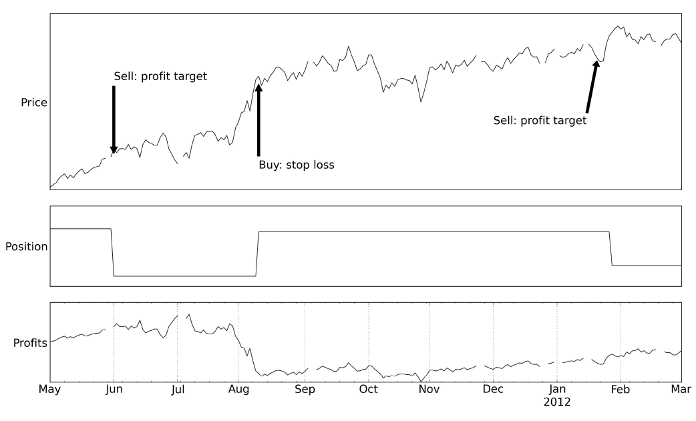
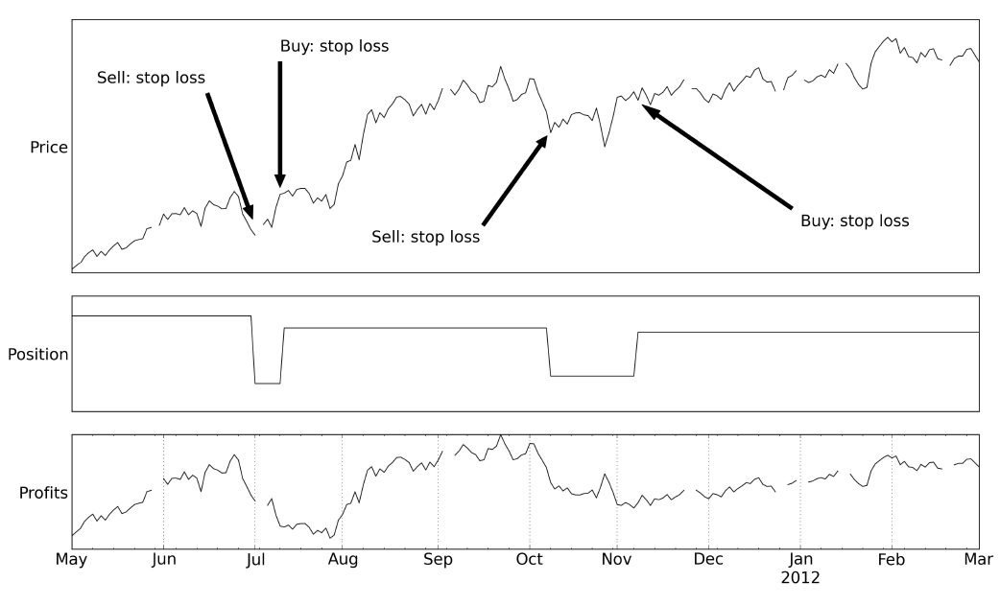
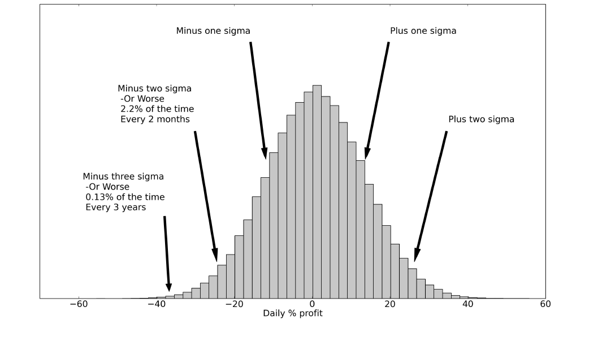

# Chapter One. The Flawed Human Brain｜英文原文版

来源：`OEBPS/Autopilot_ebook-8.xhtml`。按 EPUB 的正文、表格、插图与脚注顺序转排；字体、行内样式及印刷页码可能不同于原书。

## Chapter One. The Flawed Human Brain

Human minds can do wonderful things, but are deeply flawed when making financial decisions. In this chapter I explore economic theories about human behaviour, and why systematic trading and investing makes sense. I also show how our irrationality can interfere with the design of systematic strategies.

### Chapter overview

| Humans should be great traders, but... | The research that tells us why humans make bad decisions. |
| --- | --- |
| Simple trading rules | The dumb systems that are better at investing and trading than clever humans. |
| Sticking to the plan | Why you must be committed to your systems for them to work. |
| Good system design | Avoiding the human failings which can still be dangerous when designing systematic trading strategies. |

### Humans should be great traders, but...

Why do we need to trade or invest in a systematic fashion? What is wrong with using our own intuition to trade in a discretionary way? After all our brains have an astonishing ability to absorb and react to complex data, like those we see in financial markets. In my own Barclays trade described in the introduction I did analysis that would be virtually impossible to replicate with a systematic rule. But a simple rule would have been more successful than I was.7

Unfortunately there have been many other times when a systematic strategy would have made better decisions than I did. For example in 2004 I bought some shares in UK oil company BP. They quickly rose about 5% and I sold them for a small profit. They subsequently rallied to a much higher level. I resolved never to sell too quickly again.

Then in late 2009 I decided to recycle some of my Barclays profits into buying BP. Initially they went from £5 to over £6. But in April 2010 one of BP’s drilling rigs exploded in devastating fashion, killing 11 people. The shares started to fall, and a month later they were back at £5. Scarred by my earlier experience I hung on, convinced they would rebound. I finally sold at £3, which turned out to be the bottom.

I got it wrong both times. Was this just bad luck – a BP jinx? Am I a particularly poor trader, or is this evidence of a deeper problem with human psychology?

In fact despite their awesome complexity human brains like mine, and yours, are fundamentally flawed. In the jargon they are subject to cognitive biases which result in irrational behaviour. These instincts are so strong they mostly overwhelm any natural advantage that humans should have over simple decision-making rules.To see why this happens we need to understand how economists have tried to model and understand human behaviour.

#### The death of rational economic man

When the ideas of classical finance were developed in the 1950s economists assumed that people behaved in a purely rational way, resulting in perfectly efficient markets. Over time many apparent anomalies in this theory were discovered. But these were easily dismissed by the academic establishment as irrelevant, statistically insignificant or explainable through some combination of risk factors. Crucially nobody was able to come up with an alternative model that was as self-consistent and elegant as the efficient markets hypothesis.

From the 1980s onwards the field was penetrated by researchers from the discipline of psychology. For these experts in the human mind, the economist’s framework of pure rationalism must have been highly amusing. A key insight these academic interlopers brought was that our brains are loaded with baggage from the distant past.

Parts of our grey matter are still hardwired for survival in a hostile environment where quick thinking was better than slow thoughtful consideration. As a result we have deep-rooted instincts that make it extremely difficult to behave in the rational way that classical finance expects. The new field that the interlopers created was behavioural finance, and it did have its own unifying model: prospect theory.

#### Why we run losses and stop out profits

Prospect theory explains why investors get it wrong when confronted with certain trading decisions, such as whether to sell out of a position which is now showing a loss. Most people show the greatest reluctance to take losses, as I did in 2010 with BP.8

This has been catchily described as “get-evenitis” by Hersh Shefrin.9 This aversion to taking losses is a very powerful instinct. Humans do not seem to view a paper loss as real until it has been crystallised, so we can postpone the painful feeling of losing money. We are also reluctant to admit that we made a mistake with our initial purchase. Selling is an admission of failure.

Conversely, if a position has risen in value we are happy to take profits and sell quickly, as in my 2004 BP trade. The main motivation behind selling positions at a small profit appears to be to minimise regret. If the stock fell back after reaching a new high we would castigate ourselves for not taking profits earlier. Selling also confirms that our initial buy decision was correct. We hunger to get that confirmation as quickly as possible.

Both of these effects are at odds with classical financial theory, which says that people’s actions and preferences for risk are unrelated to whether they have made paper profits or losses. In contrast prospect theory says we take more risks in a losing position to get even, but we want less risk when winning, preferring a quick and certain gain to a chance of losing our profits.

Unfortunately taking small profits and letting losses run is almost always a bad idea. I can show you this by back-testing a trading system which mimics someone taking profits on small rises, but allowing losses to grow larger before cutting – an ‘early profit taker’.10 A back-test shows how profitable this rule would have been if it had been run in the past.

Figure 2 shows part of the back-test and illustrates how the rule would have traded treasury futures during summer 2011, when the USA’s sovereign debt rating was downgraded causing a counter intuitive rally. It sells and goes short in early June on a small profit and then misses the subsequent rise in prices.

Figure 2: Early profit taker misses the 2011 rally in US 10 year treasury bonds

I compared this to the results from employing the opposite strategy – ‘an early loss taker’.11 Figure 3 shows this rule did much better during the same time period.

CONCEPT: Back-test

To run a back-test you take historic data and calculate how a trading strategy would have behaved, and the profits or losses it could have made, had you been using it in the past.

Suppose you thought that buying the pound/dollar FX rate at 1.5 and selling it at 1.8 was a profitable strategy. You could take the history of the FX rate and then see what trades, and any profits, you would have made historically if you really had bought and sold according to this rule.

Back-testing is an invaluable tool for creating new trading rules. But when misused it can be dangerous, as we’ll discover in chapter three, ‘Fitting’.

Figure 3: Early loss taker stays in the 2011 US bond rally until being stopped out

When I back-tested these two rules on 31 futures contracts I found that the early loss taker beat the early profit taker in 27 of them. Tests done on similar rules, across a wide variety of asset classes, confirm this finding. The early profit taker rule, which mimics our natural instincts, does worse than a rule which does the opposite.

#### Gamblers anonymous

Some of my relatives equate trading to high stakes gambling; an attitude I am usually quick to dismiss. But there may be some truth to it, at least in certain situations. To understand why it’s worth knowing that certain types of gambling are more addictive than others, probably due to certain factors which reinforce the stimulation the brain receives during play.

There appear to be three main factors associated with the most addictive games. Firstly there should be an illusion of control, which encourages the perception of skill. Lottery players often prefer to pick their own numbers. Secondly, the game should include apparent near misses; frequent chances of almost winning the biggest prize. These are especially potent if you also receive lower value prizes, as in lotteries and slot machines. Finally, the game should be rapid and continuous to give a constant flow of stimulation. Buying a lottery ticket is not as addictive as an instant lottery or scratch card where the result is known immediately.

The illusion of control is present with all forms of active investing. Ironically the feeling of control is almost absent when investing systematically, which is one reason why many people find it difficult to utilise this trading method.

But the near miss and rapidity factors are clearly more likely to be associated with very frequent ‘day trading’. As we’ll discover later in the book it is extremely difficult to make profits when trading quickly, and only a small percentage of day traders manage to cover their costs, and make both a reasonable income and decent return on capital. Yet many amateurs feel compelled to try, and to continue trying, to beat the odds. Their frantic churning of trades is not so very different from the addict spending hours in front of a slot machine.

This particular brain deficiency leads to financial decisions that aren’t just poor, but potentially life destroying.

### Simple trading rules

Given there are flaws in the human brain which seriously affect our decision-making ability, what can we do about it? Easy: we should use systematic trading rules to make our decisions. These can help mitigate our own serious flaws, but they can also allow us to exploit the weaknesses that other human traders still have; their cognitive biases which result in behavioural anomalies in the market.

For example the early loss taker rule I mentioned above isn’t just correcting our human instinct to take profits early and hang on to losses. It earns extra returns when other people persist in doing the opposite.

Personally I find it very reassuring to have explanations based on cognitive biases of why certain trading rules are consistently profitable. This gives me confidence that what I am seeing isn’t just a statistical blip in a back-test. It means that the relevant rules should continue to work unless human behaviour changes radically. I’ll return to this theme in chapter two – ‘Systematic Trading Rules’.

### Sticking to the plan

There is no point running a systematic trading strategy unless you can stick to it. Suppose you make a New Year’s resolution to follow the early loss taker rule. Like most such resolutions it will probably prove hard to keep. When a long position in gold futures hits the 5 cent stop loss the early loss taker rule has set you will probably start making excuses:

“The fundamentals are good. They haven’t changed. I will just hold on a bit longer. Just this once. If it goes down 10 cents – which it won’t – then I will definitely sell.”

You might not even close at a 10 cent loss, kicking yourself for not selling earlier, and continue to hang on for the rebound that never comes, until the pain is unbearable and you close out. A small profit would also prove irresistible, with its own litany of excuses why you should deviate from the rule, just this once.

I call this process of interference by our internal monologue meddling. Meddling is due to the biggest cognitive bias of all: overconfidence. We think we are cleverer than the trading system and we are. We think we know more than the trading system and we do; the system focuses on a narrow set of quantifiable inputs, whilst we can analyse many kinds of complex information. We think being clever and knowing more implies we will make better decisions – but we usually don’t, thanks to cognitive biases.

To stop meddling with our trading systems we require what economists call a commitment mechanism. The idea of a commitment mechanism is several thousand years old. One of its earliest appearances is in the story of Odysseus. The mythical Greek wanted to hear the songs of the Sirens without endangering himself or his vessel. So he ordered his crew to stuff their ears with beeswax, tie him to the mast and dutifully ignore his inevitable cries to steer the ship on to the rocks.

A modern example of this is given in Victor Niederhoffer’s book Education of a Speculator. At this point in the story hedge fund manager Victor has a large long position in silver futures. We join him in early 1980 when the Hunt brothers, who had been squeezing the market upwards, are about to capitulate, which will cause the price to drop:

“I decided to set my loss limit at 50% of my winnings... The model story on this point is Odysseus... I locked myself inside a racquetball court instead of tying myself to a ship’s mast. I issued instructions to my assistant and future wife, Susan.

‘Do not listen to my entreaties if I wish to double further. If the losses reach 50% of the winnings, reduce my positions by one-half. If I beg to be released, sell everything out.’…

Some rumors about liquidation by the Hunts had hit the fan... I immediately placed a call to Susan ‘Untie me. Disregard everything I said before’ … My faithful companion followed my original directions.”

Susan closed the entire position and Victor lived to fight another day. But how can we ensure we stick to our strategies without the use of ropes or future wives?12

#### Trading systems must be objective

To be committed you must have an objective trading system. Many systems aren’t objective and require some discretion to apply. A highly subjective rule would be something like ‘Sell for small losses, and hold on to large profit making positions’. This is similar in spirit to the early loss taker rule defined earlier, but it’s much too vague.

At the first sign of a loss it’s likely you will start to redefine what constitutes ‘small’ to justify not selling. Few systems are that poorly defined, but many have ‘rules’ in them which allow for a significant degree of subjective interpretation. Technical analysts rarely agree on which patterns exist in a particular chart, and what should be done with them.

Creating a purely objective system is a powerful commitment mechanism. If you have a subjective system and your instinct goes against it, then you’ll soon be bending the rules. But if everything is clearly defined it creates a line in the sand beyond which any deviation is obvious. You cannot fool yourself that you are following a system if you blatantly ignore objective rules.

Furthermore we can only produce back-tests for purely objective systems. You will see why this is important later in the chapter.

#### Automation – the use of dogs in finance and engineering

Another advantage of objective systems is that they can be automated, and automation is a good commitment mechanism. You can’t automate subjective systems because computers cannot eyeball trend lines on charts; they need firm statements like ‘Buy if the 20 day moving average is above the 40 day’. They cannot interpret commandments like ‘Sell once the pattern is triggered unless there is a firm sign of bullish volume’ without a clear definition of both the pattern and the meaning of bullish volume.

So an objective system is one which a computer can run. But it does not mean a computer must run it. You can run many trading strategies using pencil and paper, or relatively simple spreadsheets, to calculate trades which you then execute manually. Certain kinds of systems involving complex rules, faster trading frequencies or trading in large numbers of instruments13 would be very time-consuming, or impossible, to run without automation. But for simpler systems automation isn’t necessary. Full automation is also problematic for discretionary semi-automatic traders, although they could automate their position and risk management framework once they’ve made their trading decisions manually.

Furthermore automation doesn’t stop meddling. Firstly, consider the degree of automation. Having a system which requires a human to do the actual execution of automatically generated trades is still prone to meddling. If the process is completely automated from end to end then interference is harder. There is an old joke that the best systematic trading setup consists of a computer, a man and a dog. The computer runs a fully automated strategy, the man feeds the dog, and the dog bites the man if he touches the computer.14

Secondly, any good automated software would have ways to override it in an emergency. If you desperately want to meddle then there will be frequent ‘emergencies’. Automation is of little help unless you have faith in your trading rules. A system which is fully automated but not completely trusted is potentially lethal.15 Any sane person would be tempted to shut it down at the first sign of trouble. So automation aids commitment, but it must be done with a well designed system in which you have full confidence.

### Good system design

So what is a well designed system? How can you make something which you can trust, commit to and won’t meddle with, regardless of whether it is automated or not?

It is much easier to trust a system which is objective. Firstly, because it is transparent: you know given some particular data exactly what the positions should be. Secondly, you can back-test an objective system over history. This will give you an indication of what its past behaviour was, and how it should trade in the future. For example suppose a system typically lost around 5% on one of every ten trading days in the simulated past of your back-test. You shouldn’t worry if in real trading you lose 5% every couple of weeks.16

As well as requiring systems to be objective I also prefer those that are relatively simple, transparent and based on underlying ideas,17 such as my previous hypothesis that prospect theory explains the success of the early loss taking rule. Transparency is important for gaining trust in trading systems, just as it is in politics. In the next chapter I’ll explain in more detail why I prefer systems whose performance and behaviour can be explained.

In addition to these positive attributes there are also three significant pitfalls to avoid when designing trading systems: over-fitting, overtrading and over-betting.

#### Over-fitting

A new trading system does not arrive out of the ether. It has to be designed and developed by an actual, probably overconfident,18 person. It is all too easy for that person to make design mistakes due to those same cognitive biases they are trying to escape from by trading systematically.

Firstly ‘narrative fallacy’: our brains are great at seeing patterns where there are none. Whilst developing trading rules there is often a fitting process during which the best rules are selected by looking at back-test results. If we’re not careful the rules selected will fit the data too well. They will be highly tuned to one set of market conditions and perform worse in actual trading than a simpler rule would. The system will be over-fitted.Narrative fallacy means we have a tendency to see more predictability in historic asset prices than really existed and so we’re naturally drawn to over-fitted trading rules. I’ll return to this problem in chapter three, ‘Fitting’.

Second bias, and perhaps the most serious of all: overconfidence. This manifests itself in a lack of diversification. Surveys of individual portfolios find that most amateur investors have relatively few securities in their portfolio, with a bias towards their home country, and also lack diversification across asset classes.

You might think that experts, with access to sophisticated quantitative tools, wouldn’t make these mistakes. Unfortunately they often do. This happens when they don’t consider the considerable uncertainty in expected asset returns. The most commonly used optimisation models assume they know the pattern of returns precisely. Small changes to the model inputs will produce extreme portfolios with all their eggs in one or two baskets. The result can be just as bad or worse than the portfolios of mere amateurs.

In practice many experts fiddle with the raw output of optimisations until they end up reflecting their own expectations of what the result should have been! I will discuss this further in chapter four, ‘Portfolio Allocation’.

#### Overtrading

People are highly overconfident about their own abilities relative to others. This is another cognitive bias: illusory superiority. For example nearly all drivers consider themselves above average, a theoretical impossibility and also highly unlikely given the number of deaths annually from road accidents.

Both amateur investors and professional managers have a tendency to trade too frequently.19 There are extra costs involved in trading more often. Overtrading suggests overconfidence in your own relative ability to overcome the higher hurdle of bigger costs. As I pointed out above, frequent trading can also be addictive and lead to behaviour which is indistinguishable from problem gambling.

When designing trading systems if you over-fit you will end up with systems that perform unrealistically well in back-tests, and wrongly assume that returns will easily be high enough to overcome trading costs.

#### Over betting

It will be extremely difficult to refrain from meddling if you’re worried about wiping out your capital. Take the system I mentioned above with a one-in-ten chance of a 5% daily loss. If that was ten times leveraged you would have a 10% chance of losing half your capital on any given day. Most sane people would panic after losing 50% on one day, and start meddling like crazy.

Unfortunately over betting is endemic amongst amateur investors with easy access to leverage through derivatives like spread bets. If your confidence is unbounded you can bet the maximum that your broker allows you to. Potentially this could be a ten-fold leverage on an individual equity bet, equating to an annual standard deviation of returns of around 200%. This is nuts.20

CONCEPT: Standard deviation

The standard deviation is a measure of how dispersed some data is around its average; it’s a measure of risk. The precise formula is in the glossary, but in most cases you’ll use a spreadsheet formula or software to calculate it.

Standard deviations are often used to describe the dispersion of the returns of an asset, or profits from a trading system. I use the term volatility as a shorthand for standard deviation of returns. One unit of standard deviation is also sometimes called a sigma.

In this book we’ll usually be dealing with daily returns and using daily volatilities, but it’s often useful to think about the annualised standard deviation – how much deviation we expect to see over a year.

Standard deviation doesn’t increase linearly, but with the square root of time. Over the roughly 256 business days in a year you’d expect annual standard deviation to be larger by the square root of 256, or 16.21 So you multiply daily standard deviations by 16 to get the annualised version, or divide by 16 to go from annualised to daily. In contrast to go from average daily returns to annualised average returns you just multiply by the number of days in a year, or 256. Then to go from annualised to daily you divide by 256.

Equities have an annualised standard deviation of about 20% a year. Bonds tend to be safer, depending on their maturity. A typical two year bond has an annualised sigma of around 1.5% a year, and a ten year bond would be more like 8%.

We often assume our returns have a particular type of distribution. A distribution is just a way of describing the pattern of your data. A common distribution I use is the Gaussian normal distribution. If returns are Gaussian normal, then the mean and standard deviation alone are sufficient to say how likely certain returns will be.

If your daily returns are Gaussian normal then you will see movements one sigma or less around the average about 68% of the time, and returns two sigma or less about 95% of the time. In 2.5% of days you’d see a change more than two sigma above the average. You’d also see a return which is two sigma worse than the average 2.5% of the time. The Gaussian normal distribution is symmetric.

Let’s consider the 200% annualised standard deviation mentioned above. 200% a year translates into 12.5% a day if you divide by the square root of time, 16. For the average daily return even if you’re making an optimistic 200% a year, after you’ve divided by 256 you earn just 0.8% per day. A plus one sigma return would be 12.5% above the average of 0.8%, or 13.3%. A one sigma loss would be 12.5% below the average, or -11.7%.

Figure 4: Scarily you can expect to lose 40% in one day, every three years, for a trading system with 200% annualised standard deviation of returns, and average returns of 200% per year

You’ll see returns between -11.7% and +13.3% a day around 68% of the time, and between -24.2% and +25.8% a day 95% of the time. Around 2.5% of the time you’d see losses of more than 24.2% a day. That’s quite a hefty daily loss which you’d get every couple of months. And as figure 4 shows about once every three years you’d lose three sigma or 37.2% in one day!

Scarily that’s probably still optimistic because the normal distribution tends to underestimate the chance of really bad returns. According to the normal distribution we should get daily falls of more than 4 sigma about once a century. But from 1914 to 2014 the US Dow Jones index fell by more than 4 sigma around 30 times!

You or your investors need to be comfortable with the losses you’re likely to make. The size of your positions must reflect the amount of risk you can handle. I’ll explain this in more detail in chapter nine, ‘Volatility Targeting’.

7. If in 2009 I had developed the idea of semi-automatic trading then I could have taken more advantage of my uncharacteristically brilliant analysis, by putting the trade on in a framework which controlled my risk properly.

8. For more academic detail see for example Terence Odean, ‘Are Investors Reluctant To Realize Their Losses?’, Journal of Finance 1998.

9. Shefrin 2007, Beyond Greed and Fear. I highly recommend this book for a clear overview of behavioural finance, despite its age. In academic circles this is the ‘disposition effect’ described in Shefrin and Statmen, ‘The disposition to sell winners too early and ride losers too long: theory and evidence’, Journal of Finance 1985.

10. This is based on the ‘A and B’ system defined in appendix B with parameters A = 5 and B = 20.

11. This is also based on the ‘A and B’ system in appendix B with A = 20 and B = 5.

12. This comment isn’t intended to imply that all investors and traders are unmarried heterosexual men. However, if your partner is a man rather than a woman you should be wary of using them as a commitment mechanism, as they may make things worse; research shows that women generally make better investment decisions.

13. Instrument is my term for something that you trade or invest in. So a share of BP is an instrument, as is a corn future, and so is a spread bet on the yen/dollar exchange rate.

14. This joke evolved from earlier jokes involving various kinds of hardware rather than trading systems. It is generally attributed either to management theorist Warren Bennis, or to employees of Bell labs.

15. The HAL computer in Arthur C. Clarke’s 2001: A Space Odyssey is a good example of what happens when you take automation too far and then don’t trust the system.

16. In fact by using my framework you can make predictions about likely losses even in situations when you can’t back-test, such as when you’re a semi-automatic trader not using systematic trading rules.

17. Compared to say a system which has been built purely by back-testing a large number of trading rules and picking the best regardless of whether it can be explained, a process sometimes called data mining. I’ll return to this distinction in the next chapter.

18. It’s not just trading system designers who are overconfident. There is a significant amount of academic research showing examples of overconfidence in discretionary finance, for example amongst equity analysts and macroeconomic forecasters.

19. For academic research on this see Odean and Barber, ‘The common stock investment performance of individual investors’, 1998 working paper.

20. At the time of writing some UK providers of FX spread bets offer leverage of up to 500 times. That isn’t nuts, it’s clinically insane.

21. I’m making an assumption here that adjacent returns don’t influence each other, or in the jargon of statistics they have zero autocorrelation.
