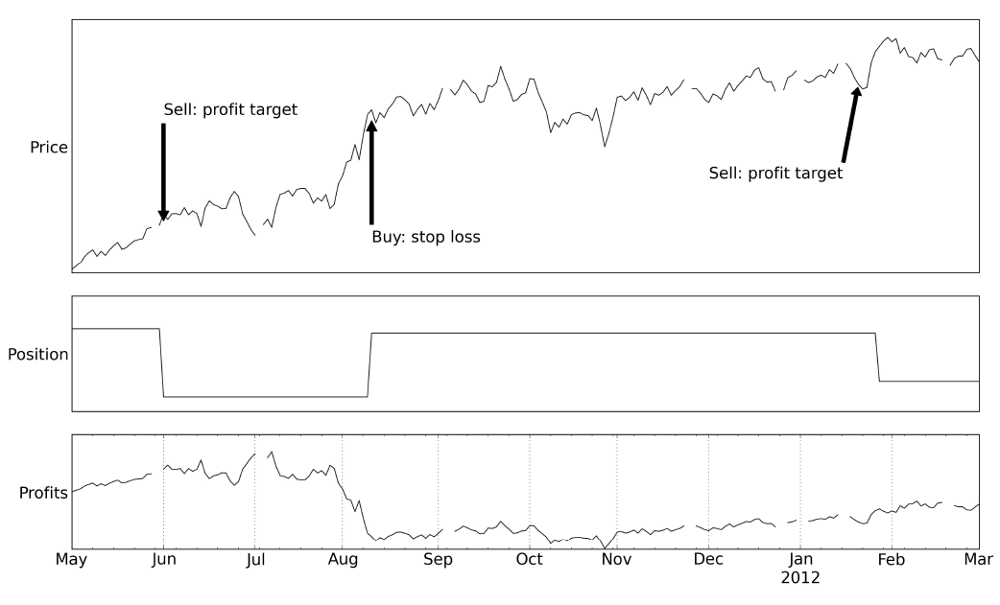
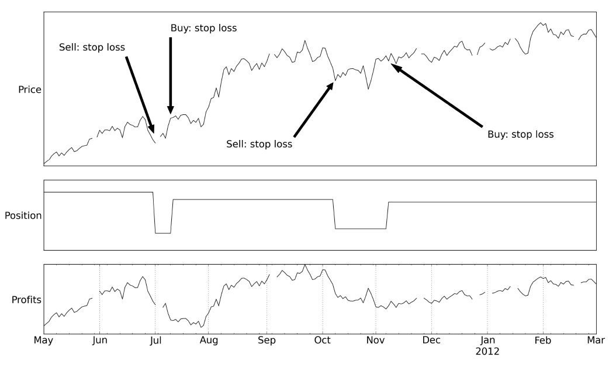
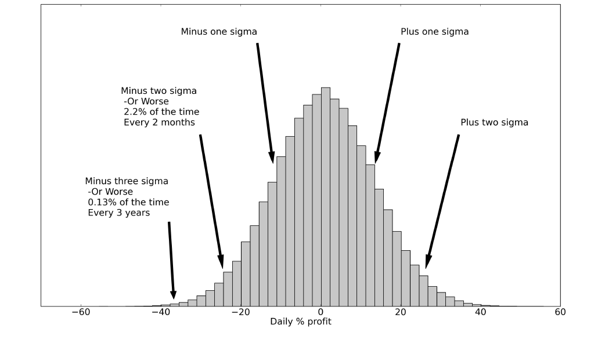

# 第一章 有缺陷的人脑｜中文忠实版

原书：Robert Carver, *Systematic Trading*, Chapter One, “The Flawed Human Brain”。书源：`ebook/Systematic Trading.epub` 内 `OEBPS/Autopilot_ebook-8.xhtml`。下列 `ch01#` 是本地提取块号，并非印刷页码。译文按原书顺序逐段对应，保留图、表、脚注和原文的数字与疑点。图内英文标记另附中文对照。作者的市场案例与交易条件处于 2015 年首版的写作语境。

## 第一章 有缺陷的人脑

**[ch01#0002]** 人脑能做出奇妙的事，但在作财务决定时有深刻的缺陷。本章我探讨关于人类行为的经济学理论，以及为什么系统化交易和投资有道理。我还会说明，我们的非理性怎样干扰系统化策略的设计。

### 本章概览 [ch01#0003–0011]

| 主题 | 内容 |
|---|---|
| 人本该是出色的交易者，然而…… | 解释人为什么会作出糟糕决定的研究。 |
| 简单交易规则 | 比聪明人更擅长投资和交易的笨系统。 |
| 坚持计划 | 为什么你必须恪守系统，系统才会奏效。 |
| 好的系统设计 | 避免设计系统化交易策略时仍可能构成危险的人性弱点。 |

### 人本该是出色的交易者，然而……

**[ch01#0013]** 为什么我们需要以系统化方式交易或投资？依靠自己的直觉进行自主判断式交易有什么问题？毕竟，我们的大脑具有惊人的能力，能吸收并回应金融市场中那样复杂的数据。在引言所述的巴克莱交易中，我做过几乎不可能用一条系统规则复制的分析。然而，一条简单规则本会比我取得更好的结果。⁷

**[ch01#0014]** 不幸的是，另有许多时候，系统化策略本会比我作出更好的决定。例如，2004 年我买了一些英国石油公司 BP 的股票。股价很快涨了约 5%，我便卖出，赚了一笔小钱。此后它们又大幅上涨到高得多的价位。我于是下定决心，以后再也不要卖得太早。

**[ch01#0015]** 于是到 2009 年末，我决定把巴克莱交易的一部分利润再投入 BP。股价起初从 5 英镑涨到超过 6 英镑。但在 2010 年 4 月，BP 的一座钻井平台发生灾难性爆炸，造成 11 人死亡。股价开始下跌，一个月后回到 5 英镑。先前的经历令我心有余悸，我坚持持有，确信它会反弹。最后我在 3 英镑卖出，而那恰好是底部。

**[ch01#0016]** 两次我都做错了。这只是坏运气，一种 BP 的厄运吗？是我特别不擅长交易，还是这说明人类心理有更深层的问题？

**[ch01#0017]** 事实上，人脑虽然复杂得惊人，但我的、你的大脑都有根本缺陷。用术语说，它们受认知偏差影响，因而产生非理性行为。这些本能如此强烈，大多会压过人类本应相对于简单决策规则拥有的任何天然优势。要明白原因，我们需要了解经济学家如何试图为人类行为建模并理解它。

#### 理性经济人的消亡

**[ch01#0019]** 20 世纪 50 年代古典金融学的思想形成时，经济学家假定人们完全理性地行动，由此产生完全有效的市场。随着时间推移，这套理论中发现了许多表面上的异常。但学术主流很容易把它们驳为无关紧要、统计上不显著，或可由若干风险因素的组合来解释。关键在于，没有人能提出一套像有效市场假说一样自洽且优雅的替代理论。

**[ch01#0020]** 从 20 世纪 80 年代起，心理学领域的研究者进入了这个领域。对于这些研究人心的专家，经济学家纯粹理性主义的框架想必颇为可笑。这些学术“闯入者”带来的一个关键洞见是：我们的大脑背负着来自遥远过去的包袱。

**[ch01#0021]** 我们的部分脑组织仍为在敌对环境中生存而预设了反应模式；在那种环境里，快速思考胜过缓慢、审慎的考虑。结果，我们有根深蒂固的本能，极难按古典金融学预期的理性方式行事。这些闯入者创建的新领域是行为金融学，它也有自己的统一模型：前景理论。

#### 为什么我们让亏损继续扩大，却止住利润

**[ch01#0023]** 前景理论解释了投资者在面对某些交易决定时为什么会做错，例如是否卖掉一笔目前亏损的头寸。多数人极不情愿接受亏损，我在 2010 年交易 BP 时就是如此。⁸

**[ch01#0024]** 赫什·谢夫林把这种现象生动地称为“回本病”。⁹ 这种不愿承受亏损的倾向是极强的本能。只要账面亏损尚未兑现，人类似乎就不把它视为真实亏损，于是能推迟失去金钱的痛苦感。我们也不愿承认最初买入时犯了错误。卖出就等于承认失败。

**[ch01#0025]** 反过来，若一笔头寸升值了，我们就乐于获利了结、迅速卖出，我 2004 年的 BP 交易就是这样。小赚便卖的主要动机，似乎是尽量减少懊悔。如果股票创出新高后跌回去，我们会责备自己为什么没有早点兑现利润。卖出还确认了最初的买入决定是正确的。我们渴望尽快得到这种确认。

**[ch01#0026]** 这两种效应都与古典金融理论相抵触。按该理论，人们的行为和风险偏好与他们的账面盈亏无关。相比之下，前景理论认为，亏损时我们会承担更多风险以求回本；盈利时则想承担更少风险，宁愿迅速获得确定的收益，也不愿冒失去利润的风险。

**[ch01#0027]** 不幸的是，小赚就收手、让亏损继续扩大，几乎总是坏主意。我可以回测一套模仿这种做法的交易系统来说明：小幅上涨就获利了结，但允许亏损扩大到更大程度才止损；我称其为“早止盈者”。¹⁰ 回测显示，如果过去运行这条规则，它本会有怎样的盈利表现。

**[ch01#0028]** 图 2 展示了回测的一部分：2011 年夏季美国主权债务评级下调、国债却反直觉上涨时，这条规则会如何交易国债期货。它在 6 月初以一笔小利润卖出并转为做空，随后错过了价格的上涨。

**[ch01#0029–0030，图 2]** 早止盈者错过了 2011 年美国十年期国债的上涨行情。图内标记：`Price` 为价格，`Position` 为头寸，`Profits` 为利润；`Sell: profit target` 为“卖出：达到止盈目标”，`Buy: stop loss` 为“买入：触发止损”。图中横轴从 5 月延至次年 3 月。

**[ch01#0031]** 我把它和采用相反策略——“早止损者”——的结果作了比较。¹¹ 图 3 显示，同一时期这条规则的表现好得多。

**[ch01#0032–0035，概念：回测]** 要进行回测，你取来历史数据，计算假如过去一直使用某种交易策略，它会怎样行动，又可能产生多少利润或亏损。假设你认为在英镑／美元汇率为 1.5 时买入、到 1.8 时卖出是一种有利可图的策略。你可以取来汇率历史数据，看看若真的按这条规则买卖，过去会做哪些交易、赚到多少利润。回测是创建新交易规则的宝贵工具，但误用时可能很危险；第三章“拟合”会谈到这一点。

**[ch01#0036–0037，图 3]** 早止损者留在 2011 年美国债券的上涨行情中，直到触发止损才离场。图内 `Buy: stop loss`、`Sell: stop loss` 分别为“买入：触发止损”“卖出：触发止损”；纵向三栏依次为价格、头寸、利润，横轴从 5 月延至次年 3 月。

**[ch01#0038]** 我在 31 个期货合约上回测这两条规则，发现早止损者在其中 27 个合约上胜过早止盈者。对类似规则、跨众多资产类别进行的检验也证实了这一发现。模仿我们天然本能的早止盈规则，比反其道而行的规则表现差。

#### 赌博者互助会

**[ch01#0040]** 我的一些亲戚把交易等同于豪赌；我通常很快就会驳斥这种看法。但至少在某些情况下，它或许有几分道理。要理解为什么，值得知道某些赌博形式比另一些更容易让人上瘾，可能是因为有些因素会强化游戏过程中大脑受到的刺激。

**[ch01#0041]** 最容易让人上瘾的游戏似乎有三个主要因素。第一，有控制感的幻觉，令人觉得其中有技巧。买彩票的人通常更愿意自己选号。第二，游戏中应有看似“差一点就中”的机会，频繁让人感觉几乎赢得最高奖金。如果还能得到较小的奖品，例如彩票和老虎机，这种效果尤其强。最后，游戏应快速而连续，以不断提供刺激。买一张普通彩票不如即开型彩票或刮刮卡容易让人上瘾，因为后者马上就知道结果。

**[ch01#0042]** 所有主动投资形式都有这种控制感的幻觉。讽刺的是，系统化投资几乎没有这种控制感，这也是许多人觉得难以采用这种交易方式的原因之一。

**[ch01#0043]** 但“差一点赢”和速度这两个因素显然更可能与交易极频繁的“日内交易”相伴。正如本书后面会看到的，交易速度越快，获利就极其困难；只有一小部分日内交易者既能覆盖成本，又能获得合理收入和不错的资本回报。然而，许多业余者仍忍不住尝试，并不断尝试去战胜这种不利的胜算。他们疯狂地反复买卖，与坐在老虎机前耗上数小时的成瘾者并没有太大区别。

**[ch01#0044]** 大脑的这种特定缺陷，会使财务决定不仅糟糕，而且可能毁掉人生。

### 简单交易规则

**[ch01#0046]** 既然人脑的缺陷严重影响决策能力，我们该怎么办？很简单：用系统化交易规则来作决定。它们既能帮助缓解我们自身的严重缺陷，也能让我们利用其他人类交易者仍有的弱点，即他们的认知偏差在市场中造成的行为异常。

**[ch01#0047]** 例如，前述早止损规则不仅纠正了人类早早获利了结、却抓着亏损不放的本能；当别人持续反其道而行时，它还会获得额外回报。

**[ch01#0048]** 对我个人而言，如果能用认知偏差解释某些交易规则为何持续盈利，我会觉得很安心。这让我更有信心，相信回测所见并非只是统计上的偶然波动。这也意味着，除非人类行为发生根本变化，相关规则应会继续奏效。第二章“系统化交易规则”会再谈这个主题。

### 坚持计划

**[ch01#0050]** 如果不能坚持执行，运行系统化交易策略就毫无意义。假设你立下新年决心，要遵守早止损规则。像大多数新年决心一样，它很可能很难坚持。当黄金期货的多头头寸触及该规则设定的 5 美分止损位时，你很可能开始找借口：

**[ch01#0051，引语]** “基本面很好，而且没有变化。我就再持有一会儿。只破例这一次。如果跌了 10 美分——它不会的——我到时候一定卖。”

**[ch01#0052]** 即便亏了 10 美分，你也可能仍不平仓，一边责怪自己没有早点卖，一边继续等待那个始终没有出现的反弹，直到痛苦无法忍受才平仓。一笔小利润同样令人难以抗拒，你也会搬出另一套理由，说明为什么这一次应该偏离规则。

**[ch01#0053]** 我把内心独白干预交易的过程称为“插手干预”（meddling）。它源于最严重的认知偏差：过度自信。我们认为自己比交易系统聪明，而这是真的。我们认为自己知道得比交易系统多，这也是真的；系统只关注一组狭窄、可量化的输入，而我们能分析许多复杂信息。我们还认为，更聪明、知道更多，就意味着会作出更好的决定；但由于认知偏差，通常并非如此。

**[ch01#0054]** 要阻止自己插手交易系统，我们需要经济学家所说的“承诺机制”。这个想法已有数千年历史，最早的例子之一见于奥德修斯的故事。这位希腊神话人物想听塞壬的歌声，又不愿危及自己或船只。于是他命船员用蜂蜡塞住耳朵，把自己绑在桅杆上，并忠实地无视他后来必然发出的、要求把船驶向礁石的呼喊。

**[ch01#0055]** 维克多·尼德霍夫在《投机者的教育》一书中提供了一个现代例子。故事发生时，这位对冲基金经理持有大量白银期货多头。时间来到 1980 年初：一直逼迫市场价格上涨的亨特兄弟即将认输，价格将因此下跌：

**[ch01#0056，引语]** “我决定把亏损上限定为已获利润的 50%……这方面的典范故事是奥德修斯……我把自己锁进了壁球场，而不是绑在船的桅杆上。我向我的助手、未来的妻子苏珊下达指示。

**[ch01#0057，引语]** ‘如果我想进一步加倍下注，不要听我的哀求。如果亏损达到已获利润的 50%，把我的头寸减半。如果我央求放我出去，就全部卖掉。’……

**[ch01#0058，引语]** 关于亨特兄弟清算的传言已经传开……我立即打电话给苏珊：‘放我出来。把我以前说的一切都当作没说。’……我忠实的同伴遵循了我最初的指示。”

**[ch01#0059]** 苏珊平掉了全部头寸，维克多得以保全实力，日后再战。但是，不靠绳子或未来的妻子，我们怎样确保自己坚持策略？¹²

#### 交易系统必须客观

**[ch01#0061]** 要坚守系统，交易系统必须客观。许多系统并不客观，在应用时需要一些主观判断。高度主观的规则可能是：“出现小额亏损就卖出，利润很大时继续持有。”它在精神上与前面定义的早止损规则相似，却过于含糊。

**[ch01#0062]** 一出现亏损，你很可能就开始重新定义什么叫“小额”，以便为不卖出找理由。很少有系统定义得如此糟糕，但许多系统的“规则”允许相当大程度的主观解释。技术分析师往往无法就某张图表上究竟有什么形态，以及应当如何应对达成一致。

**[ch01#0063]** 建立完全客观的系统，是强有力的承诺机制。若系统是主观的，而你的本能又与之相反，你很快就会扭曲规则。但如果每件事都定义清楚，就划出了一条界限，任何偏离都一目了然。公然无视客观规则时，你不可能再骗自己说仍在遵守系统。

**[ch01#0064]** 而且，我们只能为完全客观的系统制作回测。本章后面会看到这一点为何重要。

#### 自动化：金融与工程中的狗

**[ch01#0066]** 客观系统还有一个好处：可以自动运行，而自动化是很好的承诺机制。你无法将主观系统自动化，因为计算机不会凭肉眼看图表上的趋势线；它需要“若 20 日移动平均线高于 40 日移动平均线则买入”这样的确定陈述。没有对形态和“看涨成交量”作出清晰定义，它也无法解释“形态触发后卖出，除非成交量显示出明确看涨迹象”这样的指令。

**[ch01#0067]** 因此，客观系统就是计算机能够运行的系统；但这不意味着一定要由计算机来运行。许多交易策略可以用纸笔或相对简单的电子表格算出交易指令，再由你手工执行。某些系统规则复杂、交易频率更快，或涉及大量交易工具¹³，不使用自动化会极费时间，甚至不可能运行。但较简单的系统并不需要自动化。对于自主判断式的半自动交易者，完全自动化也有问题；不过他们在手工作出交易决定之后，可以把头寸与风险管理框架自动化。

**[ch01#0068]** 再者，自动化不会杜绝插手干预。首先，要看自动化的程度：系统虽然自动生成交易，却仍需人来实际执行，依然容易受到干预。若整个流程从头到尾完全自动化，干预就更难。有个老笑话说，最好的系统化交易配置是一台计算机、一个人和一条狗：计算机运行完全自动化的策略，人负责喂狗；如果人碰计算机，狗就咬他。¹⁴

**[ch01#0069]** 其次，任何好的自动化软件都会提供紧急情况下的覆盖操作方式。如果你一心想插手，就会频频出现“紧急情况”。除非你信任交易规则，否则自动化帮助不大。一个完全自动化却不被充分信任的系统，可能非常危险。¹⁵ 任何头脑正常的人在刚出现麻烦时都会想关掉它。所以自动化有助于坚持承诺，但前提是系统设计良好，而且你对它有充分信心。

### 好的系统设计

**[ch01#0071]** 那么，什么是设计良好的系统？不论是否自动化，怎样做出一套你能信任、愿意坚持、不会插手干预的系统？

**[ch01#0072]** 客观系统更容易获得信任。第一，它透明：给定特定数据，你准确知道应该持有什么头寸。第二，你可以用历史数据回测客观系统。这会让你了解它过去如何运行，也能提示它未来应如何交易。例如，假设一套系统在回测模拟的过去，平均每十个交易日就有一天亏损约 5%。如果实盘交易中每隔几周便亏损 5%，你就不应感到担忧。¹⁶

**[ch01#0073]** 除要求系统客观，我还偏好相对简单、透明，而且有基础理念支撑的系统，¹⁷ 例如前面提出的假说：前景理论解释了早止损规则为何成功。透明对于赢得对交易系统的信任很重要，正如它对政治也很重要。下一章我会更详细地解释，为什么我偏好绩效和行为都能得到解释的系统。

**[ch01#0074]** 除这些正面特征外，设计交易系统还要避免三个重大陷阱：过度拟合、过度交易和下注过大。

#### 过度拟合

**[ch01#0076]** 新交易系统不会凭空出现。它必须由一个真实的人设计开发，而这个人很可能过度自信。¹⁸ 此人太容易因为那些原本希望通过系统化交易摆脱的认知偏差，而在设计上犯错。

**[ch01#0077]** 首先是“叙事谬误”：我们的大脑很善于在没有模式的地方看到模式。开发交易规则时通常有一个拟合过程，即查看回测结果来选择最佳规则。如果不小心，选出的规则就会过于贴合数据。它们会高度适配某一组市场条件，实际交易时反而不如简单规则。这样的系统就是过度拟合。叙事谬误意味着我们倾向于在历史资产价格中看见比实际更多的可预测性，因此天然会被过度拟合的交易规则吸引。我会在第三章“拟合”中再谈这个问题。

**[ch01#0078]** 第二种偏差，也许是最严重的一种，是过度自信。它表现为缺乏分散化。对个人投资组合的调查发现，大多数业余投资者持有的证券数量相对较少，偏重本国，而且不同资产类别之间也缺少分散。

**[ch01#0079]** 你也许认为，能够使用精密量化工具的专家不会犯这些错误。可惜他们也常犯。这是因为他们没有充分考虑资产预期回报中的巨大不确定性。最常用的优化模型假定自己准确知道收益的分布规律。模型输入稍有变化，就会产生极端的投资组合，把鸡蛋全部放在一两个篮子里。结果可能和普通业余投资者的组合一样糟，甚至更糟。

**[ch01#0080]** 实际上，许多专家会反复调整优化所得的原始结果，直到它反映自己原本期待看到的结果！我将在第四章“投资组合配置”进一步讨论。

#### 过度交易

**[ch01#0082]** 人们对自己相对于他人的能力极度自信。这是另一种认知偏差：虚幻优越感。例如，几乎所有驾驶者都认为自己高于平均水平；作者称这在理论上不可能，考虑到每年道路事故死亡人数，也极不可能。

**[ch01#0083]** 业余投资者和专业管理人都有交易过于频繁的倾向。¹⁹ 更频繁交易会带来额外成本。过度交易意味着，你过度自信，以为自己相对于他人的能力足以越过更高的成本门槛。如前所述，频繁交易也可能令人上瘾，导致与问题赌博难以区分的行为。

**[ch01#0084]** 在设计交易系统时，若过度拟合，系统在回测中的表现就会好得不真实，你便会错误地认定，收益高到足以轻易覆盖交易成本。

#### 下注过大

**[ch01#0086]** 如果担心本金会被亏光，你就极难克制插手干预。以刚才那套每天有十分之一概率亏损 5% 的系统为例：若加上十倍杠杆，每个交易日就有 10% 的概率亏掉一半本金。大多数头脑正常的人若一天亏了 50%，都会惊慌失措，疯狂干预。

**[ch01#0087]** 不幸的是，过度下注在能够方便地通过点差投注等衍生品取得杠杆的业余投资者中很普遍。如果你的信心没有边界，就可以押上经纪商允许的最大赌注。对于单只股票的投注，杠杆可能达到十倍，相当于收益的年化标准差约为 200%。这太疯狂了。²⁰

**[ch01#0088–0090，概念：标准差]** 标准差衡量一组数据围绕平均值分散的程度；它是一种风险度量。准确公式在术语表中，但多数时候你会用电子表格公式或软件来计算。标准差常用于描述某项资产收益、或交易系统利润的分散程度。我把“波动率”用作收益标准差的简称。一个标准差单位有时也称一个西格玛（sigma）。

**[ch01#0091]** 本书通常处理日收益并使用日波动率，但考虑年化标准差往往也有用：即我们预期一年内会出现多大程度的波动。

**[ch01#0092]** 标准差并不随时间线性增加，而是随时间的平方根增加。一年大约有 256 个工作日，预期年化标准差是日标准差的 √256 倍，即 16 倍。²¹ 因而，日标准差乘以 16 可得年化值；年化值除以 16 可得日值。相比之下，平均日收益转成年平均收益，只需乘以一年天数，即 256；年值转成日值则除以 256。

**[ch01#0093]** 股票的年化标准差约为每年 20%。债券往往更安全，具体取决于期限。典型的两年期债券年化 sigma 约为每年 1.5%，十年期债券则更接近 8%。

**[ch01#0094]** 我们经常假定收益服从某种特定分布。“分布”只是一种描述数据形态的方式。我常用的一种分布是高斯正态分布。如果收益服从高斯正态分布，仅凭均值和标准差就足以说明某些收益出现的可能性。

**[ch01#0095]** 若日收益服从高斯正态分布，收益落在平均值上下一个 sigma 以内的时间约占 68%，落在两个 sigma 以内约占 95%。约 2.5% 的日子里，变动会超过平均值上方两个 sigma；同样有 2.5% 的日子，收益会比平均值差两个 sigma 以上。高斯正态分布是对称的。

**[ch01#0096]** 现在考虑上面提到的 200% 年化标准差。按时间平方根换算，200% 每年除以 16，就是每天 12.5%。即使乐观地假设一年赚 200%，平均日收益除以 256 后也只有每天 0.8%。高于均值一个 sigma 的收益，是在 0.8% 上加 12.5%，即 13.3%；低于均值一个 sigma，则是 0.8% 减 12.5%，即 −11.7%。

**[ch01#0097–0098，图 4]** 可怕的是：对一套收益年化标准差为 200%、平均年收益为 200% 的交易系统，你可以预期大约每三年就有一天亏损 40%。图内横轴 `Daily % profit` 是“单日利润百分比”；`Minus/Plus one sigma` 是“低于／高于均值一个 sigma”；`Plus two sigma` 是“高于均值两个 sigma”。左侧另标“低于均值两个 sigma 或更差：2.2% 的时间，约每两个月一次”和“低于均值三个 sigma 或更差：0.13% 的时间，约每三年一次”。这些是**图内原标注**；正文 #0095 与 #0099 则把两个 sigma 的单侧尾部近似写作 2.5%，两处数字照原书分别保留。

**[ch01#0099]** 约 68% 的日子，收益会在 −11.7% 到 +13.3% 之间；约 95% 的日子会在 −24.2% 到 +25.8% 之间。约 2.5% 的时候，一天会亏损超过 24.2%。这是一笔相当大的单日亏损，大约每两个月就会遇到一次。如图 4 所示，大约每三年有一天会损失三个 sigma，或 37.2%！这里的 37.2% 为原书数值，依前段给出的 0.8% 日均值及 12.5% 日标准差直接计算会得到不同的数值，故不擅自改写。

**[ch01#0100]** 更可怕的是，这可能仍然偏乐观，因为正态分布往往低估极端糟糕收益出现的概率。按正态分布，一天跌幅超过四个 sigma 的事大约每世纪才该发生一次。但从 1914 年到 2014 年，美国道琼斯指数出现超过四个 sigma 的下跌约 30 次！

**[ch01#0101]** 你或你的投资者需要能够承受可能出现的损失。头寸规模必须反映你能承受的风险量。我将在第九章“波动率目标”更详细地解释。

### 脚注 [ch01#0102–0116]

**7. [#0102]** 如果我在 2009 年就形成半自动交易的想法，便可以在一个妥善控制风险的框架内进行交易，更充分地利用我那次异乎寻常的精彩分析。

**8. [#0103]** 若想了解更多学术细节，可参见 Terence Odean，〈Are Investors Reluctant To Realize Their Losses?〉，《Journal of Finance》，1998 年。

**9. [#0104]** Shefrin，2007 年，《Beyond Greed and Fear》。尽管出版已有些年头，我仍强烈推荐这本清晰概述行为金融学的书。在学术界，这叫“处置效应”，见 Shefrin 与 Statmen，〈The disposition to sell winners too early and ride losers too long: theory and evidence〉，《Journal of Finance》，1985 年。人名拼写 `Statmen` 按 EPUB 原文保留。

**10. [#0105]** 它基于附录 B 定义的“A 和 B”系统，参数 A = 5，B = 20。

**11. [#0106]** 它同样基于附录 B 的“A 和 B”系统，参数 A = 20，B = 5。

**12. [#0107]** 这句评论并非暗示所有投资者和交易者都是未婚异性恋男性。不过，如果你的伴侣是男性而非女性，把他用作承诺机制时应当谨慎，因为他可能使事情更糟；研究显示，女性总体上会作出更好的投资决定。

**13. [#0108]** “交易工具”（instrument）是我对可供交易或投资之物的称呼。所以，BP 股票是一种交易工具，玉米期货是，美元／日元汇率的点差投注也是。

**14. [#0109]** 这个笑话从早先关于各类硬件而非交易系统的笑话演化而来。一般认为，它出自管理理论家 Warren Bennis，或贝尔实验室的员工。

**15. [#0110]** 阿瑟·C. 克拉克《2001：太空漫游》中的 HAL 计算机，是自动化做得太过、又不信任系统时会发生什么的一个好例子。

**16. [#0111]** 事实上，使用我的框架，即便无法回测，你也能预测可能的亏损；例如你是没有使用系统化交易规则的半自动交易者。

**17. [#0112]** 相比之下，有些系统纯粹靠回测大量交易规则，再挑选表现最好的一条而建成，不管其表现能否解释；这种过程有时称作数据挖掘。下一章我会再谈这一区别。

**18. [#0113]** 过度自信的并非只有交易系统设计者。大量学术研究显示，自主判断式金融活动中也有过度自信的例子，例如股票分析师和宏观经济预测者。

**19. [#0114]** 有关这方面的学术研究，可参见 Odean 与 Barber，〈The common stock investment performance of individual investors〉，1998 年工作论文。作者次序按 EPUB 原文保留。

**20. [#0115]** 写作本书时，英国某些外汇点差投注提供者允许高达 500 倍的杠杆。那已经不是“疯狂”，而是“临床意义上的精神失常”。

**21. [#0116]** 我在这里假定相邻的收益不会相互影响；用统计学术语说，就是它们的自相关为零。
