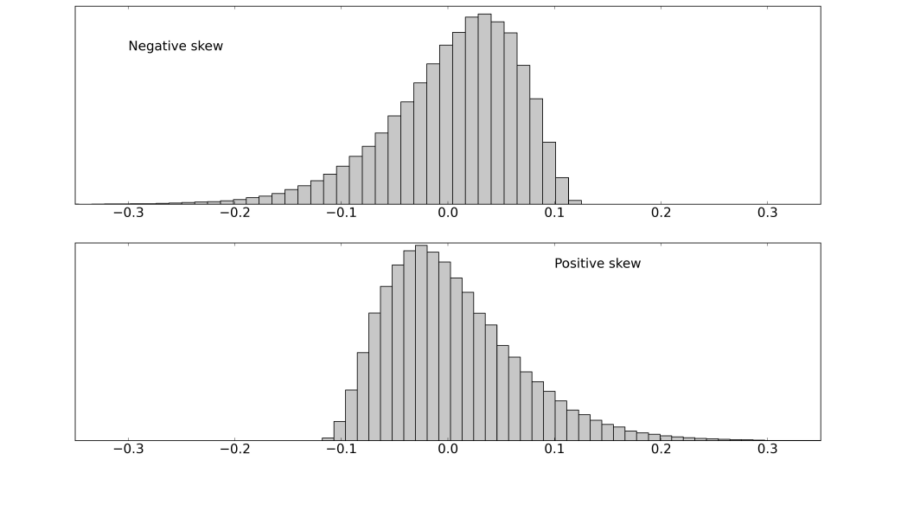

# Chapter Two. Systematic Trading Rules｜英文原文版

来源：`OEBPS/Autopilot_ebook-9.xhtml`。按 EPUB 的正文、表格、插图与脚注顺序转排；字体、行内样式及印刷页码可能不同于原书。

## Chapter Two. Systematic Trading Rules

A trading rule is a systematic way of predicting price movements. Trading rules are a core component of any trading system, so how can you find trading rules that will work? Why do they work? What styles of trading are available? Finally, how successful should you expect trading rules to be?

### Chapter overview

| What makes a good trading rule | Some key elements that make a trading rule more likely to be successful. |
| --- | --- |
| When trading rules don’t work | Reasons why a trading rule which worked in back-test may not work in practice when actually traded. |
| Why are certain rules profitable? | Explanations for why profit making rules exist, to help you work out if that profitability is likely to be repeatable. |
| Classifying trading styles | The main ways in which you can classify rules into trading styles, and the important characteristics each style has. |
| Achievable Sharpe ratios | What are realistic Sharpe ratios to expect? |

### What makes a good trading rule

Staunch systems trader

This section mostly relates to how trading rules are fitted. This is less applicable to asset allocating investors and semi-automatic traders, and they can skip to ‘Why are certain rules profitable?’

#### It is carefully built from ideas or data

Systematic trading assumes the future will be like the past. Hence you should create rules that would have worked historically, and hope that they will continue to work.

But there are at least two different ways to find rules that made money in the past. One common method, which I call data first, is to analyse some data, find some profitable patterns and create some trading rules to exploit them. This is sometimes called data mining. The alternative, ideas first, is to come up with an idea, then create a rule, which is then tested on data to see if it works.22 Here is Leda Braga, head of hedge fund Systematica, describing ideas first in an interview with Bloomberg in February 2015:

“There’s a creative moment when you think of a hypothesis, maybe it’s that interest rate data derives currency rates. So we think about that first before mining the data. We don’t mine the data to come up with ideas.”

Designing an ideas first system is like saying: “I want to design a system that captures this source of return. I hope this source is still around in the future.”

Whereas for a data first system: “Here is a system that was profitable in the past given the patterns in the market (which I won’t try and explain or understand). I hope these patterns persist in the future.”

| Advantages of ideas first | Advantages of data first |
| --- | --- |
| If an idea works no further potentially dangerous fitting is required. | There will be a bias with ideas first to testing things that you know will work, either because of ‘market lore’ or academic studies. This is a form of implicit over-fitting. |
| Any fitting will probably be done in a small subset of alternatives. | With ideas first it is tempting to try a large number of ideas to find the ones that work. This is definitely over-fitting. |
| You tend to get simpler and more intuitive trading rules with ideas first. | In data first all the fitting is explicit, so the degree of over-fitting can be controlled. |
| You can construct rules that make intuitive sense, with a story behind them. | A compelling theory or story does not guarantee that the source of returns is repeatable, and could give a false sense of security. This is the narrative fallacy I mentioned in Chapter 1. |
| It’s easier to classify the trading rule and work out where its profits are coming from. | Clever data analysis might unearth novel strategies that were previously unknown. |

In my experience consistently profitable trading comes out of careful research, done by thoughtful and knowledgeable people, who seek to understand where their profits come from. The loss making systematic trading I’ve seen has often been the result of haphazard data mining, done without any consideration of the reasons why a rule might have appeared profitable in the past or might not be in the future.

That experience, combined with my preference for things I can trust and understand, means I favour the ideas first method. This usually results in intuitive, simpler and more transparent rules. As long as a small number of ideas are tested over-fitting is less likely. In the next chapter, ‘Fitting’, I focus on ideas first testing because it is simpler and does not require sophisticated techniques to implement safely.

But in some situations the data first process could be better; for example in high frequency trading where there is plenty of data, rules can be refitted regularly and novel ideas are more likely to be found as market structure evolves.

You should be aware of the strengths and weaknesses of your preferred method and use it appropriately.

#### Explainable profits

Understanding why trading rules make money is very important. If you know why something was profitable in the past you can also have some idea of whether profits will continue, or if and when the rule might fail.

With an ideas first approach you can easily explain why a strategy was profitable, since the explanation is inherent in the original idea. For example you might have tested a trend following rule, which you think makes money because of cognitive biases explained by prospect theory.

With data first any explanation has to follow the fitting process. You first examine how a rule behaves and then infer what might be causing the effect. The more complex a data driven trading rule is the harder it will be to explain.

There is however a danger in seeking out explanations. Remember the narrative fallacy, another cognitive bias: humans like stories. We’re more likely to believe in rules which have convincing explanations, even if their performance doesn’t stand up to statistical scrutiny. To trust a trading rule I like to have both a good story and a rigorous back-test.

#### Intuitively understandable behaviour

A strategy that is intuitive is much easier to trust. If in advance of an earnings announcement you see Unilever’s equity price rising a trend following system ought to be buying. If the strategy sold instead that might be a cause for concern and you would check for bad data or software bugs. Usually though you’d see what was expected and be able to relax.

A complicated system might buy or sell when prices moved higher, depending on the exact pattern. This would make its behaviour less obvious and more unpredictable.

#### As simple as possible

It is much easier to explain the profitability and behaviour of simple trading rules, those with few moving parts and no weird interactions. Ideas first rules should be simple unless you begin with a very convoluted idea, or over complicate it to get a more profitable back-test, neither of which is recommended.

Data first rules can be very simple or extremely complicated, depending on how many parameters are fitted. A data first rule with more parameters will be less explainable, and more vulnerable to over-fitting. But a complex data first rule can also exploit a novel trading pattern that simpler rules will miss.

#### Can be systematised

Ideas need to translated into systematised rules. Not all styles of trading are entirely suitable for this, because they are inherently subjective or because of data limitations. They can still however be wrapped up inside a systematic position management framework, as I show in the semi-automatic trader example.

Too subjective

Many methods of trading cannot be systematised because it’s impossible to write down a set of relatively simple, objective and generic rules. For more esoteric forms of technical analysis turning a strangely named candlestick pattern into a precise rule is difficult. Another example would be merger arbitrage where you have to assess the likelihood of a deal going through based on analysis of a number of hard to quantify factors.

Data limitations

Even if a strategy is objective the necessary data might be unavailable. Even if you could write trading rules for merger arbitrage the necessary information about legal and regulatory issues cannot easily be converted into an algorithm friendly format.

There might also be a shortage of data. As you will see in the next chapter, ‘Fitting’, many years of data are needed to properly test a strategy. Some hedge funds have recently used data such as Google search popularity and Twitter trending to forecast markets. These ideas make good press releases, but there won’t be enough data to properly evaluate them for many years.

You might also struggle to compare data between instruments. For example accounting measures aren’t consistent across countries because of different rules and standards. This means inter country equity value strategies are difficult to implement.

### When trading rules don’t work

Staunch systems trader

This section mostly relates to how trading rules are fitted. This is less applicable to asset allocating investors and semi-automatic traders. They can skip to ‘Why are certain rules profitable?’

There are various reasons why a rule that was successful in back-test might fail in reality.

#### It never really worked

First there are rules which apparently work in a back-test, but wouldn’t have actually made money in the past. The rules might be over-fitted, which I will discuss at length in the next chapter. Alternatively they could rely on forward looking data that was published with a delay not present in the back-test. There may be also survivorship bias in the instruments you are considering.You might have underestimated trading costs or missed out an important element of the market structure at the time, such as constraints on short selling of equities. Finally your history could be too brief and miss out on a crucial period when the strategy would have blown up.23

#### The world changes

You want strategies that worked in the past and will continue to do so. But what if the behaviour or market pattern you are trying to exploit vanishes?

For example what if systematic traders, using the same rules, dominate a market? Won’t the relevant strategies all stop working? This is most problematic for relative value strategies which try and buy when assets become cheap and sell when they are expensive. With a large population of similar systems any slight mis-pricing will be immediately corrected and returns will vanish.

Conversely trend followers might be happy to see price trends reinforced when they collectively dominate a market, however when prices reverse they could get caught in a synchronised rush for the exit.

When computers have a significant advantage, as in ultra high frequency trading, they have squeezed out people almost entirely. These are no longer taking advantage of human weaknesses or market structure, but are engaged in an arms race where success comes from pure speed and anticipating your opponent’s reaction. This area falls entirely outside the domain of this book.

### Why certain rules are profitable

This section is relevant to all readers

Whether you are using systematic rules or making discretionary forecasts it’s important to understand where your returns are coming from and what your ‘edge’ is – if any. This section briefly covers the theory around this subject.24 It presents some possible reasons why certain assets, portfolios of assets, or dynamic trading rules make profits.

#### Risk premia

When you buy insurance you pay a premium. Premia are set at a level where insurers expect to have occasional large payouts, but to be profitable on average. The insurance buyer is guaranteed to lose over the long run, but in return is covered against rare significant losses. These two different profiles of returns are also seen in the financial markets, so the analogy of buying and selling insurance is very useful.

Anyone wanting to buy ‘financial insurance’ will happily suffer below average market returns, whilst those willing to sell would get higher returns through earning a risk premium, analogous to the insurer’s profits. Certain assets are more heavily exposed to certain kinds of risks; buying these assets brings additional returns from various risk premia.

Persistent risk premium

Some risk premia persist for long periods, like the extra return you’d expect from investing in equities versus safer assets like bonds. A range of other risk factors such as book-to-market ratios and firm size are used in equity value strategies. In other assets there are different premia. For example longer maturity bonds earn a premium over those which mature earlier since investors like to be compensated for lending over longer periods.

Timing varying risk premium

Buying cheap credit default swap insurance on risky mortgages in 2006 subsequently made hedge fund manager John Paulson billions of dollars when the market melted down a year later.25 Conversely when there is blood on the streets you can buy risky assets for peanuts, as in early 2009 when I bought my insufficiently aggressive stake in Barclays.

Clearly risk premia are not constant. People’s appetite for risk varies over time as they veer between the relative euphoria of years like 2006 and the panic of 2009. You can make profits buying cheap premia and selling expensive ones. This is a form of mean reversion trading, where you assume premia, and hence prices, will revert to some long-term equilibrium.

In practice it’s impossible to say exactly what the ‘correct’ value of a premium should be and infer if you should be buying or selling. The market can also move away from its correct value for long periods of time. Nevertheless this is another useful source of return.

Skew and unlikely events premium

The rational investor of classical financial theory only cares about an asset’s Sharpe ratio (SR) – it’s average returns adjusted for their standard deviation. This only makes sense if all assets have symmetrically distributed returns. But in practice assets with the same SR could make steady losses with occasional large returns (like an insurance buyer), or steady gains with occasional large losses (as a seller of insurance does). This implies that the skew of each asset’s returns is different.

CONCEPT: Sharpe ratio (SR)

The Sharpe ratio (SR) measures how profitable a trading strategy or holding an asset has been, or is expected to be. To calculate it you take returns and adjust them for their risk.

Strictly speaking you should take the ‘excess’ return over and above a risk free interest rate,26 although this isn’t relevant for a trader using derivatives,27 nor as important in the post 2009 low interest rate era as it was before.

Formally it is the mean return for a particular time period divided by the standard deviation of returns for the same time period. So the daily SR would be the average daily return, divided by the standard deviation of daily returns. However I normally use the annualised Sharpe ratio – annualised returns divided by annualised standard deviation. Assuming there are 256 business days in a year the annualised SR is roughly 16 times the daily.28

The Sharpe ratio is not a perfect measure. In particular its assumption of symmetric gains and losses is unrealistic. It is useless for comparing assets where infrequent large losses occur with others that have rare large gains; for this you need to consider skew.

CONCEPT: Skew

In chapter one when discussing standard deviation I said that a large loss was as likely as a large gain for the symmetric Gaussian normal distribution. A two sigma move up in price would occur around 2.5% of the time, with the same chance of a two sigma move down.

But many assets don’t have a symmetric distribution – their returns are skewed to one side or the other. In many cases large losses are more likely than large gains. Global stock markets fell 20% on a single day in October 1987 – about 20 sigma – but they have never rallied as rapidly.

Where an asset has a higher chance of a large down move than an equivalent up move, it is said to have a negative skew. If large up moves are more likely then it has positive skew.

Assuming they have the same Sharpe ratio, the returns from a positively skewed asset will contain more losing days than for those of a negatively skewed asset. But the losing days will be relatively small in magnitude. A negatively skewed asset will have fewer down days, but the losses on those days will be larger.

Returning to my earlier analogy, buying insurance is a positive skew strategy. You will experience frequent small losses (paying out premia) with occasional large gains (receiving payouts). If you sell insurance then you’ll get frequent small gains and occasional large losses – negative skew.

Figure 5 and table 1 show the return distribution and statistics of two assets with different skews but the same Sharpe ratio.

Figure 5: Two assets, Same Sharpe ratio, different skews

Which is better, positive or negative skew? It depends...

Table 1: Characteristics of negative versus positive skew

|  | Negative skew | Positive skew |
| --- | --- | --- |
| Mean of daily returns | 0.4% | 0.4% |
| Sigma of daily returns | 6.3% | 6.3% |
| Annualised Sharpe ratio | 1.0 | 1.0 |
| Skew of daily returns | -1.0 | 1.0 |
| Median daily return | 1.4% | -0.6% |
| Average Gain:Average Loss | 0.8 | 1.4 |
| Hit rate (% of positive returns) | 59% | 46% |
| Expected annual worst daily loss | -22% | -10% |
| Expected annual best daily gain | 10% | 22% |

Equities normally have mildly negative skew. ‘Safe haven’ assets like gold and Swiss francs tend to have positive skew. However the skew of these assets is relatively mild compared to owning options.

One group of option-like assets are the equity volatility indices: the VIX index on the US S&P 500, and the V2TX index on the European Euro Stoxx 50. Both of these can be traded with very liquid futures.

Buying the VIX and V2TX futures gives you highly positive skew, but as you are effectively purchasing insurance against unexpectedly high equity volatility it also tends to have a negative Sharpe ratio (SR). Similarly selling the futures gives a positive SR, but with an extremely negative skew. Each of these futures has skew around four times higher than their underlying index.

Many people have a strong dislike for the occasional large losses of negative skew which is why they buy home insurance. Relative value strategies tend to exhibit this behaviour, so investors should demand a skew premium for investing in them.

Conversely positive skew is attractive, which partly explains why even highly numerate and rational people like me buy lottery tickets. A related effect is that most of us overestimate very rare probabilities. This means we will overpay for disaster insurance, such as deep out of the money put options that will only pay off if stocks drop 20%.

People also like to have a small chance of winning large amounts; they buy out of the money call options, favour 200-1 horses whose real chance of winning is 1,000 to 1, and once again they buy lottery tickets. They will happily give up return premia to those who are willing to take the other side of these gambles.

These various illogical preferences can be explained by cognitive biases.

#### Leverage

Do you borrow to invest? Classical financial theory assumes people will borrow freely, but many investors cannot or will not do so. Borrowing to buy stocks on margin is still unusual behaviour for amateur traders. Although the availability of derivatives like futures and contracts for difference has increased substantially they are still a tool for the brave minority. Many institutional funds do not borrow either, whilst for others there are limits imposed by regulators and brokers.

This means that high Sharpe ratio (SR) assets with low returns, but even lower volatility, will remain unloved by those who require high returns and can’t borrow to invest. They would rather buy high return assets with higher risk, even if the additional risk is not fully compensated for and the SR is lower.

As a result undiversified portfolios are common, with equities contributing nearly all the volatility. People prefer riskier stocks, epitomised by the technology bubble in 1999. This effect also explains why short maturity bonds have historically had higher SR than longer maturity bonds.The lucky investors who can use leverage should outperform others over the long run. But beware: in a crisis a death spiral can easily develop in portfolios built on debt. Prices fall, brokers ask for more margin or restrict borrowing entirely, investors have to sell, and prices fall further. These forced sales at the worst possible price can eliminate years of profits.

I’ll discuss the safe use of leverage in chapter nine, ‘Volatility targeting’.

#### Liquidity and size

The degree of liquidity in an asset is how easily we can buy or sell without unduly affecting the price. Larger institutional investors have to buy in large size and liquidate quickly on client redemptions, so they prefer liquid assets, which then get their prices bid up relative to less liquid alternatives. Thus we get the well known effect of smaller companies offering better returns. Liquidity premia also explain the attractiveness of ‘alternative’ assets like land and venture capital. Investors happy to hold less liquid portfolios for longer periods have greater opportunities for higher returns.

The premia for liquidity, size and leverage can vary over time, presenting opportunities for well timed buying and selling. For example derivatives related to mortgage backed assets were liquid and attracted premium prices at the end of 2006; a year later they were almost untradeable and willing buyers could get significant discounts even on heavily depressed official quotes.

#### When others have to trade

Not everyone trades because they are trying to make money. Some are forced to. For example central banks wishing to keep their currency weak – such as Switzerland or Japan – can do so indefinitely if they are comfortable with the ensuing costs.29

A foreign exchange carry trading rule that borrows in low interest rate currencies like Switzerland and invests in high interest rate currencies will be consistently profitable as a result, at least until the currency policy is abandoned (as it was for Switzerland in January 2015). This can lead to sudden losses, making carry a decidedly negative skew strategy.

Here are some other examples from different asset classes. End of year trading to minimise taxation or ‘window dress’ balance sheets creates seasonal effects in equity prices. Insurance companies might have to buy rare long maturity bonds to hedge liabilities, pushing up their price. As long as the position size of those forced to trade is greater than those who exploit them these opportunities will persist.

Another set of money making opportunities is available to those willing to act as liquidity providers. Note this is different from earning a liquidity premium by holding illiquid assets for long periods. Liquidity providers behave as market markets, trying to capture the spread that less patient traders don’t mind paying. This is definitely negative skew territory as unforeseen price spikes can quickly wipe out large quantities of patiently accumulated small gains.

#### Barriers to entry, returns to effort and cost

Some trading rules have barriers to entry in the form of costs or investments that need to be made to realise profits from them. High frequency strategies require renting expensive servers located physically within exchange buildings, as well as developing specialised software. The returns of such systems need to be high enough to compensate for the investment needed, as well as their much higher costs.

If an opportunity requires a lot of work to exploit, then it may be passed up by most investors and additional returns would be available. An example would be investing in private firms, where lengthy due diligence and legal work is required. It’s important to understand that just because something takes time, and may require specialist knowledge, doesn’t mean the profits are a payment for skill. The extra returns available are just fair compensation for the time and effort needed.

#### Behavioural effects

A classical financial economist would be comfortable with most of the above explanations. But you can also create rules which extract returns from other people’s behavioural weaknesses. These effects persist because of market inefficiencies such as bans on short selling, and the sheer weight of money influenced by these biases.

The early loss taker trading rule of chapter one is a simple trend following rule which I believe is profitable because of prospect theory biases. People don’t want to keep recent winners, they prefer hanging on to losers, and they will give up excess returns for the nice warm feeling they get from behaving like this. Prospect theory can also explain preferences people have around return skew and overweighting unlikely events, which I’ve already touched on. There are a large number of other behavioural biases, and strategies that could be built on them.

#### Self-fulfilling prophecy

Many weird technical trading systems such as Fibonacci numbers and the like have absolutely no justification, except perhaps some tenuous link to behavioural theories. But because a lot of people use these ideas we do get persistent price movements around key levels, and they may end up working. It is hard to say if they will continue to work in the future.

#### Pure alpha and skill

Warren Buffett, John Templeton, Peter Lynch: there are a small number of investors who seem to be able to persistently generate extraordinary profits that none of the above theories can easily explain. It is possible they are just very lucky, the one in a billion monkey who has by sheer fluke successfully written a sonnet. But they may possess the rare elixir of alpha; genuine skill in making investment decisions.

It is unlikely that what these outliers do can be written down and reproduced systematically. Those who exhibit pure skill can adapt to changing market opportunities in a way that a systematic rule never could. If you think you are part of this elite group then the semi-automatic trader example is for you.

### Classifying trading styles

This section is relevant to all readers.

This section is useful for all three example groups. I believe even semi-automatic traders would benefit from having a good understanding of the likely risks of their style of trading.

#### Static versus dynamic

A trading strategy could be static – where you invest your portfolio and then do nothing. The returns from static strategies inherit the characteristics of the underlying assets. Alternatively it could be dynamic – where you actively trade. In this case you will earn additional types of return from buying and selling, and the characteristics of those returns will depend on your trading style.

There are various degrees of static strategies. The most vanilla flavour is a simple buy and hold portfolio. Let’s pretend that Apple and Microsoft have the same price per share. If you can’t decide between them then you’d buy equal numbers of shares in Apple and Microsoft today.

Next week Apple brings out a new iGadget and doubles in price, whilst sclerotic Microsoft halves after releasing a new Windows that everyone hates. As a buy and hold investor you would do nothing. Your portfolio is now seriously unbalanced; 80% in Apple and only 20% in Microsoft.

The second degree static strategy is to re-balance your portfolio so you keep the same cash value in each company. You’d need to sell your Apple shares to the point where you only had 50% of your portfolio in the designer of swanky white gadgets, whilst simultaneously buying shares in the semi-monopolistic software house.

Now suppose you wanted not just an equal cash value for the two companies but equal risk. This is often called risk parity investing. We’ll assume risk is equal to the recent standard deviation of the daily percentage changes in price for each firm.

CONCEPT: Risk

Risk is a slippery concept which is difficult to pin down. I like to divide the world of risk into predictable risks, or what Donald Rumsfeld30 would call Known Unknowns, and unpredictable risks (Unknown Unknowns).

It’s very hard to forecast what the return will be each day over the next few weeks for an asset or portfolio. But you can model and estimate what the variation in returns is likely to be. Estimates based entirely on assuming that recent levels of variation will persist tend to be relatively good.31 The element of risk that is encapsulated by a model of variation is the predictable part.

However there is always the danger that you haven’t correctly estimated the underlying variation, or that the level of variation will change, or that your model of where market returns come from is wrong or incomplete (perhaps because of skew and other nuances since returns aren’t usually exactly Gaussian normal).32 These are all sources of unpredictable risks.

I define predictable risk as being equal to the recent historic level of the standard deviation of percentage daily changes in price. This is a useful simplification but one which ignores the unpredictable elements of risk. The dangers of this assumption should always be at the front of your mind.

Again suppose for simplicity each technology stock starts life with the same standard deviation of returns, so for a third degree portfolio you would put 50% of your cash in each stock.

Now Apple has to recall its latest iPhone due to a technical fault, so the price crashes. The next day it rebounds to its prior level on news that Apple is to buy coolstartup.com. Although the price is unchanged the expected risk of thrilling Apple shares (defined as the recent standard deviation of returns) has doubled relative to dull Microsoft. If you did nothing, two-thirds of your estimated portfolio risk would be coming from AAPL, and just one-third from MSFT.

In a fourth degree static portfolio you rebalance to get a constant expected risk allocation. Once again you’d need to sell Apple and buy Microsoft to bring things back into line. My example asset allocating investor will be running a fourth degree static portfolio. Although they will not use any dynamic trading rules, they will use the systematic framework to ensure that their portfolio risk remains as desired.

CONCEPT: Volatility standardisation

One of the most powerful techniques I use in my trading system framework is volatility standardisation. This is adjusting the returns of different assets so that they have the same expected risk. As I discussed above, my standard definition of expected risk is to use an estimate of recent standard deviation.

This has a number of benefits. It allows you to have dynamic portfolios where each component contributes an equal amount of risk. Furthermore, as you’ll see later in the book it means that you can apply the same trading rule to different assets, if the trading rule is applied to volatility standardised returns.

It also means that you can easily combine different trading rules, and run portfolios of rules for multiple instruments.

#### Skew again

The most overlooked characteristic of a strategy is the expected skew of its returns, i.e. how symmetrical they are.

As you shall see in chapter nine, ‘Volatility targeting’, the different characteristics of positive and negative skew trading determine how much risk you should take. If you are using a systematic trading rule and have access to back-testing technology you can measure your skew. Otherwise you will need to make a judgment on what it is likely to be based on your trading style.

Be aware that if you are making steady profits nearly every day, and most of your trades are winners, then there is a good chance you are engaged in negative skew trading. It’s just that you haven’t yet seen any rare large losses.

| Positive skew | Negative skew |
| --- | --- |
| Frequent small losses and infrequent large gains. | Frequent small gains and infrequent large losses. |
| Like buying an insurance policy. | Like selling an insurance policy. |
| Similar to buying options, you benefit from prices moving more than expected. | Similar to selling options, you benefit from prices moving less than expected. |
| Because losses tend to be small and frequent, risk management is easier. | Because losses are large and infrequent, risk management is harder. |
| Leverage required depends on asset class, but is lower than for negative skew. | Often requires leverage to achieve decent absolute returns in normal times; so gets killed in bad times. |
| Examples: • Trend following strategies. • Bets done by buying options, e.g. if you think the stock market will weaken then buying put options. • John Paulson in 2006 buying cheap credit default swap insurance on securities backed by mortgages.* • Tail protect hedge funds that try and provide cheap insurance against large market moves, as practised by Nassim Taleb amongst others. | Examples: • FX carry • Fixed income relative value as practised by Long Term Capital Management (LTCM), a large hedge fund that blew up in 1998.** • Market making. • Short option strategies, e.g. selling equity option ‘straddles’ (pairs of call and put options). Such as Nick Leeson of Barings who lost around $1 billion selling straddles in January 1995.*** |

* See The Greatest Trade Ever by Gregory Zuckerman.

** See When Genius Failed by Roger Lowenstein.

*** See Rogue Trader by none other than Nick Leeson.

#### Trading speed: Fast vs Slow

Very slow (average holding period: several months to many years)

Very slow systems look almost like static portfolios, with additional gradual changes in position coming from their trading rules. Rules often involve mean reversion to very long run equilibrium such as relative value equity portfolios that buy past losers, and sell recent winners.

Returns from dynamic trading get worse the less frequently you trade because of the law of active management; at these slow speeds they will be very poor. These lower profits can’t be statistically distinguished from noise, so you should avoid using these kinds of rules in systematic strategies.

CONCEPT: Law of active management

The law of active management, first articulated by Richard Kahn in 1989, states that the Sharpe ratio33 of a trading strategy will be proportional to the square root of the number of independent bets made per year.

This law gives us some idea of how profits should vary with trading speed. Suppose you’re holding one asset at a time, and making one ‘bet’ per year (buying, holding for 12 months before selling, then repeating), and that you expect an SR of 0.15 from this activity.

Now if you decide to make four ‘bets’ a year, holding the asset for three months, then because 2 is the square root of 4 you should expect an SR of 2 × 0.15 = 0.30. If you begin betting every single business day, then with around 256 business days in a year the SR will be 16 times larger than 0.15, or 2.4. This is a very decent Sharpe ratio indeed.

Unfortunately this result is theoretical and has its flaws. Firstly it assumes that the ‘skill’ of the trader is constant across holding periods. However the skills required to day trade are very different from those a long-term investor needs, as I’m sure Warren Buffett would agree. This is particularly true for systematic trading rules which tend to have a ‘sweet spot’ holding period. For example at medium frequencies of weeks to months most assets exhibit momentum; but at shorter and longer horizons they behave differently.

More importantly the law ignores transaction costs. As you’ll see later in the book these can seriously damage the returns of fast traders, except perhaps in very cheap markets.

Nevertheless this result seems to hold reasonably well for longer periods where costs are not an issue. Most trading rules see their Sharpe ratios declining once they have holding periods exceeding several months. If due to high costs you need to trade this slowly you are probably better trying not to forecast asset prices at all, like an asset allocating investor.

The other important implication of the law is that diversification across assets can substantially improve returns. If you can find four assets which have zero correlation then you can double your Sharpe ratio. Whilst this might seem unrealistic a trading strategy with a large number of instruments, covering a group of half a dozen asset classes, the returns of which will be relatively uncorrelated, can have returns which are two to three times those for a single asset.

Medium (average holding period: a few hours or days, to several months)

Again because of the law of active management you get more attractive returns as you reduce your holding period to a few months or less. Profits from trading rules become statistically significant and they can be back-tested.

Although trading rules can’t attain the large Sharpe ratios of high frequency trading they are readily accessible to a wider population of traders. A manual system, run part-time, working on daily data and trading through an ordinary broker works well enough. As a result more people’s effort and research goes into investigating this particular realm, so it’s perhaps less likely that there are any highly profitable and novel trading rules that have not yet been discovered.

Trading costs need to be accurately measured to decide whether an instrument should be traded at a faster or slower speed within this region. Large institutional traders also need to determine if a market has the capacity to absorb their trading. I cover these subjects in chapter twelve, ‘Speed and Size’.

Fast (holding period: microseconds to one day)

The final part of the spectrum goes from day trading down to millisecond level high frequency trading and market making. Typical raw Sharpe ratios could be very high due to the number of trades made, but costs will chew up a big chunk of profits. Special execution algorithms are needed to reduce costs below normal levels. Back-testing requires sophisticated models of the evolution of the order book.

There are higher barriers to entry than at slower speeds; co-located servers and fully automated software is needed. Also faster strategies are likely to have limited capacity. Capital requirements are small as positions are not held overnight, but there is always the danger of extreme losses due to markets gapping, or systems going rogue. It is impossible for humans to monitor trading activity in real time so you need very tight controls and good monitoring systems.

All this means that realising the very high theoretical Sharpe ratio from super fast strategies is no picnic. The domain of high frequency trading mostly falls outside the scope of this book.

#### Technical vs fundamental

Strategies vary in the source of data they use, either using technical or fundamental information, or both. Purely technical rules only use price data. Non price, fundamental data, comes in two main flavours: micro and macro. Micro data is about a specific asset, for example the yield of a particular bond or the PE ratio of a company. Macro data such as inflation and GDP growth covers entire economies.

I have worked extensively with both fundamental and technical data. Technical systems are easier to build and run, but in another example of barriers to entry the additional effort required for including fundamental rules is usually rewarded with higher returns. The examples in this book are all technical, but only because they are simpler to explain.

#### Portfolio size

There are successful traders who only ever trade one futures contract. At the other extreme large equity index funds could have thousands of holdings. Remember that the law of active management shows that diversification is the best source of additional risk adjusted returns. Both traders and investors should hold more positions when they can; ideally across several asset classes to get the greatest possible benefit. With larger portfolios you’re also less exposed to instrument specific problems such as bad data or temporary liquidity issues.

However smaller portfolios make sense for semi-automatic traders or for those running entirely manual systems. As I’ll discuss in chapter twelve, ‘Speed and Size’, those with relatively small accounts also have to limit the number of positions they take.

To make them tractable the examples in this book have relatively small numbers of instruments. But I trade over 40 futures contracts across multiple asset classes in my own fully automated system since I firmly believe in diversification.

#### Leverage: more risk and yet more skew

Leverage is borrowing to invest or trade. The borrowing can be explicit as when trading equities on margin, or implicit as with derivatives like futures. You need leverage when the natural return and risk of an asset is less than desired. If you want a 10% return on average, and your asset is a bond with an expected Sharpe ratio of 0.5, but only a 5% annualised standard deviation, then you need to lever up four times.34

Is leverage dangerous? Not always. Leverage alone is a poor measure of risk, as varying amounts make sense for different assets. What makes it deadly is the potential for large unexpected losses.

Suppose you’d put on a relative value trade in 2007 between two highly correlated bonds, buying four year and selling five year bonds, both issued by the Greek government.35 This would have earned you a fairly steady return of much less than 1% a year but with almost zero volatility. Because of the low natural risk you would probably have used leverage to increase your chances of getting a reasonable return like 5% or 10% a year.

In early 2010 the close relationship between these two bonds collapsed due to the huge uncertainty about the likelihood and timing of a European bailout of Greece. You would have seen significantly higher losses on your four year bond than profits on the five year, and a huge loss overall.

To rub salt into the wound even though you could cover the initial losses your brokers then demanded yet more margin. You ended up forced to sell out at the worst possible price. Because you used leverage to do the trade you would have had no choice but to liquidate the position, even though it would be profitable when the bonds finally matured.

Notice that this relative value trade is a classic example of negative skew, small consistent gains until the trade goes terribly wrong. These steady gains tricked you into thinking that the position was low risk, and lured you into using leverage to improve your returns. But you have the unpredictable risk that the volatility or correlations will change, and for negative skew positions it will usually surprise with large losses rather than gains.

So beware of gearing up on apparently low risk with an asset or with a style of trading which is likely to have negative skew, even if you haven’t yet seen any evidence of the large downside. As we’ll see later in the book I’m firmly against trading instruments with very low volatility, and leveraging up negative skew trading rules too highly.

#### Contrarians, market followers and crowded trades

Mean reversion and relative value traders act as contrarians – they seek to take advantage of mis-pricing which means buying low after falls and selling when the price has risen. Other styles of trading involve following the market; notably the various forms of trend following. Contrarian traders like to catch falling knives and buy more as prices fall. Trend followers will close positions that have started to lose money, like the early loss taker trading rule. Market followers tend to see positive skew from taking small losses as the trend moves against them, with an occasional large profit from a significant move in their favour. Conversely contrarians see negative skew, with many small profits as each mis-pricing is corrected, then occasional large losses when prices jump away from their equilibrium.

Crowded trades are deadly. They happen when the majority of market participants have the same bet on, which could be from behaving as contrarians or market followers. As the story goes when the shoeshine boy or the taxi driver is in the market, it’s time to get out. Crowded trades are most lethal when a leveraged strategy has started to go wrong and positions have to be liquidated to meet margin requirements.

Relative value strategies which need high leverage are particularly vulnerable to crowds. Often after a long stable period of rising markets these trades get swamped by people seeking extra returns. This results in the available profits being reduced, the apparent risk falling, and required leverage increasing further. Then the music stops and their negative skew becomes horribly apparent.

Two classic examples are the meltdown of fixed income relative value hedge fund manager Long Term Capital Management in mid-199836 and the Quant Quake – sharp losses seen over just two days by equity relative value systematic funds in August 2007.

### Achievable Sharpe ratios

This section is relevant to all readers

It’s important to have a realistic sense of what level of Sharpe ratios (SR) are achievable. As I said in the previous chapter, inflated expectations can lead to over betting (which we’ll discuss more in chapter nine, ‘Volatility Targeting’) and overtrading (see chapter twelve, ‘Speed and Size’), both of which will seriously damage your chances of trading profitably.

Let’s begin with one of the simplest possible risky investments, a long only equity position in one company. Although they have been higher in the past, excess equity returns on single equities will probably average around 3% a year in the future. This is because the main cause of higher returns was the significant fall in inflation from the mid 1970’s; something that won’t be repeated. With annualised standard deviation of around 20% this implies an SR of 3% ÷ 20% = 0.15 is realistic.

Using the results implied by the law of active management, investing in a portfolio of equities will do slightly better. A group of at least 20 equities trading in the same country but diversified across different industries should have an SR of around 0.20. This is also what I’d expect from holding an equity index, like the S&P 500. If you invest globally across multiple countries you can probably get to a Sharpe ratio of around 0.25.

To do much better you’d need to allocate across multiple asset classes: equities, bonds, commodities and so on. Because correlations between asset classes are usually low a portfolio covering several of these types of assets can probably expect to reach a Sharpe ratio of around 0.40. Notice this is slightly more than double what you get from investing in an equity index. This is a realistic maximum figure for static strategies, like those used by asset allocating investors.

It’s much harder to say what the returns should be for dynamic trading rules, like those used by staunch systems traders. My own experience is that with a reasonably diversified set of rules the average SR on a single instrument, such as a commodity future or FX spread bet, is around 0.40.37 Again if you trade across multiple asset classes then you can get around double this.

But many traders have highly unrealistic expectations of back-tested Sharpe ratios of 2.0, 3.0 or even higher; just on single instruments! These values are far too optimistic and are caused by over-fitting, which I’ll discuss more in part two. In reality SR consistently greater than 1.0 are rarely achieved, even by sophisticated institutional investors. Analysis of returns from a group of systematic hedge funds shows that none could sustain a Sharpe ratio above 1.0 for more than a few years.38

What sort of SR should discretionary semi-automatic traders expect? This is a more difficult question to answer. It is generally accepted that only a minority of traders are profitable. Most likely to be losers are day traders and those in relatively expensive markets such as retail FX spread betting.

I’m inclined to be optimistic and assume that a competent trader following the advice in this book would get an average SR betting on a single instrument at a time of around 0.25. This is obviously lower than the trader using a systematic trading rule. Such traders tend not to diversify across asset classes. However if they did this would imply a total portfolio SR of no more than 0.50.

There is a good chance the Sharpe ratios I’ve given here probably won’t meet your needs or expectations. There are two apparently easy ways to try and increase them, both of which are incredibly dangerous.

Firstly you could trade negative skew strategies. Very high SR is often a result of hidden negative skew. Take an imaginary strategy which returns 100% in year one, 65% in year two, 100% in year three, 65% in year four and so on. After 20 years the SR is an astonishing 4.6. Unfortunately in year 21 you make minus 100% and lose your entire investment. It turns out this system had seriously negative skew.

Although this might seem like a bad result the Sharpe ratio after 21 years is still an excellent 1.7, even once the skew has revealed itself. Clearly this is not a genuine example, but less extreme instances of this have actually occurred. For example the SR of Long Term Capital Management, the hedge fund which blew up in 1998 and which I mentioned earlier in the chapter, was also around 4.6.

The second path to the mirage of higher Sharpe is to trade more quickly. The law of active management implies that if you can realise a Sharpe ratio of 0.40 on a single instrument when trading with a holding period of a month, then betting once a day could boost that to an SR of 1.8. If you held your positions for just an hour and bet eight times a day you’d get to an SR of 5.2! As I said earlier, this assumes that profitable opportunities can be found at such timescales, and also ignores trading costs.

Table 2 assumes that you can achieve these theoretical pre-cost SR, but then takes costs into account.39 It looks like trading every day, or every couple of days, could theoretically give you an SR above 1.0 on a single asset. However this is only true if you use futures, which are very cheap to trade. Most amateur investors use more expensive derivatives; for example spread bets in the UK. It’s impossible, even in theory, to trade these quickly and profitably.

Table 2: Can you really make more money trading faster? In theory if you trade futures, which are cheap. With expensive assets like spread betting, no chance

| Holding period | Theoretical SR pre-cost | After cost SR, average future | After cost SR, average spread bet |
| --- | --- | --- | --- |
| 1 month | 0.40 | 0.37 | 0.28 |
| 1 week | 0.83 | 0.71 | 0.27 |
| 1 day | 1.8 | 1.2 | -0.75 |
| Half a day | 2.6 | 1.4 | -2.5 |
| One hour | 5.2 | 0.28 | -16.4 |

The table shows the theoretical Sharpe ratio (SR) for a given holding period (rows), assuming the one month SR is 0.40. SR are also shown after costs have been deducted, for a typical futures contract and spread bet respectively.

### Conclusion

You may assume that I have a strong dislike for certain investing styles and instruments, in particular those with negative skew. Nothing could be further from the truth and about a third of my own trading system is in this category.

Instead I think that a balanced combination of trading rules, with different styles that work in different environments, is better than any single alternative. It’s important that you understand and can cope with the risks of your trading system. You, and your client if you’re a professional money manager, must be comfortable with the likely behaviour of your strategy.

I also believe finding the best trading rules is less important than designing your trading system in the correct way. In particular you need to avoid the serious crime of over-fitting. This will be the subject of the next chapter as we move on to part two – the tools of systematic trading.

22. There is a third method which is to use an idea which you cannot or will not test on historical data. Strictly speaking, this wouldn’t be systematic trading.

23. This is the aptly named ‘Peso problem’ and is particularly problematic for negative skew strategies which I define later in this chapter.

24. An exhaustive treatment of this topic can be found in Expected Returns by Antti Ilmanen.

25. See The Greatest Trade Ever by Gregory Zuckerman.

26. The US Fed funds rate, UK Bank of England base rate, or whatever is relevant elsewhere.

27. For derivative traders the cost of funding is embedded in their returns. This ignores the interest received on any margin posted or excess funds.

28. This is because you multiply the average daily return by the number of trading days in a year, or 256, to annualise it, but you multiply the daily standard deviation of returns by the ‘square root of time’, and the square root of 256 is 16. See page 27. Technical note: This is an approximation which is only exact for returns with Gaussian normal distributions and no autocorrelation.

29. Conversely, governments cannot maintain strong currencies indefinitely against market pressure as their foreign reserves will eventually run out. This happened in 1992 when the UK government tried to support the pound to keep its value within the European Exchange Rate Mechanism. Hedge fund manager George Soros bet against the Bank of England and made a billion pounds or so when they capitulated.

30. In a speech in 2002 US Secretary of State Donald Rumsfeld identified three kinds of knowledge: known knowns, known unknowns and unknown unknowns.

31. I’ll discuss exactly how you measure recent levels of standard deviation in chapter ten, ‘Position sizing’. If you can’t wait, it’s on page 165.

32. This essentially is the problem that Nassim Taleb discusses in his book The Black Swan.

33. Actually it’s the information ratio, which is identical to the Sharpe ratio except that the numerator is the return relative to a benchmark rather than the risk free rate. For our purpose however the distinction isn’t important.

34. With no leverage your expected return will be the Sharpe ratio of 0.5 multiplied by the standard deviation of 5%, e.g. 2.5%. To get a return of 10% you need to leverage your portfolio four times since 2.5% × 4 = 10%.

35. For finance geeks reading this it’s implicit here that I am doing this trade on a duration neutral basis.

36. See When Genius Failed by Roger Lowenstein.

37. This result comes from using trading rules with holding periods of a few days up to several months. My own highly diversified futures trading system has a back-tested SR of 1.0, and in part four I create a simplified version of this with an SR of just over 0.50. Both back tests are done following the advice in part two, so the SR are realistic and not over-fitted.

38. The analysis was done on a large set of Commodity Trading Advisors, a type of fund that is dominated by systematic trend followers. These returns are post fees (so the gross returns would be higher), but also include interest received on margin funds. These two effects roughly balance out. A small number of other types of systematic hedge fund are able to consistently return Sharpe ratios above 1.0. However, as I’ll discuss below, this is often due to negative skew.

39. In chapter twelve, ‘Speed and Size’, I’ll calculate how much it costs to trade different instruments. Those costs are used here.
