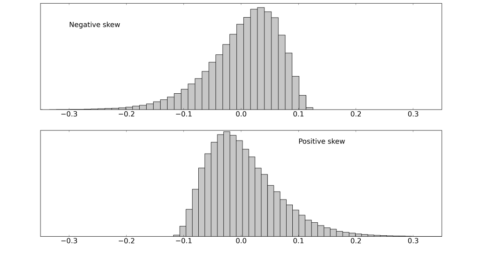

# 第二章 系统化交易规则｜中文忠实版

原书：Robert Carver, *Systematic Trading*, Chapter Two, “Systematic Trading Rules”。书源：`ebook/Systematic Trading.epub` 内 `OEBPS/Autopilot_ebook-9.xhtml`。`ch02#` 是本地提取块号，并非印刷页码。译文按原书顺序对应正文、表格、图注和脚注；保留作者 2015 年写作语境下的数字、条件与判断。

## 第二章 系统化交易规则

**[ch02#0002]** 交易规则是一种系统化预测价格变动的方式。交易规则是任何交易系统的核心组成部分，那么怎样找到有效的规则？它们为什么有效？有哪些交易风格可选？最后，你应该期待交易规则取得怎样的成绩？

### 本章概览 [ch02#0003–0013]

| 主题 | 内容 |
|---|---|
| 什么使交易规则成为好规则 | 使规则更可能成功的若干关键要素。 |
| 交易规则何时失效 | 回测中有效的规则在实际交易时可能不起作用的原因。 |
| 为什么某些规则有利可图 | 解释盈利规则为何存在，以帮助判断其收益是否可能重复。 |
| 交易风格分类 | 将规则归为不同风格的主要方法，以及各风格的重要特征。 |
| 可达到的夏普比率 | 现实中可以期待怎样的夏普比率？ |

### 什么使交易规则成为好规则

**[ch02#0015–0016，坚定的系统交易者]** 本节主要讨论交易规则如何拟合。对资产配置投资者和半自动交易者而言，相关性较小，可以跳至“为什么某些规则有利可图”。

#### 从想法或数据出发，谨慎构建

**[ch02#0018]** 系统化交易假设未来会像过去。因此你应创建在历史上本会奏效的规则，并希望它们继续奏效。

**[ch02#0019]** 但寻找过去赚钱的规则，至少有两种不同途径。一种常见方法，我称为“数据先行”：分析一些数据，找到盈利模式，再创建规则利用它们。有时这叫数据挖掘。另一种“想法先行”：先提出想法，再建立规则，随后用数据检验是否有效。²² 以下是对冲基金 Systematica 负责人 Leda Braga 在 2015 年 2 月接受彭博采访时对想法先行的描述：

**[ch02#0020]** “当你想到一个假设时，会有创造性的时刻；也许你认为利率数据决定汇率。所以我们先思考这个问题，再挖掘数据。我们不是靠挖掘数据来产生想法。”

**[ch02#0021]** 设计想法先行的系统，就像在说：“我想设计一套捕捉这种收益来源的系统。我希望这种来源未来仍在。”

**[ch02#0022]** 数据先行的系统则是在说：“根据市场中这些模式，这套系统过去有利可图（我不打算解释或理解这些模式）。我希望它们未来仍会持续。”

**[ch02#0023–0034，两种方法对照表]** 原表两栏的标题分别为“想法先行的优点”和“数据先行的优点”；右栏前两项实际是对想法先行的警示，译文保留其原有排布与措辞。

| 想法先行的优点 | 数据先行的优点（原表标题） |
|---|---|
| 如果想法有效，就不需要进一步作可能危险的拟合。 | 想法先行会偏向检验那些你已知道会有效的东西，原因可能是“市场传闻”或学术研究。这是一种隐性的过度拟合。 |
| 若需要拟合，通常也只在少量备选方案中进行。 | 想法先行时，容易试很多想法，挑出有效的。这毫无疑问是过度拟合。 |
| 想法先行通常得到更简单、更直观的交易规则。 | 数据先行的拟合都是显性的，因此能够控制过度拟合的程度。 |
| 你可以构造符合直觉、背后有一套故事的规则。 | 动听的理论或故事不能保证收益来源可以重复，还可能给人虚假的安全感。这就是我在第一章提到的叙事谬误。 |
| 更容易给规则分类，弄清利润来自哪里。 | 巧妙的数据分析也许能发现过去无人知道的新策略。 |

**[ch02#0035]** 根据我的经验，持续盈利的交易来自深思熟虑、知识丰富的人所做的谨慎研究；他们努力理解利润从何而来。我见过的亏钱的系统化交易，往往来自随意的数据挖掘，既不考虑规则过去为何看似盈利，也不考虑它未来为何可能失效。

**[ch02#0036]** 这种经历，加上我偏好能够信任和理解的东西，使我倾向想法先行。这通常产生直观、简单、透明的规则。只要检验的想法不多，过度拟合的可能性就较低。下一章“拟合”将着重讨论想法先行的检验，因为它更简单，而且不需要复杂技术也能安全实施。

**[ch02#0037]** 但在某些情形下，数据先行可能更好。例如高频交易有大量数据，可定期重新拟合规则，而且随着市场结构演变，更可能发现新想法。

**[ch02#0038]** 你应了解自己偏好方法的长处与弱点，并恰当地使用它。

#### 能解释的利润

**[ch02#0040]** 理解交易规则为何赚钱非常重要。若知道某物过去为何盈利，你也能对利润是否延续、规则可能在何时或何种情况下失效有所判断。

**[ch02#0041]** 用想法先行的方法，很容易解释策略为何盈利，因为解释就在原始想法之中。例如，你可能检验一条趋势跟随规则，并认为它因前景理论所解释的认知偏差而赚钱。

**[ch02#0042]** 数据先行则必须在拟合之后再寻找解释：先观察规则怎样运行，再推断是什么造成了效果。数据驱动规则越复杂，解释就越难。

**[ch02#0043]** 不过，寻求解释也有危险。记住叙事谬误这种认知偏差：人喜欢故事。即使表现经不起统计检验，我们也更容易相信解释令人信服的规则。要信任一条规则，我既要好故事，也要严谨的回测。

#### 行为符合直觉

**[ch02#0045]** 直观的策略更容易让人信任。如果联合利华公布财报前股价上涨，一套趋势跟随系统理应买入。若它反而卖出，你可能担心并检查错误数据或软件缺陷。不过通常你会看到预期中的行为，便能放下心来。

**[ch02#0046]** 复杂系统则可能在价格上升时买入，也可能卖出，取决于具体形态。这使它的行为不那么明显，也更难预测。

#### 尽可能简单

**[ch02#0048]** 交易规则越简单、运转部分越少、奇怪的相互作用越少，越容易解释其盈利和行为。想法先行的规则应当简单，除非一开始的想法就很曲折，或你为取得更赚钱的回测而把它弄复杂；这两种做法都不值得推荐。

**[ch02#0049]** 数据先行的规则可能极简单，也可能极复杂，取决于拟合了多少参数。参数越多，就越难解释，也越容易过度拟合。但复杂的数据先行规则也可能利用简单规则错过的新交易模式。

#### 能够系统化

**[ch02#0051]** 想法需要转化成系统化规则。有些交易风格本质上带有主观性，或受到数据限制，并不完全适合这样做。不过它们仍可纳入系统化的头寸管理框架，我会在半自动交易者的例子中说明。

**[ch02#0052–0053，过于主观]** 许多交易方法无法系统化，因为不可能写出一组相对简单、客观而且通用的规则。对于一些更冷门的技术分析，把名称古怪的蜡烛图形态变成精确规则很困难。另一个例子是并购套利：你必须分析若干难以量化的因素，评估交易能否完成。

**[ch02#0054–0055，数据限制]** 即使策略是客观的，所需数据也可能不可得。即便你能为并购套利写出规则，法律和监管问题的必要信息也难以转成适于算法处理的格式。

**[ch02#0056]** 数据还可能太少。下一章“拟合”会说明，正确检验策略需要多年的数据。近期有对冲基金用谷歌搜索热度、Twitter 热门话题等数据预测市场。这些想法很适合写新闻稿，但在未来很多年里都不会有足够的数据来充分评估。

**[ch02#0057]** 跨标的比较数据也可能困难。例如各国规则和标准不同，会计指标并不一致。因此跨国股票价值策略难以实施。

### 交易规则何时失效

**[ch02#0059–0061，坚定的系统交易者]** 本节主要涉及规则拟合，对资产配置投资者和半自动交易者相关性较小。他们可以跳至“为什么某些规则有利可图”。回测成功的规则，现实中仍可能因各种原因失效。

#### 它其实从未有效

**[ch02#0063]** 首先有些规则在回测中看似有效，过去实际交易却本不会赚钱。规则可能过度拟合，下一章会详细讨论；也可能使用了前瞻性数据——现实中数据公布有延迟，回测却没有计入。你考虑的标的还可能存在幸存者偏差。你也可能低估了交易成本，或遗漏当时市场结构的一个重要部分，例如股票卖空限制。最后，历史样本可能太短，漏掉策略本会崩溃的关键时期。²³

#### 世界会变化

**[ch02#0065]** 你希望策略过去有效，将来也继续有效。但若你要利用的行为或市场模式消失了呢？

**[ch02#0066]** 例如，若使用同一规则的系统交易者主导一个市场，相关策略是否都会失效？这对相对价值策略最成问题：它们试图在资产便宜时买入、昂贵时卖出。若大量类似系统存在，任何微小的错误定价都会立即得到纠正，收益便会消失。

**[ch02#0067]** 相反，趋势跟随者也许乐见大家共同主导市场时价格趋势得到强化；但价格反转时，他们可能同时蜂拥逃离。

**[ch02#0068]** 在超高频交易等计算机拥有显著优势的领域，计算机几乎完全挤走了人。这些系统不再利用人的弱点或市场结构，而是在纯粹速度和预判对手反应方面进行军备竞赛。这个领域完全超出本书范围。

### 为什么某些规则有利可图

**[ch02#0070–0071，适用于所有读者]** 无论你使用系统规则，还是自主判断作预测，都必须理解收益从何而来，以及你究竟有没有“优势”。本节简要介绍相关理论，²⁴ 给出某些资产、资产组合或动态交易规则为何会盈利的可能原因。

#### 风险溢价

**[ch02#0073]** 买保险要付保费。保费定价使保险公司预计偶尔支付巨额赔款，但平均而言仍会盈利。买保险的人长期来看必然亏钱，换来的是对罕见重大损失的保障。这两种不同的收益形态也见于金融市场，所以买卖保险是一个很有用的类比。

**[ch02#0074]** 想买“金融保险”的人愿意承受低于市场平均的收益；愿意卖保险的人则通过获得风险溢价，取得较高回报，类似保险公司的利润。有些资产特别容易受到某类风险影响；买入它们，便会从多种风险溢价中获得额外回报。

**[ch02#0075–0076，长期存在的风险溢价]** 有些风险溢价会持续很久，例如投资股票相对于债券等较安全资产所预期的额外收益。股票价值策略还采用账面市值比、公司规模等一系列风险因素。其他资产有不同溢价。例如期限较长的债券相对于较早到期的债券有溢价，因为投资者希望长期出借资金得到补偿。

**[ch02#0077–0078，随时间变化的风险溢价]** 2006 年以低价买入高风险抵押贷款的信用违约互换保险，使对冲基金经理约翰·保尔森在一年后市场崩溃时赚得数十亿美元。²⁵ 反过来，在市场一片恐慌时，你也能以极低价格买入高风险资产；如 2009 年初我买入巴克莱股票时，可惜买得不够激进。

**[ch02#0079]** 显然风险溢价并非常数。人们的风险偏好随时间变化，在 2006 年那样相对亢奋的年份与 2009 年的恐慌之间摆动。低价买入溢价、高价卖出可以获利。这是一种均值回归交易，假设溢价及相应价格会回到某个长期均衡。

**[ch02#0080]** 实际上，不可能准确说出溢价的“正确”价值，再推断应该买入还是卖出。市场也可能长期偏离正确价值。尽管如此，这仍是另一种有用的收益来源。

#### 偏态与罕见事件溢价

**[ch02#0082]** 古典金融理论中的理性投资者只关心资产的夏普比率（SR），也就是相对于标准差调整后的平均收益。只有所有资产的收益都呈对称分布时，这才说得通。现实中，两种资产的夏普相同，一种可能持续小亏、偶尔大赚（像保险买家），另一种则持续小赚、偶尔大亏（像卖保险的人）。这意味着两者收益的偏态不同。

#### 概念：夏普比率

**[ch02#0084]** 夏普比率衡量交易策略或持有资产过去有多赚钱，或预期有多赚钱。计算时将收益按风险调整。

**[ch02#0085]** 严格说来，应该取高于无风险利率的“超额”收益，²⁶ 虽然对使用衍生品的交易者这并不相关，²⁷ 而且在 2009 年之后的低利率时代，其重要性也不及以前。

**[ch02#0086]** 形式上，它等于某个期间的平均收益除以同期间收益的标准差。因此日夏普等于平均日收益除以日收益标准差。不过我通常用年化夏普：年化收益除以年化标准差。若假设每年有 256 个工作日，年化夏普约为日夏普的 16 倍。²⁸

**[ch02#0087]** 夏普并非完美指标；尤其是它假定收益与亏损对称，这不现实。比较偶尔出现巨亏和偶尔出现巨赚的资产时，它不起作用；此时还需考虑偏态。

#### 概念：偏态

**[ch02#0089]** 第一章讨论标准差时，我说过在对称的高斯正态分布中，大亏与大赚同样可能。价格向上变动两个标准差约有 2.5% 的概率，向下两个标准差的概率也一样。

**[ch02#0090]** 但很多资产的分布不对称，收益向一侧偏斜；很多时候巨亏比巨赚更可能发生。1987 年 10 月，全球股市在一天内下跌 20%，约为 20 个标准差，但从未同样快速地上涨。

**[ch02#0091]** 若资产大幅下跌比等幅上涨更可能出现，就称为负偏态；若大幅上涨更可能出现，则是正偏态。

**[ch02#0092]** 假设夏普相同，正偏态资产出现亏损日的次数会多于负偏态资产，但每次亏损相对较小。负偏态资产下跌日较少，却亏得更大。

**[ch02#0093]** 回到先前的比喻，买保险是正偏态：频繁支付保费，偶尔得到大额赔付；卖保险则频繁小赚、偶尔大亏，是负偏态。

**[ch02#0094]** 图 5 和表 1 展示了两种夏普比率相同、偏态不同的资产收益分布及统计量。

**[ch02#0095–0097，图 5]** 图 5：两种资产，夏普比率相同，偏态不同。上图 `Negative skew` 为负偏态，分布左尾较长；下图 `Positive skew` 为正偏态，右尾较长。正偏态还是负偏态更好？要看情况……

**[ch02#0098–0127，表 1：负偏态与正偏态的特征]**

| 指标 | 负偏态 | 正偏态 |
|---|---:|---:|
| 日收益平均值 | 0.4% | 0.4% |
| 日收益标准差（σ） | 6.3% | 6.3% |
| 年化夏普比率 | 1.0 | 1.0 |
| 日收益偏态 | −1.0 | 1.0 |
| 日收益中位数 | 1.4% | −0.6% |
| 平均盈利：平均亏损 | 0.8 | 1.4 |
| 命中率（正收益占比） | 59% | 46% |
| 预期一年中最差单日亏损 | −22% | −10% |
| 预期一年中最佳单日收益 | 10% | 22% |

**[ch02#0128]** 股票通常有轻微的负偏态。黄金、瑞士法郎等“避险”资产则往往有正偏态。不过与持有期权相比，这些资产的偏态相对温和。

**[ch02#0129]** 一类类似期权的资产是股票波动率指数：美国标普 500 的 VIX 指数，以及欧洲 Euro Stoxx 50 的 V2TX 指数。两者都能通过流动性很高的期货交易。

**[ch02#0130]** 买入 VIX 和 V2TX 期货会得到高度正偏态，但由于你实际上是在购买对意外高股票波动率的保险，它们也往往有负夏普比率（SR）。同样，卖出这些期货可得到正夏普，却有极强的负偏态。这两种期货各自的偏态幅度约为标的指数的四倍。

**[ch02#0131]** 很多人非常厌恶负偏态下偶尔出现的巨亏，这也是他们购买房屋保险的原因。相对价值策略往往表现出这种特征，因此投资者应该要求偏态溢价，才愿意投资此类策略。

**[ch02#0132]** 相反，正偏态有吸引力；这部分解释了为什么连我这样擅长数字和理性思考的人也买彩票。相关的另一种效应是，多数人会高估极罕见事件的概率。因此我们会为灾难保险付出过高价格，例如只有股票下跌 20% 才会获利的深度价外看跌期权。

**[ch02#0133]** 人们还喜欢以很小概率赢取巨额回报：买价外看涨期权，偏爱赔率 200 比 1、真实获胜机会却只有 1,000 比 1 的赛马，也再次去买彩票。他们乐于把收益溢价让给愿意站在这些赌注另一边的人。

**[ch02#0134]** 这些不合逻辑的偏好可由认知偏差解释。

#### 杠杆

**[ch02#0136]** 你会借钱投资吗？古典金融理论假设人们可自由借贷，但很多投资者不能或不愿这样做。个人交易者借钱融资买股仍不常见。虽然期货和差价合约等衍生品的可得性大幅增加，它们仍只是少数胆大者的工具。很多机构基金也不借钱，另一些则受到监管者和经纪商限制。

**[ch02#0137]** 因此，夏普比率（SR）虽高、但收益低且波动率更低的资产，对于要求高回报又不能借钱投资的人来说，仍缺乏吸引力。他们宁愿购买收益高、风险更高的资产，即使额外风险没有得到充分补偿、夏普更低。

**[ch02#0138]** 结果，缺乏分散的组合很常见，几乎所有波动都来自股票。人们偏爱风险较高的股票，1999 年科技泡沫是典型。这也解释了为什么短期限债券历史上的夏普比率高于长期限债券。那些幸运地能够使用杠杆的投资者，长期应当胜过其他人。但要小心：危机中，负债组合容易进入死亡螺旋。价格下跌、经纪商要求追加保证金或完全限制借贷、投资者不得不卖出、价格进一步下跌。在最糟糕价格进行的被迫出售，可能抹去多年的利润。

**[ch02#0139]** 我会在第九章“波动率目标”讨论如何安全地使用杠杆。

#### 流动性与规模

**[ch02#0141]** 资产的流动性，指我们在不过度影响价格的情况下买卖它有多容易。较大的机构投资者必须大额买入，又需在客户赎回时迅速变现，因此偏好流动性高的资产；与流动性较低的替代品相比，这些资产的价格便被抬高。于是我们看到小公司提供较高回报这一熟知现象。流动性溢价也解释了土地和风险投资等“另类”资产的吸引力。愿意更长期持有低流动性组合的投资者，有更多机会取得较高回报。

**[ch02#0142]** 流动性、规模和杠杆的溢价会随时间变化，为时机得当的买卖创造机会。例如 2006 年末，与抵押贷款支持资产相关的衍生品流动性高，价格有溢价；一年后它们几乎无法交易，即使官方报价已大幅下跌，愿意买入者仍可获得显著折扣。

#### 当别人不得不交易时

**[ch02#0144]** 交易并非人人都为了赚钱。有些人不得不交易。例如希望维持本币弱势的中央银行——如瑞士或日本——只要愿意承担由此产生的成本，就可以无限期地这样做。²⁹

**[ch02#0145]** 外汇套息规则从瑞士等低利率货币借钱，投向高利率货币，因此会持续盈利，至少在货币政策被放弃之前如此（瑞士在 2015 年 1 月便是如此）。政策改变会带来突然亏损，使套息交易成为明显的负偏态策略。

**[ch02#0146]** 其他资产类别也有例子。为减税或“粉饰”资产负债表而在年末交易，会在股价中制造季节效应。保险公司为对冲负债，可能必须买入稀少的长期限债券，把价格推高。只要被迫交易者的头寸规模大于利用这些机会者，机会就会持续。

**[ch02#0147]** 愿意提供流动性的人还有另一类赚钱机会。注意，这不同于长期持有低流动性资产所赚的流动性溢价。流动性提供者充当做市商，试图获取不那么有耐心的交易者愿付的买卖价差。这肯定属于负偏态：不可预见的价格跳动可能迅速抹去长时间积攒的大量小利润。

#### 进入门槛、投入和成本的回报

**[ch02#0149]** 有些交易规则的进入门槛，是为实现利润必须支付的成本或投入。高频策略需要租用实际设在交易所建筑内的昂贵服务器，还要开发专门软件。这类系统的收益必须足够高，才能补偿必要投资及高得多的交易成本。

**[ch02#0150]** 若利用机会需要大量工作，多数投资者可能放弃，因此有额外回报可得。例如投资私人企业，需要耗时的尽职调查和法律工作。重要的是，某事耗时、需要专业知识，并不意味着利润是对技能的奖赏。可得的额外回报，只是对所需时间和精力的公平补偿。

#### 行为效应

**[ch02#0152]** 古典金融经济学家会认可前面的大多数解释。但你也可以建立规则，从别人的行为弱点中取得收益。这些效应会持续，原因包括禁止卖空等市场低效，以及受这些偏差左右的庞大资金量。

**[ch02#0153]** 第一章的“早止损者”规则是一条简单趋势跟随规则，我认为它之所以盈利，是由于前景理论所说的偏差。人们不愿继续持有近期赢家，反而爱抱住输家；为得到这样做带来的温暖愉悦感，他们甘愿放弃超额收益。前景理论还能解释人们对收益偏态以及低概率事件的偏好，我前面已经提到。还有许多其他行为偏差，以及可基于它们建立的策略。

#### 自我实现的预言

**[ch02#0155]** 许多古怪的技术交易系统，如斐波那契数列之类，完全没有依据，或许只与行为理论有些牵强联系。但因为很多人使用这些想法，关键价位附近确实会出现持续的价格变动，于是它们最终可能奏效。它们未来是否继续奏效，很难判断。

#### 纯粹的阿尔法与技能

**[ch02#0157]** 沃伦·巴菲特、约翰·邓普顿、彼得·林奇：有少数投资者似乎能够持续创造超凡利润，而上述理论都难以解释。他们可能只是极其幸运，如十亿只猴子中偶然写成一首十四行诗的那一只。但他们也可能拥有罕见的阿尔法秘方：作投资决定的真正技能。

**[ch02#0158]** 这些特例的做法不太可能被写下来并系统化复制。真正有技能的人能够适应变化的市场机会，这一点系统规则永远做不到。若你认为自己属于这个精英群体，半自动交易者的例子就是为你准备的。

### 交易风格分类

**[ch02#0160–0161，适用于所有读者]** 本节对三类示例读者都有用。我认为连半自动交易者也会受益于对自身交易风格可能风险的充分理解。

#### 静态与动态

**[ch02#0163]** 交易策略可以是静态的：投好组合后什么也不做。静态策略的收益继承标的资产的特征。也可以是动态的：主动买卖。这时你会从买卖中获得额外类型的收益，而这些收益的特征取决于交易风格。

**[ch02#0164]** 静态策略有不同程度。最普通的是简单买入持有组合。假设苹果和微软每股价格相同。若你在两者间拿不定主意，今天就买入相同股数的苹果和微软。

**[ch02#0165]** 下周苹果推出新 iGadget，股价翻倍；行动迟缓的微软发布人人讨厌的新 Windows，股价减半。作为买入持有投资者，你不会做任何事。组合现在严重失衡：苹果占 80%，微软只占 20%。

**[ch02#0166]** 第二层次的静态策略是再平衡，使两家公司始终占相同金额。你需卖出苹果，直到这家设计时髦白色设备的公司只占组合 50%；同时买入那家近乎垄断的软件公司。

**[ch02#0167]** 现在假设你要的不只是两家公司金额相等，还要风险相等。这通常称为风险平价投资。我们假定风险等于各公司近期每日价格百分比变化的标准差。

#### 概念：风险

**[ch02#0169]** 风险是个难以精确定义的概念。我喜欢把风险分为可预测风险——唐纳德·拉姆斯菲尔德³⁰ 所称的“已知的未知”——与不可预测风险（“未知的未知”）。

**[ch02#0170]** 未来几周某项资产或组合每天的收益极难预测，但你可以为收益变动幅度建模和估计。只假定近期变动幅度会持续的估计，往往相对不错。³¹ 变动模型所捕捉的风险部分，就是可预测的部分。

**[ch02#0171]** 不过你可能没有正确估计基础变动幅度，变动程度可能改变，或者你关于市场收益来源的模型错误或不完整（例如收益通常并非严格的高斯正态分布，还存在偏态等细节）。³² 这些都是不可预测风险的来源。

**[ch02#0172]** 我把可预测风险定义为近期每日价格百分比变化的历史标准差。这种简化很有用，却忽略了不可预测的风险部分。应始终把这一假设的危险记在心上。

**[ch02#0173]** 再为简便起见，假设两只科技股最初有相同的收益标准差；对于第三层次的组合，你会把现金的 50% 投入每只股票。

**[ch02#0174]** 现在苹果因技术故障必须召回最新 iPhone，股价暴跌。次日又因苹果将收购 coolstartup.com 的消息，股价反弹至原位。虽然价格未变，苹果这只刺激的股票的预期风险（定义为近期收益标准差）相对于平淡的微软已经翻倍。如果你什么都不做，组合估计风险的三分之二会来自 AAPL，只有三分之一来自 MSFT。

**[ch02#0175]** 在第四层次的静态组合中，你会再平衡，维持恒定的预期风险配置。又一次需要卖苹果、买微软，使比例恢复正常。我的资产配置投资者示例会运行第四层次的静态组合。虽然他们不用任何动态交易规则，却会运用系统化框架，确保组合风险维持在期望水平。

#### 概念：波动率标准化

**[ch02#0177]** 我在交易系统框架中使用的最有力技术之一，是波动率标准化：调整不同资产的收益，使它们具有相同的预期风险。如上文所述，我对预期风险的标准定义采用近期标准差估计。

**[ch02#0178]** 这有多项好处：能够建立每个组成部分贡献相同风险的动态组合；而且如后文将看到的，若把规则用于波动率标准化后的收益，同一条交易规则便可用于不同资产。

**[ch02#0179]** 它也使不同规则容易组合起来，为多个标的运行规则组合。

#### 再谈偏态

**[ch02#0181]** 策略最容易被忽略的特征，是其收益的预期偏态，即收益有多对称。

**[ch02#0182]** 第九章“波动率目标”会说明，正负偏态交易的不同特征决定了你应承担多少风险。若你使用系统交易规则且有回测技术，就可以测量偏态；否则必须根据交易风格判断它可能如何。

**[ch02#0183]** 若你几乎每天都稳定盈利，且大多数交易都获利，要留心：你很可能在进行负偏态交易，只是还没遇到罕见的巨亏。

**[ch02#0184–0208，正负偏态风格对照表]**

| 正偏态 | 负偏态 |
|---|---|
| 经常小亏，偶尔大赚。 | 经常小赚，偶尔大亏。 |
| 像买保险。 | 像卖保险。 |
| 类似买入期权，价格波动超过预期时受益。 | 类似卖出期权，价格波动小于预期时受益。 |
| 亏损往往小而频繁，风险管理较容易。 | 亏损大而罕见，风险管理较难。 |
| 所需杠杆依资产类别而异，但低于负偏态策略。 | 平常时期为取得可观绝对收益往往需要杠杆，因此在糟糕时期遭受重创。 |
| 例子：趋势跟随；通过买入期权下注，例如预期股市下跌时买入看跌期权；约翰·保尔森在 2006 年买入以抵押贷款证券为基础的廉价信用违约互换保险*；纳西姆·塔勒布等人所做、试图对市场大幅变动提供廉价保险的尾部保护对冲基金。 | 例子：外汇套息；长期资本管理公司（LTCM）所做的固定收益相对价值交易，该大型对冲基金在 1998 年崩溃**；做市；卖出期权策略，例如卖出股票期权的“跨式组合”（一份看涨与一份看跌期权），巴林银行的尼克·利森在 1995 年 1 月卖出跨式组合，损失约 10 亿美元***。 |

**[ch02#0206–0208，表内注]** * 见 Gregory Zuckerman 的 *The Greatest Trade Ever*。** 见 Roger Lowenstein 的 *When Genius Failed*。*** 见尼克·利森本人所著的 *Rogue Trader*。

#### 交易速度：快与慢

**[ch02#0210–0212，非常慢：平均持仓数月至多年]** 非常慢的系统看起来几乎像静态组合，交易规则只会使头寸额外缓慢变化。规则常涉及回归极长期均衡，例如相对价值股票组合，买入过去的输家、卖出近期赢家。根据主动管理定律，交易越不频繁，动态交易的收益越差；在这样的慢速下，收益会很低。这些较低利润在统计上无法与噪声区分，因此应避免在系统化策略中使用这种规则。

#### 概念：主动管理定律

**[ch02#0214]** 理查德·卡恩于 1989 年最先提出的主动管理定律称，交易策略的夏普比率³³ 与每年独立下注次数的平方根成正比。

**[ch02#0215]** 它让我们大致了解利润如何随交易速度变化。假设你每次只持有一种资产，每年下注一次（买入、持有 12 个月后卖出，再重复），预计这项活动的夏普为 0.15。

**[ch02#0216]** 若改成每年下注四次、每次持有三个月，因为 4 的平方根是 2，你应预期夏普为 `2 × 0.15 = 0.30`。若每个工作日都下注，一年约 256 个工作日，夏普便会是 0.15 的 16 倍，即 2.4。这确实是非常不错的夏普。

**[ch02#0217]** 不幸的是，这个结果只是理论推导，有其缺陷。首先，它假设交易者的“技能”在不同持仓期保持不变。但日内交易需要的技能与长期投资截然不同，我相信沃伦·巴菲特也会同意。系统交易规则尤其如此：它们往往有一个效果最佳的持仓期。例如在数周至数月的中等频率，多数资产表现出动量；在更短或更长期间，它们的行为却不同。

**[ch02#0218]** 更重要的是，这一定律忽略了交易成本。后文会看到，成本可能严重损害快速交易者的收益，或许只有成本极低的市场例外。

**[ch02#0219]** 不过，对于成本不是问题的较长持仓期，这一结果似乎相当适用。多数交易规则的持仓期一旦超过几个月，夏普就开始下降。若因成本高昂必须交易得如此缓慢，你或许最好根本不预测资产价格，而像资产配置投资者一样行动。

**[ch02#0220]** 定律的另一项重要启示是：跨资产分散可以大幅提高收益。若找到四种零相关资产，就能把夏普翻倍。虽然这听起来不现实，但一套覆盖约半打资产类别、包含大量标的且各自收益相对不相关的策略，其收益可能达到单一资产的两至三倍。

**[ch02#0221–0222，中速：平均持仓数小时或数日至数月]** 再次根据主动管理定律，把持仓期缩短到几个月或更短，会得到更有吸引力的收益。交易规则的利润开始具有统计显著性，也能进行回测。

**[ch02#0223]** 虽然这类规则无法达到高频交易的高夏普，但更多交易者可以使用。兼职运行人工系统、使用日度数据、通过普通经纪商交易，已足够可行。因此更多人投入精力与研究来探索这一领域，尚未发现的高利润新规则也许更少。

**[ch02#0224]** 在这一速度区间，要准确测算交易成本，才能决定某标的该交易得更快还是更慢。大型机构交易者还需判断市场容量能否容纳其交易。第十二章“速度与规模”将讨论这些问题。

**[ch02#0225–0226，快速：持仓一微秒至一天]** 速度谱系的最后一段，从日内交易延伸到毫秒级的高频交易和做市。因为交易次数多，典型的原始夏普可能很高，但成本会吃掉大块利润。需要特殊执行算法把成本降到通常水平以下；回测则要用复杂模型描述订单簿如何变化。

**[ch02#0227]** 其进入门槛高于慢速交易：需要与交易所机房共址的服务器和全自动软件。快速策略的容量也可能有限。由于不持仓过夜，资本需求较小，但市场跳空或系统失控始终可能造成极端损失。人无法实时监控交易活动，所以必须有严格控制和良好的监测系统。

**[ch02#0228]** 这一切意味着，实现超高速策略的极高理论夏普并不轻松。高频交易大多超出本书范围。

#### 技术面与基本面

**[ch02#0230]** 策略使用的数据来源不同，可以用技术面信息、基本面信息，或两者兼用。纯技术规则只用价格数据。非价格的基本面数据主要有两类：微观和宏观。微观数据针对某种特定资产，如某只债券的收益率、某家公司的市盈率；通胀和 GDP 增长等宏观数据则覆盖整个经济体。

**[ch02#0231]** 我广泛使用过基本面和技术面数据。技术系统更容易建立和运行，但这又是一个进入门槛的例子：加入基本面规则所需的额外努力，通常会得到更高回报。本书示例都用技术面，只因为它们更容易解释。

#### 组合规模

**[ch02#0233]** 有成功交易者始终只交易一种期货合约。另一极端是大型股票指数基金，可持有数千只股票。记住，主动管理定律表明，分散是增加风险调整后收益的最佳来源。交易者和投资者只要能做到，就应持有更多头寸；理想情况下跨越几个资产类别，以获得尽可能大的好处。组合越大，受到错误数据或暂时流动性问题等单一标的困扰的程度也越低。

**[ch02#0234]** 不过，半自动交易者或完全手工运行系统的人，较小组合也有道理。第十二章“速度与规模”会讨论：账户相对较小的人也必须限制头寸数量。

**[ch02#0235]** 为使例子易于处理，本书都使用相对较少的标的。但在我自己的全自动系统中，我跨多个资产类别交易超过 40 种期货合约，因为我坚信分散。

#### 杠杆：更多风险，也更多偏态

**[ch02#0237]** 杠杆就是借钱投资或交易。借款可以是显性的，如融资买股；也可以隐含在期货等衍生品中。当资产的自然收益和风险低于你想要的水平时，就需要杠杆。若你希望平均收益为 10%，所持债券的预期夏普为 0.5，但年化标准差仅 5%，就需要把杠杆放大四倍。³⁴

**[ch02#0238]** 杠杆危险吗？并非总是。单看杠杆倍数，不能很好衡量风险，因为不同资产适合的倍数不同。使杠杆致命的是发生巨大意外损失的可能。

**[ch02#0239]** 假设你在 2007 年对两只高度相关的希腊政府债券做了一笔相对价值交易：买入四年期、卖出五年期债券。³⁵ 它本会带来相当稳定、每年远低于 1% 的收益，波动率几乎为零。因其自然风险很低，你可能会使用杠杆，增加获得每年 5% 或 10% 这样合理收益的机会。

**[ch02#0240]** 2010 年初，欧洲是否及何时救助希腊高度不确定，两种债券之间的密切关系因而破裂。四年期债券上的亏损会明显超过五年期债券上的利润，整体造成巨亏。

**[ch02#0241]** 雪上加霜的是，即使你能弥补最初亏损，经纪商随后仍会要求更多保证金。结果你被迫在最糟糕价格平仓。由于交易用了杠杆，你除了清算头寸别无选择，尽管这些债券最终到期时，这笔交易本来会盈利。

**[ch02#0242]** 注意，这笔相对价值交易是负偏态的典型例子：稳定小赚，直到交易严重出错。稳定收益骗你以为头寸风险低，诱使你通过杠杆提高回报。但你面临波动率或相关性变化的不可预测风险；对于负偏态头寸，这类意外通常带来巨亏，而不是巨赚。

**[ch02#0243]** 因此，对看似低风险的资产或可能呈负偏态的交易风格，要警惕加杠杆，即使你尚未见到任何大额下行损失的证据。后文会看到，我坚决反对交易波动率很低的标的，也反对给负偏态规则加过高杠杆。

#### 逆势者、跟随市场者与拥挤交易

**[ch02#0245]** 均值回归与相对价值交易者是逆势者：寻找错误定价，在下跌后低买、上涨后卖出。其他风格则跟随市场，尤其是各种趋势跟随。逆势者喜欢接下落的刀子，价格越跌越买。趋势跟随者会平掉开始亏钱的头寸，如“早止损者”规则。跟随市场者通常呈正偏态：趋势逆着他们时接受小亏，偶尔在有利的大行情中赚大钱。相反，逆势者通常呈负偏态：每次错误定价被纠正便取得小利润，价格偶尔远离均衡时则出现巨亏。

**[ch02#0246]** 拥挤交易十分致命：多数市场参与者作出同一种押注，可能是逆势，也可能是跟随市场。俗话说，当擦鞋童或出租车司机都进入市场，就该退出了。若高杠杆策略开始出错，为满足保证金要求必须清算头寸，拥挤交易尤其危险。

**[ch02#0247]** 需要高杠杆的相对价值策略特别容易受拥挤影响。稳定上涨的市场持续很久后，追求额外收益的人常涌向这类交易。这会压低可得利润、降低表面风险，并使所需杠杆进一步增加。随后音乐停止，负偏态便可怕地显现出来。

**[ch02#0248]** 两个经典例子是固定收益相对价值对冲基金长期资本管理公司在 1998 年年中的崩溃，³⁶ 以及 2007 年 8 月股票相对价值系统基金在短短两天内遭受重创的“量化地震”。

### 可达到的夏普比率

**[ch02#0250–0251，适用于所有读者]** 对能够达到怎样的夏普比率（SR），保持现实感很重要。如上一章所说，夸大的期望会导致过度下注（第九章“波动率目标”会再谈）和过度交易（见第十二章“速度与规模”），两者都会严重削弱盈利机会。

**[ch02#0252]** 先看最简单的高风险投资之一：只持有一家公司的股票。尽管过去更高，未来单只股票的超额收益平均可能约为每年 3%。原因是过去高回报的主要成因，是从 20 世纪 70 年代中期开始通胀显著下降；这不会重演。若年化标准差约 20%，则现实的夏普约为 `3% ÷ 20% = 0.15`。

**[ch02#0253]** 根据主动管理定律所暗示的结果，投资股票组合会稍好一些。同一国家内、分布于不同行业的至少 20 只股票，夏普应约为 0.20。我也预计持有标普 500 之类股票指数可达到这一水平。若投资遍及多个国家，可能达到约 0.25。

**[ch02#0254]** 要明显更好，就需配置多个资产类别：股票、债券、商品等。由于资产类别间相关性通常较低，涵盖数类资产的组合，预期夏普可能达到约 0.40。注意，这略高于股票指数投资所得的两倍。这是资产配置投资者使用的静态策略所能达到的现实最高值。

**[ch02#0255]** 对坚定的系统交易者所用的动态规则，收益应当是多少，更难断言。以我的经验，采用适度分散的一组规则时，单一标的——如某种商品期货或外汇 spread bet——的平均夏普约为 0.40。³⁷ 同样，跨多个资产类别交易，便可达到大约两倍。

**[ch02#0256]** 但许多交易者对单一标的回测夏普抱有很不现实的期望：2.0、3.0，甚至更高！这些值过于乐观，源于过度拟合，我会在第二部分详谈。现实中，即便是老练的机构投资者，也很少持续达到高于 1.0 的夏普。一组系统化对冲基金的收益分析显示，没有一家能把高于 1.0 的夏普维持超过几年。³⁸

**[ch02#0257]** 自主判断的半自动交易者该期待怎样的夏普？这个问题更难回答。一般认为，只有少数交易者盈利。日内交易者和在成本较高市场（如零售外汇 spread betting）交易的人，最可能亏损。

**[ch02#0258]** 我倾向乐观，假定遵循本书建议的合格交易者，每次押注单一标的时，平均夏普约为 0.25。这显然低于采用系统交易规则的人。此类交易者往往不跨资产类别分散；即便他们这样做，整个组合的夏普也不会高于 0.50。

**[ch02#0259]** 我给出的这些夏普值很可能达不到你的需要或期望。有两种看似容易提高夏普的办法，但都极其危险。

**[ch02#0260]** 第一是交易负偏态策略。非常高的夏普往往来自隐藏的负偏态。想象一套策略：第一年赚 100%，第二年赚 65%，第三年又赚 100%，第四年再赚 65%，依此类推。20 年后夏普惊人地达到 4.6。不幸的是，第 21 年亏损 100%，全部投资化为乌有。原来这套系统具有严重负偏态。

**[ch02#0261]** 即使结果如此糟糕，21 年后的夏普仍有出色的 1.7，尽管偏态已暴露。这显然不是真实案例，但程度较轻的类似事件确实发生过。例如本章先前提到、于 1998 年崩溃的对冲基金长期资本管理公司，夏普也约为 4.6。

**[ch02#0262]** 通向更高夏普这一幻象的第二条路，是加快交易速度。主动管理定律意味着，若在单一标的上以一个月持仓期交易能实现 0.40 的夏普，每天下注一次或可把它推至 1.8。若头寸只持有一小时、每天下注八次，夏普会达到 5.2！但如前所述，这假设相应时间尺度存在盈利机会，也忽略交易成本。

**[ch02#0263]** 表 2 假设这些理论上的成本前夏普可以实现，再计入成本。³⁹ 看起来每日或每隔几日交易，理论上可能在单一资产上取得超过 1.0 的夏普。但只有使用交易成本很低的期货才成立。多数业余投资者使用成本更高的衍生品，例如英国的 spread bet。对这些产品而言，即使在理论上，也不可能快速而盈利地交易。

**[ch02#0264–0289，表 2：交易得更快真的能赚更多吗？]** 原书表题的回答是：理论上，若交易便宜的期货，可以；对 spread betting 等昂贵产品，则没机会。

| 平均持仓期 | 理论夏普：扣成本前 | 扣成本后：普通期货 | 扣成本后：普通 spread bet |
|---|---:|---:|---:|
| 1 个月 | 0.40 | 0.37 | 0.28 |
| 1 周 | 0.83 | 0.71 | 0.27 |
| 1 天 | 1.8 | 1.2 | −0.75 |
| 半天 | 2.6 | 1.4 | −2.5 |
| 1 小时 | 5.2 | 0.28 | −16.4 |

**[ch02#0289，表注]** 表格按各行持仓期给出理论夏普比率（SR），假定一个月持仓的夏普为 0.40；同时分别给出典型期货合约和 spread bet 扣除成本后的夏普。

### 结论

**[ch02#0291]** 你也许以为我强烈厌恶某些投资风格和工具，尤其是负偏态的。但事实完全相反，我自己的交易系统约三分之一属于这一类。

**[ch02#0292]** 我认为，与任何单一方案相比，把不同环境下有效的各种风格规则平衡组合起来更好。重要的是，你必须理解并能够承受自己交易系统的风险。你——若你是专业资金管理人，还有你的客户——都必须能接受策略可能表现出的行为。

**[ch02#0293]** 我还相信，找到最好的交易规则，不如以正确方式设计交易系统重要。尤其要避免过度拟合这一严重过错。下一章将讨论这个问题；我们也将进入第二部分——系统化交易的工具。

### 脚注 [ch02#0294–0311]

**²² [ch02#0294]** 第三种方法是采用一个你不能或不愿用历史数据检验的想法。严格说来，这不属于系统化交易。

**²³ [ch02#0295]** 这恰当地称为“比索问题”；对于本章后面定义的负偏态策略，尤其成问题。

**²⁴ [ch02#0296]** Antti Ilmanen 的 *Expected Returns* 对这个主题有全面论述。

**²⁵ [ch02#0297]** 见 Gregory Zuckerman 的 *The Greatest Trade Ever*。

**²⁶ [ch02#0298]** 美国联邦基金利率、英国央行基准利率，或其他地方相关的利率。

**²⁷ [ch02#0299]** 对衍生品交易者，融资成本已包含在收益中。这里未计入缴纳保证金或闲置资金收到的利息。

**²⁸ [ch02#0300]** 因为年化平均日收益要乘一年交易日数，即 256；日收益标准差则乘“时间的平方根”，`√256 = 16`。见原书第 27 页。技术说明：这只是近似，只有收益服从高斯正态分布且没有自相关时才严格成立。

**²⁹ [ch02#0301]** 反过来，政府无法无限期顶住市场压力维持强势货币，因为外汇储备终会耗尽。1992 年英国政府试图支撑英镑，使其价值留在欧洲汇率机制范围内时便发生了这种事。对冲基金经理乔治·索罗斯押注英国央行会失败，在对方让步后赚了约 10 亿英镑。

**³⁰ [ch02#0302]** 2002 年的一次演讲中，美国国务卿唐纳德·拉姆斯菲尔德区分了三种知识：已知的已知、已知的未知和未知的未知。

**³¹ [ch02#0303]** 我会在第十章“头寸规模”具体讨论如何测量近期标准差水平。如果等不及，见原书第 165 页。

**³² [ch02#0304]** 这基本上就是纳西姆·塔勒布在 *The Black Swan* 一书中讨论的问题。

**³³ [ch02#0305]** 准确地说，这里用的是信息比率；它与夏普比率相同，唯一区别是分子为相对于基准、而不是相对于无风险利率的收益。不过在这里，这种区别并不重要。

**³⁴ [ch02#0306]** 不用杠杆时，预期收益是夏普比率 0.5 乘标准差 5%，即 2.5%。要取得 10% 收益，组合须加四倍杠杆，因为 `2.5% × 4 = 10%`。

**³⁵ [ch02#0307]** 对阅读本书的金融行家，这里隐含的条件是：我以久期中性方式进行这笔交易。

**³⁶ [ch02#0308]** 见 Roger Lowenstein 的 *When Genius Failed*。

**³⁷ [ch02#0309]** 此结果来自持仓期为几天至几个月的交易规则。我自己高度分散的期货系统，回测夏普为 1.0；第四部分我又建立其简化版，夏普略高于 0.50。两次回测都遵循第二部分的建议，因此这些夏普是现实的，没有过度拟合。

**³⁸ [ch02#0310]** 分析对象是一大组商品交易顾问（CTA），这类基金以系统趋势跟随者为主。这些收益已扣费用（所以毛收益会更高），但也包括保证金资金收到的利息。这两种效应大致相抵。少数其他类型的系统化对冲基金能够持续取得高于 1.0 的夏普。不过，如下文将讨论的，这往往源于负偏态。

**³⁹ [ch02#0311]** 第十二章“速度与规模”会计算交易不同工具的成本；这里使用的就是那些成本。
