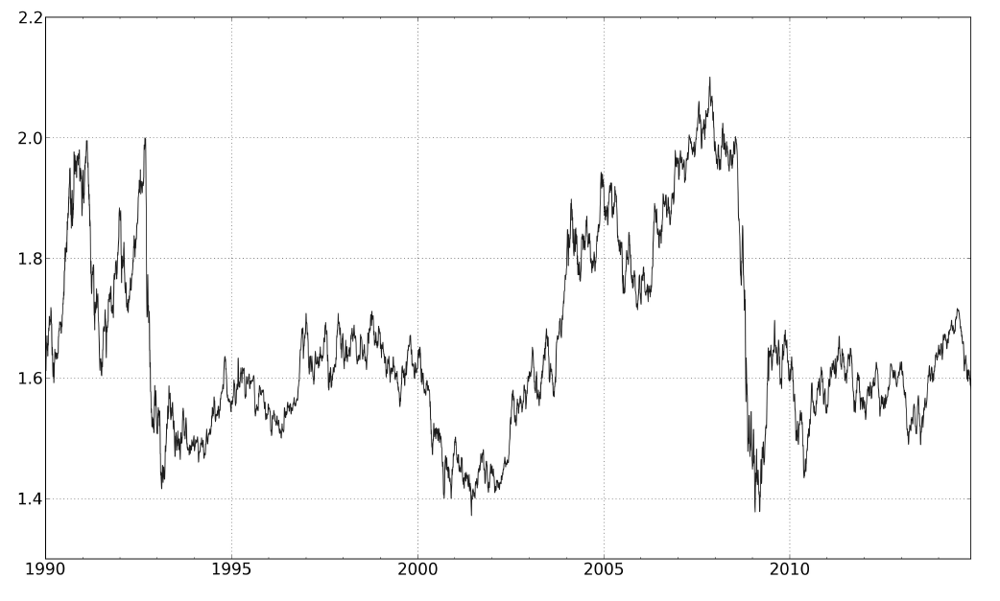
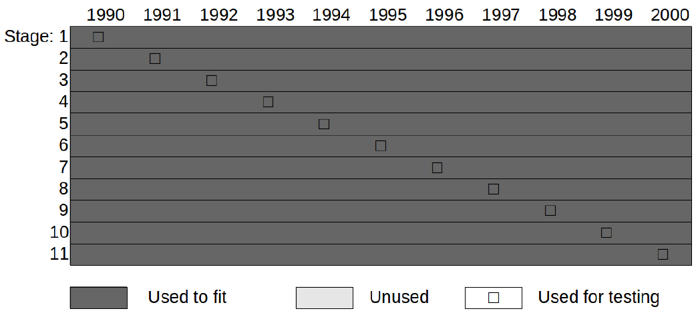
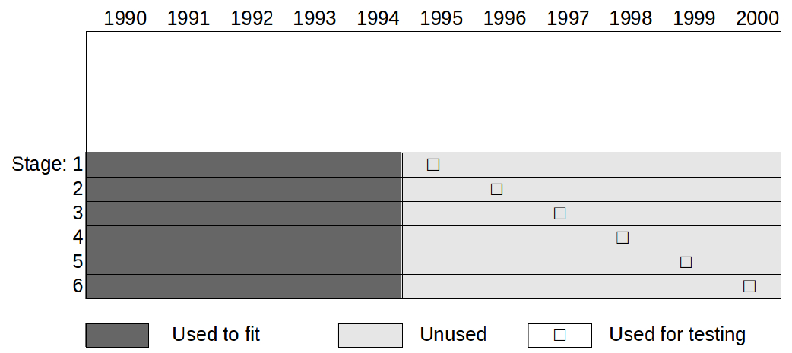
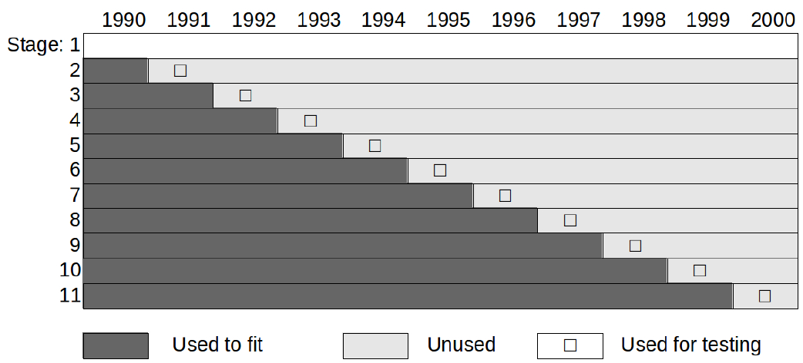
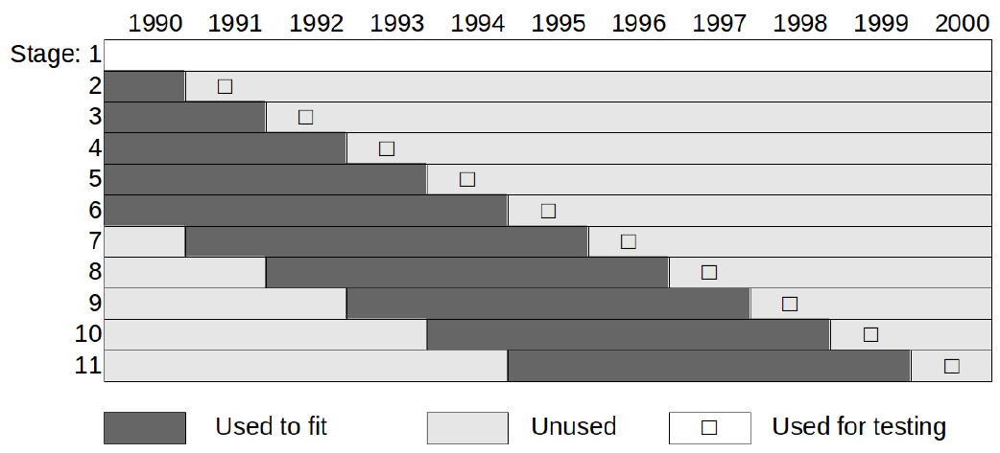
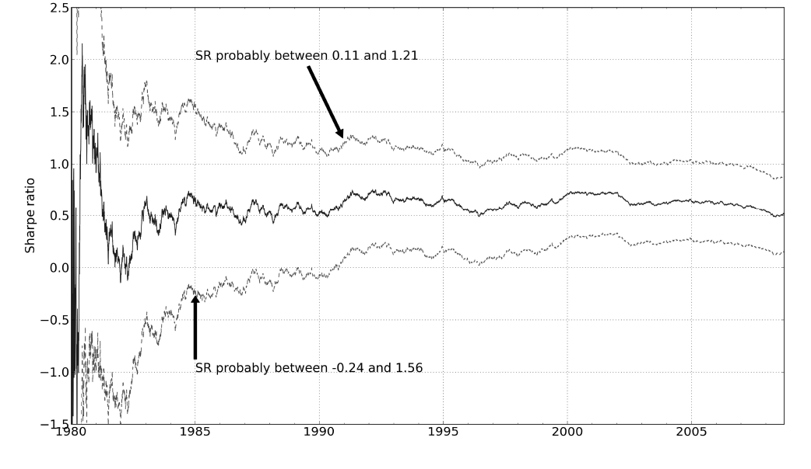
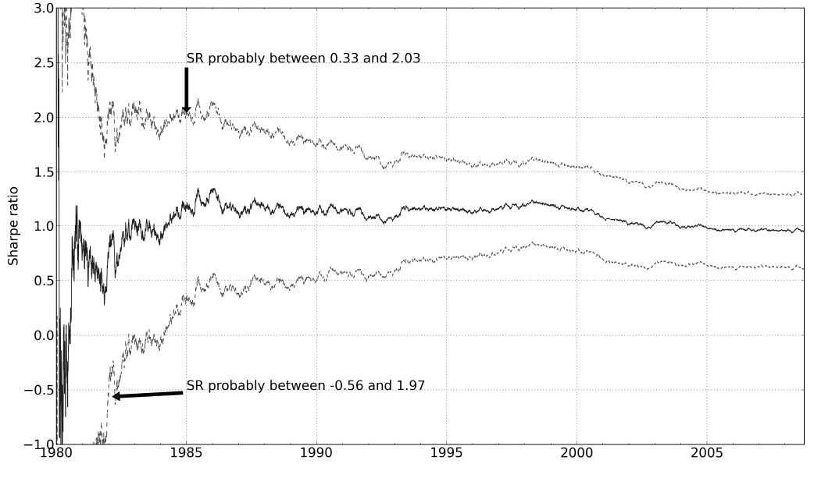
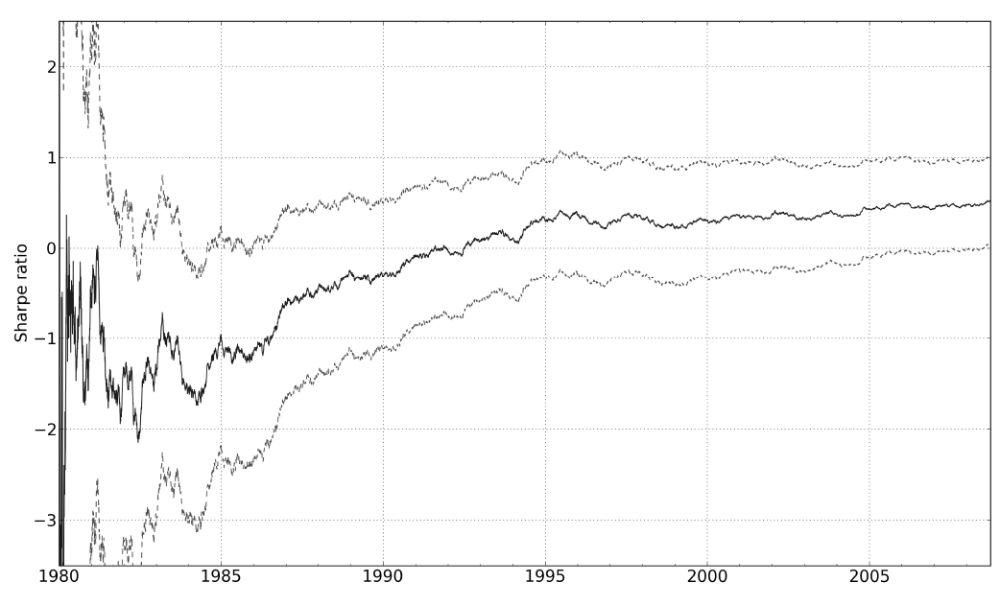

# 第三章 拟合｜中文忠实版

原书：Robert Carver, *Systematic Trading*, Chapter Three, “Fitting”。书源：`ebook/Systematic Trading.epub` 内 `OEBPS/Autopilot_ebook-11.xhtml`。`ch03#` 是本地提取块号，不是印刷页码。本译文依原书顺序覆盖正文、章节概览、表 3–6、图 6–13 的图注与图中文字，以及脚注 40–55。书中统计判断与历史回测均保留作者原意；译者提示单列，不改写原文。

## 第三章 拟合

**[ch03#0002–0004｜坚定的系统交易者]** 本章全部讨论怎样利用数据，制定坚定的系统交易者所用的交易规则。如果你打算利用我的框架，以半自动交易者的身份作出自主判断的预测，或以资产配置投资者的身份完全不使用规则，本章并非必读。

决定运行系统化交易系统，就意味着你必须选择一条或多条交易规则，并将其他规则判为不值得采用。这个过程常被称为**拟合**。鉴于人类容易过度自信的倾向，这个过程充满危险。你必须警惕**过度拟合**⁴⁰：选出一组过于贴合过去数据、因而未来不大可能赚钱的交易规则。

### 本章概览 [ch03#0005–0011]

| 主题 | 内容 |
|---|---|
| 过度拟合的危险 | 根据过去的数据有选择地挑选和拟合规则，存在什么危险。 |
| 有效的拟合 | 如果你坚持拟合交易规则，必须遵循哪些步骤。 |
| 我如何选择规则 | 我用来几乎完全避开拟合的过程。 |

### 过度拟合的危险

#### 找出 50 个模型的年轻人 [ch03#0013–0018]

离开对冲基金行业不久后，我开始同本地一家自营交易公司 Aqueduct Capital⁴¹ 商谈提供咨询和管理部分资金的事宜。办公室里是常见的混合阵容：见多识广的前 LIFFE 交易员和天真的年轻人，大家都在日内交易少数几种期货合约。不过，老板尤其为他的量化团队自豪。团队由几个二十多岁、带着运行现成回测软件包的电脑的年轻人组成。

“这是乔。他来这里才一个月，就已经找出了 50 条在回测中盈利的新交易规则！”老板惊叹道。

“是啊，这软件太神奇了。它每天能自动测试几百条规则。”乔补充说。

我努力保持面不改色，尽可能委婉地回答：“嗯，我相信其中有些会奏效。”

后来，合资商谈不可避免地破裂了；这倒是件幸事，因为几个月后那家公司便清算了。从成千上万种可能性中筛出表面上盈利的规则，是一种极其危险的做法；原因将在本章其余部分显现。

#### 从想法出发，检验规则及其变体 [ch03#0019–0028]

在理解乔为什么走错路之前，你需要先弄清拟合究竟包含什么。本章我只讨论第二章介绍过的“想法先行”方法。你已经知道我更喜欢想法先行；这里采用它，还有一个原因：比起另一种“数据先行”方法，用它来解释和理解如何避免过度拟合要容易得多。

拟合过程将从一份候选清单中挑选一条或多条交易规则，每条规则都基于一个出色的想法。我们看一个刻意设计的例子，但请注意，我**不建议**使用这条规则。基本假设是英镑兑美元汇率似乎会在区间内波动，如图 6 所示。你可能认为，英镑低于过去一年平均值 5% 时买入、高于该均值 5% 时卖出，是个好策略。这是一个均值回归规则的例子。

现在你要用历史数据检验最初的规则，观察它的表现和行为。到这一步，如果规则没有前景，你可以放弃它，转向下一个想法。如果足够喜欢它，你可以进入我称为“校准”的下一阶段；当然，完全沿用最初版本也有可能，而且往往是可取的。

*图 6：英镑兑美元汇率。* [ch03#0023–0024]

在校准阶段，你考察基本交易规则的若干变体。就这个简单例子而言，你可以把原来的正负 5% 区间同 3%、6% 或 10% 等其他区间相比较；也可以将当前价格与过去一年、一周或两年等期间的平均价格比较。通常你会采用夏普比率等表现指标，选出最赚钱的规则。校准也可以用来寻找以某种特定方式运行的规则，例如以特定速度交易；我会在书中后面展示这一点。之后，你可以决定保留哪一个或哪几个变体。

一旦选定交易规则及其变体的组合，你就需要决定如何在它们之间分配资金。此类组合配置决策是下一章的主题。眼下值得指出的是，一个差的变体可以直接淘汰，也可以在整个系统中只获得较小的配置。

如果你想用数据先行方法呢？那么你需要有足够的专业能力，使用自己偏好的工具来运用本章原则。⁴² 对自己没有深入理解的数据先行方法，你不应该使用。我强烈建议，不要仅仅因为某种方法随回测软件一同提供，就盲目采用。

继续之前，再提醒一点关于想法先行检验的风险。任何称职的交易系统设计者都了解历史，读过相关教科书，也知道别人交易什么。你可能最终只检验那些你已经知道有效的想法，这是一种隐性的过度拟合。因此，无论你随后在拟合过程中多么谨慎，回测得到的夏普比率很可能仍然偏高——要警惕过度自信！

#### 用时间机器作弊 [ch03#0029–0052]

先看拟合时的第一个常见错误：假装你能使用时间机器。

拟合时始终有两个不同的时期：首先是拟合模型所用时期，其次是检验模型所用时期。仍以拟合英镑兑美元交易规则为例，假设你想找到单个最佳变体，并且有十年的每日价格数据可供拟合。⁴³

最容易、或许也最常见的办法，是将整整十年作为拟合期，找到这十年中最赚钱的单个变体。随后回头检验这个单一变体在同样十年中的每一年的表现。无论检验的是哪一年，使用的都是根据完整十年数据拟合的同一个模型。

图 7 用 1990 至 2000 年运行的模型作示意。拟合的每个阶段占一行。第一行表示：用 1990 至 2000 年的全部数据拟合模型，再用这个模型检验 1990 年。第二阶段用同一个已拟合模型检验 1991 年的表现，依此类推。

这样的回测表现会惊人地好，好得不真实。既然实际上没有时间机器，你在 1990 年并没有完整十年的数据，也未必会挑中正确的变体。这叫**样本内回测**，因为你使用同一批数据来拟合和检验表现。应该避免样本内检验：它会给出极其乐观的回测结果，并偏向更复杂、能更好贴合数据但在真实交易中表现较差的规则。

还有更好的办法。常见的一种是像图 8 那样，把样本分成两个历史时期。你拿前半段，即 1990 至 1994 年的全部数据，在这一时期拟合出最佳变体。然后用这个单一变体，检验后半段的样本外表现；在这里，是 1995 至 2000 年的每一年。

问题在于，你浪费了一半数据，最后只有六年的表现可供考察。⁴⁴ 你也没有考虑数据后半段市场结构可能发生的变化。

*图 7：样本内回测——高效，但不诚实。* 样本内检验：你使用所有数据拟合，然后从起点开始检验表现。每个阶段（一行）检验不同年份的数据，但拟合始终使用所有年份的数据。图中深灰色表示“用于拟合”，浅灰色表示“未使用”，小方框表示“用于检验”。[ch03#0037–0039]

*图 8：一半数据用于样本外检验——诚实，却浪费。* 你在前半段拟合交易规则，然后在后半段检验表现。每个阶段（一行）检验不同年份，但始终用前半段数据拟合。前半段不做检验；后半段不用于拟合。图例同图 7。[ch03#0040–0042]

我偏好的办法是使用图 9 所示的**扩展窗口**。⁴⁵ 假设你认为拟合系统至少需要一年的数据。在下一个阶段，你使用第一年即 1990 年的数据拟合，然后在第二年即 1991 年检验得到的变体。图 9 的第三阶段，用 1990 和 1991 年的数据拟合出的变体检验 1992 年。要检验 1993 年，你就用 1990、1991 和 1992 年的数据拟合出最佳变体。

这一过程持续到 2000 年，届时你使用此前十年的数据选择最佳变体。由于拟合只使用过去数据，所以没有作弊。你也尽可能使用所有“合法”可用的历史，没有浪费。

这种方法唯一的问题是，如果世界发生变化，你仍会使用可能已经无关的旧数据。为了避免这一点，等积累足够历史后，你可以只用最近五年或十年的数据拟合，并丢弃更早年份。这就是**滚动窗口**。⁴⁶ 如图 10 所示，五年滚动窗口在 1996 年之前与扩展窗口相同。到这时，你会舍弃 1990 年，只用 1991 至 1995 年来拟合最佳变体。

窗口长度要足够短，才能捕捉市场结构变化；同时又要足够长，才能得到具有统计显著性的结果。你稍后会看到，拟合模型往往需要几十年的数据，这令滚动窗口的使用变得棘手。

*图 9：扩展窗口样本外检验，既高效又诚实。* 每一年都只用过去数据拟合。每一行展示某一年所进行的拟合和检验。图例同图 7。[ch03#0047–0049]

*图 10：滚动窗口样本外检验能够适应条件变化，但必须确保有足够数据达到统计显著性。* 每一年都使用过去数据拟合，最多使用五年的数据。每一行展示某一年所进行的拟合和检验。图例同图 7。[ch03#0050–0052]

#### 拟合何以出错 [ch03#0053–0062]

现在来看一个不良拟合做法的具体例子。我打算从 90 种可能变体中，选择第一章介绍的“尽早止损”交易规则在 CME 黄金期货合约上的最佳变体。⁴⁷ 这看似过多，但仍少于前面故事中乔所测试的变体数量。请注意：如果一条交易规则有五个参数，每个参数允许取十个离散值，那么我会测试 **10,000** 个变体！

一旦有至少一年的数据，我就根据过去 12 个月的夏普比率（SR）找出表现最高的变体。然后检验它在下一年的表现，此时仍使用此前 12 个月的数据。此过程每年重复。你应该认出，这是一项采用一年滚动窗口的回测。

你认为下面哪种选择会给我最好的表现？

1. **选择最佳变体：**每一年，我使用前一年表现最好的变体。
2. **随机选择变体：**不采用拟合结果，每年随机选择一个变体。由于每次选择的随机性会影响结果，我多次运行这个实验，再取平均表现。
3. **保留所有变体：**同样不采用拟合结果，保留全部 90 个变体，等权平均它们的预测。

如果你特别喜欢拟合，结果会令人失望。每年选择上一年的最佳规则，只得到相当差的 **0.07** 夏普比率。如果选第二种办法，每年 1 月 1 日随机挑选一条规则，平均得到 **0.2** 的夏普比率。最好的选择是完全不筛选交易规则变体，而把所有变体等权混合使用，得到 **0.33** 的夏普比率。对单一标的上运行的同一类交易规则来说，这已经相当不错。这些结果可能只是偶然，但我在许多不同标的与交易规则上得到类似结果。

为什么拟合表现如此差？

首先，一次只选一个变体运行，带有过度自信的意味。你马上会看到，我们很少有足够证据断定一条规则肯定比另一条好。其次，一年的数据完全不足以判断哪条交易规则最好。我只拟合单一标的——黄金期货——的历史，让问题更严重。最后，与乔一样，我测试了太多变体。

#### 规则筛选的风险 [ch03#0063–0130]

**多重检验问题——即使是随机规则，也有些看起来不错。**为什么检验大量交易规则和变体这么危险？除了需要花费精力，你还很可能仅仅因为偶然，就选中一条差规则。

这里有个实验来说明原因。假设我想施展炼金术，在根本不存在盈利规则的地方找出盈利规则。我有一个候选池，其中每条可能规则的真实预期平均收益都为零——虽然在现实情况下，我事先并不知道这一点！这些规则完全是任意的，其收益由随机数据生成。⁴⁸

在每次测试中，与上面的黄金期货例子一样，我取候选池中每条规则一年的收益数据，选出这一年夏普比率（SR）高于某一最低水平的所有规则。如果没有规则的 SR 超过门槛，我就一条也不选。所有通过检验的规则都会保留，即使有 50 条也是如此。

由于基础数据是随机的，我需要多次生成新数据并重复检验，才能得到有意义的结果。然后，在给定最低门槛和候选池规模时，我计算被选中规则的平均数量。如表 3 所示，即使我严格设定极高的最低 SR **2.0**，只要测试的规则够多，仍会选中几条差规则。

**表 3：只要测试足够多的规则，总有一些差规则会混进来。** [ch03#0069–0095]

| 候选池中测试的规则数 | 最低 SR 0.5 | 最低 SR 1.0 | 最低 SR 2.0 |
|---:|---:|---:|---:|
| 1 | <1 | <1 | <1 |
| 5 | 1.4 | <1 | <1 |
| 10 | 3 | 1.5 | <1 |
| 50 | 16 | 8 | 1.2 |
| 100 | 30 | 16 | 2.3 |

此表按不同候选池大小（行）和夏普比率必须超过的最低门槛（列），显示从任意、无盈利能力的规则池中平均会选出多少条规则。

在实践中，我该用多高的 SR 门槛？由于这些想象中的规则实际上没有一条赚钱，理想情况是一条也不接受。但真实拟合不能把门槛设得过高，否则连好规则也会被丢弃；毕竟，在单一标的上检验的真实交易规则，其现实可期的 SR 大概只有 **0.30**。假设我能够接受有 **5%** 的机会挑出至少一条真正不赚钱的规则。此外，现实中我通常有超过一年的数据，所以再看看增加历史数据会怎样影响结果。

表 4 给出了全部结果。不出所料，收益序列的长度在这里非常重要。历史越长，SR 真实为零的规则仅凭好运走出一段亮眼表现的机会越小，因此我可以降低门槛。然而，即便有 **30 年**数据，我也不敢测试太多规则；即使只测试少数几条，门槛对真实夏普比率仅 **0.3** 的许多完全不错的变体而言仍然太高。

**表 4：历史越长，可以把夏普比率门槛设得越低，同时避免从更大的候选池中选中差规则。** [ch03#0098–0130]

| 测试规则数 \ 历史年数 | 1 | 5 | 10 | 30 |
|---:|---:|---:|---:|---:|
| 1 | 1.5 | 0.7 | 0.5 | 0.4 |
| 5 | 2.3 | 1.1 | 0.8 | 0.5 |
| 10 | 2.8 | 1.2 | 0.8 | 0.6 |
| 50 | 3.4 | 1.5 | 1.0 | 0.6 |
| 100 | 3.4 | 1.5 | 1.1 | 0.7 |

此表给出：测试特定规模的规则候选池（行）、使用特定年数的历史数据（列）时，为确保选中一条或多条真正差规则的机会仅有 **5%**，所需设定的夏普比率门槛。

#### 要判断一条规则好不好，需要多少历史？[ch03#0131–0163]

你已经看到，用不够多的历史数据来选择或校准规则，是一个常见错误。究竟需要多少数据？要判断一条规则具有正的夏普比率、值得保留，又需要多长时间？

为回答这个问题，我又生成了一些随机的交易规则每日收益，这次假设其基础的真实夏普比率为正——同样，在现实中我不会预先知道它。随着越来越多的交易历史数据被生成，我可以逐年估计 SR，以及截至该年的平均值。同时，我还考察这些年度夏普比率的分布。⁴⁹ 这让我对测得平均 SR 的统计显著性有所把握：我只是运气好，还是真的有个好系统？

检验统计显著性的一种经典方法是 **T 检验**。在这个例子中，它根据估计值的均值和标准差，判断估计的夏普比率是否很可能为正。用标准差 sigma 为单位衡量，均值离零越远，未知的 SR 实际为正的可能性就越大。

此检验常用两个 sigma 作为门槛。如果估计的平均 SR 高于零两个标准差，那么假如真实 SR 实际为负，出现这种结果的机会只有 **2.5%**。

图 11 显示一条任意交易规则测得的平均 SR 如何随时间演变，以及其周围的上下“置信界限”。每条置信界限距离平均值两个 sigma。因此，当下界升至零以上时，我就知道：这套交易系统其实是一条伪装成盈利规则的亏损规则，其机会只有 **2.5%**。

*图 11：真实夏普比率（SR）为 0.5 时，需要十多年才能通过 T 检验，得出 SR 很可能为正的结论。* 纵轴为夏普比率；图中两处箭头文字分别为“SR 很可能在 0.11 与 1.21 之间”和“SR 很可能在 −0.24 与 1.56 之间”。[ch03#0137–0138]

从图中可以看到，平均 SR 很快趋向真实值 **0.5**。但下置信界限要十多年后才升至零以上，直到那时才最终通过 T 检验。只有这时，我们才能比较确信这不是一个亏损系统。

如果对真实 SR **1.0** 的规则重复试验，就得到图 12。通过检验只需要几年。平均而言，SR 越高的策略，总能更快证明其盈利能力。

*图 12：真实夏普比率为 1.0 时，几年内就能通过 T 检验。* 纵轴为夏普比率；图中两处箭头文字分别为“SR 很可能在 0.33 与 2.03 之间”和“SR 很可能在 −0.56 与 1.97 之间”。[ch03#0141–0142]

再来找出特定真实夏普比率下，通过检验平均要多久。完成必要的实验后，我得到表 5。除了非常好的规则，你至少需要十年、通常需要更长的数据，才能确信策略会赚钱。⁵⁰ 单一标的一条普通交易规则，其现实可期的 SR 约为 **0.3**；所以你需要将近 **40 年**历史！

**表 5：多数策略要用几十年的数据，才能看出它们是否可能盈利。** [ch03#0144–0163]

| 真实夏普比率 | 0.2 | 0.3 | 0.4 | 0.5 | 0.7 | 1.0 | 1.5 | 2.0 |
|---|---:|---:|---:|---:|---:|---:|---:|---:|
| 平均需要多少年通过盈利能力 T 检验 | 45 | 37 | 33 | 20 | 10 | 6 | 3 | 1.4 |

此表展示给定交易规则的真实夏普比率时，平均需要多少年才能通过盈利能力 T 检验。

#### 要判断一条规则比另一条更好，需要多少历史？[ch03#0164–0202]

现在，如果你有几条备选规则，想找出最好的一条呢？假设我又有两条随机规则，一条真实夏普比率（SR）为 **0.30**，另一条为 **0.80**。先假设它们是很不一样的规则，两者收益没有相关性。这次进行 T 检验，我需要估计两条规则夏普比率之差，并测量这个差值的平均值及标准差。

*图 13：要发现一条 SR 为 0.8 的策略很可能优于一条与其不相关、SR 为 0.3 的策略，需要三十年。* 纵轴为夏普比率。[ch03#0166–0167]

图 13 展示 SR 差值的平均值，以及该差值的相关置信界限。一旦下置信界限升至零以上，我们就能比较确信其中一条规则较好；因为同样，纯属偶然出现这种情况的概率只有 **2.5%**。从图 13 可以看到，达到这种确信程度需要约 **30 年**！

表 6 展示一条 SR 为 **0.30** 的规则，与另一条真实 SR 更高的规则比较时，通过 T 检验平均需要多久。结果随 SR 差距以及两条规则的相关性而变化。对于给定的 SR 差距，关系越密切的规则越容易、更快区分。⁵¹ 在实践中，区分规则需要相当长的历史数据；只有少数变体既高度相关、表现又相差悬殊的情况例外。

**表 6：只凭几年的数据能区分交易规则吗？只有当两者高度相关，而且一方表现大幅优于另一方时才行。** [ch03#0170–0202]

| 夏普比率优势 \ 规则收益相关性 | −1.0 | 0.0 | 0.5 | 0.8 | 0.95 |
|---:|---:|---:|---:|---:|---:|
| 0.1 | 47 | 47 | 46 | 44 | 37 |
| 0.25 | 46 | 45 | 40 | 32 | 10 |
| 0.5 | 41 | 37 | 25 | 10 | 3 |
| 1.0 | 23 | 11 | 8 | 2.5 | 0.5 |

此表展示：在较好规则的 SR 优势（行）和两条规则交易收益的相关性（列）给定时，我们需要多少年才能比较确信其中一条规则更好。

#### 是否应该为所有标的拟合同一条交易规则？[ch03#0203–0210]

2010 年，我工作的那家大型系统化对冲基金按资产类别进行了重组。我的团队管理固定收益组合，另一个团队管理股票，依此类推。起初，我们运行的交易策略相当相似。但随着我们做了更多针对特定市场的研究，我们逐渐都相信，必须以不同方式定制各自的系统。

很多时候，我们更进一步，开始分别拟合组合的不同部分。例如，新兴市场和发达市场的债券期货，我们可能拟合不同的交易规则变体。⁵² 分别拟合很常见，许多系统交易者将其推至极端，为每个标的分别拟合。几乎所有回测软件包——例如乔使用的那一种——默认都是一次在单个标的上拟合交易规则。因此，英镑兑美元会有某个规则变体，欧元兑美元又有另一个，依此类推。

这是我们此前见过的认知偏差——**叙事谬误**——的典型例子。对人类思维来说，针对不同标的讲不同故事，进而使用不同交易规则，似乎说得通。

但这样做对吗？这取决于各个变体在不同标的上的行为差异是否具有统计显著性。如果没有，那么为每个标的量身定制规则很可能导致过度拟合。实践中，不同标的之间通常不存在统计显著的差异；如果它们彼此关系紧密，例如一组股票指数期货，就尤其如此。⁵³

事实上，汇集数据、一起拟合多个标的，是获得更多历史数据的极好办法；这使你更有希望区分盈利和亏损的交易规则。

举个例子，在我自己的组合里有两条交易规则：对一个典型的单一标的，它们的平均夏普比率分别为 **0.05** 和 **0.30**。尽管两者完全不相关，表 6 显示我仍需要 **45 年**才能区分它们；即使最早的金融期货也只从 **1972 年**才开始交易，所以这几乎不可能。然而，同样的规则运行在一个标的组合上时，SR 分别为 **0.13** 和 **1.13**。⁵⁴ 表 6 显示，只需要 **11 年**数据就能区分这两个夏普比率。

为了便于汇集数据，你应设计具有通用性、能适用于任何标的的交易规则。我将在第七章“预测”中给出通用规则的例子。

### 有效拟合的若干规则 [ch03#0211–0229]

如果你还没有被劝得放弃拟合，坚持使用数据来筛选和校准交易规则，那么遵循以下建议，应能帮你避开严重麻烦。那些现在理应对拟合感到恐惧的人，可以直接跳到下一节；在那里，我会展示自己如何几乎完全避免拟合。

#### 保持简单

我不喜欢复杂的拟合方法，也倾向于不用它们。但如果你自认精通某种高深的统计技艺，自然会想施展它。只是要注意：方法越复杂，你就越难察觉自己何时发生了过度拟合。

#### 减少备选项

如表 4 所示，除非你有很多年的数据，否则缩小所考虑的交易规则和变体的候选池至关重要。⁵⁵

#### 禁用时间机器

你始终应该使用滚动窗口或扩展窗口来进行样本外拟合。若使用滚动窗口，不要让它太短；应记住，要把规则与随机噪声、以及把不同规则彼此区分开，需要多少年的数据（表 4、5、6）。

#### 不要随意丢弃规则

根据过去表现，选出一条规则或一个变体而丢弃其他备选项之前，仔细看看表 6。现实中，很少有两条高度相关的规则，表现却截然不同。更可能的情形是：两条很不一样的规则，夏普比率（SR）也许相差 **0.5**，但几乎不相关；或者高度相关的规则变体，SR 也非常相近。两种情形都需要 **30 年**的数据才能区分。

拥有 **30 年**或更久的价格历史并不常见，因此很难仅凭表现就有理由选择一条规则、放弃另一条。

#### 汇集多个标的的数据

你需要尽可能多的数据，才能做出好的拟合决策。最简单的办法是汇集多个标的的数据。

只有在不同规则跨标的的表现存在统计显著差异时，你才应该分别为各标的拟合。实践中，这样做很少有必要。

#### 比较时要同类可比

本章一直假设你会用夏普比率（SR）比较规则。但是，如果仅凭 SR 比较正偏态规则和负偏态的备选规则，会产生很大误导，因为负偏态规则往往会得到好看到失真的 SR。

#### 当未来不会像过去

小心不要只关注绝对表现，而忽略相对于基准的收益。这非常危险，因为股票、债券等许多资产类别在过去大约 **40 年**里表现极好。要在回测中获得额外收益，最容易的方法是使用与基础资产类别相关性更高的交易规则。

这在未来不大可能奏效，因为这些高收益的主要原因是通胀大幅下降；这种下降不会重演。

### 我如何选择规则 [ch03#0230–0251]

要穿过拟合这个雷区，有许多办法。我自己偏好几乎完全避开它：选择交易规则及其变体时，不看实际表现。我的流程如下：

1. 针对我对市场行为的每个想法，提出少量交易规则来利用它。
2. 为每条规则选择少数几个变体。在这个阶段，我不看表现，而看交易速度、与其他变体的相关性等行为特征。
3. 在考虑夏普比率的不确定性的前提下，为每个变体分配预测权重。差规则得到的权重较低，但很少被彻底排除。

这一流程意味着，我不使用表现数据来拟合交易规则和变体。相反，收益数据留给确定**预测权重**。这些权重决定各变体以什么比例用于预测各标的的收益。下一章将解释，这种组合配置如何在降低表面上表现差的变体权重的同时，避免过度拟合的风险。

最终组合中权重小到可以忽略的变体，终究可以从实际运行的交易系统中剔除，以降低执行复杂度。这样得到的最终结果，与更早就排除该规则相同；但意味着将这条后来被排除的规则纳入计算的回测表现，会更贴近现实。

#### 从少量想法开始

我更愿意只提出相对少量的交易规则想法。在我自己的组合中，有来自五个不同主题的八条规则。但如果从零开始，我会先用两条规则：第七章“预测”中将展示的趋势跟踪和持有收益规则。

你应该只用少量规则，理由如下：

- **降低过度拟合风险：**想法越少，过度拟合的机会越小；接受一条规则所需达到的临界夏普比率也越低（表 4）。
- **同一件事有多种做法：**一种市场行为可以用多种方式捕捉。例如，我们可以用动量振荡指标、背离以及突破系统等捕捉趋势。为同一种行为准备几十条相似规则，价值不大。
- **保持简单：**在我的流程下，所有规则都会通过筛选；因此，如果一开始规则过多，交易系统就会变得复杂。复杂系统更难信任，也更难理解。

业余和专业的交易系统设计者，都花了过多时间精力寻找更多、更好的交易规则。但新增规则的边际价值很低，尤其当它们属于同一种交易风格时。在交易某个特定标的时，不同规则之间的平均相关性，高于用同一规则交易不同标的之间的相关性。因此，跨标的分散比跨规则分散更可取。

新增标的是上传和检查数据这样乏味的工作，没有提出更多交易规则那么有趣；但据我的经验，它有益得多。

#### 保留适当数量的变体

虽然我倾向于使用较少的交易规则，但对任何可以校准的规则，我通常不会只保留一个变体。不过，也没必要使用 **90** 种或更多可能的组合！例如，如果你想捕捉价格动量，大概需要一个捕捉相对较快趋势的变体、一个捕捉极慢走势的变体，也许再加上两三个介于两者之间的变体。

如果两个变体的相关性超过 **95%**，你可以放心丢掉其中一个，因为它几乎没有边际收益。你还可以去掉交易成本过高的变体，或交易速度极慢、因此不太可能带来显著收益的变体。但不要仅仅因为表现而丢弃变体。

#### 暂时不要看收益

我倾向于把实际历史表现数据留给确定交易规则及其变体应获得什么预测权重。若方法得当，你既可以得到贴近现实的回测表现，又能降低差规则的权重。但如果你已经使用真实数据预先挑出了好规则，回测表现就会过于乐观，过度拟合也已经发生。

因此，在这个阶段，你应该只看相关性和可能的交易成本等行为特征，而不是表现。你必须避免污染回测。

这里没有详述这个过程，但书的后面会有实例。不论你拟合交易规则，还是采用我这种尽量不干预的方法，接下来的问题都是：交易系统中，规则 X 与规则 Y 各用多少，标的 A 与标的 B 各用多少？这个组合配置问题将在下一章讨论。

### 脚注 [ch03#0252–0267]

**40.** 另一个常见术语是“曲线拟合”（curve fitting）。

**41.** 为了保护那些无知的人，所有姓名都已经改过。

**42.** 数据先行过程的主要危险是允许过多的自由度。（我不会定义这个术语，因为任何采用数据先行方法的人本就应该理解它。如果你不懂，那就有麻烦了！）想法先行的危险则是：你检验太多想法或想法的变体，直到找到一条（或 50 条！）有效的规则。两种方法都可能得到过度拟合的交易规则：回测看起来很好，真正交易后却表现不佳。

**43.** 本书始终假设你使用每日数据。这通常意味着你能得到更长的价格历史，也适合我将讨论的交易规则类型。只有在测试速度极快的交易规则时，例如预计持仓不到一周的规则，才需要更高频率的数据。

**44.** 你也可以像前面那样用前半段拟合、后半段检验，随后再用后半段拟合、前半段检验。这保留了更多数据，却并不完全诚实，因为仍然需要时间机器，尽管只用了一次。还有一种变体：用整套数据拟合，但剔除正在检验的那一年。这在我看来也相当不诚实。

**45.** 这种方法有时叫作“锚定拟合”（anchored fitting）。

**46.** 另一种广泛使用的说法是“向前滚动拟合”（walk forward fitting）。

**47.** 对有兴趣的读者：本例基于附录 B 定义的“A 和 B”系统。B 的值（止损值）取 **1 到 10** 的整数，以捕捉不同的趋势长度。由于我只想考察趋势跟踪规则（尽早止损的规则），所以仅遍历 A 的值（利润目标）大于或等于 B 的情形：**A = 1 × B、1.5 × B、2 × B、……、5 × B**。这样总共得到 **90** 个可能变体。

**48.** 本章许多例子使用任意交易规则变体的假想每日收益。这些虚构收益是随机生成的，但具有我指定的特征：预期均值、标准差（由此得到夏普比率），以及在相关情形下与其他变体的相关性。然后我多次运行检验，报告平均结果，因此答案不会受每组随机数具体结果的左右。

**49.** 要了解这一问题更技术性的讨论，请参阅 Andrew Lo 发表于 *Financial Analysts Journal* 58 卷第 4 期（2002 年 7／8 月）的论文“The Statistics of Sharpe ratios”。

**50.** 这些结果也取决于收益的偏态。例如，在真实 SR 同为 **1.0** 时，与正偏态趋势跟踪策略相比，我需要为典型的负偏态波动率卖出策略多用大约 **三年**数据，才能通过 T 检验。

**51.** 更微妙的是，所涉及夏普比率的整体水平也会影响结果，如 Andrew Lo 的论文所讨论的。规则收益的偏态也很重要，即使比较的是偏态相近的规则。

**52.** 实际上我们并没有这样做。或者，我们做过吗？遗憾的是，我不能举出真实例子，否则会违反保密协议。

**53.** 有一些例外，特别是有关标的的交易成本不同时；我会在第十二章“速度与规模”讨论。

**54. 技术说明：**这些收益，是用同一条交易规则交易一个标的等权组合时得到的收益。夏普比率（SR）的提高来自标的之间的分散效果。另一种方法是把各标的连续的收益序列首尾拼接。这会得到很长的收益历史，但拼接序列的 SR 与各单一标的 SR 的平均值几乎相同（并不完全相等，因为各标的价格序列长度不同）。

**55.** 如果使用更复杂的拟合技术，那么你需要适当地限制自由度。

### 译者核对提示

- 原书在 `ch03#0054` 写“五个参数、每个十种取值”共 **10,000** 种变体；若五个参数独立组合，算术上应为 **10⁵ = 100,000**。正文保留原书数字。
- 原书在 `ch03#0135–0139、#0168` 把检验尾部概率表述成规则真实亏损的概率；这在频率学派统计解释下不能直接倒置。正文保留其说法，相关辨析见[伴读版](001_伴读.md)。
- 图表中的年数和回测结果来自作者设定的历史检验或随机模拟，不是对未来业绩的保证。
