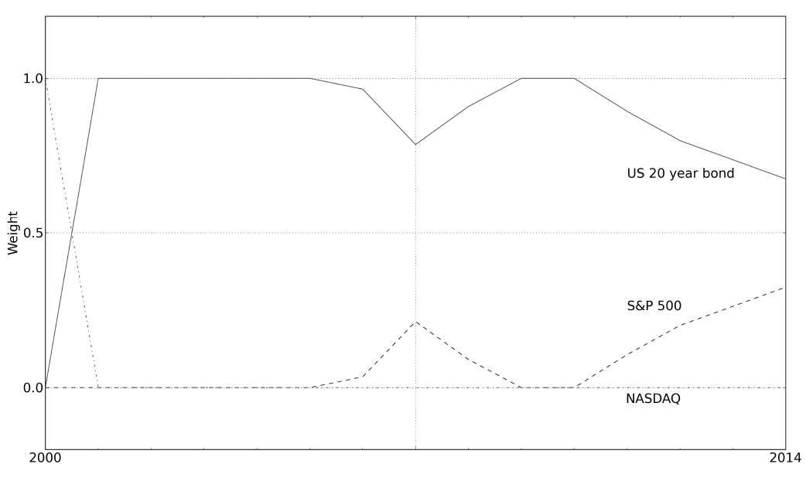
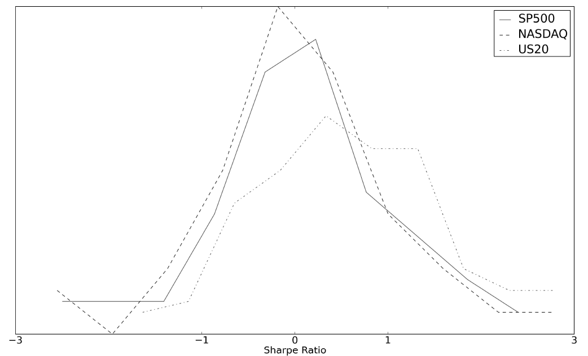
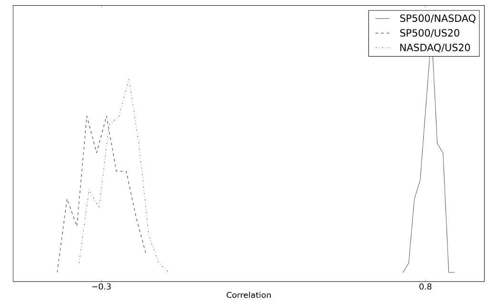
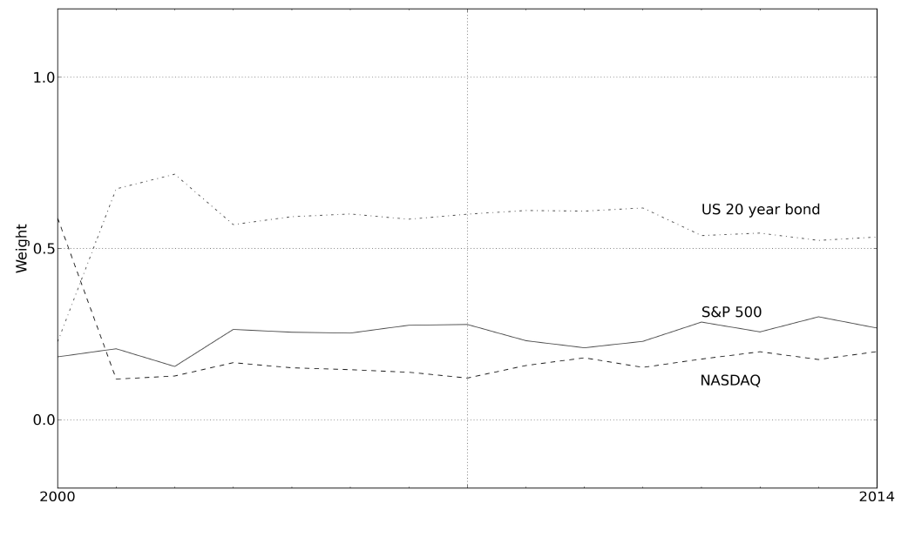

# Chapter Four. Portfolio Allocation｜英文原文版

来源：`OEBPS/Autopilot_ebook-12.xhtml`。按 EPUB 的正文、表格、插图与脚注顺序转排；字体、行内样式及印刷页码可能不同于原书。

## Chapter Four. Portfolio Allocation

Staunch systems trader

Asset allocating investor

This chapter is about deciding how you share out your trading capital between different instruments or trading rules. Deciding the allocation between instruments is important for asset allocating investors, whilst staunch systems traders have to make both kinds of decision.

It isn’t relevant if you’re a semi-automatic trader, since you won’t use systematic trading rules and will trade different instruments opportunistically. You can skip this chapter.

Deciding how to allocate within a portfolio of assets is a problem every investor faces. How much in equities, bonds or cash? Should you split your equity allocation evenly between countries or just stick it all in the USA?

Allocation decisions are equally important for systematic investors and traders. If you’re a staunch systems trader running more than one trading rule, including any variations, then you need to decide what forecast weights to use when you combine rules together to forecast the price of each instrument.

Both staunch systems traders and asset allocating investors also need to decide instrument weights; how much of your portfolio to put into the trading systems you have for each instrument. Because the tools in this chapter are for making both kinds of decision, I’ll refer to portfolios of generic assets, which could be either instruments or trading rules. Later in the book I’ll show you specific examples of each of the two types of allocation problem.

Just like trading rules, portfolio weights can be over-fitted. Optimising weights can give you a portfolio which does really well in back-tests, but which fails badly when traded in reality. Such portfolios are usually highly extreme; allocating to just a small subset of the assets available. In this chapter I’ll show you how to avoid the pitfalls of these highly undiversified portfolios.

### Chapter overview

| Optimising gone bad | How classic portfolio optimisation can often result in over-fitted extreme portfolio weights. |
| --- | --- |
| Saving optimisation from itself | Some insights from an alternative technique, bootstrapping, which can help us understand what is going wrong. |
| Making weights by hand | How to use a simple method called handcrafting to get portfolio weights. |
| Incorporating Sharpe ratios | Using additional information about expected performance to improve handcrafted weights. |

### Optimising gone bad

#### Introducing optimisation

Portfolio optimisation will find the set of asset weights which give the best expected risk adjusted returns, usually measured by Sharpe ratio. The inputs to this are the expected average returns, standard deviation of returns, and their correlation. The standard method for doing this was first introduced by Harry Markowitz in the 1950s. It was a neat and elegant solution to a complex problem.

Unfortunately it’s all too easy to be distracted by elegance, and forget the important assumptions underlying the maths. As you will see below, blind use of this method frequently results in ugly portfolios with extreme weights. Just because an equation is wonderful to behold doesn’t mean you should slavishly use its results without thought of the consequences. As Einstein said, “If you are out to describe the truth, leave elegance to the tailor.”

In the early part of my career I was fatally distracted by the lovely equations and ended up with some terrible portfolios, until I learned the error of my ways. Subsequently I often had to review the allocation decisions made by researchers who were less experienced, although undoubtedly cleverer and more academically qualified than myself.

When I asked one of these rocket scientists what they thought about the extreme portfolio weights they’d found I often got a shrug. “These are what the optimiser came up with.” The unspoken assumption was that the equation must be right. Hopefully after reading this chapter you will be less accepting of attractive mathematics.

#### Some good news

Portfolio optimisation is hard. But there are a few difficulties that don’t arise when you’re using it to design trading strategies. This is because you aren’t deciding directly how large your positions in various instruments should be. Instead you’re deciding what weight should be given to different parts of your trading system. These can either be the forecast weights telling you in what proportion to use trading rule variations for a particular instrument, or the instrument weights determining how much of your capital to allocate for trading each instrument.

This gives you two advantages. Firstly, you can’t have negative weights in your portfolio; you can’t short trading rules, so the lowest possible weight is zero. If a trading rule is expected to lose money you shouldn’t include it at all.56 Secondly, using my framework will mean that profits from your trading rules have identical expected standard deviation of returns. This is because of the volatility standardisation I spoke about in chapter two, ‘Systematic Trading Rules’. By using this technique you simplify the problem and only need to use expected Sharpe ratios and correlations to work out your weights.

Although you won’t be optimising the underlying positions in individual assets like equities or bonds in your trading systems, I will be using portfolios of simple assets in this chapter to make the examples more straightforward. However to make it easier to interpret the results I will adjust asset returns before any calculations so that they have the same standard deviation as you’ll have when you work with trading system returns.

#### The unstable world of portfolio weights

Let’s take a simple example of allocating capital between three assets: the NASDAQ and S&P 500 US stock indices, and the US 20 year benchmark bond. I am using data from January 1999 to mid-2014 and all returns are volatility standardised to have the same expected standard deviation. Each year from January 2000 onwards I’m going to use returns from all previous years to calculate some optimal weights.57 Because each optimisation uses all available data to create a single set of weights I call this a single period optimisation.

The calculation is done using the classic Markowitz optimisation; I find the maximum risk adjusted return (e.g. Sharpe ratio) using the estimated means and correlations, and standard deviations (which are all identical because I’ve used volatility standardisation). I also don’t allow weights to be negative and they have to sum up to exactly 100%.

Figure 14 shows the weights calculated for each year.58 In the last throes of the late 1990s tech boom I naturally put all my money into the fast rising NASDAQ. This then implodes, and is permanently removed from the portfolio. For much of the remaining period I put my entire capital in bonds. At the end I only have 25% in equities, all of which is in the S&P 500. This is a very extreme portfolio, with very unstable weights.

Figure 14: Single period optimisation usually means extreme weights

The figure shows the portfolio weights produced by single period optimisation done each year on all previous data.

#### Not all statistical estimates are created equal

Faced with such nightmares a natural reaction is to discard any hope of optimising. Perhaps we should just allocate equally to all the assets we have. Many academic researchers have also come to this conclusion and there is plenty of evidence that equal weights are hard to beat.59

When do equal weights make sense?60

- Same volatility: If all assets had the same expected standard deviation of returns. This is always the case for the volatility standardised assets we’re using.

- Same Sharpe ratio: If all assets had the same expected Sharpe ratio (SR).

- Same correlation: If all assets had the same expected co-movement of returns.

If these assumptions aren’t correct, then what should your portfolio look like?61

What kind of portfolio should we have with...

- Same Sharpe ratio and correlation: Equal weights.

- Significantly different Sharpe ratio (SR): Larger weights for assets that are expected to have higher SR, smaller for low SR.

- Significantly different correlation: Larger weights for highly diversifying assets which have lower correlations to other assets, and smaller for less diversifying assets.

Let’s see if these assumptions are true in the simple example. Figure 15 shows the distribution of Sharpe ratios for each of the three assets. Notice that the lines mostly overlap; this means we can’t distinguish between the historic performance of each asset. Although bonds did have a higher average SR the advantage isn’t statistically significant. If you read the previous chapter, and remember table 6, it is no surprise that the 15 years of data isn’t enough to say with confidence which asset had the best SR.

Figure 15: Harder to distinguish Sharpe ratios than you think

The figure shows the distribution of Sharpe ratios for the three assets in my example portfolio.

On the contrary, we can often distinguish different correlations. Figure 16 shows the distribution of correlations in my simple example. You should be able to easily pick apart the correlated equities and the diversifying bond asset.

So in the simple example I should be able to do better than equal weights, as there is significant data about correlations. A good portfolio would have more of the diversifying bond asset than the equities, but wouldn’t take much account of the insignificantly different Sharpe ratios. However the classic optimiser doesn’t work like this, because it can’t see all the information in figures 15 and 16. It uses only the average SR and correlation, not knowing or caring how much uncertainty there is in each estimate.

Figure 16: Equities clearly correlated with each other, and negatively with bonds

The figure shows the distribution of correlations for pairs of the three assets in my example portfolio.

### Saving optimisation from itself

How can we fix this problem? I have two techniques that I use. The first, which is quite hard work, is called bootstrapping. This involves repeating my optimisation many times over different parts of the data, taking the resulting weights, and averaging them out. So the weights are the average of many optimisations, rather than one optimisation on the average of all data.

The justification for bootstrapping is simple. I believe that the past is a good guide to the future, but I don’t know which part of the past will be repeated. To hedge my bets I assume there is an equal chance of seeing any particular historical period repeated. So it’s logical to use an average of all the portfolios which did best in previous periods.

Bootstrapping has some nice advantages over classic optimisation. Most of the individual optimisations have extreme weights. However with enough of them it’s unlikely the average will be extreme. If I have noisy data, and the past contains periods which were very different, then the optimal portfolios will be close to equal weights. But with significant differences in Sharpe ratios or correlations similar portfolios will crop up repeatedly, and the average will reflect that. The averaged weights naturally reflect the amount of uncertainty that the data has.

Let’s see the results of running an expanding window bootstrap optimisation on our simple three asset portfolio. Figure 17 shows the results over time, whilst table 7 compares the final weights with a classic single period optimisation and equal weights.62 After the first year the weights are relatively stable, and for all periods less extreme than for the single period method. However the diversifying allocation to bonds is greater than with equal weights, so this portfolio should do better.

Figure 17: Bootstrapped portfolio weights: stable and evenly spread

The figure shows the portfolio weights I get over time from using the bootstrap method on the example assets.

Table 7: Bootstrapped weights are more even than the single period method, but account for correlations better than equal weights

|  | Equal weight | Single period | Bootstrapped |
| --- | --- | --- | --- |
| US 20 year bond | 33% | 68% | 53% |
| S&P 500 equities | 33% | 32% | 27% |
| NASDAQ equities | 33% | 0% | 20% |

The table shows the final portfolio weights using equal weights and after optimising using both single period and bootstrapped methods with an expanding window.

Bootstrapping requires a suitable software package, the ability to write your own optimisation code, or a black belt in spread-sheeting. If you are interested in this technique there are more details in appendix C. Meanwhile I’m going to show you the second, much simpler, way I use to get robust portfolio weights.

### Making weights by hand

Something weird happens if you ask an experienced and skilled expert in portfolio optimisation, but not one who uses bootstrapping, to do some work for you. Under your gaze they will pull out their optimisation software and diligently produce some weights. As we’ve seen these are inevitably awful, with many assets having zero weights and one or two having huge allocations. The artisan will then suggest you go for a coffee whilst they do their magic.

When you return the weights have suspiciously changed; they’re now much nicer and less extreme. Upon interrogation the expert will admit they have tortured the software with all kinds of arcane tricks until it produced the right result. Experts know from glancing at the problem roughly what a good answer should look like, and their skill lies in extracting it from the computer.

I remember once being told “Optimisation is more of an art than a science.” This never seemed particularly satisfying. I would have preferred a process that always produced exactly the same result for the same data set, regardless of who was operating the machinery.

After leaving the financial industry I set myself the task of creating my own trading system, which naturally meant doing some optimisation. As it would take time to write the necessary code for bootstrapping I thought I’d use the simpler single period method for my first attempt. I soon found myself with weights I didn’t like, and true to form began fiddling to improve them. After toying with the optimiser for a few minutes, I quickly realised it would be better to cut out the artistic pseudo-optimisation stage entirely. Why not just write down the right weights to start with?

The only tool required would be a sharp pencil, and something like the back of an envelope or a beer mat to write on. A little harder was defining exactly what ‘good’ weights would look like for a given portfolio.

I started with small portfolios. For simple situations where equal weights were justified this was easy. To deal with more difficult groups I used the results from experiments on artificial data with the bootstrapping method.

To cope with larger portfolios I made the problem modular. So I first worked on subsets of the portfolio which I formed into groups, and then calculated the weight of each group relative to others. If necessary I used more than one level of grouping depending on how complicated the problem was.

The handcrafting method was born. Let’s see how it works in more detail.

#### Handcrafting method

The procedure involves constructing the portfolio in a bottom-up fashion by first forming groups of similar assets. Within and across groups you set allocations using a table of optimal weights for similar portfolios. These weights come from my own experiments with bootstrapping.

As you would expect the method assumes that all assets have the same expected standard deviation of returns. I also assume, for now, that they also have the same Sharpe ratio (SR). I’ll relax that assumption later, but as you saw above and perhaps in the last chapter it’s quite common to be unable to find statistically significant differences between the Sharpe ratios of assets.

So all you need is an idea of what correlations are likely to be. As you’ll see these don’t need to be precise, and you can either estimate them with historical data or take an educated guess given the nature of the assets in your portfolio. If you don’t want to do your own guessing then tables 50 to 57 in appendix C show some rough correlations between the returns of different instruments, and sets of different trading rules for the same instrument.

Once you have your correlations you need to group the most highly correlated assets together. Except with unusual portfolios the groupings will normally be pretty obvious; so for example in a Nikkei stock portfolio you’d probably put all Japanese utility stocks together, all banks together and so on.

Groups should ideally contain only one, two or three assets, but more is okay if their correlations are similar enough. Within these small groups there are only a limited number of distinctive correlation patterns that really matter.

The correct weights for these patterns are shown in table 8. If the exact correlation value isn’t shown then you should round to the closest relevant number.63 Negative values should be floored at zero.64 The three asset correlations shown are those between assets A and B, A and C, and B and C respectively. These give the weights shown for assets A, B and C respectively.

Table 8: Group weights to use when handcrafting portfolios

| Group of one asset | 1 | 100% to that asset |
| --- | --- | --- |
| Any group of two assets | 2 | 50% to each asset |
| Any size group with identical correlations | 3 | Equal weights |
| Four or more assets without identical correlations | 4 | Split groups further or differently until they match another row |
| Three assets with correlations AB, AC, BC |  | Weights for A, B, C |
| 3 assets correlation 0.0, 0.5, 0.0 | 5 | Weights: 30%, 40%, 30% |
| 3 assets correlation 0.0, 0.9, 0.0 | 6 | Weights: 27%, 46%, 27% |
| 3 assets correlation 0.5, 0.0, 0.5 | 7 | Weights: 37%, 26%, 37% |
| 3 assets correlation 0.0, 0.5, 0.9 | 8 | Weights: 45%, 45%, 10% |
| 3 assets correlation 0.9, 0.0, 0.9 | 9 | Weights: 39%, 22%, 39% |
| 3 assets correlation 0.5, 0.9, 0.5 | 10 | Weights: 29%, 42%, 29% |
| 3 assets correlation 0.9, 0.5, 0.9 | 11 | Weights: 42%, 16%, 42% |

Numbers in bold in middle of table are used to identify rows.

Note that there are other permutations of these correlations which aren’t shown here that would just be a re-ordering of a set of values included in the table. So for example suppose your portfolio has three assets: US bonds (D), S&P 500 (E) and NASDAQ (F); with correlations of -0.3 (DE), -0.2 (DF) and 0.8 (EF); which you would round to 0.0 (DE), 0.0 (DF), 0.9 (EF).

After reordering and mapping to ABC in the table the relevant row number 6 is 0.0 (DE mapping to AB), 0.9 (EF mapping to AC), 0.0 (DF mapping to BC) giving weights of 27% (A), 46% (B), 27% (C). Expressing that back in the original problem (E=A, D=B, F=C) the weights are US Bonds 46% (D), S&P 500 27% (E) and NASDAQ 27% (F).65

Let’s think about the intuition of where these weights come from. Equities aren’t very diversifying since they have a correlation of 0.90 with each other. But bonds are uncorrelated with the two equity indices, so add more diversification to the portfolio. So it makes sense that they get a higher weight, and the weight of the equities sinks lower.

Once every group has been processed you then allocate weights to groups, based on your guess or estimate of the correlation between groups.66 Finally the weight of each asset in the overall portfolio is just the total weight of its group multiplied by the weight it has within the group.

Depending on the size and structure of the portfolio this process could be done with two levels as explained here, at just one level if all the assets fall readily into table 8 without needing subgroups, or with three or more levels.

To see how grouping works consider again the three asset portfolio of US bonds, S&P 500 and NASDAQ. Common sense and the correlations estimated above imply I should create one group for the single bond asset, and a second group for the two equity indices. Here is how I calculated the weights. The row numbers shown refer to the relevant rows of table 8.

| First level grouping Within asset classes | Group one (bonds): One asset, gets 100%. Row 1. Group two (equities): Two assets, I place 50% in each. Row 2. |
| --- | --- |
| Second level grouping Across asset classes | I have two groups to allocate to, each gets 50%. Row 2. |

Each equity index gets 50% (within group weight) multiplied by 50% (weight of group) which is 25%. The one bond asset gets the other 50%. The weights are shown in figure 9. They are fairly close to the ungrouped handcrafted weights, and to what the full bootstrap method gave us in its final iteration – despite both handcrafting methods taking only a few seconds and needing no computing power. Because I didn’t use Sharpe ratios there isn’t the slight overweight on bonds and S&P 500 that we have in the bootstrapped results. I’ll address that shortcoming below.

Table 9: Handcrafted weights are similar to bootstrapped weights, but with less work

|  | Equal weight | Single period | Bootstrapped | Handcrafted ungrouped | Handcrafted grouped |
| --- | --- | --- | --- | --- | --- |
| US 20 year bond | 33% | 68% | 53% | 46% | 50% |
| S&P 500 equities | 33% | 32% | 27% | 27% | 25% |
| NASDAQ equities | 33% | 0% | 20% | 27% | 25% |

The table shows the final portfolio weights using equal weights, after optimising using both single period and bootstrapped methods with expanding windows, and using handcrafting without and with grouping.

#### A more complex example

Now for a harder challenge. Suppose I have a portfolio of three UK banks (Barclays, HSBC and RBS), two UK retailers (Tesco and Sainsburys), three US banks (JP Morgan, Citigroup and Bank of America), three US retailers (Safeway, Walmart and Costco), two UK government bonds (5 year and 10 year) and three US bonds (2 year, 20 year and 30 year). I grouped these, from the lowest grouping upwards as follows: equity sector, country and asset class, giving the grouping in table 10.

Table 10: Grouping for larger example portfolio

|  | 1st level | 2nd level | 3rd level | 4th level |
| --- | --- | --- | --- | --- |
| Barclays | UK banks | UK equities | Equities | Whole portfolio |
| HSBC |  |  |  |  |
| RBS |  |  |  |  |
| Tesco | UK retailers |  |  |  |
| Sainsbury |  |  |  |  |
| JP Morgan | US banks | US equities |  |  |
| Citigroup |  |  |  |  |
| Bank of America |  |  |  |  |
| Safeway | US retailers |  |  |  |
| Walmart |  |  |  |  |
| Costco |  |  |  |  |
| 10 year UK bond | UK bonds | Bonds |  |  |
| 20 year UK bond |  |  |  |  |
| 2 year US bond | US bonds |  |  |  |
| 20 year US bond |  |  |  |  |
| 30 year US bond |  |  |  |  |

Here is how I calculated the weights. Relevant rows of table 8 are shown.

| First level grouping By equity industry within country, by bond country | Within equities I’m going to assume stocks have similar correlations if they’re within the same industry and country. • UK banks: Assuming similar correlations allocate 33.3% to each. Row 3. • UK retail: Two assets so allocate 50% to each. Row 2. • US banks: Similar correlations so allocate 33.3%. Row 3. • US retail: Similar correlations so allocate 33.3%. Row 3. • UK bonds: Two assets so allocate 50% to each. Row 2. • US bonds: For the three US bonds things are a little more complex. From table 55 (page 308) the 2 year and 20 year bonds typically have 0.5 correlation, 2 year/30 year 0.5 and 20 year/30 year 0.9. This matches row 10 of table 8, giving weights of 42% in the 2 year bond and 29% in each of the 20 and 30 year bonds. |
| --- | --- |
| Second level grouping By country within asset class | • UK equities: Two groups (UK banks and UK retailers) so allocate 50% to each. Row 2. • US equities: Two groups (US banks and US retailers) so allocate 50% to each. Row 2. • UK bonds: 100% as only one group. Row 1. • US bonds: 100%, one group. Row 1. |
| Third level grouping By asset class | Equities: Two groups (US equities and UK equities) so allocate 50% to each. Row 2. Bonds: Two groups (US and UK bonds) so allocate 50% to each. Row 2. |
| Fourth level grouping Across asset classes | Two grouped assets (bonds and equities) allocate 50% to each. Row 2. |

Final weights

The final weights for each asset, from multiplying the weights they are given at each grouping stage, are shown in table 11.

Notice I mostly didn’t use correlations except in the US bonds group. If you can keep your groups down to one or two members, or your group members are similarly correlated, then you don’t need to use correlations once you’ve determined your groups.

With 16 assets equal weights would have come out at 6.25% each. This was an unbalanced portfolio with more equities than bonds, and where it was unrealistic to assume identical correlations. In this situation we should be able to beat equal weights by giving more allocation to more diversifying assets.

Table 11: Construction of weights in larger example portfolio

|  | 1st | 2nd | 3rd | 4th | Final |
| --- | --- | --- | --- | --- | --- |
| Barclays | 33% | 50% | 50% | 50% | 4.2% |
| HSBC | 33% | 50% | 50% | 50% | 4.2% |
| RBS | 33% | 50% | 50% | 50% | 4.2% |
| Tesco | 50% | 50% | 50% | 50% | 6.3% |
| Sainsbury | 50% | 50% | 50% | 50% | 6.3% |
| JP Morgan | 33% | 50% | 50% | 50% | 4.2% |
| Citigroup | 33% | 50% | 50% | 50% | 4.2% |
| Bank of America | 33% | 50% | 50% | 50% | 4.2% |
| Safeway | 33% | 50% | 50% | 50% | 4.2% |
| Walmart | 33% | 50% | 50% | 50% | 4.2% |
| Costco | 33% | 50% | 50% | 50% | 4.2% |
| 10 year UK bond | 50% | 100% | 50% | 50% | 12.5% |
| 20 year UK bond | 50% | 100% | 50% | 50% | 12.5% |
| 2 year US bond | 42% | 100% | 50% | 50% | 10.5% |
| 20 year US bond | 29% | 100% | 50% | 50% | 7.3% |
| 30 year US bond | 29% | 100% | 50% | 50% | 7.3% |

Calculation of weights is shown for each grouping stage, and in the last column we have the final portfolio weight, which is the product of the weights for each stage. Borders show grouping. There is some rounding.

#### Are we cheating?

The handcrafting method cannot easily be repeated automatically in multiple years, so is unsuitable for an expanding or rolling out of sample back-test.67 You fit one single in sample set of portfolio weights, with knowledge of all past data. Arguably there is a danger that the resulting portfolio will be over-fitted. This is more likely if you’re using estimated correlations, although it’s also an issue with correlations that are educated guesses, since both imply you knew the future at the start of the back-test.

Relax; you will be using information from the future but in mitigation the weights you’ll produce will be much less extreme than an in sample single period optimisation will produce. Also correlations usually don’t move enough that handcrafted weights would be dramatically different over time. So the weights you will produce using all data are likely to be very similar if you do them earlier in the back-test using only past data. Also for now the method ignores differences in Sharpe ratio (SR), which also ensures weights are not extreme and relatively stable.

To illustrate this I fitted the trading system I outline in chapter fifteen for staunch systems traders. Using in sample handcrafting rather than rolling out of sample bootstrapping gave an insignificant advantage (Sharpe ratio of 0.54 rather than 0.52). In comparison in sample single period optimisation produced an unrealistically high SR of 0.84; although when I used the single period method to perform a rolling out of sample fit it did much worse, with an SR of 0.3.

Nevertheless the results of back-testing handcrafted portfolios should be treated with slightly more scepticism than a true out of sample method like bootstrapping.

### Incorporating Sharpe ratios

The basic handcrafting method assumes all assets have the same expected Sharpe ratio (SR). Usually you don’t have enough data to determine whether historic SR were significantly different. However there might be times when you have a valid opinion about relative asset Sharpes.

One example which I’ll return to later is when some assets have higher costs than others. Costs are known with much more certainty than raw performance, so you can usually have a statistically well informed opinion about their effect on returns.

Another scenario is where you are following my recommended procedure for trading rule selection outlined in the previous chapter. With my preferred method you don’t remove unprofitable trading rules before deciding what their forecast weights should be. However if a rule is terrible in back-test you’ll want to reduce its weight, although it will probably have some allocation, since it’s hard to find sufficient evidence that one rule is definitely better or worse than another (as covered in the last chapter).

By experimenting with random data I calculated how bootstrapped portfolio weights change in a group of assets whose true SR are not equal. These adjustments can then be applied to handcrafted weights. These results are below in table 12. To avoid showing infinite permutations the results are in relative terms, so it’s the SR relative to the average for the group that matters.

Table 12: How much should you adjust handcrafted weights by if you have some information about asset Sharpe ratios?

|  | Adjustment factor |  |  |
| --- | --- | --- | --- |
| SR difference to average | (A) With certainty e.g. costs | (B) Without certainty, more than ten years’ data | (C) Without certainty, less than ten years’ data |
| -0.50 | 0.32 | 0.65 | 1.0 |
| -0.40 | 0.42 | 0.75 | 1.0 |
| -0.30 | 0.55 | 0.83 | 1.0 |
| -0.25 | 0.60 | 0.85 | 1.0 |
| -0.20 | 0.66 | 0.88 | 1.0 |
| -0.15 | 0.77 | 0.92 | 1.0 |
| -0.10 | 0.85 | 0.95 | 1.0 |
| -0.05 | 0.94 | 0.98 | 1.0 |
| 0 | 1.00 | 1.00 | 1.0 |
| 0.05 | 1.11 | 1.03 | 1.0 |
| 0.10 | 1.19 | 1.06 | 1.0 |
| 0.15 | 1.30 | 1.09 | 1.0 |
| 0.20 | 1.37 | 1.13 | 1.0 |
| 0.25 | 1.48 | 1.15 | 1.0 |
| 0.30 | 1.56 | 1.17 | 1.0 |
| 0.40 | 1.72 | 1.25 | 1.0 |
| 0.50 | 1.83 | 1.35 | 1.0 |

The table shows the adjustment factor to use for handcrafted weights given the Sharpe ratio (SR) of an asset versus portfolio average (rows), certainty of SR estimate and amount of data used to estimate (columns). Column A: SR difference is known precisely, e.g. different trading costs. Column B: SR estimated using more than ten years of data or forecasted. Column C: SR estimated using less than ten years of data.

Initially my experiments assumed I knew the true SR difference. For cost adjustments this is a fair assumption. Column A shows the adjustment factor to multiply the starting portfolio weights by when we know differences with complete certainty.

However if you are using historical estimates of SR, or forecasting them in some other way, then you can’t be as confident. You should use the less aggressive adjustment factors in column B. Finally if you’re estimating SR based on less than ten years of data I advise not adjusting at all. As you might have seen in the last chapter estimates of SR are extremely unlikely to be statistically different after only a few years. Though it’s trivial I’ve put this in column C of the table.

#### Follow these steps to adjust handcrafted weights for Sharpe ratio

| Starting weights | Work out the handcrafted weights for the group. These will add up to 100%. |
| --- | --- |
| Get Sharpe ratios | In each group using historical data, cost estimates, or some other method, find the expected SR for each asset. |
| Sharpe versus average | Calculate the average SR for the entire group and then work out the relative difference higher or lower than this for each asset. |
| Get multiplier | Find the weight multiplier for each asset from column A, B or C in table 12, depending on how certain you are about the SR estimate, and if relevant how much data was used. |
| Multiply | Multiply each of the weights in the group by the relevant multiplier. |
| Normalise | The resulting weights in the group may not add up to 100%. If necessary normalise the weights so they sum to exactly 100%. |

If you have two or more levels of grouping you’ll need to repeat this process. When you move up to the next level you should estimate the SR of each group as a whole. You can do this by back-testing each group’s returns, taking a weighted average of the SR for each individual asset in the group, or just using a simple average SR across the group’s assets. The process for adjusting group weights is then the same as for within groups.

#### A simple example

Let’s return to the simple three asset portfolio of two US equity and one bond market, using handcrafting with groups. My historic estimates of Sharpe ratios are around 0 for NASDAQ, 0.5 for S&P 500 and 0.75 for bonds. Here is what I did with the equity group (the bond group is still just 100% in a single asset):

| Starting weights | NASDAQ: 50%, S&P 500: 50% |
| --- | --- |
| Estimate Sharpes | NASDAQ: 0, S&P 500: 0.5 (from historical data) |
| Sharpe versus average | Average: 0.25. Difference to average: • NASDAQ 0 - 0.25 = -0.25 • S&P 500 0.5 - 0.25 = 0.25 |
| Get multiplier | I have uncertain estimates with over ten years of data so I use column B of table 12: • NASDAQ: 0.85 • S&P 500: 1.15 |
| Multiply | NASDAQ: 50% × 0.85 = 42% S&P 500: 50% × 1.15 = 58% |
| Normalise | Total is 100% so no normalisation required. |

Now for the second level where I mix bonds and equities

| Starting weights | Equities: 50%, Bonds: 50% |
| --- | --- |
| Guess Sharpes | Equities: using a simple average of NASDAQ with SR of 0 and S&P 500 with SR 0.5, I get an average of 0.25 Bonds: 0.75 from historical data. |
| Sharpe versus average | Average across bonds and equities: 0.50. Difference to average: • Equities 0.25 - 0.50 = -0.25 • Bonds 0.75 - 0.50 = 0.25 |
| Get multiplier | From column B of table 12: • Equities: 0.85 • Bonds: 1.15 |
| Multiply | Equities: 50% × 0.85 = 42% Bonds: 50% × 1.15 = 58% |
| Normalise | Total is 100% so no normalisation required. |

The final weights then are 18% NASDAQ (42% × 42%), 24% to S&P 500 (58% × 42%) and 58% to bonds. Though more uneven than before they are much less extreme than what I’d get with a single period optimiser using the same SR figures, as table 9 shows. They’re also not dissimilar to my final bootstrapped weights, which also use Sharpe ratios in their calculation.

Table 13: How much of an effect does including Sharpe ratios (SR) have on optimised portfolio weights?

|  | Single period (uses SR) | Bootstrapped (uses SR) | Handcrafted: no SR | Handcrafted: using SR |
| --- | --- | --- | --- | --- |
| US 20 year bond | 68% | 53% | 50% | 58% |
| S&P 500 equities | 32% | 27% | 25% | 24% |
| NASDAQ equities | 0% | 20% | 25% | 18% |

When I bring in Sharpe ratio estimates, handcrafting up-weights better performing assets and produces similar results to bootstrapping, but does not result in extreme portfolios like single period optimisation.

#### Once again, are we cheating?

Now you’re using Sharpe ratios (SR) to produce your handcrafted weights it’s worth reiterating that this is a mild form of in-sample back-test cheating, since you only use the final SR averaged over all data history, which you wouldn’t have at the beginning of the back-test.68

Again this is a fair criticism, but the problem is not that serious. The weights are still not extreme, so the effect on back-tested SR you get is modest compared to in-sample single period optimisation. However you should still be cautious of assuming that you’d be able to achieve the back-test SR in live trading. Table 14 shows you roughly how much you should degrade back-tested returns to get realistic achievable Sharpe ratios given a particular fitting technique for a system like the one I describe in chapter fifteen.

Table 14: With how many pinches of salt should we treat back-tested Sharpe ratios?

|  | Pessimism factor |
| --- | --- |
| Single period optimisation, uses SR, in sample | 25% |
| Single period optimisation, uses SR, out of sample | 75% |
| Bootstrapping, uses SR, in sample | 60% |
| Bootstrapping, uses SR, out of sample | 75% |
| Handcrafted, no SR used, in sample | 70% |
| Handcrafted, uses SR, in sample | 65% |

The table shows what proportion of back-tested returns are likely to be available in the future. Numbers shown are for the trading system in chapter fifteen, which has four trading rule variations and six instruments. More complicated trading systems will require larger corrections for overstated in sample performance. I assume 25% of past performance was due to unrepeatable secular trends in asset prices, as I discussed in chapter two (page 52).

Now you should be able to use fitting and optimisation safely we can move on to part three: my framework for trading systems.

Footnote 56. A rule with a significantly negative Sharpe ratio either has very high trading costs and should be omitted, or it is consistently wrong and so should be inverted with longs and shorts reversed before incorporating it into the portfolio (although you’ll probably also want to consider the logic of your original idea before proceeding).

Footnote 57. If you read the previous chapter you should recognise this as an out of sample expanding window.

Footnote 58. Remember these are displayed as if all assets had the same standard deviation. So in practice roughly twice as much actual money would be allocated to bonds than shown here, due to their lower volatility.

Footnote 59. For example see DeMiguel, Victor, Lorenzo Garlappi and Raman Uppal, ‘Optimal versus naive diversification: How inefficient is the 1/N portfolio strategy?’, Review of Financial Studies 2009.

Footnote 60. To be pedantic there are some unusual portfolios where equal weights are optimal that don’t fulfill these criteria, but they aren’t relevant here.

Footnote 61. The portfolios examined by academic researchers mostly consisted of equities from the same country, which tend to have similar standard deviation and correlations. In this situation equal weights will indeed be hard to beat.

Footnote 62. This is the result of using 100 bootstraps, each 1 year in length, with daily returns drawn randomly with replacement.

Footnote 63. Alternatively some interpolation of weights could be done, but this makes this simple method rather complicated.

Footnote 64. An asset with a negative correlation would get an unreasonably extreme allocation.

Footnote 65. If you didn’t enjoy the mapping and un-mapping process you can find a larger table of weights on my website that doesn’t require untangling in this way.

Footnote 66. If you are going to use estimation then you would need to construct mini-portfolios for each group and back-test them to get their returns. Alternatively you can use the average (simple or weighted by intra group weights) of the correlation between the group members.

Footnote 67. Actually it is possible to back-test the handcrafting method, and I have done so to validate it, but it requires historical estimates of correlation using only past data and an algorithm to cluster groups into a hierarchy. If you must use a back-tested method then the bootstrap method is much easier to implement. After all, the main benefit of handcrafting is its simplicity.

Footnote 68. As with the standard handcrafted weights it’s possible to back-test this by doing the SR adjustment on an expanding window. For the first ten years of data you shouldn’t adjust the weights at all. After that you should use only past data to estimate the SR at each point in the back-test. But again this is much more work than using the bootstrapping method.
