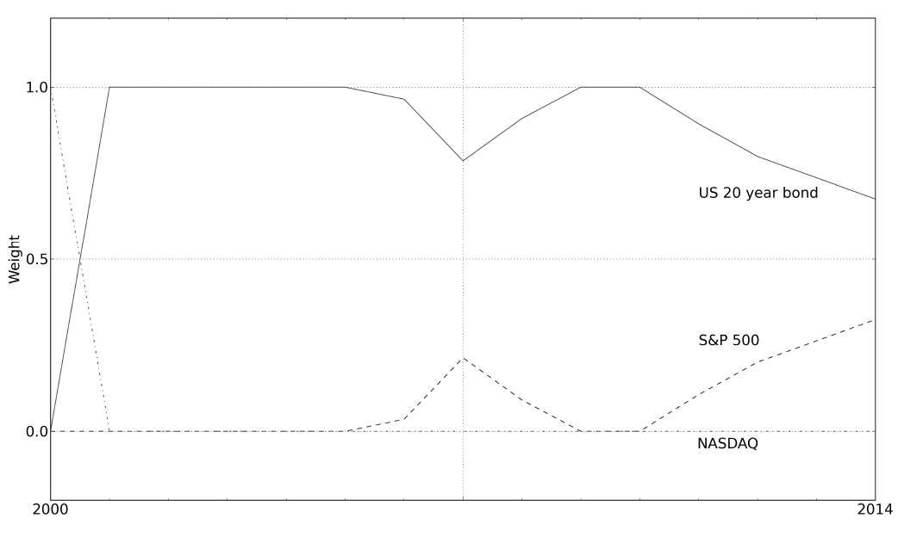
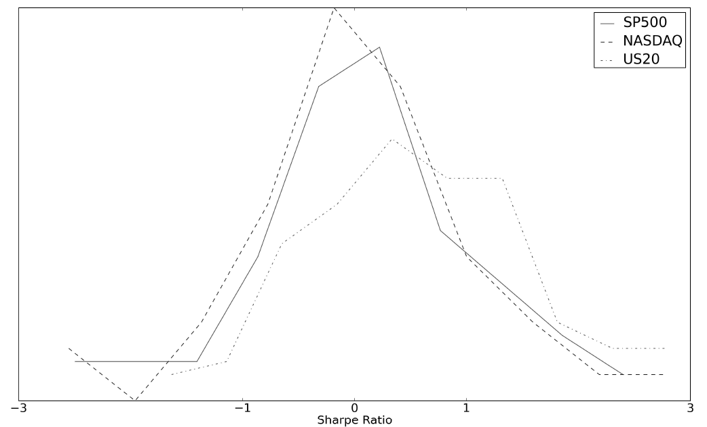
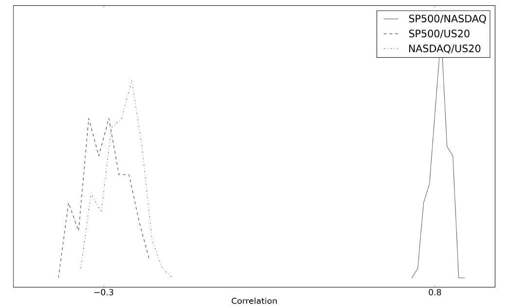
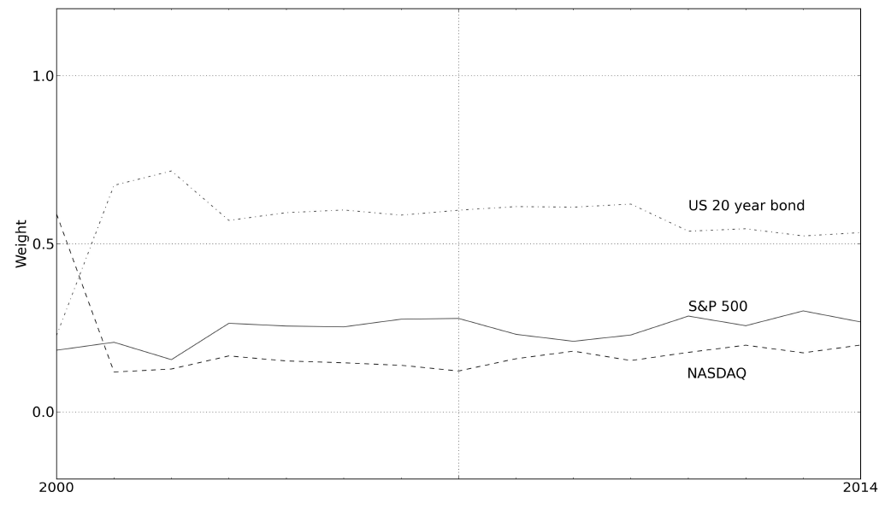

# 第四章 组合配置｜中文忠实版

原书：Robert Carver, *Systematic Trading*, Chapter Four, “Portfolio Allocation”。来源：`ebook/Systematic Trading.epub` 内 `OEBPS/Autopilot_ebook-12.xhtml`；`ch04#` 是本地提取块号，并非印刷页码。本译文按原书顺序覆盖章节概览、正文、图 14–17 的图注、表 7–14 及脚注 56–68。表格依据 EPUB 的 XHTML 单元格转排。译者核对提示列于末尾，不替换原书说法。

## 第四章 组合配置

**[ch04#0002–0009｜坚定的系统交易者；资产配置投资者]** 本章讨论如何把交易资本分配给不同的标的或交易规则。标的之间的分配对资产配置投资者很重要；坚定的系统交易者则必须作出这两类决定。

如果你是半自动交易者，本章与你无关：你不会使用系统化交易规则，而会视机会交易不同标的。你可以跳过本章。

如何在资产组合内分配，是每位投资者都会面对的问题。股票、债券或现金各占多少？股票配置应平均分给不同国家，还是全部放在美国？

配置决策对系统化投资者和交易者同样重要。如果坚定的系统交易者运行不止一条交易规则，连同规则的不同变体在内，就必须决定把这些规则合成各标的价格预测时，各自使用多大的预测权重。

坚定的系统交易者和资产配置投资者也都要决定标的权重，即给每个标的的交易系统分配多少组合资本。本章的工具同时用于这两种决策，所以我会泛称“资产组合”；这里的资产既可能是标的，也可能是交易规则。后文会分别给出两种配置问题的具体例子。

与交易规则一样，组合权重也会过度拟合。优化权重可能产生回测表现极佳、实际交易却很糟的组合。这类组合通常极端地只配置可选资产中的少数几个。本章将说明如何避开这种高度缺乏分散化的组合陷阱。

### 本章概览 [ch04#0010–0018]

| 主题 | 内容 |
|---|---|
| 优化失控 | 经典组合优化怎样经常产生过度拟合的极端权重。 |
| 拯救优化 | 另一种方法——自助抽样——带来哪些洞见，帮助理解问题出在哪里。 |
| 手工制定权重 | 怎样使用称为“手工构造”的简单方法取得组合权重。 |
| 纳入夏普比率 | 怎样利用有关预期表现的额外信息改进手工构造的权重。 |

### 优化失控

#### 介绍优化 [ch04#0019–0024]

组合优化要找到一组资产权重，使预期风险调整后收益最佳，通常以夏普比率衡量。输入包括预期平均收益、收益标准差和收益之间的相关性。Harry Markowitz 于 20 世纪 50 年代首次提出这一问题的标准解法；它为复杂问题提供了整洁优雅的解答。

可惜，人很容易被优雅吸引，忘记数学背后的重要假设。下文会看到，盲目使用这一方法经常得到权重极端、难看的组合。方程即便美妙，也不意味着不顾后果地照搬结果。正如爱因斯坦所说：“如果你要描述真理，就把优雅留给裁缝吧。”

职业生涯早期，我也被漂亮的方程深深迷住，做出过一些糟糕的组合，后来才认识到错误。此后，我常常审查一些研究人员的配置决定；他们经验不如我，但无疑比我聪明，学术资历也更高。

我问其中一位“火箭科学家”如何看待他算出的极端权重，得到的往往只是耸肩：“优化器算出来就是这样。”言外之意是方程一定正确。希望读完本章，你不会再如此轻信好看的数学。

#### 好消息 [ch04#0025–0028]

组合优化很难。不过，在设计交易策略时，有些难题并不会出现，因为你并不是直接决定各种标的应持有多大头寸，而是在决定交易系统不同部分的权重。这可能是预测权重，规定某一标的的交易规则变体按什么比例使用；也可能是标的权重，决定为交易每个标的分配多少资本。

这带来两个好处。第一，组合里不能有负权重：交易规则无法被“做空”，所以最低权重为零。如果预计一条规则会亏钱，就不该纳入。⁵⁶ 第二，在我的框架里，各规则利润的预期收益标准差相同。这源于第二章《系统化交易规则》讲过的波动率标准化。使用它后，配权只需考虑预期夏普比率和相关性，问题得以简化。

尽管你不会在交易系统里优化股票、债券等单个基础资产的持仓，本章仍用简单资产的组合来说明，以便例子易懂。为了让结果更容易解释，我会先调整这些资产的收益，使其标准差与处理交易系统收益时相同，再进行任何计算。

#### 不稳定的组合权重 [ch04#0029–0035]

先看在三种资产间分配资本的例子：美国纳斯达克和标普 500 股票指数，以及美国 20 年期基准债券。我使用 1999 年 1 月至 2014 年年中的数据，并将全部收益做波动率标准化，使预期标准差一致。从 2000 年 1 月起，每年都用此前所有年份的收益计算一组最优权重。⁵⁷ 每次优化都用截至当时可得的全部数据得出单一组权重，所以我称它为“单期优化”。

计算采用经典的 Markowitz 优化：利用估计的均值、相关性和标准差（因波动率标准化，标准差全部相同）寻找最高风险调整后收益，例如最高夏普比率。我还规定权重不得为负，且总和必须恰为 100%。

图 14 显示逐年算出的权重。⁵⁸ 在 20 世纪 90 年代末科技热潮的最后阶段，我自然把所有钱投进急涨的纳斯达克。随后它崩溃，被永久移出组合。在余下时期的大部分时间，我把全部资本放在债券里。最后股票只占 25%，且全在标普 500。这是权重极不稳定的极端组合。

**图 14：单期优化通常意味着极端权重。** 图中是每年利用此前全部数据作一次单期优化得到的组合权重。

#### 各种统计估计并非同样可靠 [ch04#0036–0055]

面对这样的噩梦，自然会想放弃优化，也许干脆把可用资产全部等权配置。许多学术研究者也得出这个结论，而且有不少证据表明等权很难击败。⁵⁹

什么时候等权合理？⁶⁰

- **相同波动率**：所有资产的预期收益标准差相同；这里使用的波动率标准化资产始终满足这一条件。
- **相同夏普比率**：所有资产的预期夏普比率（SR）相同。
- **相同相关性**：所有资产的预期收益共同变动程度相同。

如果这些假设不成立，组合应是什么样？⁶¹

- **夏普比率与相关性相同**：等权。
- **夏普比率显著不同**：预期 SR 较高的资产权重较大，较低的权重较小。
- **相关性显著不同**：与其他资产相关性较低、分散化作用较强者权重较大；分散化作用较弱者权重较小。

看看简单例子是否满足这些假设。图 15 是三种资产夏普比率的分布。注意三条线大多重合，意味着无法区分各资产的历史表现。债券虽有较高的平均 SR，这一优势在统计上却不显著。如果读过上一章并记得表 6，就不会惊讶：15 年的数据不足以让我们有把握地说哪一种资产的 SR 最佳。

**图 15：夏普比率比你想象的更难区分。** 图中是示例组合三种资产的夏普比率分布。

相反，我们往往能区分不同的相关性。图 16 显示简单例子中的相关性分布；你应该很容易看出彼此相关的股票资产，以及提供分散化的债券资产。

因此，这个例子里我应当能够做得比等权更好，因为相关性方面有显著的信息。好的组合会比等权多配提供分散化的债券，却不会太看重差异不显著的夏普比率。但是经典优化器不会这样做，因为它看不到图 15 和图 16 的全部信息。它只使用平均 SR 和相关性，不知道也不关心每项估计有多不确定。

**图 16：股票之间明显相关，与债券则呈负相关。** 图中是示例组合三种资产两两之间的相关性分布。

### 拯救优化 [ch04#0056–0081]

怎样修复这一问题？我使用两种技术。第一种工作量相当大，叫自助抽样（bootstrapping）：在数据的不同部分重复做许多次优化，再取所得权重的平均值。因此，权重是**许多次优化的平均**，而不是对全部数据取平均后只优化一次。

自助抽样的理由很简单。我相信过去能较好地指引未来，却不知道过去的哪段时期会重演。为了两面下注，我假定每一特定历史时期重现的机会相等。因此，平均过去各时期最优组合，是合乎逻辑的。

相比经典优化，自助抽样有一些好处。单次优化的权重多数仍极端，但次数足够多时，平均权重不大可能极端。如果数据噪声大，历史里包含差异很大的时期，各最优组合平均后就接近等权；若夏普比率或相关性存在显著差异，相似的组合会反复出现，平均值便会反映这一点。平均权重自然体现数据里的不确定性。

看看对三资产组合做扩展窗口自助抽样优化的结果。图 17 显示权重随时间变化，表 7 比较了最终权重、经典单期优化和等权。⁶² 第一年后权重相对稳定，所有时期均不如单期方法极端。但债券的分散化配置比等权更高，因此这个组合应该表现更好。

**图 17：自助抽样的组合权重稳定、分布均匀。** 图中是我对示例资产使用自助抽样方法得到的权重随时间的变化。

**表 7：自助抽样比单期方法更均匀，又比等权更能顾及相关性。**

| 资产 | 等权 | 单期 | 自助抽样 |
|---|---:|---:|---:|
| 美国 20 年期债券 | 33% | 68% | 53% |
| 标普 500 股票 | 33% | 32% | 27% |
| 纳斯达克股票 | 33% | 0% | 20% |

表中是等权、扩展窗口单期优化和扩展窗口自助抽样优化得到的最终组合权重。

自助抽样需要合适的软件包、自己编写优化代码的能力，或高超的电子表格技巧。如果你对它感兴趣，附录 C 有更多细节。下面我会介绍第二种方法，它简单得多，却也能得到稳健的组合权重。

### 手工制定权重

#### 手工构造方法 [ch04#0082–0097]

如果请一位经验丰富、技艺高超却不使用自助抽样的组合优化专家帮你做事，会发生一件怪事。他会当着你的面打开优化软件，认真算出一组权重。正如我们所见，结果必然很糟：许多资产权重为零，一两项的配置巨大。然后这位匠人会建议你去喝杯咖啡，让他施展魔法。

等你回来，权重可疑地变了，变得好看且不那么极端。经过追问，专家会承认自己用种种神秘技巧折腾软件，直到它给出“正确”结果。专家看一眼问题，大致就知道好答案应是什么样；他们的本领是在电脑里把它挖出来。

我记得有人告诉过我：“优化更像艺术，而非科学。”这话总让我不太满意。我宁愿有一套程序：同一组数据无论由谁操作机器，都得到完全相同的结果。

离开金融业后，我着手建立自己的交易系统，自然需要做些优化。编写自助抽样代码要花时间，于是初次尝试时打算用较简单的单期方法。我很快得到一组不喜欢的权重，又像往常一样开始摆弄优化器。折腾几分钟后，我突然意识到，最好完全省掉这段带艺术色彩的“伪优化”：何不一开始就写下正确的权重？

所需工具只有一支削尖的铅笔，以及信封背面或啤酒杯垫之类可供书写的东西。稍难的是定义给定组合里“好”权重究竟长什么样。

我从小组合入手。在等权合理的简单情形下，事情很容易；对于较难的组别，我借鉴了用自助抽样方法对人工数据做实验的结果。为了应付较大的组合，我把问题拆成模块：先处理组合的子集并组成组，再计算各组相对于其他组的权重；视复杂程度，必要时使用多层分组。手工构造方法就此诞生。下面详看它如何运作。

这一程序自下而上构建组合：先把相似资产分组，然后利用针对相似组合的最优权重表，确定组内和组间配置。表中权重来自我自己的自助抽样实验。

如你所料，方法假定各资产的预期收益标准差相同。暂时还假定它们的夏普比率（SR）也相同；稍后会放宽这一假设。不过正如上文、也许还有上一章所示，我们往往找不出资产 SR 在统计上显著的差别。

因此，你只需大概知道相关性可能是多少。估计无需精确：既可用历史数据，也可依据组合中资产的性质作有根据的猜测。不愿自己猜的话，附录 C 的表 50–57 给出了不同标的收益之间，以及同一标的不同交易规则组之间的粗略相关性。

有了相关性，就把彼此相关性最高的资产归在一起。除非组合特殊，分组通常很明显。例如在日经股票组合里，你大概会把日本公用事业股放一组、银行股放另一组，以此类推。理想情况下每组只有一、二或三项资产；若相关性足够相似，更多也可以。这样的小组里，真正有区别且重要的相关性模式只有少数几种。

表 8 给出这些模式对应的权重。如果准确相关系数不在表内，就四舍五入到最接近的相关数字。⁶³ 负值按零处理。⁶⁴ 三资产行的相关性依次为 A 与 B、A 与 C、B 与 C；相应权重则依次给 A、B、C。

**表 8：手工构造组合时使用的组内权重。** [ch04#0098–0134]

| 资产组或三项相关性（AB、AC、BC） | 行号 | 权重（A、B、C） |
|---|---:|---|
| 一项资产 | 1 | 该资产 100% |
| 任意两项资产 | 2 | 各 50% |
| 任意规模、相关性相同的组 | 3 | 等权 |
| 四项或以上、相关性不同 | 4 | 进一步或重新分组，直至符合其他行 |
| 三项：0.0、0.5、0.0 | 5 | 30%、40%、30% |
| 三项：0.0、0.9、0.0 | 6 | 27%、46%、27% |
| 三项：0.5、0.0、0.5 | 7 | 37%、26%、37% |
| 三项：0.0、0.5、0.9 | 8 | 45%、45%、10% |
| 三项：0.9、0.0、0.9 | 9 | 39%、22%、39% |
| 三项：0.5、0.9、0.5 | 10 | 29%、42%、29% |
| 三项：0.9、0.5、0.9 | 11 | 42%、16%、42% |

原表中间的粗体数字用于标识行号。表未列出这些相关性的所有排列；有些只是已列数值的重新排序。

#### 从三资产例子到逐层分组 [ch04#0135–0173]

例如，设组合有美国债券 D、标普 500 E、纳斯达克 F，相关性为 −0.3（DE）、−0.2（DF）和 0.8（EF）。查表时将它们归为 0.0（DE）、0.0（DF）、0.9（EF）。重新排序并映射到表中的 ABC 后，对应第 6 行：0.0（DE 映射到 AB）、0.9（EF 映射到 AC）、0.0（DF 映射到 BC），给 A、B、C 的权重依次为 27%、46%、27%。再映射回原问题（E=A、D=B、F=C），美国债券 D 占 46%，标普 500 E 占 27%，纳斯达克 F 占 27%。⁶⁵

想想这些权重的直觉。两只股票指数的相关性为 0.90，所以彼此不太能分散风险；债券与两者不相关，给组合带来更多分散化。因此债券权重较高、股票权重较低，是有道理的。

每组处理完后，根据你对组间相关性的猜测或估计，分配各组权重。⁶⁶ 最后，每项资产在整个组合里的权重，就是其所在组的总权重乘以它在组内的权重。依组合规模和结构，这个过程可以有两层；若所有资产不需分小组就能直接对应表 8，则只要一层；也可能需要三层或更多。

再看美国债券、标普 500 和纳斯达克的例子。常识和上述估计的相关性表明：应将单独的债券作为一组，两只股票指数作为第二组。我的计算如下；行号指表 8 的对应行。

| 层级 | 组 | 配置 |
|---|---|---|
| 第一层：资产类别内部 | 第一组，债券 | 只有一项，得 100%；第 1 行。 |
| 第一层：资产类别内部 | 第二组，股票 | 两项，各 50%；第 2 行。 |
| 第二层：资产类别之间 | 债券组与股票组 | 两组，各 50%；第 2 行。 |

每只股票指数得到组内 50% 乘以股票组 50%，即 25%；单项债券得到另外 50%。这些权重见原书所称的“图 9”。它们与不分组的手工权重、完整自助抽样方法最后一次的结果相当接近，而两种手工方法只需几秒钟，无须计算能力。因为我没有使用夏普比率，所以不像自助抽样结果那样略微增配债券和标普 500。下文会处理这一缺点。

**表 9：手工权重与自助抽样接近，但工作量更小。**

| 资产 | 等权 | 单期 | 自助抽样 | 手工不分组 | 手工分组 |
|---|---:|---:|---:|---:|---:|
| 美国 20 年期债券 | 33% | 68% | 53% | 46% | 50% |
| 标普 500 股票 | 33% | 32% | 27% | 27% | 25% |
| 纳斯达克股票 | 33% | 0% | 20% | 27% | 25% |

表中是等权、扩展窗口单期优化、扩展窗口自助抽样优化，以及不分组和分组两种手工构造得到的最终组合权重。

#### 更复杂的例子 [ch04#0174–0337]

来面对一个更难的挑战。设我的组合里有三家英国银行（Barclays、HSBC、RBS）、两家英国零售商（Tesco、Sainsburys）、三家美国银行（JP Morgan、Citigroup、Bank of America）、三家美国零售商（Safeway、Walmart、Costco）、两只英国政府债券（5 年期和 10 年期），以及三只美国债券（2 年期、20 年期、30 年期）。我从最低层向上按股票行业、国家、资产类别分组，得到表 10。

**表 10：较大示例组合的分组。**

| 标的 | 第一层 | 第二层 | 第三层 | 第四层 |
|---|---|---|---|---|
| Barclays、HSBC、RBS | 英国银行 | 英国股票 | 股票 | 全组合 |
| Tesco、Sainsbury | 英国零售 | 英国股票 | 股票 | 全组合 |
| JP Morgan、Citigroup、Bank of America | 美国银行 | 美国股票 | 股票 | 全组合 |
| Safeway、Walmart、Costco | 美国零售 | 美国股票 | 股票 | 全组合 |
| 英国 10 年期、20 年期债券 | 英国债券 | 债券 | 全组合 | — |
| 美国 2 年期、20 年期、30 年期债券 | 美国债券 | 债券 | 全组合 | — |

权重计算如下，括号里是表 8 对应的行号。

**第一层：按各国股票行业、债券国家分组。** 我假设同一行业、同一国家的股票有相近的相关性。英国银行各 33.3%（第 3 行）；英国零售两项各 50%（第 2 行）；美国银行各 33.3%（第 3 行）；美国零售各 33.3%（第 3 行）；英国债券两项各 50%（第 2 行）。美国债券稍复杂：据表 55（原书第 308 页），2 年期与 20 年期债券通常相关 0.5，2 年期与 30 年期为 0.5，20 年期与 30 年期为 0.9。这对应表 8 第 10 行，2 年期债券得 42%，20 与 30 年期各得 29%。

**第二层：资产类别内部按国家。** 英国股票有银行、零售两组，各 50%（第 2 行）；美国股票同样两组，各 50%（第 2 行）；英国债券只有一组，得 100%（第 1 行）；美国债券也只有一组，得 100%（第 1 行）。

**第三层：按资产类别。** 股票有美国和英国两组，各 50%（第 2 行）；债券也有美国和英国两组，各 50%（第 2 行）。

**第四层：跨资产类别。** 债券和股票两组各占 50%（第 2 行）。每项资产把各层所得权重相乘，得到表 11 的最终权重。

注意，除了美国债券组，我几乎没有使用相关系数。只要每组能保持一两个成员，或组内成员的相关性相近，那么确定分组之后便不再需要相关系数。

若 16 项资产直接等权，每项是 6.25%。这个组合并不均衡：股票多于债券，而且假定相关性相同也不现实。在这种情况下，多配分散化较强的资产，应能胜过直接等权。

**表 11：较大示例组合的权重构造。**

| 标的 | 第一层 | 第二层 | 第三层 | 第四层 | 最终 |
|---|---:|---:|---:|---:|---:|
| Barclays | 33% | 50% | 50% | 50% | 4.2% |
| HSBC | 33% | 50% | 50% | 50% | 4.2% |
| RBS | 33% | 50% | 50% | 50% | 4.2% |
| Tesco | 50% | 50% | 50% | 50% | 6.3% |
| Sainsbury | 50% | 50% | 50% | 50% | 6.3% |
| JP Morgan | 33% | 50% | 50% | 50% | 4.2% |
| Citigroup | 33% | 50% | 50% | 50% | 4.2% |
| Bank of America | 33% | 50% | 50% | 50% | 4.2% |
| Safeway | 33% | 50% | 50% | 50% | 4.2% |
| Walmart | 33% | 50% | 50% | 50% | 4.2% |
| Costco | 33% | 50% | 50% | 50% | 4.2% |
| 英国 10 年期债券 | 50% | 100% | 50% | 50% | 12.5% |
| 英国 20 年期债券 | 50% | 100% | 50% | 50% | 12.5% |
| 美国 2 年期债券 | 42% | 100% | 50% | 50% | 10.5% |
| 美国 20 年期债券 | 29% | 100% | 50% | 50% | 7.3% |
| 美国 30 年期债券 | 29% | 100% | 50% | 50% | 7.3% |

表中列出每层的计算权重，末列为各层权重之积，即最终组合权重。原表以边框标明分组；数字经过一定舍入。

#### 我们是否作弊？[ch04#0338–0342]

手工构造方法不容易在多个年份自动重复，因此不适合用来做扩展窗口或滚动的样本外回测。⁶⁷ 你会在知道全部过去数据的情况下，只拟合一组样本内组合权重。可以说，所得组合有过度拟合的危险。使用估计的相关性时尤其如此；但根据经验猜测相关性也有同样问题，因为两者都意味着你在回测开始时已经知道未来。

先别担心。你确实使用了未来信息；但相比样本内单期优化，你做出的权重会远不那么极端，这一点可以减轻问题。此外，相关性通常不会变动到使手工权重随时间发生剧变。因此，用全样本做出的权重，可能与你在回测早期只用当时已有数据做出的权重十分相近。并且目前的方法忽略夏普比率的差异，也确保权重不极端、相对稳定。

为说明这一点，我拟合了第十五章为坚定的系统交易者描述的交易系统。使用样本内手工构造，相比滚动样本外自助抽样，优势不显著：夏普比率为 0.54，对方为 0.52。相比之下，样本内单期优化得到不现实的高 SR 0.84；但若用单期方法做滚动样本外拟合，表现差得多，SR 仅为 0.3。

即便如此，相比真正的样本外方法，例如自助抽样，仍应对手工构造组合的回测结果多保留一点怀疑。

### 纳入夏普比率

基本的手工构造方法假设所有资产的预期夏普比率（SR）相同。通常数据不够，无法判定历史 SR 是否显著不同。不过有时你可能有充分根据，认为不同资产的相对夏普比率确有差别。[ch04#0343–0347]

稍后会再谈的一个例子，是一些资产的成本高于另一些。成本比原始表现更确定，因此你通常能就它对收益的影响形成统计上更有根据的看法。

另一种情况是遵循上一章建议的交易规则选择流程。按我偏好的方法，在决定预测权重之前，不先剔除不赚钱的规则。不过，如果一条规则的回测表现糟透了，你会想降低其权重，尽管它大概仍应获得一定配置，因为很难找到足够证据证明一条规则一定优于或劣于另一条；上一章对此已经讨论。

通过随机数据实验，我计算了真实 SR 不相等的一组资产，其自助抽样组合权重如何变化。然后可把这些调整应用于手工权重。结果见表 12。为免列出无穷多种排列，结果用相对值表示：重要的是某项资产 SR 相对于组内平均 SR 的差。

**表 12：若掌握一些资产夏普比率信息，应将手工权重调整多少？** [ch04#0348–0422]

| SR 与组平均之差 | A：有把握，例如成本 | B：不确定，超过 10 年数据 | C：不确定，少于 10 年数据 |
|---:|---:|---:|---:|
| −0.50 | 0.32 | 0.65 | 1.0 |
| −0.40 | 0.42 | 0.75 | 1.0 |
| −0.30 | 0.55 | 0.83 | 1.0 |
| −0.25 | 0.60 | 0.85 | 1.0 |
| −0.20 | 0.66 | 0.88 | 1.0 |
| −0.15 | 0.77 | 0.92 | 1.0 |
| −0.10 | 0.85 | 0.95 | 1.0 |
| −0.05 | 0.94 | 0.98 | 1.0 |
| 0 | 1.00 | 1.00 | 1.0 |
| 0.05 | 1.11 | 1.03 | 1.0 |
| 0.10 | 1.19 | 1.06 | 1.0 |
| 0.15 | 1.30 | 1.09 | 1.0 |
| 0.20 | 1.37 | 1.13 | 1.0 |
| 0.25 | 1.48 | 1.15 | 1.0 |
| 0.30 | 1.56 | 1.17 | 1.0 |
| 0.40 | 1.72 | 1.25 | 1.0 |
| 0.50 | 1.83 | 1.35 | 1.0 |

表给出手工权重的调整乘数，依据是资产 SR 与组合平均 SR 的差（各行）、SR 估计的确定程度及估计所用数据量（各列）。A 列：SR 差异可精确知道，例如交易成本不同。B 列：SR 用超过十年的数据估计，或通过预测得到。C 列：SR 用少于十年的数据估计。

起初我的实验假定已知真实 SR 差异。用于成本调整时，这个假设尚算合理。A 列显示，在完全确定差异时，应乘在初始组合权重上的调整系数。若依据历史数据估计 SR，或以其他方法预测，就不能如此确信；应使用 B 列较温和的系数。最后，如果依据不足十年的数据估计 SR，我建议完全不调整。如上一章可能已看到，只有几年的数据时，SR 估计之间有统计显著差异的可能性极低。虽然这很简单，我还是把它放进了表中的 C 列。[ch04#0423–0424]

#### 按夏普比率调整手工权重的步骤 [ch04#0425–0438]

1. **起始权重**：算出组内手工权重；总和应为 100%。
2. **取得夏普比率**：利用历史数据、成本估计或其他方法，找出组内每项资产的预期 SR。
3. **与平均值比较**：算出整个组的平均 SR，再求每项资产比它高或低多少。
4. **找乘数**：按 SR 估计的确定程度，以及适用时估计所用数据量，在表 12 的 A、B 或 C 列查每项资产的权重乘数。
5. **相乘**：组内各项权重乘以各自对应的乘数。
6. **归一化**：调整后组内权重可能不再合计 100%；必要时将其归一，使总和恰为 100%。

若有两层或更多分组，就须重复这个过程。上升到下一层时，应估计每一整组的 SR。方法可以是回测该组收益、对组内单项资产的 SR 加权平均，或简单平均组内各项资产的 SR。调整组间权重的过程与调整组内相同。

#### 简单例子 [ch04#0439–0500]

回到由两个美国股票市场和一个债券市场构成的三资产组合，采用分组手工构造。我对历史夏普比率的估计是：纳斯达克约为 0，标普 500 为 0.5，债券为 0.75。股票组的处理如下；债券组只有一项，仍占组内 100%。

| 步骤 | 股票组计算 |
|---|---|
| 起始权重 | 纳斯达克 50%；标普 500 50%。 |
| 估计 SR | 纳斯达克 0；标普 500 0.5，均来自历史数据。 |
| 与平均值之差 | 平均 0.25；纳斯达克 `0−0.25=−0.25`，标普 500 `0.5−0.25=0.25`。 |
| 找乘数 | 估计不确定，但数据超过十年，使用表 12 B 列：纳斯达克 0.85，标普 500 1.15。 |
| 相乘 | 纳斯达克 `50%×0.85=42%`；标普 500 `50%×1.15=58%`。 |
| 归一化 | 总和为 100%，无须再归一。 |

接下来第二层，把债券和股票混合：

| 步骤 | 组间计算 |
|---|---|
| 起始权重 | 股票 50%；债券 50%。 |
| 猜测 SR | 股票：纳斯达克 SR 0 与标普 500 SR 0.5 的简单平均，为 0.25；债券：历史数据为 0.75。 |
| 与平均值之差 | 股债平均 0.50；股票 `0.25−0.50=−0.25`，债券 `0.75−0.50=0.25`。 |
| 找乘数 | 表 12 B 列：股票 0.85，债券 1.15。 |
| 相乘 | 股票 `50%×0.85=42%`；债券 `50%×1.15=58%`。 |
| 归一化 | 总和为 100%，无须再归一。 |

最终权重是纳斯达克 18%（42%×42%）、标普 500 24%（58%×42%）、债券 58%。虽然比先前不均匀，但比用相同 SR 数字做单期优化得到的组合远不极端，见表 9。它也与最后一次自助抽样权重相差不大；后者的计算同样使用了夏普比率。

**表 13：纳入夏普比率（SR）对优化后的组合权重有多大影响？**

| 资产 | 单期，使用 SR | 自助抽样，使用 SR | 手工，不使用 SR | 手工，使用 SR |
|---|---:|---:|---:|---:|
| 美国 20 年期债券 | 68% | 53% | 50% | 58% |
| 标普 500 股票 | 32% | 27% | 25% | 24% |
| 纳斯达克股票 | 0% | 20% | 25% | 18% |

纳入 SR 估计后，手工构造会提高表现较好资产的权重，结果与自助抽样接近，又不会像单期优化那样产生极端组合。

#### 再问一次：我们是否作弊？[ch04#0501–0519]

现在你用夏普比率（SR）构造手工权重，值得重申：这是一种轻微的样本内回测作弊，因为你只使用整个历史数据的最终平均 SR，而在回测开始时，这些数据还不存在。⁶⁸

这项批评是公允的，但问题不算太严重。权重仍不极端，因此相较样本内单期优化，对回测 SR 的影响较温和。不过，仍应谨慎，不能想当然地认为实盘交易能够达到回测 SR。表 14 对第十五章那类系统给出大致折减：视采用的拟合技术，将回测收益折成比较现实、可能达到的夏普比率。

**表 14：看待回测夏普比率该打多少折扣？**

| 拟合方法 | “悲观系数”：可能保留的回测表现比例 |
|---|---:|
| 单期优化，使用 SR，样本内 | 25% |
| 单期优化，使用 SR，样本外 | 75% |
| 自助抽样，使用 SR，样本内 | 60% |
| 自助抽样，使用 SR，样本外 | 75% |
| 手工构造，不使用 SR，样本内 | 70% |
| 手工构造，使用 SR，样本内 | 65% |

表中是过去回测收益未来可能获得的比例。数字针对第十五章的交易系统，其中有四个交易规则变体、六个标的。更复杂的交易系统需要更大幅度地修正样本内表现高估。我假定过去表现的 25% 来自资产价格不可重复的长期趋势，第二章（原书第 52 页）已讨论这一点。

至此，你应该能够安全地使用拟合与优化；接下来进入第三部分：我的交易系统框架。

### 原书脚注 [ch04#0520–0532]

**56.** 夏普比率显著为负的规则，要么交易成本极高，应予剔除；要么持续做错，应在纳入组合前把多空方向反过来。不过，在这样做之前，你大概也应重新审视最初想法的逻辑。

**57.** 如果读过上一章，应认出这是样本外扩展窗口。

**58.** 记住，图中的资产显示方式是假设它们具有相同标准差。因此在实际操作中，债券波动率较低，投向债券的实际金额大致会是图中所示的两倍。

**59.** 例如参见 DeMiguel、Victor、Lorenzo Garlappi 与 Raman Uppal，〈Optimal versus naive diversification: How inefficient is the 1/N portfolio strategy?〉，*Review of Financial Studies*，2009 年。

**60.** 严格说，有些不符合这些条件的特殊组合也以等权为最优，但这里无需考虑。

**61.** 学术研究者考察的组合，大多是同一国家的股票，其标准差和相关性往往相似。在这种情况下，等权确实很难击败。

**62.** 这里做了 100 次自助抽样，每次长度一年；日收益通过有放回的随机抽样取得。

**63.** 另一种做法是对权重作插值，但那会使这个简单方法变得相当复杂。

**64.** 负相关的资产会得到不合理的极端配置。

**65.** 如果你不喜欢映射再反向映射，我的网站上有一张更大的权重表，不必这样费劲地解开顺序。

**66.** 若要估计组间相关性，就须为每组构造小组合，再回测其收益。或者，可以对组内成员之间的相关性取平均；可以简单平均，也可以依组内权重加权平均。

**67.** 实际上，手工构造方法可以回测，我也曾这样验证它；但需要仅使用过去数据估计的历史相关性，以及将组聚成层级的算法。如果一定要用可回测的方法，自助抽样反而更容易实现。毕竟，手工构造最大的好处在于简单。

**68.** 与标准手工权重一样，可以在扩展窗口里作 SR 调整，从而回测。前十年数据不应调整任何权重；之后在回测每个时点，只用此前数据估计 SR。但同样地，这比使用自助抽样方法费事得多。

### 译者核对提示

- `ch04#0032` 正文称期末股票仅 **25%**，但图 14 末端和表 7 显示标普 500 **32%**、债券 **68%**。译文保留正文的 25%，表格仍按原表。
- `ch04#0148` 把权重定位写作“图 9”，上下文实际接续的是**表 9**；译文保留原称呼。
- `ch04#0175` 的例子开头称英国债券为 **5 年期和 10 年期**，表 10–11 却列为 **10 年期和 20 年期**；分别依原处翻译。
- `ch04#0454–0455` 的 `50%×0.85=42%`、`50%×1.15=58%` 是原书整数舍入；精确计算为 42.5%、57.5%。末尾 18%、24%、58% 也属近似值。
