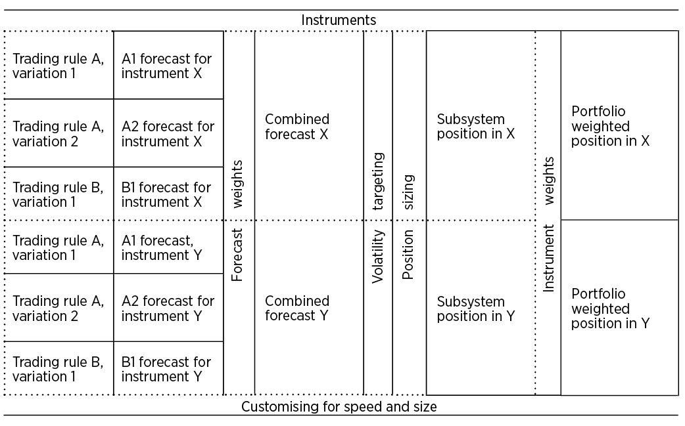

# 第五章 框架概览｜中文忠实版

原书：Robert Carver, *Systematic Trading*, Chapter Five, “Framework Overview”。来源：`ebook/Systematic Trading.epub` 内 `OEBPS/Autopilot_ebook-14.xhtml`；`ch05#` 为本地提取块号，并非印刷页码。本译文依原书顺序覆盖正文、两张 XHTML 表、表 15 的图片文字与图注，以及脚注 69–73。译者核对提示列于末尾，不替换原书说法。

## 第五章 框架概览

**[ch05#0001–0002]** 现在你掌握了一些理论，或许也有了几种量化工具，可以开始构建交易系统了。在本书第三部分，我将介绍一套框架。它会为构建几乎任何类型的策略提供一个模板。

### 本章概览 [ch05#0003–0010]

| 主题 | 内容 |
|---|---|
| 一个糟糕的例子 | 一套存在若干致命缺陷的交易系统。 |
| 为什么使用模块化框架 | 模块化框架适用于系统化交易策略的理由。 |
| 框架的组成部分 | 框架各组成部分的简要路线图。 |

第三部分接下来的章节会更详细地介绍每个组成部分。在本书最后一部分，我将展示这套框架的三个使用实例，分别面向半自动交易者、资产配置投资者和坚定的系统交易者。

### 一个糟糕的例子 [ch05#0011–0029]

下面是许多书籍和网站中可以见到的那种交易系统的一个例子。⁶⁹

| 项目 | 规则 |
|---|---|
| 入场规则 | 20 日移动平均线上穿 40 日移动平均线时买入；反过来则采取相反方向。 |
| 出场规则 | 入场规则遭到破坏时反向操作。因此，如果你持有多头，当 20 日移动平均线落到 40 日移动平均线下方时，就平掉多头并做空。 |
| 头寸规模 | 交易量绝不超过 10 份欧洲美元期货合约、1 份富时指数合约，或点差投注中每点 £10。 |
| 资金管理 | 每笔交易的押注绝不超过资本的 3%。 |
| 止损 | 设置移动止损；一旦亏掉资本的 3% 就平仓。如果发现止损触发得过于频繁，就把止损放宽。 |

我不打算讨论入场或出场规则。⁷⁰ 但是，头寸规模、资金管理和止损规则乱成一团。

首先，为什么是 3%？这会产生恰当的风险量吗？如果我特别保守，也仍然应该使用 3% 吗？如果我不太看好某笔交易，应该押多少？我的组合通常有 40 个头寸，难道我应该在同一时刻让 40 笔各占组合资本 3% 的金额处于风险之中（这意味着处于风险中的金额达到整个组合的 120%）？如果使用交易频率较低的规则，3% 还合理吗？

上面的头寸规模或许适合账户规模大约为 £50,000、并具有某种风险偏好的人；其他人怎么办？这些数字在写书时可能是对的，但我们五年后读到它时还对吗？如果某个标的没有列在其中，我们能交易它吗？又该怎样交易？

最后，只根据你的资本和个人痛苦阈值设置止损，是错误的。⁷¹ 一个账户很小、又讨厌亏钱的人，可能几分钟后就会触发非常紧的止损；一家大型对冲基金却可能几十年后才平掉亏损头寸。适用于石油期货的止损，对波动相对平静的美元／加元外汇市场会完全不合适。适用于 2006 年平静市场的止损，在我们 2008 年见到的疯狂行情中会紧得荒谬。

解决办法是把系统的组成部分拆开：交易规则（包括显性或隐性的止损）、头寸规模计算，以及波动率目标的计算（即你愿意置于风险中的平均现金金额）。随后，你就能独立于其他运转部件，设计每一个组成部分。

交易规则和止损应只以预期的市场价格波动为依据，绝不应考虑你的账户规模。计算波动率目标，也就是决定让多少资本处于风险之中，则取决于账户规模和你的痛苦阈值。⁷² 然后应根据市场波动有多大、你对价格预测有多大把握，以及你希望拿多少资本冒险，来确定头寸规模。

每个组成部分都是模块化框架的一部分；它们合在一起，构成一套完整的交易系统。

### 为什么采用模块化框架？[ch05#0030–0034]

还记得我在本书引言中把汽车和交易系统作类比。交易规则是系统的引擎。它们给出标的价格的预测：价格预计上涨还是下跌，以及幅度有多大。汽车的底盘、传动系统和变速箱把引擎产生的动力转化为向前的运动。类似地，围绕交易规则，你还会有一套头寸风险管理框架。它把预测转化为你实际需要持有的头寸。

正如我在引言中所说，现代汽车的组成部分是模块化的，因此可以逐个换成其他部件。我这套框架中的交易规则和其他组成部分，也可以更换和调整。

“模块”和“组成部分”这些词，可能让人以为它们是需要几千行计算机代码才能实现的复杂过程。事实并非如此。每个部分只涉及几个基本算术步骤，一台计算器或一张简单的电子表格就足够了。

让我们更详细地看看模块化方法的优点。

#### 灵活性 [ch05#0035–0036]

模块化设计最明显的好处是灵活。汽车确实可以是你喜欢的任何颜色，黑色也包括在内。同样，我的框架几乎可以适配任何交易规则，包括半自动交易者使用的自主判断预测，以及资产配置投资者使用的极其简单的规则。如果你不喜欢头寸规模计算部分，或框架中的任何其他部分，可以用自己的方案替换它。

#### 透明的模块 [ch05#0037–0039]

一个框架可以很好地模块化，内部却全是不透明的黑箱。多数个人电脑就是这样制造的。你可以换掉硬盘或显卡，却不容易改造它们或自己制造一个，于是只能把一个神秘部件换成另一个神秘部件。

相比之下，我这套框架中的每个组成部分都是透明的——我会解释它怎样构建，以及为什么这样构建。这应能让你具备理解与信心，去调整每个模块，或从零创建自己的模块。

#### 各组成部分具有明确的接口 [ch05#0040–0043]

如果你更换汽车的变速箱，需要确定汽车仍能按要求前进或后退。但如果新变速箱的传动轴输出方向反了，你原想倒车驶出车道，却会开车撞上自家大门。为避免这种情况，我们必须规定：变速箱的轴顺时针转动时，汽车应向前行驶；反之则向后。

同样，如果你使用新的交易规则，模块化交易系统框架的其余部分仍应正确运作，并给你规模恰当的头寸。为此，各个组成部分需要有明确的接口——一份说明它们如何与系统其他部分交互的规格。

例如，在这套框架中，无论你采用什么交易风格、交易什么标的，一条交易规则给出的预测值，譬如 +1.5，都必须具有一致的含义。⁷³

#### 把乏味的部分做好 [ch05#0044–0046]

交易系统中包裹着交易规则的那部分，也就是框架，很容易被忽视。与开发新颖刺激的交易规则，或作出自己的自主判断预测相比，创建框架是一件乏味的工作。但它极其重要。通过创建一套标准框架，我已经替你完成了这项枯燥却关键的工作。

只要任何交易规则都以符合正确接口的一致方式产生预测，框架就能正常运作。因此，它无需为了每条新规则而彻底重新设计。此外，资产配置投资者和半自动交易者借助这套框架，即使不用交易规则预测价格，也能获得系统化交易的许多好处。

#### 实例给你一个起点 [ch05#0047–0048]

从零开始建立一套新交易系统，是一件颇令人望而却步的事。本书最后一部分有三个详细实例，展示如何使用框架来适应资产配置投资者、半自动交易者和坚定的系统交易者。它们合在一起，提供了一组系统，可作为你发展自己想法的起点。

### 框架的组成部分 [ch05#0049–0053]

表 15 展示了一套小型交易系统所具有的组成部分：两条交易规则、合计四个交易规则变体，以及两个标的。你首先为每个标的建立一个交易子系统。每个子系统尝试预测单个标的的价格，并计算所需的适当头寸。随后，把这些子系统合成一个投资组合，形成最终的交易系统。

**表 15：交易系统中组成部分的示例。** 这套交易系统有两条交易规则 A 和 B；三个规则变体 A1、A2、B1；以及两个标的 X 和 Y。虚线表示 X 和 Y 各自的交易子系统。

**表 15 图片文字转述：** 对 X 和 Y，每个标的都分别从规则 A 的变体 1、变体 2 与规则 B 的变体 1，产生 A1、A2、B1 三个预测；经“预测权重”合成该标的的预测，再经“波动率目标”和“头寸规模计算”得到该标的的子系统头寸。两个子系统经过“标的权重”，形成 X、Y 各自的组合加权头寸。图底部的“根据交易速度和规模进行调整”横跨整套系统。这段转述覆盖图片内文字的流程关系；图片本身保留在上方供核对。

#### 交易标的 [ch05#0054–0055]

标的就是你交易并持有头寸的东西。它们可以是任何金融资产，包括直接持有的股票、债券，也包括期权、期货、差价合约及点差投注等衍生品。你还可以交易集合投资基金，例如交易所交易基金（ETF）、共同基金，甚至对冲基金。

#### 预测 [ch05#0056–0059]

预测，是在给定某个交易规则变体的条件下，对特定标的价格将变化多少的估计。例如，一套简单的股票策略可能有三个预测：其中两个是趋势跟随规则的变体，分别观察不同速度的趋势；另一个是股票价值交易规则，只有一个变体。如果像表 15 那样交易两个标的，就总共需要作出 3 × 2 = 6 个预测。

产生预测的交易规则，是坚定的系统交易者使用的所有交易系统的核心引擎。不同策略之间最大的差别，在于使用哪些规则和变体，以及交易哪些标的。相比之下，框架的其余部分会相当相似。

半自动交易者作出自主判断预测，而不是使用系统化规则。资产配置投资者不试图预测资产价格，而是对所有标的使用同一个固定预测。

#### 合成预测 [ch05#0060–0061]

对于一个标的，你需要一个单一的预测，说明它的价格会上涨还是下跌，以及幅度有多大。如果你有不止一个预测，就需要用加权平均，把它们合成为该标的的一个合成预测。为此，你要给每个交易规则变体分配预测权重。

#### 波动率目标 [ch05#0062–0063]

明确你希望在交易系统整体上承担多少风险，十分重要。我把它定义为你愿意让自己面对的典型平均每日亏损。这一波动率目标由你的财富、风险承受能力、获得杠杆的条件，以及预期盈利能力来决定。起初，我们会假定你把全部资本放进只针对一个标的的单个交易子系统。

#### 经调整的头寸 [ch05#0064–0066]

现在，你可以根据标的的风险有多大、你对预测有多大把握，以及你的波动率目标，决定持有多少基础资产。眼下你将计算的头寸，仍以只交易一个孤立标的、处于单个交易子系统为前提。

到这一步，你实际上已经有了一套完整的交易系统，不过它只针对单个标的。正如人体细胞各自都是独立的生命体，这些交易子系统也都是自成一体的单位；但在下一阶段，你会把它们组合起来。

#### 投资组合 [ch05#0067–0068]

为了尽可能分散风险，你通常会希望交易多个标的，组成由多个交易子系统构成的投资组合，每个子系统负责一个标的。这要求你决定如何在组合中的不同子系统之间分配资本；你会用标的权重完成这件事。经过这一步，你将得到每个标的经组合权重调整的头寸，再用它们计算需要进行的交易。

#### 交易速度与规模 [ch05#0069–0070]

这不是框架中的一个独立组成部分，而是一组适用于整个系统的原则。设计交易系统时，重要的是知道交易成本有多高，以及你的资本量是否异乎寻常地大或小。掌握这些信息后，又该怎样相应调整系统？我会在第三部分的最后一章详细讨论这两个问题。

### 脚注 [ch05#0071–0075]

**69.** 这是一个假想例子；据我所知，它与任何公开可得的系统都不完全相同。

**70.** 这些规则并不算太糟，因为它们完全系统化，而且非常简单。不过，它们是二元的（你要么完全持有头寸，要么完全退出），这并不理想；只有一个交易规则变体也不够完善。

**71.** 大多数优秀交易者都认识到这一点。以下是 Jack Schwager 在 *Hedge Fund Wizards* 中采访对冲基金经理 Colm O’Shea 的一段话。Jack：“所以你不用止损？”Colm：“不，我用。我只是把止损设得足够宽。在那些早期日子里，我设止损的价位并不符合交易背后的基本假设。我是按自己的痛苦阈值设置止损。现在我退出一笔交易，是因为我错了。……价格与我的假设不符。我错了，需要退出并重新思考情况。”（着重号为作者所加。）

**72.** 还要考虑其他因素，例如所需杠杆与可获得杠杆的比较，以及系统的预期表现。我会在第九章“波动率目标”中更详细地讨论这些问题。

**73.** 后续章节会说明，这种一致的含义究竟是什么。

### 译者核对提示

- 正文 `ch05#0050` 写“合计四个交易规则变体”，而表 15 图片、图注 `#0053` 和后文 `#0057` 列出的都是 A1、A2、B1 **三个**变体。译文分别保留原书两处数字，不擅自补出第四个。
- `ch05#0063` 的“典型平均每日亏损”是作者对风险目标的表述，并非每日最大亏损保证。`#0043` 的 `+1.5` 也尚未给定收益率或价格单位；脚注 73 指向后文。
