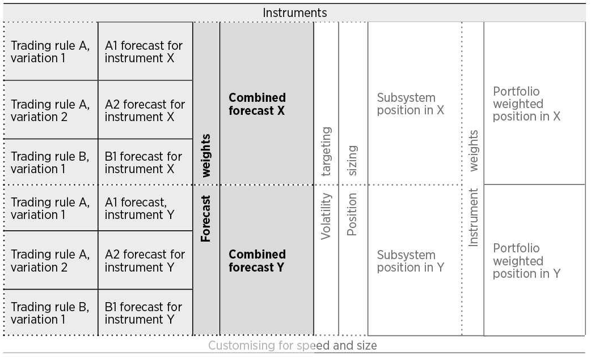
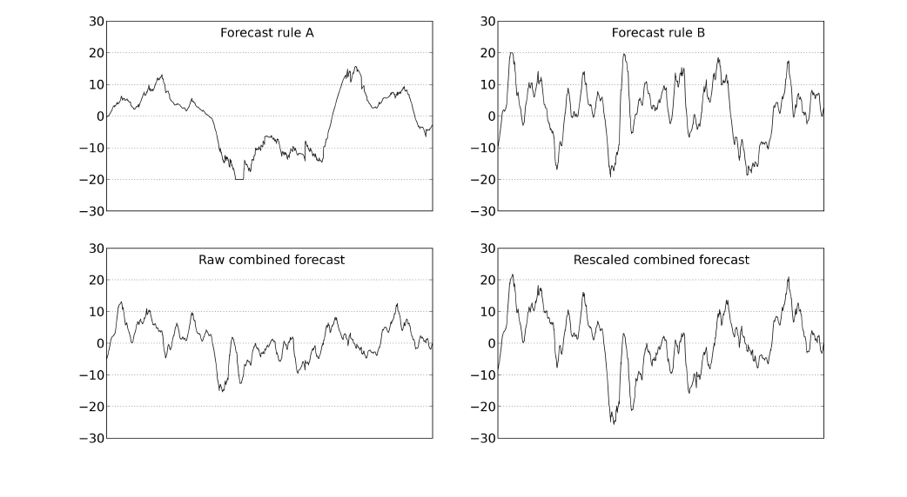

# Chapter Eight. Combined Forecasts｜英文原文版

来源：`OEBPS/Autopilot_ebook-17.xhtml`。按 EPUB 的正文、表格、插图与脚注顺序转排；字体、行内样式及印刷页码可能不同于原书。

## Chapter Eight. Combined Forecasts

Staunch Systems Trader

This chapter is about combining forecasts from different trading rules, including variations of the same rule, so it’s required reading for most staunch systems traders. If you’re an asset allocating investor using the single ‘no rule’ rule or a semi-automatic trader you can skip ahead to chapter nine.

Life is simple when you have only one trading rule. Strong positive forecast? Then buy. Negative? Sell. But what if you have multiple rules and they disagree?

As you saw in the previous chapter, in late 2009 and 2010 one of my trading rules (the EWMAC trend following rule) had turned bullish on crude oil, but another (Carry) was still bearish (see figures 18 and 19). What should I have done – buy, sell, or do nothing? Multiple forecasts which disagree aren’t conclusive – you need to create a single combined forecast for every instrument.

### Chapter overview

| Combining with forecast weights | How to use forecast weights to produce a single combined forecast for each instrument. |
| --- | --- |
| Choosing the forecast weights | Using the handcrafting method to find weights for each trading rule. |
| Getting the correct variation | Making sure the combined forecast has the right expected absolute value by correcting for diversification across the individual forecasts. |
| Capping combined forecasts | Just like the forecast from each trading rule you should limit the size of your combined forecasts. |

### Combining with forecast weights

How do you go from two or more forecasts, to a single combined forecast for each instrument? In the framework you need to use a weighted average of your forecasts, where the weights are forecast weights. These are a type of portfolio weight, where your portfolio consists of trading rule variations, and they should all be positive and add up to 100%.

So if you were trading crude oil in mid-2009, as shown in figures 18 and 19, then you might have had forecasts of +15 in the EWMAC trend following variation and -10 in Carry. With forecast weights of 50% in each rule your combined forecast would be 2.5.86

### Choosing the forecast weights

How do you find the best weights to use when combining forecasts? This is an example of the problem of allocating a portfolio of assets, which we discussed in chapter four. But now the asset weights you have to choose are forecast weights for trading rules and their variations, rather than long positions in equities or bonds.

Forecast weights might be the same for all instruments, or different. I’ll now show you how to use the handcrafting method I described in chapter four to find those weights, although you can also use bootstrapping if you’re comfortable with that.87 To find handcrafted weights you need both correlations and a way of grouping your assets.

You can back-test the performance of different trading rules to get historical estimates for correlations. Alternatively tables 56 and 57 in appendix C (from page 308) give some typical values for trading rules within the same instrument.

Once you have correlations the next step in the handcrafted method is to group your assets. The simplest way is to group the variations within a particular trading rule, then allocate across trading rules. Let’s take a simple example. Suppose we’re using the two rules from the last chapter, trend following (EWMAC) and Carry. For now assume that EWMAC has three variants, with fast look-backs of 16, 32 and 64 for the moving averages.88 The carry rule has a single variation. Here is how I calculated the weights.

| First level grouping Within trading rules | • Group one (EWMAC): From table 57 in appendix C (page 309) I get the correlations between EWMAC variations: 0.90 between adjacent variations, and 0.7 between the variations with fast look-backs 16 and 64. Using table 8 (page 89) row 11 I get weights of 16% in look-back 32, and 42% in look-backs 16 and 64. • Group two (Carry): One asset. Using table 8 row 1: 100% in Carry. |
| --- | --- |
| Second level grouping Across trading rules | Using table 8 row 2: 50% in the EWMAC and 50% in Carry. |

This gives us the weights in table 17. By the way it’s also possible to have a three level grouping, if you are mixing rules of different styles.

Table 17: Example Handcrafted forecast weights

|  | 1st level | 2nd level | Final weights |
| --- | --- | --- | --- |
| EWMAC 16, 64 | 42% | 50% | 21% |
| EWMAC 32, 128 | 16% | 50% | 8% |
| EWMAC 64, 256 | 42% | 50% | 21% |
| Carry | 100% | 50% | 50% |

Notice that I haven’t shown you how to incorporate different performance between rules, the effect of costs, or how to decide if different instruments should have different weights. If you’ve followed my advice from chapter three, and not fitted or selected trading rules based on Sharpe ratio, then you risk having some poor rules in your portfolio, on which you could want to reduce the allocation. It’s also quite likely faster rules will have worse after-cost performance than slower ones.

I’ll discuss these issues in detail in chapter twelve, ‘Speed and Size’. There will also be a more realistic example using performance and cost estimates in the staunch systems trader example chapter in part four.

### Getting to 10

I recommended in chapter six that all your individual forecasts should have the same expected variability – equivalent to an expected absolute value of 10. But unless your trading rules are perfectly correlated it’s likely that the combined forecast will end up on a smaller scale. It’s the same general effect you get from putting less than perfectly correlated assets into any portfolio, where the overall portfolio will always end up with lower risk than its constituents. The magnitude of the fall in standard deviation will depend on the degree of diversification.

However the trading system framework will not work consistently if combined forecasts have a low and unpredictable scaling. You need your combined forecasts to maintain the same expected absolute value of 10 as you required for individual forecasts. To fix this the combined forecast is multiplied by a forecast diversification multiplier.

CONCEPT: Diversification multiplier

If you have two stocks, each with identical return volatility of 10%, with half your money in each, what will be the volatility of the whole portfolio? Naturally it will depend on how correlated the two assets are.

If they are perfectly correlated then the portfolio will have a return standard deviation of 10%; the same as the individual assets. But if the correlation between the two assets was 0.5, the portfolio volatility would come out at 8.66%.89 Similarly a correlation of zero gives a volatility of 7.07%. More diversified portfolios have lower volatility.

In the framework we are concerned with putting together volatility standardised assets that have the same expected average standard deviation of returns; and to do this we need forecasts to have the same average absolute value. To ensure this is always the case you need to multiply the forecasts or positions you have to account for portfolio diversification, so that your total portfolio also achieves the standard volatility target.

This multiplication factor is the diversification multiplier.90 If the correlation between the two assets in the simple two stocks example is 1.0, then because the portfolio has the same volatility as its members (10%) no adjustment is required, and the multiplier will be 1. A correlation of 0.5 implies a multiplier equal to the target volatility of 10%, divided by the natural portfolio volatility of 8.66%. This will be 10 ÷ 8.66 = 1.15. Finally if the two assets were completely uncorrelated with portfolio volatility of 7.07%, then the multiplier would be 10 ÷ 7.07 = 1.44.

You will get even higher values with negative correlations. However this will result in dangerously large multipliers, so I strongly recommend you floor any estimated correlations at zero.

You can use two possible sources for correlations to do this calculation. Correlations can be estimated with data from back-tests, or using rule of thumb values from the tables in appendix C.91

You can do the actual calculation with the precise equation, or alternatively table 18 gives a rule of thumb which will give a good approximation.92

Figure 20: Combining different forecasts reduces variability. Rescaling fixes this

Figure 20 shows this effect for two uncorrelated forecasts A and B, which I’ve combined with a 50% weight to each. They cover the range from -20 to +20. But the combined forecast is much less variable than I want, with a smaller range of -15 to +12. Scaling the combined forecast up with a forecast diversification multiplier fixes the problem.

Table 18: More assets and lower correlations mean more diversification and a higher multiplier93

| Number of assets / Diversification multiplier | Average correlation between assets 0.0 | Average correlation between assets 0.25 | Average correlation between assets 0.5 | Average correlation between assets 0.75 | Average correlation between assets 1.0 |
| --- | --- | --- | --- | --- | --- |
| 2 | 1.41 | 1.27 | 1.15 | 1.10 | 1.0 |
| 3 | 1.73 | 1.41 | 1.22 | 1.12 | 1.0 |
| 4 | 2.0 | 1.51 | 1.27 | 1.10 | 1.0 |
| 5 | 2.2 | 1.58 | 1.29 | 1.15 | 1.0 |
| 10 | 3.2 | 1.75 | 1.35 | 1.17 | 1.0 |
| 15 | 3.9 | 1.83 | 1.37 | 1.17 | 1.0 |
| 20 | 4.5 | 1.86 | 1.38 | 1.18 | 1.0 |
| 50 or more | 7.1 | 1.94 | 1.40 | 1.19 | 1.0 |

The table shows the approximate diversification multiplier given the number of assets in a portfolio (rows) and the average correlation between them (columns). Beware of using very high multipliers.

I’ll now explain how to calculate the forecast diversification multiplier. If you don’t have back-tested forecast values then you can estimate likely correlations from tables 56 and 57 in appendix C (from page 308). Correlation between selected variations of the same rule tends to be high; up to 0.9 but averaging around 0.7. Across different trading rules within the same style it is around 0.5. Using different styles of rules, correlations for trading rules within an instrument are around 0.25.

For the simple example with four rule variations from earlier in the chapter I populated a correlation matrix using the information in appendix C, which is shown in table 19.

Table 19: Correlation of trading rule forecasts in simple example

|  | EW16 | EW32 | EW64 | Carry |
| --- | --- | --- | --- | --- |
| EWMAC 16,64 | 1 |  |  |  |
| EWMAC 32,128 | 0.9 | 1 |  |  |
| EWMAC 64,256 | 0.6 | 0.9 | 1 |  |
| Carry | 0.25 | 0.25 | 0.25 | 1 |

Values shown are correlations, populated using values in appendix C tables.

You could now use tables 18 and 19 to find an approximate forecast diversification multiplier for the four rule variations. The matrix in table 19 has a rounded average correlation of 0.50,94 which with four assets in table 18 gives a multiplier of 1.27. As a comparison the precise value is 1.31 using the actual forecast weights calculated above and the formula on page 311.

Finally, a word of warning. It’s possible, as table 18 shows us, to get very high multipliers if your trading rules are sufficiently diversified, even if you cap negative correlations at zero. As you’ll see in a moment I recommend that combined forecasts are limited to a maximum value of 20, so having a high multiplier would mean having capped forecasts most of the time, and effectively behaving as if you had a binary trading rule which is either fully long or fully short.

To avoid this I advocate using a maximum diversification multiplier of 2.5, regardless of what your actual estimate is.

### Capped at 20

In the previous chapter I recommended that you limit the forecast from individual rules to the range -20 to +20. However it’s possible in theory for a combined forecast to go above 20 if the forecast diversification multiplier is greater than 1, as is usually the case. To take a simple example, if the Carry rule and a single EWMAC variation both had forecasts of +16, with forecast weights of 50% on each rule, and a diversification multiplier of 1.5, then the combined forecast would be 24.95

All the reasons cited in the previous chapter for limiting individual forecasts apply equally to combined forecasts, so I strongly encourage you to limit combined forecasts to absolute values of 20 or less. Any value outside this range should be capped.

### Summary for combining forecasts

| Instrument forecasts for each trading rule and variation | You start with the forecasts for each trading rule variation for an instrument. So if you have two rules, each with three variations, then you’d have six possible forecast values per instrument. I recommended in the previous chapter that each individual forecast has an expected average absolute value of around 10 and should be limited to between -20 and +20. |
| --- | --- |
| Forecast weights | Each rule variation should have a positive forecast weight. The weights must add up to 100%. These weights can be the same across instruments, or different. |
| Raw combined forecast | Using the forecast weights, take a weighted average of the forecasts from each rule variation. |
| Forecast diversification multiplier | This is needed to get the expected absolute value of the combined forecast up to the recommended value of 10. Estimated correlations are needed; from back-test results, or the rule of thumb tables in appendix C. You can then calculate the multiplier approximately from table 18 or precisely using the equation on page 311. The multiplier is at least 1.0 and I recommend a maximum of 2.5. |
| Rescaled combined forecast | This is the raw combined forecast multiplied by the forecast diversification multiplier. Because of the diversification multiplier it will have an expected average absolute value equal to the expected variability of the individual forecasts, which I recommend to be 10. |
| Final combined forecast | I recommend you cap the rescaled combined forecasts within the range -20 to +20, as for individual forecasts. |

Now you can forecast price movements for a particular instrument you are ready to translate that into actual trades. The first step in doing this is to decide how much money you are willing to put at risk, as you’ll see in the next chapter.

Footnote 86. (0.5 × 15) + (0.5 × -10) = 2.5.

Footnote 87. Naturally this should be done on an out of sample basis, so your weights change during the back-test. After cost performance must be used when generating portfolio weights. I discuss costs more in chapter twelve, ‘Speed and Size’.

Footnote 88. The slow look-back is 4 times the fast, as discussed in appendix B, page 296.

Footnote 89. You can replicate this result with one of the many online portfolio calculators, such as www.zenwealth.com/businessfinanceonline/RR/PortfolioCalculator.html

Footnote 90. The diversification multiplier is also a measure of the number of independent bets in the portfolio, as used in the law of active management.

Footnote 91. A couple of technical points. Firstly strictly speaking diversification multipliers should be calculated on a rolling out of sample basis if based on back-tested data. However as you’re not optimising a parameter based on profitability, estimating these single multipliers won’t cause serious problems with over-fitting. Secondly when estimating forecast diversification multipliers you can either use the forecasts from each individual instrument, or pool back-tests of different instruments (which is my preferred approach), before calculating correlation matrices.

Footnote 92. The precise formula and spreadsheet method is in appendix D (page 311).

Footnote 93. These values assume that you have equal weights in your portfolio and all correlations are identical. So they are an approximation, but very close to the real answer except for extreme portfolios.

Footnote 94. You shouldn’t include the self correlation ‘1’ values when working out the average.

Footnote 95. The weighted average of the two forecasts is (16.0 × 50%) + (16.0 × 50%) = 16.0. After applying the multiplier the combined forecast is 16.0 × 1.5 = 24.
