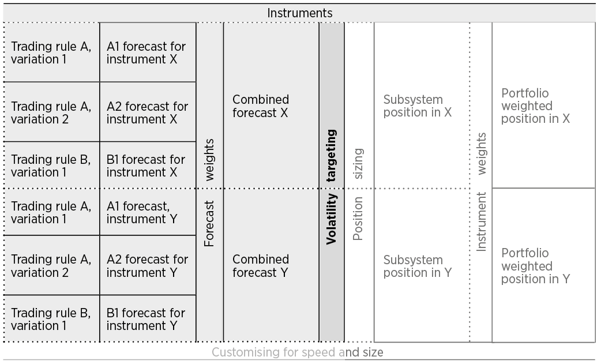
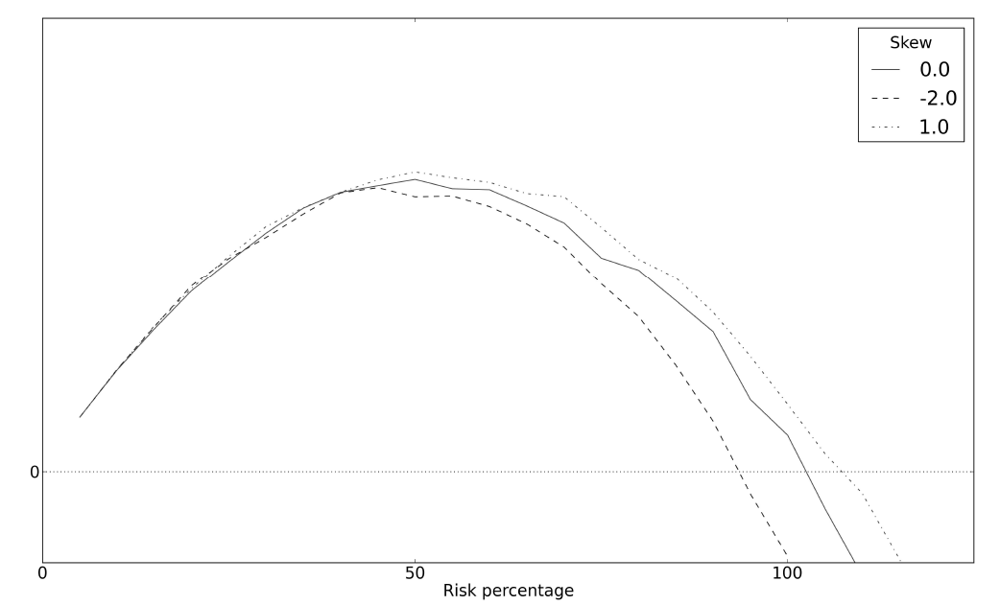

# Chapter Nine. Volatility targeting｜英文原文版

来源：`OEBPS/Autopilot_ebook-18.xhtml`。按 EPUB 的正文、表格、插图与脚注顺序转排；字体、行内样式及印刷页码可能不同于原书。

## Chapter Nine. Volatility targeting

Do you remember Sergei, dispenser of opaque trading advice in chapter seven? He told me that there were three issues to consider when deciding how big a position we should have. The first thing to consider was how much we liked the trade. You’ve dealt with that by creating a single forecast for each instrument you’re trading – either a discretionary forecast for semi-automated traders, a constant forecast for asset allocating investors, or a combined forecast for staunch systems traders. Now we’re ready to return to Sergei’s second question, “How much can you afford to lose?”96

### Chapter overview

| The importance of risk targeting | Why getting your appetite for risk right is so important and the key issues involved. |
| --- | --- |
| Setting your volatility target | The measure of how much risk you’re prepared to take and how to calculate it. |
| Rolling up profits and losses | How your volatility target should be adjusted when you lose or make money. |
| What percentage of capital per trade | Relating the volatility targeting concept to traditional money management where you limit bets to a specific percentage of capital. |

### The importance of risk targeting

Deciding your overall trading risk is the most important decision you will have to make when designing your trading system. Nearly all amateur traders lose money and most do so because their positions are too large compared to their account size.97 Suffering painful losses is the main reason why both amateurs and professionals meddle with trading systems rather than letting them run unimpeded.

Making this decision correctly involves understanding two things. Firstly you must understand your system, in particular its likely performance and whether it’s likely to have positive or negative skew. You must avoid overconfidence, as I discussed in chapter one. You should not extrapolate over-fitted back-test results to create high expectations of return. Are you sure your strategy can generate a Sharpe ratio of 2.0 after costs? Are you really, really sure?

Next you must understand yourself, in a complete and honest way. Can you face the possibility of regularly losing 5%, 10% or 20% of your own capital in a day?

These points also apply to those paid to manage other people’s money. Additionally professionals need to understand their clients’ tolerance for losing money. If investors aren’t truly comfortable with the risks being taken then you will see them redeeming in droves when large losses occur.

### Setting a volatility target

Imaginary conversation between a financial advisor and myself:

Financial ‘expert’: “How much risk do you want to take?”

Me: “What do you mean by risk?”

Financial ‘expert’: “Er... well how would you define your tolerance for losing money?”

Me: “Well it could be how much I’m prepared to lose next year. Or tomorrow. Or next week. Are you talking about the absolute maximum loss I can cope with, or the average, or the worst loss I’d expect 95 days out of 100 (the so called ‘Value at Risk’)? Which question would you like me to answer?”

Financial ‘expert’: “Hold on. I need to speak to my supervisor...”

Joking aside, how do we answer this deceptively simple question? To keep things simple I use a single figure to measure appetite for risk – an expected standard deviation, which I call the volatility target. You can measure this as a percentage, or in cash terms, and over different time periods. So for example the daily cash volatility target is the average expected standard deviation of the daily portfolio returns. As it’s a cash value you need to specify the currency that your account or fund is denominated in.

When I first discussed risk on page 44 I talked about predictable and unpredictable risks. Your volatility target is the long-term average of expected, predictable, risk. The exact predictable risk you have on any given day will depend on the strength of your forecasts, and on the current expected correlation of asset prices. You’ll also face unpredictable risks if your forecast of volatility or correlations is wrong. In any case the actual amount you lose or gain on any given day will be random, since even a perfect estimation of risk only tells you what your average gains and losses will be.

I find it’s easier to look at an annualised cash volatility target, which will be the annualised expected daily standard deviation of returns. As before you annualise by multiplying by the square root of time; given there are around 256 trading days in a year this will be 16. Beware: the annualised volatility target isn’t the maximum, or even the average, you might expect to lose in a year.98 Indeed it’s quite probable you will sometimes lose more than that in a year.

It’s also easier to separate out your cash account value and the appropriate level of risk to run on that money. The amount of cash you are trading with is your trading capital. You then decide what your volatility target will be as a percentage of that capital. If you multiply this percentage volatility target by your trading capital, then you’ll get your volatility target in cash terms. So with a million dollars of trading capital and an annualised 10% percentage volatility target, you would have an annualised cash volatility target of $100,000.

In the rest of the chapter I’ll be dealing with the implications of where you set your trading capital and percentage volatility target, rather than setting your cash volatility target directly. This means that amateur traders with £1,000 in their account can use the same guidelines to set percentage volatility target as multi-billion Euro hedge funds.

Here are the points to consider when setting your trading capital and percentage volatility targets:

- How much can you lose?: How much money do you have to trade or invest?

- How much risk can you cope with?: Can you afford to lose it all? Can you afford to lose half? What probability of losing half would you be comfortable with? What probability of losing 90% of it over ten years would make you lose sleep?

- Can you realise that risk?: Given the instruments you are investing in and the safe amount of leverage (if any) you can use, can you actually hit the risk target?

- Is this level of risk right for your system?: Given the characteristics of your trading system, expected Sharpe ratio and skew, does the amount of risk make sense?

#### How much can you lose?

The initial trading capital is the amount of cash you start with, bearing in mind that there is a chance that you might lose all or nearly all of it, although hopefully that’s quite unlikely. I’ll show you below how to set your percentage volatility target based on exactly how relaxed you are about losses.

For an institutional investor things are usually straightforward; you are given £100 million and you would use 100% of it. Sometimes you might not go ‘all in’ if you have guaranteed some of the capital, or need to retain cash for potential redemptions.

If you’re investing your own money then your trading capital will depend on your savings and how much you are willing to commit to such a risky endeavour. In any case – and I can’t emphasise this enough – never put in more than you can afford to lose. Never trade with borrowed money, or money earmarked to pay off debts.99 Even if you follow the advice in this book to the letter there is still a remote chance that you will be unlucky enough to burn through virtually your entire account.

#### Can you cope with the risk?

Let’s say you decide to put $100,000 of trading capital into your account and run with a 200% volatility target; equating to an annualised cash volatility target of $200,000. Could you cope with losing $20,000 in one day? What about having a cumulative loss, or draw-down, of over $60,000? If it isn’t your money, could your client cope with it?

I hope so because you’re likely to see those kinds of losses within the first few weeks of trading! As table 20 shows, a $20,000 loss would typically be seen every month, and a $62,000 cumulative loss around 10% of the time.100

Table 20: What kind of losses do we see for a particular volatility target?

| Expected | Percentage volatility target 25% | Percentage volatility target 50% | Percentage volatility target 100% | Percentage volatility target 200% |
| --- | --- | --- | --- | --- |
| Worst daily loss each month | $2,500 | $5,000 | $10,000 | $20,000 |
| Worst weekly loss each year | $6,900 | $14,000 | $28,000 | $55,000 |
| Worst monthly loss every ten years | $16,000 | $32,000 | $63,000 | $80,000 |
| Worst daily loss every 30 years | $5,400 | $11,000 | $22,000 | $43,000 |
| 10% of the time, the cumulative loss will be at least | $9,300 | $15,000 | $30,500 | $62,000 |
| 1% of the time, the cumulative loss will be at least | $11,000 | $18,500 | $37,000 | $75,000 |

The table shows various expected losses (rows), and different percentage volatility targets (columns), given trading capital of $100,000, assuming Sharpe ratio 0.5 and zero skew with Gaussian normal returns.

Now, table 20 assumes you have zero skew in your returns. Are you running a positive skew trend following system, or a negative skew relative value or carry rule? Systems with different skew have varying risk properties. As table 21 shows, the worst days, weeks and months for a negative skew strategy are much nastier than with zero skew. For positive skew strategies large losses are much less likely, as you can see in table 22. However the typical cumulative loss is higher.

With negative skew it’s vital to have sufficient capital to cope with the very bad days, weeks and months you will occasionally see. This is especially true with high leverage and the risk your broker will make a margin call at the worst possible time. With positive skew the difficulty is psychological; committing to a system when you spend most of your time suffering cumulative losses.

Table 21: How do typical losses look with negative skew? Individual losses are higher than in table 20, but cumulative losses are smaller

| Expected | Percentage volatility target 25% | Percentage volatility target 50% |
| --- | --- | --- |
| Worst daily loss each month | $3,100 | $6,100 |
| Worst weekly loss each year | $8,500 | $17,000 |
| Worst monthly loss every ten years | $18,100 | $36,000 |
| Worst daily loss every 30 years | $11,500 | $23,000 |
| 10% of the time, the cumulative loss will be at least | $3,700 | $7,400 |
| 1% of the time, the cumulative loss will be at least | $7,100 | $14,000 |

The table shows various expected losses (rows) and different percentage volatility targets (columns), for a negative skew option selling strategy given trading capital of $100,000.101 The strategy has a Sharpe ratio of 0.5 and skew of around -2.

Table 22: How do loss patterns change for positive skew? With positive skew individual losses are much better than in tables 20 and 21, but average cumulative losses a little worse

| Expected | Percentage volatility target 25% | Percentage volatility target 50% |
| --- | --- | --- |
| Worst daily loss each month | $2,000 | $4,000 |
| Worst weekly loss each year | $6,100 | $12,000 |
| Worst monthly loss every ten years | $15,000 | $30,000 |
| Worst daily loss every 30 years | $2,800 | $5,700 |
| 10% of the time, the cumulative loss will be at least | $11,000 | $22,000 |
| 1% of the time, the cumulative loss will be at least | $12,000 | $24,000 |

This table shows various expected losses (rows) given different percentage volatility targets (columns), for a positive skew trend following strategy, with trading capital of $100,000.102 The strategy has a Sharpe ratio of 0.5 and skew of around 1.0.

Earlier I said you could frame risk by how much you are prepared to lose in a lifetime. That’s difficult to quantify without knowing your life expectancy, so let’s assume you will trade for ten years. In table 23 I show the chances of ending a decade-long trading career with less than half, and less than 10%, of your trading capital left, given a certain percentage target volatility.

Only you know how much risk you can cope with. However you, or your clients, must be able to stomach the likely losses involved. If you can’t then you should set a lower percentage volatility target, or if possible consider using less initial trading capital.

Table 23: What are the chances of losing all, or most, of my money?

|  | Percentage volatility target |  |  |  |
| --- | --- | --- | --- | --- |
|  | 25% | 50% | 100% | 200% |
| Chance of losing half | <1% | 10% | 40% | 93% |
| Chance of losing 90% | <1% | 1.1% | 22% | 88% |

The table shows chances of ending a ten-year trading career losing a given proportion (rows), of initial trading capital given different percentage volatility targets, assuming Sharpe ratio is 0.50 and zero skew.103

#### Can you realise that risk?

If you’re investing in leveraged derivatives like futures and spread bets then very high levels of risk are attainable, even if they aren’t desirable. Such systems can easily run at over 100% annualised target volatility with margin to spare.

But if you can’t get enough, or any, leverage then you might have a problem achieving your target volatility. If you are buying short-term government bonds with an expected volatility of perhaps 5% a year, then without leverage it’s impossible to create a portfolio with a 50% volatility target. With no leverage you are restricted to the amount of natural risk that your instruments have. With only 100% leverage you are limited to twice that natural risk, and so on.

Because it’s mostly a problem for non-leveraged asset allocating investors I’ll go into more detail about this in the relevant part of part four, chapter fourteen.

Is there too much leverage?

Even if you are able to leverage up as required to hit a particular percentage volatility target, it would be very unwise if excessive gearing is needed. This is particularly problematic for negative skew instruments and trading strategies, which tend to have low natural risk – until they blow up.

I’ve mentioned before the huge appreciation of the Swiss franc that happened in just minutes in January 2015. At the start of the day in question the natural risk of holding a position in EUR/CHF was tiny, at around 1% a year. If this was the only instrument you were trading then to achieve a 50% annualised volatility target would have needed 50 times leverage. Retail FX brokers had no compunction in allowing this, with leverage up to 500 times available from some providers.

If you had been on the wrong side of this move, with your entire trading capital leveraged 50 times, then a 2% appreciation would have wiped you out. But the actual move was over 16%! Only those with leverage of 7 times or less would have survived the day, which implies a maximum achievable 7% volatility target.

You should ensure that with a given percentage volatility target any individual position would not wipe you out after the largest conceivable move. Diversifying amongst many different instruments will also help, and we’ll return to that in chapter eleven, ‘Portfolios’. A 16% move with 50 times leverage would have been just about survivable if EUR/CHF was only 10% of your portfolio, assuming no other losses had occured elsewhere.

Ideally such low volatility instruments, requiring insanely high leverage, should be excluded from any trading system.

#### Is this the right level of risk?

Suppose you’ve decided on a 200% volatility target. You’ve got the leverage you need; but you haven’t got carried away. Furthermore you’re confident that you will cope with the spectacularly bumpy ride tables 20 to 23 imply you’ll be getting. Assuming you are a profitable trader, should you then set your target at 200% and expect to end up incredibly wealthy through the magic of compound interest?

The short answer is no. There is a Goldilocks level of risk – not too little and not too much. Even if you are willing and able to go above this level you shouldn’t, as you will end up with more than your tongue getting burnt.

Naively if you expect to be profitable then you should bet as much as you’re allowed to. However this ignores the compounding of returns over time. Suppose you have a fantastic expected average return of 100% on each trade for a given bet size. You then lose 90% of your capital on your first trade and make 190% on your next trade. Unfortunately there is only 29% of your cash left, even though you’ve achieved the expected average return of 100% per trade.104 To maximise your final profits, the optimal bet to make is actually a quarter of the original size.

Nearly all professional gamblers, many professional money managers and some amateurs in both fields know that this optimal point should be calculated using something called the Kelly criterion.105 Kelly has some useful but potentially dangerous implications for how you should set your percentage volatility target.

A simple formula can be used to determine how you should set your volatility target, given the underlying Sharpe ratio (SR) of your trading system. You should set your volatility target at the same level as your expected SR. So if you think your annualised SR will be 0.25 then you should have a 25% annualised volatility target.

You can see this in figure 21, where for an SR 0.5 system the best performance is achieved with the optimal 50% volatility target. This is true for all three systems shown, regardless of skew.

Figure 21: Kelly criterion implies the optimal risk percentage for a Sharpe ratio 0.5 system is 50%. With higher risk things go badly, especially for negative skew strategies.

The X-axis shows the percentage volatility target and the Y-axis the geometric mean of returns which Kelly optimises.

Table 24: Big Sharpe means Bigger Risk and exponentially Bigger Profits

| Expected Sharpe ratio | Optimum percentage volatility target | Expected return |
| --- | --- | --- |
| 0.2 | 20% | 4% |
| 0.5 | 50% | 25% |
| 0.75 | 75% | 56% |
| 1.0 | 100% | 100% |
| 2.0 | 200% | 400% |

The table shows the expected annual return (as a percentage of trading capital), given different Sharpe ratio (SR) (rows) and using the optimal Kelly percentage volatility target. Expected return is SR multiplied by percentage volatility target.

This finding is potentially dangerous when used by an over confident investor. It’s very easy with back-testing software to get over-fitted performance with a Sharpe ratio (SR) of 2, 3 or even higher. If you believe those are attainable then a risk percentage of 100% or 200% seems justified. As table 24 shows, running at a 200% risk with SR of 2.0 implies huge returns of 400% a year!

Unfortunately many people with capital of $20,000 will conclude it’s possible to earn 400% a year, or $80,000, as full-time traders. There are also plenty of brokers who will happily provide them with the necessary leverage. Most of these people will quickly lose their $20,000, as they won’t achieve their expected SR. It’s very difficult to know exactly what your true Sharpe ratio really would have been in the past, with back-tests giving you only a rough upwardly estimate, and it’s utterly impossible to know what SR to expect in the future.

Even if you had a crystal ball, and knew your expected Sharpe precisely, you could be unlucky and have a decade or more of sub-par performance. Figure 21 shows that if you realise an SR of only 0.5 then a 200% volatility target will see you ending up deep underwater. In general if you get your estimate of SR wrong and bet more than the optimal then you have a high chance of losing your shirt.

Recommended percentage volatility targets

I run a highly diversified futures trading system with around 45 instruments, eight trading rules drawn from four different styles, and 30 trading rule variations. In a 35 year back-test, conservatively fitted with out of sample bootstrapping, it has a Sharpe ratio (SR) of around 1.0 after costs, but the highest volatility target I’d advocate using for it is 37%, rather than the 100% suggested by the Kelly criterion and the back-tested SR.106 Why such a conservative number – am I a wimp?

There are several reasons for my caution. Firstly, it’s unlikely a back-tested SR will be achieved in the future. On average realised performance is never as good as in back-tests. This is because it’s very easy to over-fit if you ignore the advice in chapters three and four. Additionally it’s difficult with ideas first testing to avoid using only trading rules that you already know would have worked.

Even if you could avoid over-fitting actual profits are unlikely to be as high as they could have been in the past. This is because future asset returns are likely to be lower than in the historical data set we usually use for back-testing, as I discussed in chapter two, ‘Systematic Trading Rules’, in the section on achievable Sharpe ratios (from page 52).

To find realistic achievable SR from back-test results a good rule of thumb is to use the ratios in table 14 (page 100). These suggest that for an out of sample bootstrap, as I’ve used in my own system, a ratio of 0.75 should be applied to find a more realistic Sharpe ratio. Much lower ratios should be used if you haven’t been as careful with your fitting. I also said in chapter two that I think the absolute maximum SR that staunch systems traders should expect to achieve is 1.0, regardless of how good their back-test is.

Secondly, using the full Kelly criteria is far too aggressive, because of the risk of getting a poor run of luck and the large drawdowns that can result, even if SR expectations are correct.107 In table 23 someone using the correct Kelly target of 50% would have a 10% chance of losing half their money after ten years; which most people would find worrying. It’s far better to use Half-Kelly and set your risk at half the optimal. Column A of table 25 shows the recommended percentage volatility target for a given realistic back-tested SR.

For my own system I started with the back-tested Sharpe ratio of 1.0. Multiplying by 0.75 (as I’m using out of sample bootstrapping) from table 14, this gives me a realistic SR of 0.75. With full Kelly criterion betting that would be a 75% volatility target, which I then halved to get 37% (rounding down).

This assumes your trading system, like mine, has zero or positive skew. You should be very careful if you have expected negative skew. As figure 21 shows, the penalty for too much risk is greater with negative skew than when skew is positive, or zero. As I discussed in chapter two, many negative skew strategies have fantastic SR in back-test, but I advise you to run them at half the risk you’d use for a more benign trading system. Column B of table 25 shows the recommended percentage volatility target for negative skew systems.

Table 25: What volatility target should staunch systems traders use?

|  | Recommended percentage volatility target |  |
| --- | --- | --- |
| Realistic back-tested SR | (A) Skew>0 | (B) Negative skew |
| 0.25 | 12% | 6% |
| 0.40 | 20% | 10% |
| 0.50 | 25% | 12% |
| 0.75 | 37% | 19% |
| 1.0 or more | 50% | 25% |

The table shows the recommended percentage volatility target for those who can back-test their dynamic trading systems, depending on the skew of returns (columns) and achievable back-tested Sharpe ratios (SR) (rows) after making adjustments to simulated results from table 14 on page 100. Optimal volatility target is calculated using Half-Kelly. For negative skew strategies this is cut in half again. We assume a maximum SR of 1.0 is achievable.

The returns of asset allocating investors are limited by their use of a static trading strategy. With a small, relatively undiversified portfolio you shouldn’t expect high Sharpe ratios. As I said in chapter two, if you’re holding a dozen equities in different industries but from the same country then you probably will achieve an SR of around 0.20. Those with larger portfolios diversified across multiple asset classes could get a maximum realistic SR of 0.4.

Column C of table 26 shows the correct targets given asset allocators’ SR expectations. However, as you’ll see in chapter fourteen, it’s unlikely even this level of volatility can be achieved as these investors don’t use leverage.

Semi-automatic traders have systems which cannot be back-tested and usually have a small, relatively un-diversified, set of ad-hoc instruments. I would initially assume an achievable SR of 0.20 unless you are very experienced, are trading across multiple asset classes, and have a good track record with real money. As you saw in chapter two, in my opinion an SR of 0.5 is the maximum safe achievable level, so you should set the volatility target at no more than 25%.

Again the target should be halved if you are trading a strategy that is likely to have negative skew, such as selling option volatility, or exhibits a similar return pattern with steady profits on most bets with occasional large losses. Columns D and E of table 26 show the appropriate volatility targets for this type of trader.

Table 26: What volatility target should asset allocating investors and semi-automatic traders use?

| Expected SR | Recommended percentage volatility target (C) Asset allocating investor | Recommended percentage volatility target (D) Semi-automatic trader, zero or positive skew | Recommended percentage volatility target (E) Semi-automatic trader, negative skew |
| --- | --- | --- | --- |
| 0.20 | 10% | 10% | 5% |
| 0.30 | 15% | 15% | 7% |
| 0.40 | 20% | 20% | 10% |
| 0.5 or more | 20% | 25% | 12% |

This table shows the recommended percentage volatility target depending on the type of trader and expected skew (columns), and Sharpe ratio (SR) expectations (rows). The optimal volatility target is calculated using Half-Kelly. We assume asset allocators shouldn’t expect more than 0.40 SR and semi-automatic traders won’t get more than 0.50 SR. Asset allocators are assumed to have zero skew. We halve volatility targets for negative skew semi-automatic trading.

This implies that nobody will use more than a maximum 50% volatility target and most people should use less. Tables 20 to 23 illustrate that a 50% annualised volatility will mean some pretty substantial losses from time to time. Just because the volatility targets in tables 25 and 26 are optimal it doesn’t mean they will suit you, or that your broker will permit them. It just means you should never run a higher risk target than this.

#### When the percentage volatility target should be changed

I don’t advocate changing your percentage volatility target since there is a potential risk of meddling; reducing it when you don’t trust your system and increasing it when it agrees with you. The exception is if you have grossly miscalculated your tolerance for risk. You begin trading on day one with a 50% target, but the first big loss then sends you or your investors into a panic. In this case you should significantly reduce your percentage target. However it should ideally be a one off change and only ever downwards.

To avoid this scenario it’s better to start with significantly lower trading capital and gradually increase it until you have the full amount invested. Keep the percentage volatility target fixed and allow your cash volatility to increase up to the point just before you get uncomfortable. This also helps with gaining confidence in your trading strategy and testing any automated systems.

### Rolling up profits and losses

Once set your percentage volatility target shouldn’t need changing. However your trading capital will definitely change from its initial value. This implies that your cash volatility target will also be adjusted over time.

Let’s imagine you have trading capital of $100,000 and after reading this chapter you’ve decided on a 30% volatility target. You begin trading with the appropriate $30,000 annualised cash volatility target. Then on day one you lose $2,000. Should you continue to use a $30,000 volatility target?

You should not. The implication of the Kelly criterion is that you should adjust your risk according to your current capital. You did have $100,000 of capital, but now you only have $98,000. Instead of having a 30% volatility target ($30,000 of $100,000) you effectively have a target of $30,000 divided by $98,000 = 30.6%. This might not seem a big deal, but you are now betting more than you intended and you’ve slightly increased your chances of going bankrupt. If you make further losses the situation could deteriorate fast.

The correct thing to do is to reduce your volatility target to 30% of your current capital of $98,000, or $29,400.

Now suppose things start to improve and you make $2,000 back. Your accumulated losses have reduced to zero and your volatility target will be back to 30% of $100,000, or $30,000. After another profitable day making $3,000 you’re now in positive territory with an account value of $103,000 – higher than your starting capital. Should you now increase your risk appetite above its initial level?

If you want to maximise your wealth then Kelly says you should roll up your profits and increase your capital.108 The new volatility target will be 30% of $103,000, or $30,900. This means you will be compounding your returns, which over the long run will increase them faster.

You should also reduce your trading capital, and hence your cash volatility target, if you withdraw money from your trading account or investors redeem. Similarly if you put more funds in then you would normally increase your maximum capital. There are exceptions such as if you are putting cash into a leveraged account to meet margin or reduce borrowing, but you don’t want to increase the amount of capital at risk.

In my own trading an automated process checks my account value, and adjusts risk accordingly, on an hourly basis. If your system is not automated and if you are running with more than a 15% volatility target I would recommend checking at least daily. With a lower target you can check more infrequently, but if you’re using leverage I’d advise always calculating your volatility target at least once a week.

### What percentage of capital per trade?

Traditional money management systems allocate a certain percentage of trading capital to be risked on each trade or bet. If you’re familiar with these systems you might be wondering how this relates to the volatility targeting done here. It is possible to infer the percentage volatility target that is implied for a particular trading system if you know the approximate holding period, the average number of positions held and the maximum amount of capital put at risk on each trade. You just need to assume that the average bet is half the maximum, which is the same ratio between my recommended average forecast of 10 and maximum of 20.

Table 27 gives the results, assuming an average of two positions are held at once. If a greater or fewer number are traded on average, then you just need to multiply or divide the figures appropriately. So with an average of four positions you’d double them, and for a single position halve them.

Table 27: What is the volatility implied by a trading system’s holding period and bet size?

|  | Implied percentage volatility target |  |  |  |  |
| --- | --- | --- | --- | --- | --- |
|  | Maximum percentage of capital at risk per trade |  |  |  |  |
| Average holding period | 1% | 2.5% | 5% | 10% | 20% |
| 1 day | 40% | 100% | 200% | ! | ! |
| 1 week | 16% | 40% | 80% | 160% | ! |
| 2 weeks | 8% | 19% | 38% | 76% | 152% |
| 6 weeks | 4% | 10% | 21% | 41% | 82% |
| 3 months | 3% | 7% | 13% | 27% | 53% |

The table shows the implied annualised percentage volatility target for a given average holding period (rows) and maximum percentage of capital allocated to each bet (columns), assuming an average of two bets are held in the portfolio. “!” indicates volatility greater than 200% per year.

As an example take the system which I briefly discussed in the introductory chapter. This held positions for around a week, with no more than 10% of capital at risk. Let’s assume on average that two bets are made at once, although the author wasn’t clear on this point (a common shortcoming in trading books).

This all sounds fairly sedate but from the table this works out to a suicidal 160% volatility target. If this target is Kelly optimal then the achievable Sharpe ratio must be at least 1.6, implying an expected return of 1.6 × 160% or 256% a year! There is some serious overconfidence at work here. Worse still, this is nowhere near the most aggressive system I’ve ever seen.

### Summary of volatility targeting

| Percentage volatility target | Desired long run expectation of annualised standard deviation of percentage portfolio returns. A maximum of: • The level of risk that you are comfortable with given tables 20 to 23. • What is practically attainable given your access to leverage and the natural risk of your instruments (see the asset allocating investor example in part four for more details). • The highest level that is safe given the natural volatility of your instruments, and how much leverage they need. Avoid very low volatility instruments requiring insanely high leverage. • The recommended percentage volatility in tables 25 and 26, depending on the back-tested or expected Sharpe ratio and skew of your trading system, and the type of trader or investor you are. Percentage volatility target should remain unchanged. |
| --- | --- |
| Trading capital | The amount of capital you currently have at risk in your account. Every day you should add profits and any injections of funds. Deduct any losses and withdrawals made from the account. Measured in currency. |
| Annualised cash volatility target | Long run expectation of annualised standard deviation of daily portfolio returns. Equal to the trading capital multiplied by the percentage volatility target. Measured in currency. |
| Daily cash volatility target | Long run expectation of daily standard deviation of daily portfolio returns. Annualised cash volatility target divided by ‘the square root of time’, which for a 256 business day year is 16. Measured in currency. |

In the next chapter I will come back to the final piece of advice I got from Sergei and think about how the risk of an instrument determines what size position we should take.

Footnote 96. Many trading books use the term ‘money management’ to cover both volatility targeting and position sizing (which is discussed in the next chapter), but I prefer to separate them out for the reasons I explained in chapter five, ‘Framework Overview’.

Footnote 97. The other reason is that they trade too much, which is covered in chapter twelve, ‘Speed and Size’.

Footnote 98. There are several reasons why your expected average annual loss wouldn’t be equal to the annualised expected daily standard deviation. Firstly, if your Sharpe ratio is greater than zero then your expected average annual loss will be smaller than one sigma. Secondly, in the event of losses you’d probably reduce your positions if you’re using trend following rules or stop losses. Thirdly, as you’ll see in the next chapter ‘Position Sizing’, you should reduce your positions when price volatility rises, which reduces losses in periods of rising risk. Also, as you’ll see later in this chapter, you’d reduce your risk target throughout the year if you made losses, and vice versa. More technically if consecutive returns aren’t independent, and have time series autocorrelation, then annualising by multiplying by 16 is a poor approximation.

Footnote 99. This isn’t a ban on leverage, but if your trading capital is £100,000 you should actually have that available to lose, and none of it should be borrowed. I’ll discuss leverage in more detail below.

Footnote 100. I’ve assumed a Sharpe ratio (SR) of 0.5 here, and the returns are drawn from a Gaussian normal distribution. Using a different SR won’t affect these numbers much, although the annual loss figures will be slightly better (worse) if the true Sharpe is higher (lower).

Footnote 101. Results are from a back-test of a strategy which involves persistently selling futures option straddles.

Footnote 102. Figures from back-testing a futures system using a mixture of relatively fast trend following rule variations.

Footnote 103. The results would be slightly worse for negative skew, and slightly better for positive skew. For example with a 200% volatility target the chances of losing half your capital over ten years are 90% with positive skew of 1.0 and 97% with negative skew of -2.0.

Footnote 104. After the first loss you have 10% of your capital left. A 190% return on this generates another 19%, for a total of 29%.

Footnote 105. The Kelly criterion maximises the geometric mean of returns, which is what we get from compounding. It was invented by physicist John Kelly in 1956. There is an excellent and highly readable book on this subject – Fortune’s Formula by William Poundstone.

Footnote 106. At the time of writing I’m using a 25% volatility target, reflecting my relatively low appetite for risk.

Footnote 107. Here is famous Kelly fan, hedge fund manager and Blackjack card counter Ed Thorpe: “My experience has been that most cautious … investors who use Kelly find the frequency of substantial bankroll reductions to be uncomfortably large.” (Quoted in Fortune’s Formula.)

Footnote 108. Someone who is trading as a hobby and starting with a small stake would probably do this. Those investing other people’s money should also add all profits after fees to their trading capital, so that returns are compounded, unless they are committed to paying coupons or guaranteeing a certain proportion of the initial investment made. If you are more risk averse then rolling up profits might not make sense, if for example you live partly or wholly off your trading income. This is the approach that I take.
