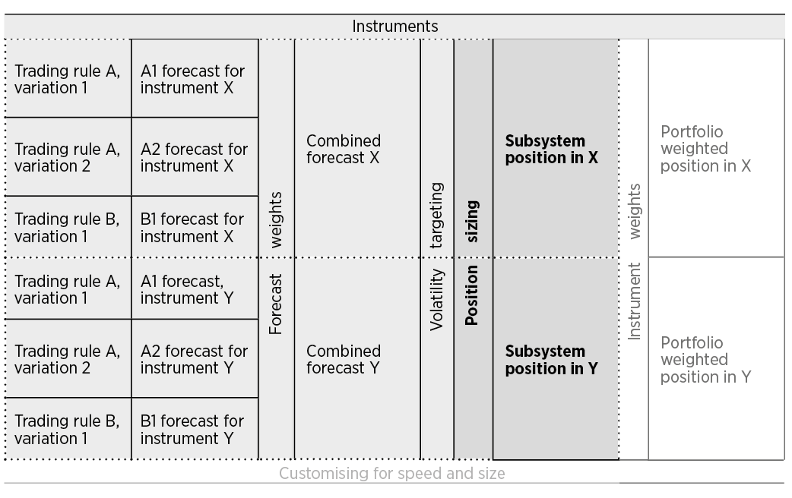
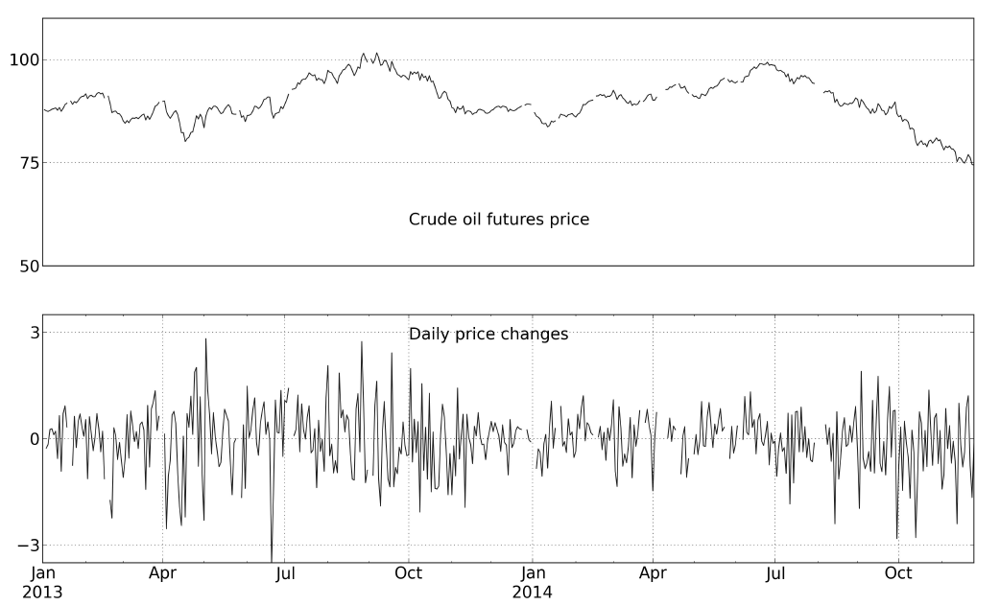
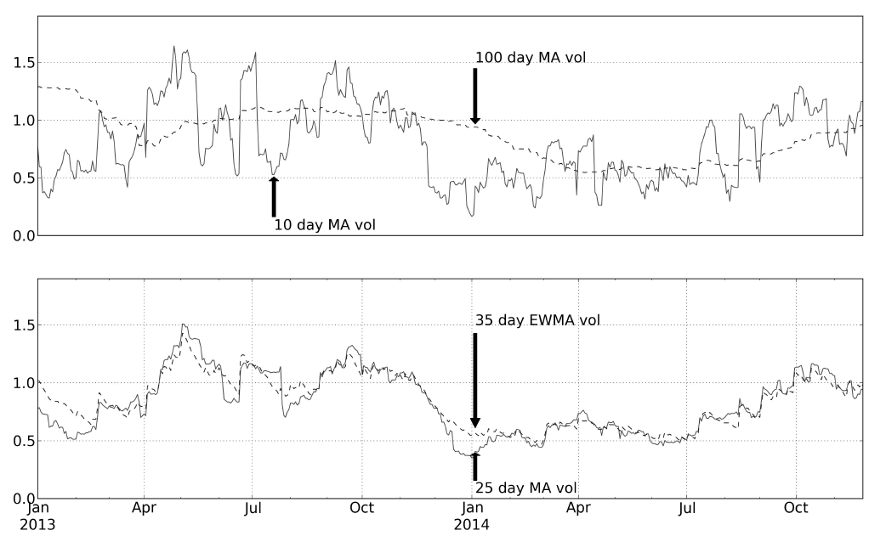

# 第十章　头寸规模｜中文忠实版

原书：Robert Carver, *Systematic Trading*, Chapter Ten, “Position Sizing”；EPUB `OEBPS/Autopilot_ebook-19.xhtml`，定位块 `ch10#0001–0130`。以下依原书顺序翻译正文、三张文字表、图注与脚注。块号不是印刷页码。图中的英文标签保留于原图；图 23 内写 35 天 EWMA，正文与脚注 113 写 36 天，两处照原样保留。

## 第十章　头寸规模（`#0001–0005`）

让我们回到第七章中谢尔盖的三个问题。第一，你有多看好这笔交易？这就是每个标的的预测值。第二，你承受得起多少损失？你应当根据期望的目标波动率，知道自己愿意把多少交易资本筹码放到假想赌场的绿色台面上。

到目前为止都还好。但你究竟应该买卖多少股股票、多少债券、多少点差投注点数或多少期货合约？如果你在纽约交易原油期货，一个 `−6` 的合成预测值和 `£1,000,000` 的年化现金目标波动率，在实际操作中意味着什么？为回答这个问题，我们需要回到谢尔盖的第三个问题：你的交易有多大风险？

知道这一点后，你就可以离开预测值和交易规则的抽象世界，决定真实金融工具的实际持仓规模。

### 本章概览（`#0006–0012`）

| 问题 | 本章要回答的内容 |
| --- | --- |
| 风险有多大？ | 如果持有一个单位的标的，会承担多少风险？ |
| 波动率目标与头寸风险 | 现金波动率目标和各标的的风险有什么关系？ |
| 从预测值到头寸 | 给定你对预测的信心、现金波动率目标和头寸风险，应持有多大的头寸？ |

### 风险有多大？（`#0013–0014`）

持有一个标的的预期风险是多少？¹⁰⁹ 如果你持有一股苹果股票或一手原油期货合约，会面对多大的危险？

#### 交易单位与单位价值（`#0015–0020`）

先问一个带点哲学意味的问题：一个标的的“一个”到底是什么？我把它定义为标的交易单位（*instrument block*）。如果“一个”标的的价格上涨 `1%`，你会赚或亏多少？这就是单位价值（*block value*）。

这些定义对股票投资者似乎微不足道。“一股”苹果股票就是一股苹果股票。如果股价为 `$400`，买入一个单位恰好需要 `$400`。如果股价上涨 `1%`，由 `$400` 到 `$404`，你就赚 `$4`。苹果股票和大多数其他股票的自然交易单位是一股，单位价值是股价的 `1%`。不过，为降低成本，你有时会以更大的单位交易，通常为 `100` 股。这时单位价值是 `100 × 1% × 股价`，数值等于一股的价格。

但事情并非总这么简单。例如，你可以通过英国的金融点差投注公司，以指数每变动一点 `£10` 的投注额押注富时指数下跌。如果富时指数上涨 `1%`，从 `6500` 升到 `6565`，你将亏损 `£650`。这里的单位价值是价格 `1%` 的十倍。

期货合约的单位价值也并不直观。NYMEX 的 WTI 原油期货以每桶美元报价，但每手期货代表 `1000` 桶。因此，价格上涨 `1%`，从 `$75` 到 `$75.75`，持有一手多头将获得 `$750`，其单位价值就是 `$750`。

一手欧洲美元期货代表名义上借入 `$100万`、期限为三个月的成本，报价等于 `100` 减去年利率。如果价格上涨 `1%`，从 `98.00` 到 `98.98`，应付利率便从 `2%` 降至 `1.02%`。因为三个月是四分之一年，这笔贷款节省的利息是 `$100万 × 0.98% × 0.25 = $2,450`。单位价值就是 `$2,450`。¹¹⁰

#### 价格波动率（`#0021–0040`）

我们已经确定：对于一个多头标的，其报价下跌 `1%`，每个交易单位都会带来一定损失，损失数额等于单位价值。但价格下跌 `1%` 的可能性有多大？股票价格在几分钟内就可能变动 `1%` 或更多，而两年期债券可能几个月都不会变动 `1%`。你该如何把这些不同的风险水平纳入考虑？

这也是波动率标准化要做的事。你需要计算标的每日百分比收益率的预期标准差；我把它定义为标的的价格波动率。例如，普通股票的价格波动率约为 `1%`；而在我写作时，德国两年期 Schatz 国债期货的日标准差仅为 `0.02%`。

**概念：衡量近期标准差。** 请记得，我对可预测风险的标准定义（见原书第 44 页）是价格的预期日标准差。估计未来波动率最简单的方法之一，是衡量近期标准差。由于波动率往往具有持续性，这个方法的效果出乎意料地好：如果市场过去几周非常疯狂，随后几周很可能继续疯狂。

我建议用以下三种方法之一计算近期标准差。

第一种方法是目测图表。看图 22 可以发现，在图中最后一个月，原油期货平均每天变动约 `$1.0`，相当于末端价格 `$75` 的 `1.33%`。这种方法适合本来就可能盯着图表看的半自动交易者，但我不建议其他人采用。

第二种方法是在一个滚动时间窗口内，精确计算价格变化的标准差；这个窗口称为波动率回看期。你可以使用 `10` 个工作日左右的短窗口（约两周），或 `100` 天之类的较长窗口。

如图 23 上半部分所示，窗口越短，波动率估计越嘈杂；你会在第十二章看到，这意味着更高的交易成本，但它能很快对变化作出反应。较慢的估计更平稳，却需要更长时间适应新的波动环境。哪个回看期最好，并不显而易见。

在我的研究中，从几天到六个月的回看期，扣除成本前的表现几乎没有差别。¹¹¹ 为避免过度拟合，我决定默认使用 `25` 个工作日，也就是五周。这个数值对应行业中最常用的取值，例如 RiskMetrics™ 系统。¹¹² 第十二章“速度与规模”会讨论何时及为何对交易费用高的标的使用更长回看期。

图 23 下半部分显示用 `25` 天回看期估计的波动率，也显示了我第三种方法的估计结果：使用标准差的指数加权移动平均（EWMA）。

与简单移动平均相比，这种方法给出的数值更平稳，同时仍能迅速回应市场状态的显著变化。我为它选定的默认回看期是 `36` 天，与简单移动平均的 `25` 天窗口等效。¹¹³ 两种移动平均的波动率计算方法详见附录 D，原书第 312 页。

使用近期价格波动率，通常能很好地算出按风险调整的头寸规模。但是，如果你在 `2007` 年初用这种方法交易信用违约互换，或在美国零利率时期的任何时候交易欧洲美元期货曲线前端，或在 `2015` 年 `1` 月初交易瑞士法郎外汇，结果都可能是一场灾难。

在所有这些时期，价格波动率都非常低。如果波动率低，你就会买入大量交易单位，因为每个单位的预期风险很小。但是，平静期之后，市场常会突然在一夜之间变得疯狂，让你背负危险的巨大头寸。

正如我在前几章已经提到的，持有波动率极低的资产通常不是好主意；这又是一个避开它们的理由。

**图 22：**原油期货价格与每日变化。

**图 23：**使用不同回看期（以天计）的简单移动平均（MA）和指数加权（EWMA）标准差，衡量原油价格波动率。

回到本章开头的例子，如果使用图 23 下半部分，这里原油期货的价格波动约为每天 `$1`，相当于图中末端价格（`$75`）的 `1.33%`。

#### 标的币种波动量（`#0041–0043`）

如果一手原油期货合约的单位价值为 `$750`，价格波动率为 `1.333%`，持有一手的风险是多少？这就是标的币种波动量：以标的币种衡量的、持有一个交易单位所获每日收益的预期标准差。对于原油期货，你预计任一日会看到约 `1.33%` 的价格变化；由于每 `1%` 的价格变化会让你产生 `$750` 的损益，你每日的盈亏平均约为 `1.33 × $750 = $997.50`。因此，WTI 原油期货的标的币种波动量为 `$997.50`。这个数值不应取整。

一般而言，标的币种波动量等于单位价值乘以价格波动率。其币种与单位价值相同。

#### 换算成真实的钱是多少？（`#0044–0047`）

如果你是交易原油期货的美国投资者、交易英国股票的英国人，或购买德国债券的欧元区投资者，以上计算就够了。但很多投资者和交易者要买卖以不同于交易资本币种计价的工具。仅有标的币种波动量并不足够。你还需要知道以账户币种计量的标的价值波动量；这个币种也就是现金波动率目标所用的币种。我将其称为标的价值波动量。

需要用适当的汇率，把标的币种波动量换算为标的价值波动量。该汇率的分子是标的币种，分母是账户价值所用的币种。

例如，对持有英镑账户的英国投资者来说，需要将一手原油期货的标的币种波动量（`$997.50`）乘以当时的 USD/GBP 汇率，算出这些美元值多少英镑。在我写这一段时，USD/GBP 为 `0.67`，所以标的价值波动量为 `$997.50 × 0.67 = £668.325`。同样，此时仍不应对数字取整。注意我使用的是 USD/GBP，而非通常报价的 GBP/USD。务必使用正确方向的汇率。

### 波动率目标与头寸风险（`#0048–0054`）

现在，把以上结果与你的现金波动率目标联系起来，也就是你要求并且能够接受的交易账户风险。根据上一章关于波动率目标的讨论（原书第 146 页），你的每日现金波动率目标，是以交易资本币种衡量的、长期预期的每日收益标准差。

回看本章开头的例子：有一位投资者的年化现金目标波动量为 `£1,000,000`，意味着每日目标为它的十六分之一，即 `£62,500`。¹¹⁴ 我在上文算出，对英国投资者而言，一手原油期货的标的价值波动量为 `£668.325`。这就是持有一个交易单位——一手期货合约——的日风险。那么，这位投资者应持有多少个原油交易单位？

目前，先假设我们为这位投资者构建一个交易子系统，也就是仅交易一个标的的系统。我们会只靠一个标的的头寸实现全部现金波动率目标，这里就是原油。下一章构建由多个子系统组成的组合时，会放宽这个假设。

我们还假定，以一笔固定的资产多头头寸所带来的恒定预期波动率，取得所需的目标风险。因此，此时先不考虑标的的预测值；下一节再讨论预测值。

为了让例中的投资者通过原油期货多头取得全部所需的 `£62,500` 每日标准差，必须用 `£62,500` 除以每手风险 `£668.325`，买入 `93.52` 手。`93.52` 是一个缩放因子，用来反映标的自身波动率与组合所需波动率之间的差异。我称之为波动率缩放系数。

一般而言，波动率缩放系数等于每日现金波动率目标除以标的价值波动量。请注意，两项都以交易资本的币种计量。也请注意，不应把波动率缩放系数取整成整数。

### 从预测值到头寸（`#0055–0063`）

我已经说明，在本章的简单例子里，投资者需要持有 `93.52` 手原油期货的多头（波动率缩放系数），才能实现期望的波动率目标。不过，这忽略了投资者的任何预测：无论是多条交易规则合成的预测，还是资产配置投资者和半自动交易者作出的单一预测。章首假设例中的预测值是 `−6`。投资者显然想做空而非做多，但该做空多少？

为此，你需要考虑平均预测值。长期而言，不论每天的预测值是什么，你仍想让收益达到波动率目标。在第七章（原书第 122 页），我建议预测值的长期平均绝对值为 `10`。这意味着，长期要达到目标，你希望头寸的平均预期变动程度，与预测值恒为 `+10` 时相同。

因此，波动率缩放系数实际上给出了与恒定 `+10` 预测值相符的头寸。如果当前更乐观，正预测值更大，就应买入更多交易单位；如果更悲观，就应减少单位数，预测值为负时则做空。

在上面的例子里，我算出的波动率缩放系数是 `93.52` 手原油期货合约。这与长期预测刻度一致，因此预测值为 `+10` 时，买入 `93.52` 手（暂时忽略不能持有零头合约这件事）。如果预测值降到 `+5`，信心只有原来的一半，就只需要原头寸的一半，即 `46.76` 手。预测值为 `−20`，意味着要做空原头寸的两倍，也就是卖出 `187.04` 个交易单位。

由此得到的交易单位数量就是子系统头寸。之所以称为子系统头寸，是因为如前所述，本章假设你的全部资本都投入一个只交易单一标的的子系统，而非运行多个标的的完整交易系统。

子系统头寸等于波动率缩放系数乘以预测值，再除以长期平均值 `10`。所以在原油例子中，预测值为 `−6`，波动率缩放系数算得 `93.52`，子系统头寸就是 `(93.52 × −6) ÷ 10 = −56.11`，意味着做空 `56.11` 手。此时也不要对非整数头寸取整。

如果你是资产配置投资者，可能已注意到：由于预测值恒为 `+10`（来自单一“无规则”规则），你的头寸始终等于波动率缩放系数。

对其他交易者和投资者，头寸取决于预测值和波动率缩放系数的组成部分，即组合的现金波动率目标、标的的账户价值波动量。预测值的绝对值更高、账户更大、风险偏好更强或标的价格波动率更低，都会使头寸更大；反之亦然。

### 头寸规模小结（`#0064–0095`）

| 变量 | 定义及单位 |
| --- | --- |
| 标的预测值 | **坚定的系统交易者**：将某标的各交易规则的预测值加权，并计入预测分散化乘数后，按第八章计算出的合成预测值。**资产配置投资者**：恒为 `+10`。**半自动交易者**：单一的自主判断预测值。三类读者最终对每个标的都有一个预测值，其预期平均绝对值为 `10`，范围限制在 `−20` 至 `+20`。 |
| 年化现金波动率目标 | 第九章的**百分比波动率目标**乘以**交易资本**。它是组合预期风险的年化量，以交易资本的币种计量。 |
| 每日现金波动率目标 | 年化现金波动率目标除以“时间的平方根”；一年约有 `256` 个工作日，因此应除以 `16`。 |
| 价格波动率 | 标的价格变化的预期日标准差。须警惕极低的标准差。单位是价格的百分比。 |
| 标的交易单位 | 交易该标的所用的单位。股票通常是一股，但若少量交易不划算，`100` 股也可能合适；期货为一手合约；点差投注则为每点的最低投注额。 |
| 单位价值 | 一个交易单位的价格每变化 `1%`，对应多少货币价值。单位是标的币种，例如美国股票用美元。 |
| 标的币种波动量 | 标的价值的日标准差，等于单位价值乘以价格波动率，单位是标的币种。 |
| 汇率 | 标的币种（分子）与交易资本币种（分母）之间的汇率。 |
| 标的价值波动量 | 以交易资本币种衡量的标的价值日标准差，等于标的币种波动量乘以汇率，单位是账户币种。 |
| 波动率缩放系数 | 假设全部交易资本只投入一个标的、暂不考虑预测值时，需持有的头寸单位数。等于每日现金波动率目标除以标的价值波动量；两者均用账户币种计量。单位是交易单位数。 |
| 子系统头寸 | 给定预测值，需要持有多少交易单位。等于标的预测值乘以波动率缩放系数，再除以 `10`。单位是交易单位数。 |

#### 头寸规模计算实例（`#0096–0123`）

章首的投资者有 `£1,000,000` 的年化波动率目标，投资 WTI 原油期货合约，预测值为 `−6`。

| 项目 | 原书计算实例 |
| --- | --- |
| 标的预测值 | `−6`。 |
| 年化现金波动率目标 | `£1,000,000`。 |
| 每日现金波动率目标 | 年化现金波动率目标除以 `16`：`£62,500`。 |
| 价格波动率 | 对原油而言，图 23 下半部分显示平均每天变动 `$1`；价格为 `$75`，相当于 `1.33%`。 |
| 标的交易单位 | 一手期货合约。 |
| 单位价值 | WTI 原油合约为 `1000` 桶，价格为 `$75`；价格变动 `1%` 相当于 `$0.75 × 1000 = $750`。 |
| 标的币种波动量 | 单位价值乘以价格波动率。原油为 `$750 × 1.33 = $997.50`。 |
| 汇率 | 分子为标的币种 USD，分母为账户价值币种 GBP。此处 USD/GBP 约为 `0.67`。 |
| 标的价值波动量 | 标的币种波动量乘以汇率：`$997.50 × 0.67 = £668.325`。 |
| 波动率缩放系数 | 每日现金波动率目标除以标的价值波动量，两者均以投资者的币种计量：`£62,500 ÷ £668.325 = 93.52` 手合约。 |
| 子系统头寸 | 最终的标的合成预测值乘以波动率缩放系数，再除以 `10`：`(−6 × 93.52) ÷ 10 = 做空 56.11` 手合约（不取整）。 |

现在，你可以回答谢尔盖的全部问题，而且终于得到了一个只交易单一标的的系统头寸，即子系统头寸。但是，任何好的交易系统都会持有多种资产；即便是半自动交易者，通常也会同时进行不止一笔交易。下一章会讨论如何将几个子系统合成一个组合。（`#0124`）

### 脚注（`#0125–0130`）

**109.** 请注意，这里讨论的是预期的、可预测的风险，见原书第 44 页。

**110.** 还有更复杂的情况，例如期权、利率互换和信用衍生品；本书在此不予讨论。

**111.** 如果回看期远慢于六个月，表现会逐步变差。

**112.** 截至 `2015` 年，RiskMetrics™ 归 MSCI 所有，但最初由 JP Morgan 开发。它使用指数加权移动平均，其半衰期等同于 `25` 天简单移动平均的半衰期。

**113.** 简单移动平均使用 `25` 天回看期、指数加权方法使用 `36` 天时，这两项衡量具有相同的半衰期。

**114.** 请记得，年波动率换算为日波动率，需要除以“时间的平方根”。一年约有 `256` 个工作日，因而合适的除数是 `16`。
