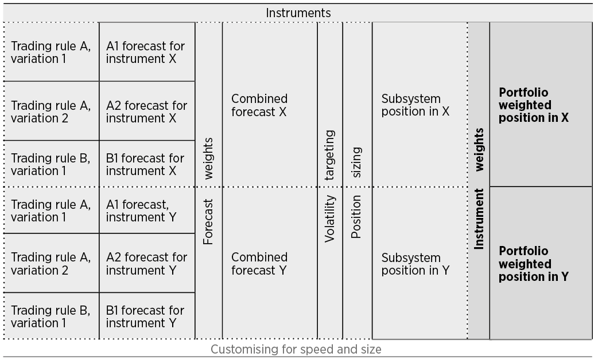

# 第十一章　组合｜中文忠实版

原书：Robert Carver, *Systematic Trading*, Chapter Eleven, “Portfolios”；EPUB `OEBPS/Autopilot_ebook-20.xhtml`，定位块 `ch11#0001–0240`。以下按原书顺序翻译正文、九张文字表、图与脚注 115–121。块号不是印刷页码。书中的行情、汇率和合约例子属于作者 2015 年写作时的情境。表 30 的 S&P 行显示数字不能直接算出下一列，照原书保留；原书前文把精确公式定位在附录 D 第 311 页，章末摘要却写附录 C 第 311 页，两处也照录。

## 第十一章　组合（`#0001–0005`）

问：购买单只股票、而不投资集合基金的许多交易者和业余投资者，有什么共同点？答：他们的组合里往往持有太少的资产。

对个人投资者的研究发现，很多人持有的股票不到五只；交易者则往往只愿意交易一两个自己认为最熟悉的市场。到目前为止，我还没有帮你解决这个问题，因为上一章只说明了如何构建一个仅持有单一标的头寸的交易子系统。

但分散投资确实是投资中唯一的免费午餐。正如第二章（原书第 52 页）所见，跨不同资产类别配置，可以轻易使预期夏普比率翻倍。最好同时运行包含尽可能多的交易子系统和标的的组合，并在它们之间分配交易资本。为在这个组合内配置，你将使用**标的权重**。半自动交易者虽然没有一组固定资产，也应努力同时持有分布在多个标的上的若干头寸。

### 本章概览（`#0006–0016`）

| 主题 | 内容 |
| --- | --- |
| 组合与标的权重 | 什么是交易子系统的组合？什么是标的权重？ |
| 标的权重——资产配置投资者与坚定系统交易者 | 交易一组固定子系统时，如何分配权重。 |
| 标的权重——半自动交易者 | 半自动交易者同时持有多笔押注、却不一定每次都交易相同标的的特殊情况。 |
| 标的分散乘数 | 如何考虑不同标的子系统之间的分散效果。 |
| 头寸与交易的组合 | 给定标的权重，如何计算应持有的头寸，以及应产生哪些交易。 |

### 组合与标的权重（`#0017–0022`）

**本节适合所有读者。**

在前面一章，我曾以一个三资产组合说明组合优化这门“玄学”。三个资产分别是标普 500、NASDAQ 和美国 20 年期国债。现在假设你是试图在这些标的之间分配资本的资产配置投资者；或者你是拥有预测其收益的规则的坚定系统交易者。也可以设想你是半自动交易者，碰巧对这三个资产各下了一笔押注。

使用上一章的方法，你会计算出三个子系统头寸，每个标的一个。各头寸取决于你的预测值以及该标的的风险程度。在计算每个系统时，你还假定把全部交易资本投入其中。实际上，你会创建三个交易子系统，每个子系统名义上都使用你的全部资本，只交易一个标的。

但在实践中，你会在一个子系统组合之间分配资本，类似于第四章中用同样三个基础资产构建的组合。每个标的的交易子系统都会得到一个正的标的权重，所有权重之和为 `100%`。一个标的的组合加权头寸，等于该标的的子系统头寸乘以对应的标的权重，以反映它在组合中的份额。得到这个头寸后，就能算出每个标的需要做什么交易。

如本章后面会说明的，你还需要考虑组合分散的效果。不过，首先要考虑如何计算标的权重。

### 标的权重——资产配置投资者与系统交易者（`#0023–0049`）

**适用读者：资产配置投资者、坚定系统交易者。**

资产配置投资者运行一个固定的交易子系统组合，每个标的一个子系统；每个子系统只有一条交易规则，也就是产生恒定且相同预测值的“无规则”规则。坚定系统交易者拥有一组交易规则，把它们的预测值合并，再换算成头寸。两种情况下，你都是在与一组固定标的相关的子系统之间分配交易资本。这不同于传统组合配置，后者直接把资本分给每个标的的头寸。

由于前几章做过的工作，所有子系统都已进行波动率标准化，拥有相同的预期收益标准差。如第四章所见，这让组合优化更简单。你可以很容易地使用第四章介绍的手工配置方法，决定每个子系统获得的标的权重。也可以用自助抽样法作为替代。¹¹⁵

要手工制定权重，你需要给资产分组，而分组需要相关性。求相关性有两种办法：一是用回测数据估计；二是如果没有回测相关性，就使用附录 C 中表 50–55（从原书第 305 页起）给出的标的收益之间的参考相关性。

但你需要的是交易**子系统收益**之间的相关性，而不是基础标的收益之间的相关性。对动态交易系统，子系统收益的相关性往往低于基础标的收益的相关性。一个不错的近似是：子系统收益相关性等于标的收益相关性的 `0.70` 倍。因此，若附录 C 中两个资产的标的收益相关性为 `0.5`，它们的子系统相关性就是 `0.7 × 0.5 = 0.35`。

由于资产配置投资者使用静态策略，子系统的相关性很可能更接近于直接固定持有基础标的多头时的相关性。因此，我建议直接使用附录 C 的相关性，不乘 `0.7` 进行调整。

第四章中，我曾说明：如果有证据表明不同资产的夏普比率不同，如何调整组合权重。但我不建议根据夏普比率调整标的权重，因为即使考虑不同程度的成本，通常也没有足够证据表明不同标的的子系统表现不同。我会在“速度与规模”一章再谈这个问题。

来看一个例子。对标普 500、NASDAQ 和 20 年期国债这三个标的，我会这样手工制定标的权重。下面提到的行号，对应表 8（原书第 89 页）的相关行。

| 分组层级 | 操作 |
| --- | --- |
| 第一层：资产类别内部 | 第一组（债券）：只有一种资产，因此 20 年期国债占 `100%`；表 8 第 1 行。第二组（股票）：两种资产，各占 `50%`；表 8 第 2 行。 |
| 第二层：资产类别之间 | 要分配给两个组，各占 `50%`；表 8 第 2 行。 |

这样得到的权重，与第四章对实际资产得到的权重相同，如表 28 所示。当然，通常不会如此；只是因为这个例子非常简单，每组不超过两种资产，分组方式又与之前相同。

**表 28：**在这个简单例子中，交易子系统的手工权重与资产本身的权重相同。

| 标的 | 手工制定的权重 |
| --- | ---: |
| 美国 20 年期国债 | `50%` |
| 标普 500 股票 | `25%` |
| NASDAQ 股票 | `25%` |

在第四部分各个示例章节，我还给出了更复杂的标的权重手工制定例子。

### 标的权重——半自动交易（`#0050–0055`）

**适用读者：半自动交易者。**

半自动交易者并不持有一个固定的标的组合，也不会总是对每个标的都形成预测并持有头寸。相反，在任何时点，你的账面上很可能只有相对少量的机会型头寸（押注），它们来自更大的潜在交易想法池。每当你对一个不同的标的建立新押注时，都需要先作预测，再根据账户规模与标的风险确定头寸大小。

这带来一个问题：随着不同标的进入和离开，你的组合构成以及收益相关性都会随时间变化。最简单的办法，是把交易资本平均分给潜在机会。为确保风险得到适当控制，你还必须限制任一时点允许的最大押注笔数。

因此，你应在名义上允许同时进行的最多押注笔数之间平均分配风险，每笔都代表一个潜在交易子系统。例如，若名义最大值为十笔，那么每个标的的权重就是 `100% ÷ 10 = 10%`。

出于本章后面会清楚的原因，我建议这个最大值不要超过你预计长期平均持有笔数的 `2.5` 倍。

### 标的分散乘数（`#0056–0083`）

把交易资本分给各个交易子系统后，你会面对一个在第七章可能见过的问题：分散会降低风险。如果跳过了第七章，请回去阅读原书第 138 页的概念框。由交易子系统这种已进行波动率标准化的资产组成的分散组合，其预期收益标准差几乎总是低于所交易的单个资产。平均相关性越低，实际预期风险低于目标的程度就越大。

你已经知道，在这个简单例子中，两个股票指数与债券之间的相关性非常低：附录 C 表 50 的经验值是 `0.1`，而我在第四章算出的估计值是负数。子系统收益之间的相关性很可能更低。因此，若把三个标的子系统合成组合，得到的平均风险水平极不可能与单独运行其中任何一个时的目标风险水平相同。

与第七章一样，你需要应用一个系数，考虑组合中的分散效果：**标的分散乘数**。把已经计算出的组合加权头寸乘以它，以确保整个组合达到合适的预期风险水平。

**适用读者：坚定系统交易者、资产配置投资者。**

资产配置投资者和坚定系统交易者应使用各标的交易子系统**收益**之间的相关性，计算组合预期的分散程度。

你可以选择用回测估计相关性，也可以用经验相关性。¹¹⁶ 再提醒一次，附录 C 从原书第 305 页起的表 50–55，给的是**标的收益**之间的参考相关性。坚定系统交易者可以把这些数乘以 `0.7`，得到交易子系统收益之间的相关性。资产配置投资者则应不作调整，直接使用标的收益相关性。

不论从哪个来源得到相关性，计算时有两种选择：使用附录 D 原书第 311 页的公式，或使用表 18（原书第 140 页）的近似值。表 18 中的资产数量，应为你运行的子系统数量。

再回到这个三资产例子。表 50 给出的债券与股票相关性为 `0.1`，表 54 给出的标普 500 与 NASDAQ 相关性约为 `0.75`。¹¹⁷ 为举例，我假定自己运行动态交易系统，而不是静态资产配置者。因此，相关性应乘 `0.7`，得到表 29 的相关矩阵。平均相关性约为 `0.25`；表 18 中三资产对应的分散乘数是 `1.41`。¹¹⁸

如果资产足够多且相互之间相关性相对较低，分散乘数可能非常高。但在 2008 年崩盘这样的危机中，相关性往往会突然升高，使我们面临严重损失——这是不可预测风险的一个例子。为避免它带来的严重危险，我强烈建议把乘数限制在绝对最高 `2.5`。

**表 29：**三个示例资产的交易子系统相关矩阵。

|  | 国债 | 标普 | NASDAQ |
| --- | ---: | ---: | ---: |
| 美国 20 年期国债 | `1` |  |  |
| 标普 500 | `0.07` | `1` |  |
| NASDAQ | `0.07` | `0.53` | `1` |

这些相关性是附录 C 表 50 和表 54 的标的收益参考相关性的 `0.7` 倍。

**适用读者：半自动交易者。**

我建议半自动交易者使用以下简单计算：标的分散乘数等于最大押注笔数除以平均押注笔数。¹¹⁹ 例如，若任一时点平均有四笔押注，最多五笔，乘数就是 `5 ÷ 4 = 1.25`。

我主张把乘数上限设为 `2.5`，因为如果你经常交易的笔数多于平均值，预期风险就会太高。正如前面所说，这意味着最好让最大押注笔数不超过预期平均笔数的 `2.5` 倍。

### 头寸与交易的组合（`#0084–0208`）

**本节与所有读者有关。**

现在，你可以看到这个简单三资产例子中的完整交易系统如何运作。

我假定使用期货交易这些资产，年化现金波动率目标为 `€100,000`。价格波动率和汇率是我写作时的数值；为了让例子有趣、却又不过于具体，我任意选用了几个预测值。第四部分会有更具体的例子。

首先，表 30 和表 31 提醒你前几章对三个交易子系统所做的计算。

**表 30：**计算示例组合中三个资产的标的价值波动率。

| 标的 | (A) 每日价格波动率，% | (B) 单位价值 | (C) 标的币种波动率，A × B | (D) 汇率，美元／欧元 | (E) 标的价值波动率，C × D |
| --- | ---: | ---: | ---: | ---: | ---: |
| 美国 20 年期国债 | `0.52` | `$1500` | `$780` | `0.88` | `€686` |
| 标普 500 股票 | `0.84` | `$1145` | `$956` | `0.88` | `€841` |
| NASDAQ 股票 | `0.87` | `$880` | `$766` | `0.88` | `€674` |

表中的数值假定使用期货，且投资者以欧元计价。数据截至 `2015 年 1 月`。〔译注：原书标普一行列示的 `0.84 × $1145` 与 `$956` 不能直接算术相等；各列数字按原表保留。〕

**表 31：**计算示例组合中三个交易子系统的子系统头寸。

| 标的 | (F) 标的价值波动率 | (G) 每日现金波动率目标 | (H) 波动率换算系数，G ÷ F | (J) 合成预测值 | (K) 子系统头寸，(H × J) ÷ 10 |
| --- | ---: | ---: | ---: | ---: | ---: |
| 美国 20 年期国债 | `€686` | `€6,250` | `9.11` | `10` | `9.11` |
| 标普 500 股票 | `€841` | `€6,250` | `7.43` | `−10` | `−7.43` |
| NASDAQ 股票 | `€674` | `€6,250` | `9.28` | `−15` | `−13.9` |

这位投资者的现金波动率目标为 `€100,000`，相当于每日目标 `€6,250`。¹²⁰ 预测值是任意设定的。

K 列的子系统头寸假定用全部交易资本只交易一个标的。在表 32 中，我加入本章前面算出的标的权重和标的分散乘数。因此，要得到最终的组合标的头寸，只需把各子系统头寸乘以相应标的权重，再乘以补偿组合分散效果的乘数。

**表 32：**计算示例组合的组合标的头寸。

| 标的 | (K) 子系统头寸 | (L) 标的权重 | (M) 标的分散乘数 | (N) 组合标的头寸，K × L × M |
| --- | ---: | ---: | ---: | ---: |
| 美国 20 年期国债 | `9.11` | `50%` | `1.41` | `6.42` |
| 标普 500 股票 | `−7.43` | `25%` | `1.41` | `−2.62` |
| NASDAQ 股票 | `−13.9` | `25%` | `1.41` | `−4.91` |

本表使用了本章前面得到的标的权重与分散乘数。

最后的表 33 说明我如何生成实际交易。首先，我把标的头寸取整，得到取整后的目标头寸。这是整个计算过程第一次取整。然后把它与我已经持有的当前头寸比较。如果才刚开始交易，当前头寸会是零；不过为了演示逻辑，Q 列列出了任意设定的当前头寸。

最后，我就能计算需要交易的数量。我建议：如果当前头寸处于取整后目标头寸的 `10%` 范围内，就不要交易。我称之为**头寸惯性**。

例如，若原油合约的目标头寸是 `50` 手，当前头寸在 `45` 至 `55` 手之间，我就不会费事交易。反过来，若目标是 `50` 手而当前只有 `42` 手，我会买入 `8` 手，达到目标。表中的头寸相对较小，因此没有应用头寸惯性。

**表 33：**根据取整后的目标头寸和任意设定的当前头寸，计算需要的交易。

| 标的 | (N) 组合标的头寸 | (P) 取整后的目标头寸，Round(N) | (Q) 当前头寸 | (R) 交易，P − Q |
| --- | ---: | ---: | ---: | --- |
| 美国 20 年期国债 | `6.42` | `6` | `4` | 买入 `2` |
| 标普 500 股票 | `−2.62` | `−3` | `−2` | 卖出 `1` |
| NASDAQ 股票 | `−4.91` | `−5` | `−5` | 不交易 |

#### 概念：头寸惯性（`#0209–0214`）

头寸惯性是一种避免频繁小额交易的方法；这类交易会增加成本，却不会赚取额外收益。

例如，假设你希望持有的未取整头寸是 `133.48` 手意大利政府债券期货，取整为 `133` 手。如果期望头寸变为 `133.52`，取整为 `134` 手，你就会买入一手；若又降回 `133.48`，你又会卖出。但期望头寸只变了 `0.04` 手。为这么小的调整买进又卖出，付两次佣金和市场买卖价差，值得吗？大概不值得。

解决办法是等到目标头寸与当前头寸相差**超过** `10%` 才交易。对意大利国债期货，期望头寸第一次变到 `133.52` 时不会引发交易，因为当前的 `133` 手只比取整后的目标 `134` 手低 `0.75%`。事实上，要等目标头寸达到 `147` 个交易单位，你才会交易。

头寸惯性能显著降低交易成本。下一章你会看到，交易成本会严重影响收益。我的研究表明，头寸惯性通常对扣成本前的表现影响可以忽略，因此使用它没有不利之处。¹²¹

你可以手动执行交易；如果是全自动系统，也可以让算法执行。我的网站上有关于我如何用简单算法自动交易的信息（见附录 A）。

### 构建交易子系统组合的总结（`#0215–0233`）

| 项目 | 原书总结 |
| --- | --- |
| **子系统头寸** | 依据你的预测值、标的风险程度和每日现金波动率目标，按第十章方法算出每个交易子系统持有的标的交易单位数。其单位为标的交易单位。 |
| **标的权重** | 每个交易子系统都应有一个标的权重；所有权重相加应为 `100%`。坚定系统交易者和资产配置投资者可以用手工配置或自助抽样求权重。相关性可根据子系统回测估计，或使用经验值。若用经验值，动态策略应将附录 C 的标的收益相关性乘 `0.7`；使用固定不变预测值的资产配置投资者则乘 `1.0`。半自动交易者应使用相等的标的权重，即 `100%` 除以最多可能同时持有的押注笔数。 |
| **标的分散乘数** | 对资产配置投资者和坚定系统交易者，依据交易子系统收益的相关性计算。可以用附录 C 原书第 311 页的公式精确计算，或用表 18（原书第 140 页）近似计算。对半自动交易者，等于最大押注笔数除以平均押注笔数。无论哪种情况，我都建议将乘数限制在最高 `2.5`。 |
| **组合标的头寸** | 标的的子系统头寸乘以标的权重，再乘以标的分散乘数。 |
| **取整后的目标头寸** | 把组合标的头寸取整到最接近的整数个标的交易单位。 |
| **期望交易** | 算出取整后的目标头寸后，将其与你实际的当前头寸比较，生成所需交易。如果当前头寸处于目标的 `10%` 范围内，就不必交易，即应用头寸惯性。 |

这就完成了整个框架的主要部分。我现在已经说明如何建立一个由交易子系统组合构成的完整交易系统。下一章将考虑如何设计系统，以应对不同交易速度以及资本规模较大或较小时的不同交易成本。

### 脚注（`#0234–0240`）

**115.** 要使用自助抽样，你必须能够分别回测各交易子系统的表现。理想情况下，应采用滚动的样本外方式。正如我将在第十二章“速度与规模”讨论的，所计算的任何收益都应扣除成本。

**116.** 你估计出的任何负相关性都应以零为下限，以免得到过大的乘数。

**117.** 严格说来，附录 C 的表 54 给出的是不同行业股票之间的相关性。考虑到 NASDAQ 相对标普 500 偏重科技股，用它作近似似乎已经足够，而且与我们在第四章估计的实际数字非常接近。

**118.** 计算平均值之前，应去掉数值为 `1.0` 的自身相关性。

**119.** 这实际上假设半自动交易者的所有押注始终完全正相关，是非常保守的。证明如下：假设你的每日波动率目标是 `$1,000`，平均持有五笔押注，最多十笔。所有组合权重都是 `100% ÷ 10 = 10%`。每个交易子系统的波动率目标也都是 `$1,000`。乘以组合权重之后，每个子系统头寸的平均波动率为 `$100`。平均持有五笔、且全部完全正相关时，你的组合每日收益波动为 `5 × $100 = $500`（注意，若全部互不相关，风险只有 `$223`）。因此，为达到组合整体 `$1,000` 的目标，你需要分散乘数 `2`。

**120.** 从年化值换算为每日值，要除以“时间的平方根”；若假设一年有 `256` 个工作日，就应除以 `16`。

**121.** 对持仓期超过几天的交易规则，这似乎是成立的。若交易更快，你可能不该使用头寸惯性（或使用低于 `10%` 的阈值）；但下一章将看到，以那样快的速度交易而仍能赚钱非常困难。

〔定位说明：正文在 `#0064` 写“附录 D，第 311 页”，章末摘要 `#0224` 则写“附录 C，第 311 页”；两处是原书自身的不一致。正文 `#0212` 的 `133→147` 例子与其 `10%` 文字判准的边界也未完全吻合；译文保留原说法，执行规则需要另行定义。〕
