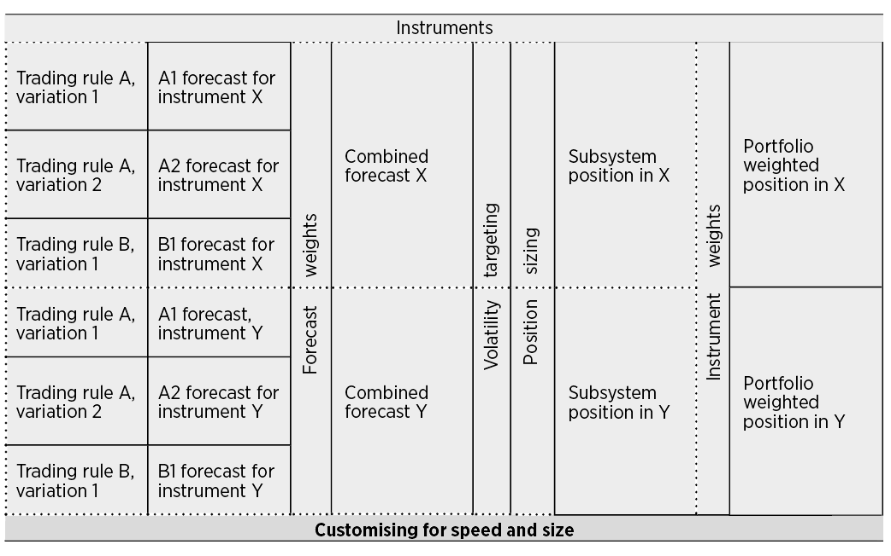

# 第十二章　速度与规模｜中文忠实版

原书：Robert Carver, *Systematic Trading*, Chapter Twelve, “Speed and Size”；EPUB `OEBPS/Autopilot_ebook-21.xhtml`，定位块 `ch12#0001–0552`。以下按原书顺序翻译正文、20 张文字表、插图说明及脚注 122–139。块号不是印刷页码。书中的行情、费用、税制和产品状况属于作者 2015 年写作时的语境。原书在 `#0133`、`#0366` 及个别周转数字有疑点，译文保留原貌，核对说明见文末。

## 第十二章　速度与规模（`#0001–0015`）

到目前为止，你在这个框架中看到的所有内容，对一位灵活的业余交易者和一位大型对冲基金的组合经理同样适用：前者持有 100 股股票头寸数小时，后者追随持续数月的趋势。但在实践中，为适应各自交易的频率和规模，这两人需要采取很不一样的交易方式。

本章将讨论面对交易速度和账户规模这两个相互关联的问题，应如何设计交易系统。

### 本章概览

| 主题 | 内容 |
| --- | --- |
| 交易速度 | 考虑交易成本之后，交易究竟应该有多快这一棘手问题。 |
| 拆解并计算交易成本 | 根据交易标的和交易系统的特征，估算预计需要支付的成本。 |
| 利用交易成本作设计决策 | 知道成本后，如何调整系统以应对。 |
| 使用较多或较少资本交易 | 使用相对少量或大量资本交易时的问题。 |
| 确定整体组合规模 | 资本账户越小，可交易的标的数量越受限制。我会说明如何确定组合的规模和构成。 |

### 交易速度（`#0016–0022`）

你应该交易得多快？如果在 2014 年 9 月 23 日星期二上午 11:05 做多美元／欧元外汇，你应该预期 11:06 就卖出吗？还是到星期四？也许你会一直持有到 12 月，甚至次年 3 月？

答案取决于两件事：你预期价格会如何变化，以及每笔交易的成本。假设你有水晶球，确知接下来一周价格会涨 10 美分。如果交易花费 1 美分，你就应该买入，因为到下个星期二肯定能赚 8 美分。¹²²

可惜水晶球很稀少。我们拥有的是预测；它不能提供确定性，但希望能让胜算向我们倾斜。你可能有一条交易规则，看过回测后预期其成本前夏普比率（SR）为 `1.5`。但这项策略把三分之二的利润付作交易成本，成本后 SR 仅为 `0.5`。如果波动率目标是 `20%`，你预期的成本前年收益为 `30%`，年成本为 `20%`，净收益仅为 `10%`。交易这条规则明智吗？¹²³

我个人认为极不明智。如果实际成本前 SR 低于 `1.0`，即原始年收益低于 `20%`，那么扣除成本后这项策略就会亏钱。相对于可获得的成本前表现，你交易得太快了。

交易过度源于过度自信，这是第一章讨论过的认知偏差之一。只有非常乐观的人才会假设，实际交易实现的成本前 SR 一定达到或超过 `1.0`。你不应该交易这样的系统，然后寄望于好运。更好的做法是设计不会因如此高的成本而变得脆弱的系统。

接下来我会说明如何计算某一标的在特定交易速度下的成本，以及如何估计可能面对的费用。然后再看如何构建交易系统，确保你赚给经纪商和做市商的钱不会超过你自己所得。

### 计算交易成本（`#0023–0222`）

#### 执行成本（`#0024–0127`）

我们首先分析的是执行成本。回测几乎总是假设成交时支付的是买卖中间价。但实际上，成交价与中间价之差取决于你的交易规模相对于可用成交量有多大。这种差额就是执行成本。看图 24，它展示欧洲 Euro Stoxx 股票指数期货的盘口快照。当时买价为 `3,369`、卖价为 `3,370`，中间价位于两者之间，即 `3,369.5`。

规模较小的交易者可以假设，其执行成本至多为通常买卖价差的一半；提交跨越价差、与最优买价或卖价成交的市价单，就是这种情形。若你卖出不超过 `437` 手，收到的价格是 `3,369`。同样，若买入少于 `8` 手，支付的价格至多是 `3,370`。本例预期执行成本为 `0.5` 点，即 `3,369` 与 `3,370` 之间一整点价差的一半。使用限价单或许会更好，但保守地假设成本高于期望更合适。

如果你的典型单笔交易小于买卖盘最优档位通常提供的数量，这个假设就合理。规模较大的交易者不能这样假设，本章最后会进一步讨论。还要记住，这不是一本关于高频交易的书。如果你每隔数秒甚至几分之一秒就不断下单，连续交易本身会改变盘口，上述假设便不成立。

**图 24：**截至 2015 年 1 月 23 日格林尼治时间 11:13，2015 年 3 月到期的 Euro Stoxx 指数期货盘口。

| 产品 | 产品代码 |
| --- | --- |
| EURO STOXX 50 指数期货 | FESX |

| 卖出时平均成交价 | 累计数量 | 该档数量 | 买价 |
| ---: | ---: | ---: | ---: |
| 3,369.00 | 437 | 437 | 3,369.00 |
| 3,368.43 | 1,013 | 576 | 3,368.00 |
| 3,367.89 | 1,633 | 620 | 3,367.00 |
| 3,367.32 | 2,330 | 697 | 3,366.00 |
| 3,366.81 | 2,988 | 658 | 3,365.00 |
| 3,366.30 | 3,659 | 671 | 3,364.00 |
| 3,365.91 | 4,144 | 485 | 3,363.00 |
| 3,365.37 | 4,814 | 670 | 3,362.00 |
| 3,364.63 | 5,797 | 983 | 3,361.00 |
| 3,364.07 | 6,587 | 790 | 3,360.00 |

| 合约 | 最新价 | 成交量 |
| --- | ---: | ---: |
| 2015 年 3 月 | 3,368.00 | 652,226 |

| 卖价 | 该档数量 | 累计数量 | 买入时平均成交价 |
| ---: | ---: | ---: | ---: |
| 3,370.00 | 7 | 7 | 3,370.00 |
| 3,371.00 | 540 | 577 | 3,370.99 |
| 3,372.00 | 1,147 | 1,724 | 3,371.66 |
| 3,373.00 | 696 | 2,420 | 3,372.05 |
| 3,374.00 | 647 | 3,067 | 3,372.46 |
| 3,375.00 | 1,017 | 4,084 | 3,373.09 |
| 3,376.00 | 831 | 4,915 | 3,373.58 |
| 3,377.00 | 502 | 5,417 | 3,373.90 |
| 3,378.00 | 1,131 | 6,548 | 3,374.61 |
| 3,379.00 | 571 | 7,119 | 3,374.96 |

来源：EUREX。

#### 成本的类型（`#0128–0142`）

上面算出的执行成本是成本的重要组成部分，但并非全部；还要支付佣金和税费。你可能面对以下成本。

| 类型 | 说明 |
| --- | --- |
| 每交易单位的预期执行成本 | 即上面所见的执行成本：中间价与实际成交价之差。小交易者通常可假设至多支付通常买卖价差的一半，如图 24 中 Euro Stoxx 的 `0.5` 点。相对于 `3,370` 的价格，这是 `0.01484%`。要得到现金成本，将价格点数所对应的百分比价差乘以每 `1%` 变动的价值。* Euro Stoxx 期货价格为 `3,370` 时，后者恰为 `€337`，于是原书写作 `0.01484 × 3,370 = €5`。** |
| 每笔委托的费用 | 许多英国零售经纪商不论交易规模如何，都按笔收佣金。典型水平为 `£5–£15`。 |
| 按交易规模收取的费用 | 其他经纪商按每 `100` 股或每一手期货合约收费。我的经纪商交易 Euro Stoxx 期货每手收 `€3`。 |
| 按交易价值百分比收取的费用 | 一些司法辖区按交易价值征收一定比例的税，例如英国 `0.5%` 的印花税。部分经纪商对较大交易也按比例收佣金；`0.1%` 很常见。 |

\* 记住，第十章“头寸规模”（原书第 164 页）把它定义为交易单位价值：价格变动 `1%` 时，我们在现金金额上赚取的数额。

\** Euro Stoxx 期货价格每变动一整点，价值变动 `€10`。所以 `1%`、即 `33.7` 点的变动价值 `€337`。

某些标的还有持有成本。期货、价差押注及差价合约需要每月或每季展期。几乎所有集合投资基金都收取年费。这些持有成本相对于交易成本通常较小，且不影响交易速度决策，因此这里暂不计入。¹²⁴

#### 把成本放到统一尺度（`#0143–0191`）

假设交易一手 Euro Stoxx 期货共花 `€8`（执行成本 `€5`、经纪费 `€3`）。这算多吗？与交易一手德国两年期国债 Schatz 期货花 `€5` 相比如何？乍看 `€5` 比 `€8` 便宜，但答案并不这么简单。如果为了达到同样的风险量，你必须买 `20` 手 Schatz，却只需 `10` 手 Euro Stoxx 呢？这就是第十章原书第 170 页的波动率缩放系数。尽管 Schatz 看起来划算，建立等风险头寸会花你 `€100`，Euro Stoxx 只花 `€80`；后者实际更便宜。

这再次提供了运用波动率标准化的机会。你应该用一种考虑各标的风险差异的成本度量：买入一交易单位再卖出，这次往返成本除以该标的的年化风险，结果是多少？这种标准化成本，等同于每次往返交易会让你的年化原始夏普比率（SR）损失多少。

计算时，先取以标的币种计价的单边每交易单位成本 `C`；因为往返要交易两次，将它乘 `2`。然后除以一交易单位价值的年化标准差。后者是日度标的币种波动 `ICV` 的年化值（原书第 168 页定义）。记住，日波动率年化要乘 `16`。¹²⁵ 因此标准化成本为 `(2 × C) ÷ (16 × ICV)`。

该公式的一项重要含义是：价格波动率较低的标的，其有效交易成本较高。这也是把风险极低的标的剔出组合的另一个理由。

写作此书时，Euro Stoxx 期货的价格日波动率约为 `1.5%`（原书第 165 页定义的标的风险程度）。每变动 `1%` 价值 `€337`（原书第 164 页讨论的交易单位价值），所以一手合约价值的日标准差约 `€506`，也就是 `ICV`。年化后为 `506 × 16 = €8,096`。每手单边成本 `€8`，于是标准化成本为 `2 × €8 ÷ €8,096`，即 `0.002 SR` 单位。

与多数期货一样，这种标的交易起来便宜。¹²⁶ 2014 年我交易的期货合约，平均标准化成本从最具流动性者（如 FTSE 100）的约 `0.001 SR`，到澳大利亚利率期货的约 `0.03 SR` 不等。¹²⁷

现在看 FTSE 100 的价差押注¹²⁸，每点押 `£1`。首先算标的币种波动。

| 项目 | 计算 |
| --- | --- |
| 价格波动率 | 当前每天 `0.75%`。 |
| 交易单位 | 每点 `£1`。 |
| 交易单位价值 | FTSE 指数为 `6,600` 时，`1%` 变动是 `66` 点；按每点 `£1` 计算，价值 `£66`。 |
| 标的币种波动 `ICV` | 价格波动率乘交易单位价值：`0.75 × £66 = £49.50`。 |

接着计算成本。

| 项目 | 计算 |
| --- | --- |
| 每交易单位的预期执行成本 | 通常价差的一半为 `4` 点，即 `£4`。* 无其他费用或税费。 |
| 每交易单位总成本 `C` | `£4`。 |
| 标的币种波动 `ICV` | 如上，`£49.50`。 |
| 以 SR 单位计的成本 | `2 × C ÷ (16 × ICV) = 2 × £4 ÷ (16 × £49.50) = 0.01 SR`。 |

\* 这是季度远期押注。即期 FTSE 的价差更窄，但按我通常的持有期，最终成本会更高。

这约为 FTSE 100 期货成本的十倍；价差押注是一种交易单位更小的零售产品，因此并不奇怪。¹²⁹ 多数主要指数的押注成本一般在 `0.01 SR` 左右，但单只股票通常更贵。我将用 `0.01 SR` 作价差押注的基准成本。

第三类标的是交易所交易基金（ETF）。与许多股票一样，它们按 `100` 股一单位交易成本更低。准确成本取决于波动率，而 ETF 的波动率又取决于基础资产和是否使用杠杆。我会保守地检查一种波动率相对低的标的：iShares IGIL 全球通胀挂钩债券 ETF。它也是第四部分资产配置例子中使用的 ETF 之一。

| 项目 | 计算 |
| --- | --- |
| 价格波动率 | 2015 年初每天约 `0.43%`。 |
| 交易单位 | `100` 股。 |
| 交易单位价值 | 每股 `$144`，`100` 股共 `$14,400`；其 `1%` 为 `$144`。 |
| 标的币种波动 `ICV` | 交易单位价值乘价格波动率：`$144 × 0.43 = $62`。 |

再看成本。

| 项目 | 计算 |
| --- | --- |
| 每交易单位的预期执行成本 | 这只 ETF 典型买卖价差宽 `70` 美分，相当于当前每股 `$144` 的 `0.486%`。交易单位价值为 `$144`，若支付半个价差，每交易单位成本为 `0.486 × $144 × 0.5 = $35`。 |
| 每笔委托费用 | 我的经纪商每笔收 `$5.00`。假设无其他费用或税费。 |
| 每交易单位总成本 `C` | `$35 + $5 = $40`。 |
| 标的币种波动 `ICV` | 如上，`$62`。 |
| 以 SR 单位计的成本 | `2 × C ÷ (16 × ICV) = 2 × $40 ÷ (16 × $62) = 0.08 SR`。 |

价格波动更高的 ETF，例如股票 ETF，按风险标准化后的成本会更低；但为求稳妥，我将 `0.08 SR` 用作 ETF 的预期成本。这些例子的成本符合当时的市场条件和我所付的经纪费用，但你在作决定之前应计算自己的数字。

#### 引入周转率（`#0192–0196`）

知道买入和卖出经风险调整数量的标的要花 `0.08 SR`、`0.01 SR` 或 `0.002 SR`，有什么用？仅有标准化成本还不够；你还需要一种标准化的交易速度度量。既然已知一次买入并卖出的往返交易，以年化 SR 单位计的成本，就要数出一年做了多少次往返。

我通过波动率标准化来衡量成本。同理，每次买卖的交易单位数量也应该经过波动率标准化。按照这个框架的运作方式，该数量等同于你的预期平均绝对头寸，即预测处于平均大小时持有的头寸（第十章原书第 170 页把它定义为波动率缩放系数）。

每年的往返次数就是**周转率**。周转率为 `1` 意味着你预计一年买入、再卖出一次平均规模的头寸，平均持有期为 `12` 个月。周转率为 `52` 则意味着平均持有一周。由于周转率经过波动率标准化，你可以单独考虑每个标的的交易模式，也就是第十章定义的交易子系统，而无须顾及组合其余部分。

例如，价差押注每次往返的标准化成本为 `0.01 SR`，每年周转 `10` 个平均头寸单位。十次往返（十次买、十次卖）在一年中会损失 `10 × 0.01 = 0.10 SR`。原本 `0.5` 的 SR 因而降至 `0.5 − 0.1 = 0.4`。

#### 周转率从哪里来？（`#0197–0212`）

继续之前，还需要弄清周转率的来源。你为何需要交易？以下按重要性递减排列。

| 来源 | 说明 |
| --- | --- |
| 预测 | 坚定系统交易者的一条或多条规则改变了预测，或半自动交易者建立新押注、平掉旧押注。除预测恒定的资产配置投资者外，这是头寸变化的主要来源。 |
| 标的币种波动 | 每交易单位价值的预期日标准差发生变化，即价格波动率乘交易单位大小。这是头寸变化的第二大原因。 |
| 交易资本 | 当前承担风险的资本额变化，取决于盈亏以及额外投入或取出的资金。不计出入金，在建议的最高 `50%` 波动率目标下，资本平均每天变化 `3%`。除了降低百分比波动率目标，你无法减少这部分引起的交易；若目标为 `16%`，日变化约 `1%`。 |
| 汇率 | 标的计价货币与当前交易资本货币之间的汇率。主要货币的汇率通常每天变动不到 `1%`。由此产生的交易无法减少，但相对也较小。 |
| 系统参数 | 理应极少改变、甚至完全不变的参数：预测权重、标的权重、预测及标的分散乘数、百分比波动率目标。别摆弄系统，就能消除这部分交易！ |

本章余下部分将集中讨论预测和价格波动率变化如何影响交易速度，因为这两项容易调整、影响也最大。

#### 估计往返次数（`#0213–0222`）

有了交易系统的周转率和标准化成本，就能计算交易各标的的预期成本。但周转率如何求得？有三种方式。

| 方法 | 说明 |
| --- | --- |
| 精细回测 | 如果有不错的回测软件，或能自己编写，可加入直接估算周转率的功能。 |
| 简单回测 | 较粗略的回测工具可以估计每年平均交易的单位数，以及平均持有单位数的绝对值。周转率于是等于：`每年交易单位数 ÷ (2 × 平均绝对持有单位数)`。 |
| 经验法则 | 第三种方式是使用经验法则。它适用于周转率由止损宽窄决定的半自动交易者、预测变化不产生周转的资产配置者，以及只用第七章所给持有收益和 EWMAC 规则的坚定系统交易者。本章后面及第四部分的示例章节会给出相关经验法则。 |

### 利用交易成本作设计决策（`#0223–0423`）

#### 设定速度上限（`#0224–0255`）

回到 Euro Stoxx 期货，标准化成本为 `0.002 SR`。假设一条规则的回测成本前收益为 `0.40 SR`，每年周转 `50` 次。预计年成本为 `50 × 0.002 = 0.10 SR`，净表现为 `0.30 SR`。

如果有另一条规则，周转率为 `100`，成本前收益却是 `0.60 SR` 呢？成本虽然翻倍为 `0.20 SR`，净收益却升至 `0.40 SR`。难道不该选择这个更贵的方案吗？

第三章讨论拟合时，我指出预期成本前表现总有很大不确定性。这意味着，要证明某个交易规则变体可能盈利，需要大量历史数据（见原书第 71 页表 5），更不用说证明它能赚够覆盖成本的钱。

同样，也需要大量数据，才能有把握地说一条规则过去表现优于另一条。因此，要选择速度更快、看似更优的变体，而舍弃速度较慢、成本较低、据称较差的替代规则，需要充分证据（见原书第 73 页表 6）。

实践中能够取得的相对成本前 SR 极不确定，预期成本却可以准确得多地预测。盲目接受高成本系统的回测结果还有一个危险：本章展示的是当前成本估计，可能与二十年前非常不同。过去不少市场的交易成本远高于现在。

快速规则在历史上可能看起来很好，但如果当时交易该市场非常昂贵，实际上没有人能利用它。现在成本下降，那种效果很可能随之消失。

为避免追逐表现，或以历史上不可行的速度交易，我建议设定**速度上限**，即系统允许的最高预期周转率。

本章开头我说过，不会交易那种把三分之二利润付作成本、每年成本高达 `1.0 SR` 的策略。我个人认为，把超过预期利润三分之一付作交易成本是鲁莽的，因此用这个比例设定自己的速度上限。如果现实一点，单一标的交易子系统的平均 SR 不大可能高于 `0.4`。¹³⁰

这意味着，无论回测看起来多好，你在成本上绝不该支付超过 `0.4` 的三分之一，即 `0.13 SR`。记住，以 SR 表示的成本等于标准化成本乘每年往返周转率。因此，`0.13` 除以某标的的标准化成本，就得到该标的的周转率上限。

对 Euro Stoxx 这样相对便宜的期货市场，这意味着最高周转率为 `0.13 ÷ 0.002 = 65` 次往返／年，平均持有期略短于一周。对 NASDAQ 期货等最便宜的标的，周转率或许可以再翻倍，使持有期约两天。

但这排除了日内交易：若每天往返两次或更多，年周转率至少 `500`。要在这样的速度下把成本控制在收益的三分之一以内，你必须有高得多的成本前 SR，或把标准化成本降到约 `0.13 ÷ 500 = 0.00025 SR`。这个成本水平约为最便宜期货所能达到水平的四分之一。

这些极便宜期货的标准化成本中，佣金约占四分之一，约每手 `$1`；其余是执行成本。因此，要做日内交易，你必须把执行成本降到零，也就是持续以中间价或更好的价格成交。若一天往返三次以上，还必须持续取得**负**执行成本。

归根结底，即使日内交易最便宜的标的，你也需要取得很高的成本前 SR，或拥有能持续赚取价差的执行策略。这并非不可能，但显然只有经证实能做到这些目标的人，才该考虑这么快地交易。这种能力实践中相当罕见，这也是绝大多数业余日内交易者不赚钱的原因。

若年成本为 `0.13 SR`，而使用建议的最高 `50%` 波动率目标（第九章原书第 146 页定义），每年支付的成本就是 `0.13 × 50% = 6.5%`。这对表现是相当大的拖累，我个人不希望看到更高的数字。

自主判断的半自动交易者无法使用回测，需要避免过度自信。与其假定每个标的最高可有 `0.40 SR`，不如保守地预期至多 `0.25 SR`。¹³¹ 因而每年成本不应超过 `0.25` 的三分之一，即 `0.08 SR`。静态交易系统表现会近似基础资产的资产配置投资者，也应采用较低的这个数字。

现在你已经可以从成本出发，考虑如何定制交易系统。框架中有几个地方会用到表现预期，这些决策现在应同时考虑成本与预期成本前表现。

| 决策 | 成本如何进入决策 |
| --- | --- |
| 交易哪些标的 | 成本过高的标的，可能难以配合你想使用的系统。 |
| 通过止损设定平均持有期（半自动交易者） | 止损应瞄准某个平均持有期；设定止损幅度时要考虑偏好标的的成本。 |
| 选择、拟合和校准交易规则（坚定系统交易者） | 若决定拟合规则，就必须同时考虑成本前 SR 和成本；对成本的把握强于对成本前表现的把握。按我偏好的拟合方法，不应看成本前表现，但仍应排除预期成本过高的规则变体。 |
| 设定预测权重（坚定系统交易者） | 应用预期成本，避免给表现好但交易成本也相对高的规则变体过高权重。 |
| 设定风险百分比 | 检查用于设定风险百分比的 SR 时，应使用成本后表现。 |
| 设定价格波动率估计的回看期 | 除预测变化外，这是交易系统周转率的另一个主要来源。交易越贵，更新价格波动率估计就应越慢。 |
| 分配标的权重（半自动交易者和资产配置者） | 除非认为额外的成本前表现足以补偿，否则应考虑给更贵的标的较低权重。 |

#### 交易哪些标的？（`#0256–0328`）

设计不超过速度上限的交易系统有两条路：先决定想以什么速度交易，再选择成本足够低的标的；或者先选定喜欢的标的，让它们限制你能交易多快。例如，如果无法交易期货而偏好 ETF，交易速度就会受到很大限制。

若采用我建议给资产配置者和半自动交易者的年度最高成本 `0.08 SR`，表 34 就给出不同持有期和周转率下可接受的最高标准化成本，也列出通常处于相应成本水平的标的。由此可根据想要的交易速度选标的，或根据偏好的标的决定交易速度。

表中还展示某类系统交易究竟能慢到什么程度，即可达到的最低年往返周转率。结合你愿意承担的成本上限，便能推断哪些标的贵到根本不适合交易。

**表 34：**半自动交易者及资产配置投资者，使用特定标的时可采用什么交易速度和持有期？

| 持有期 | 典型年周转率 | 最高成本 SR／往返 | 可能适用的标的 | 原书类别标记 |
| --- | ---: | ---: | --- | --- |
| 1 天 | 256 | 0.00031 | 无 |  |
| 3 天 | 85 | 0.001 | 最便宜的期货，如 NASDAQ |  |
| 1 个月 | 12 | 0.0067 | 除短期限债券及短期利率期货*以外的几乎所有期货 |  |
| 6.5 周 | 8 | 0.01 | 指数价差押注，如 FTSE |  |
| 3 个月 | 4 | 0.02 | 单只股票价差押注 |  |
| 6 个月 | 2.0 | 0.04 | 最便宜的 ETF，如股票指数 ETF | 最慢的半自动交易者 |
| 1 年 | 1.0 | 0.08 | 用作基准的通胀挂钩债券 ETF |  |
| 2.5 年 | 0.4 | 0.20 | 大多数单只股票 | 最慢的资产配置投资者 |

表列出不同持有期对应的年往返周转率、若每年支付不超过建议的 `0.08 SR` 时标的允许的最高成本，以及各成本水平的典型标的（估计截至 2015 年 1 月）。

\* STIR：短期利率期货。

资产配置投资者可把年周转率降到 `0.40` 次往返，因此负担得起 `0.08 ÷ 0.40 = 0.20 SR` 的成本。¹³² 所以，估计成本至多 `0.08 SR` 的 ETF 没有问题。如下一节所述，使用非常宽松止损的半自动交易者年周转率可达 `2.0`。其可支付的最高成本为 `0.08 ÷ 2.0 = 0.04 SR`。这排除了 ETF，但允许前面估为 `0.01 SR` 的价差押注。

我对坚定系统交易者做了类似分析，建议年成本最高 `0.13 SR`。表 35 给出数字，并标出每个周转水平如何对应第七章介绍的交易规则。

**表 35：**坚定系统交易者能使用多快的系统？

| 典型年周转率 | 最高成本 SR／往返 | 可能适用的标的 | 对应规则 |
| ---: | ---: | --- | --- |
| 128 | 0.001 | 最便宜的期货，如 NASDAQ |  |
| 54 | 0.0024 | 普通期货，如 WTI 原油 | 我用的最快单条趋势规则，即 EWMAC 2、8* |
| 28 | 0.0046 | 除短端债券、股票波动率指数、短期利率期货以外的大多数期货 | 第二快的单条趋势规则，即 EWMAC 4、16 |
| 12.5 | 0.01 | 几乎所有期货、指数价差押注 | 第十五章使用的规则组合 |
| 7.5 | 0.017 | 较便宜的单只股票价差押注 | 我用的最慢趋势规则，即 EWMAC 64、256 |

表列出不同年往返周转率下，若坚定系统交易者每年支付不超过建议的 `0.13 SR`，各标的可接受的最高标准化成本，以及对应成本水平的典型标的（估计截至 2015 年 1 月）。

\* 规则见第七章“预测”和附录 B（原书第 294 页）。

我还列出第十五章详细介绍的坚定系统交易者示例中，那套建议规则的周转率。使用这套相当慢的规则，年周转率为 `12.5` 次往返。¹³³ 因而可接受的最高标准化成本为 `0.13 ÷ 12.5 = 0.01 SR`；这对几乎所有主要期货市场和指数价差押注都可以。

#### 通过止损决定平均持有期（`#0329–0336`）

**适用读者：半自动交易者。**

半自动交易者应如何决定交易速度？你可能以为，这取决于自己有多急于出手：坐立不安的日内交易者每隔几分钟就点进点出；悠闲的宏观交易者每隔数周或数月才交易。

但我主张，不论如何决定入场，交易者都只使用系统化止损离场。这意味着平均持有期主要取决于止损设得紧还是松。然后，你应确保交易风格及试图预测价格变化的时间尺度，与止损水平一致。

止损设得很紧，持有期就短、周转率就高。设置紧止损时，你无法交易更贵的标的，因为在愿意支付的 SR 成本上限下，可行的标准化成本也有上限。

表 34 显示，最便宜的期货可用较紧的止损，持有约三天；价差押注则贵得多。引言中我提过一个价差押注系统，平均持有约一周，年周转率约 `52` 次往返。按这里采用的价差押注标准化成本 `0.01 SR`，年成本就是 `52 × 0.01 = 0.52 SR`。

此前（原书第 160 页）我算出该系统隐含的波动率目标为 `160%`。这意味着，仅为达到盈亏平衡，你的交易资本每年在扣除成本前就必须赚到 `0.52 × 160% = 83%`！

表 34 显示，使用价差押注时，止损对应的持有期不能短于约六周。此外，任何交易者都不太可能乐意持有超过六个月。所以你能达到的最低周转率为每年 `2` 次往返；这是前面讨论标的选择时使用的数字。

#### 选择交易规则（`#0337–0342`）

**适用读者：坚定系统交易者。**

第三章我说过，不喜欢依据实际表现拟合或校准交易规则。但这个禁忌只适用于**成本前表现**。我积极鼓励你回测并找出规则的预期周转率，再剔除成本过高的变体。

按上述建议的速度上限设法，成本不应超过 `0.13 SR`。因此，对最便宜的期货（每单位周转成本 `0.001 SR`），应剔除年周转超过 `130` 的规则；对 Euro Stoxx 期货（成本 `0.002`），剔除超过 `65` 的规则；对标准化成本 `0.01 SR` 的价差押注，剔除超过 `13` 的规则。¹³⁴

最简单的做法是，所有标的使用相同的交易规则及变体。这意味着，必须删除对组合里**最贵**标的来说过快的规则；留下的规则自然也适用于更便宜的标的。第四部分第十五章的坚定系统交易者示例会更详细展示这一过程。

不过，如果标的之间交易成本差异显著，可以考虑只让最便宜的标的使用较快变体，让较贵标的使用较慢的一组变体。在我自己的组合中，所交易期货的成本最高相差 `40` 倍，因此我采用这种方式。

#### 交易较慢的规则：给规则分配权重（`#0343–0351`）

**适用读者：坚定系统交易者。**

形成合并预测时，应如何确定预测权重？除非你认为较快规则的成本前 SR 优势足以补偿成本，否则应给高周转规则较低权重；在交易成本高的标的上尤其如此。

如果用自助抽样，在滚动样本外基础上决定权重，可以在收益估计中加入成本修正。自助抽样会自动确定权重，同时考虑可预测的成本与不确定的利润。把整个组合汇总结果算出的权重与单个标的算出的权重比较，也能看出是否有理由按标的使用不同预测权重，还是应使用同一组权重。

就我自己的系统而言，我从未找到持续一致的证据，证明较快的交易规则——无论总体上还是同一规则的不同变体——拥有更高的成本前 SR。¹³⁵ 因此，若手工制定权重，我建议假定所有交易规则的成本前 SR 相同，但考虑各自不同的交易成本。然后像第四章原书第 96 页那样，依据成本的 SR 估计调整规则的预测权重。

具体如何做？

回想第四章：调整时要比较某一资产的 SR 与组合平均 SR。对每个标的和规则变体，使用每次往返成本与周转率，算出每年以 SR 单位计的总成本。如果决定所有标的都用同一组规则，你可能希望对各标的采取同一调整。此时应使用最高、最保守的标的标准化成本，而不是各标的自身成本。

然后，对某一标的求出需要分配权重的全部规则的平均 SR 成本。由于成本相当可预测，应使用第四章原书第 96 页 SR 调整表 12 的 A 列“确定已知”。举个极端例子：一条规则年成本预计 `0.13 SR`，而所有规则平均 `0.03 SR`，它的表现相对于平均值差 `0.10 SR`，其权重应乘 `0.95`。

由于建议的速度上限排除了年成本超过 `0.13 SR` 的规则，这里的调整系数不会超出 `0.95–1.05`。多数情况下调整更小，不值得费力。但若使用较高速度上限，按规则成本调整权重可能产生显著变化。

#### 为设定风险百分比，更保守地估计夏普比率（`#0352–0355`）

**本节适用于所有读者。**

第九章“波动率目标”曾说，你应对可能取得的 SR 有现实的预期，以决定适当承担的风险。如果自己做回测，或用其他方法估计可能的表现，就必须以**扣除成本后**的结果为准。

如果使用第四部分相应示例章节建议的 SR 数字，就无须再做什么，因为这些假设都已扣除成本。

#### 放慢价格波动率估计（`#0356–0413`）

**本节适用于所有读者。**

预测之后，下一项周转来源是为适应各标的风险变化而调整头寸，即调整原书第 168 页定义的标的币种波动。它又取决于你更新日度百分比收益标准差估计的速度；这项价格波动率也在第十章定义过。

该章曾提及三种价格波动率估计方法。其中两种形式上计算某个波动率回看期内价格变化的标准差，分别采用简单移动平均和指数加权移动平均（EWMA）。我建议资产配置者和坚定系统交易者使用它们，默认回看期为 `25` 个交易日；若用 EWMA，则为 `36` 天。第三种方法是目测图表，我建议半自动交易者采用。

**适用读者：资产配置投资者、坚定系统交易者。**

如果用简单移动平均或等效的 EWMA 测量价格波动率，应该采用我建议的 `25` 天（五周交易日）回看期，还是采用更慢的十周、甚至二十周？原书第 168 页图 23 显示，较慢的回看期对风险变化反应迟钝。我的研究表明，超过二十周的回看期会让交易系统表现差很多。但较快回看期频繁变化，增加周转率，交易成本也随之上升。

首先量化较高成本的影响。你需要检查每个交易子系统的周转率，即某一标的全部交易的周转率。它包含预测变化产生的交易，也包含价格波动率估计变化带来的额外周转。前面讨论的其他交易原因影响较小，可以忽略。

若有多条交易规则，就要算出这些规则的合并预测引起的交易。先用预测权重，对每条规则的年往返周转率求加权平均；再乘预测分散乘数，得到合并预测的周转率。

如果你是资产配置投资者，使用预测恒定的“无规则”规则，那么预测不会变化，交易规则产生的周转率为零。

接着要修正价格波动率估计变化的影响，它总会增加周转率。同时还要计入原书第 184 页介绍的头寸惯性效应——原书这里写的是“不交易超过 `10%` 的头寸变化”。这会减慢交易。

表 36 展示这两项修正的净结果。若原始合并预测的年往返周转率至少为 `5`，改变回看期几乎没有影响。所以，如果你用便宜标的运行快速规则，可以放心使用默认回看期。

对较慢规则，结果取决于标的的具体成本。以资产配置者的“无规则”规则为例，仍假设交易标准化成本 `0.08` 的 ETF。预测周转率为零，应该看表格第一行。用默认五周回看期估计价格波动率，年周转率为 `1.6` 次往返，成本 `1.6 × 0.08 = 0.13 SR`。这超过给资产配置者建议的 `0.08 SR` 成本上限；他们的静态组合不太可能有很高的表现。

相反，用二十周回看期，周转率为 `0.40`，只支付 `0.40 × 0.08 = 0.032 SR`。这是原成本的四分之一，节省可观的 `0.10 SR`，也完全落在速度上限以内。请注意，若不把价格波动率估计放得比建议的最长二十周还慢，资产配置者能达到的最低年往返周转率就是 `0.4`。

**表 36：**放慢价格波动率估计有何影响？若基础规则也较慢，放慢估计可以降低系统最终周转率。

| 交易规则的起始年周转率 | 波动率估计回看期 20 周* | 10 周* | 5 周* |
| ---: | ---: | ---: | ---: |
| 0（“无规则”规则） | 0.4 | 0.8 | 1.6 |
| 1 | 1.2 | 1.5 | 2.5 |
| 5 | 4.7 | 5.0 | 5.7 |
| 10 | 9.4 | 9.8 | 10.2 |
| 12.5 | 11.7 | 12.2 | 12.6 |
| 20 | 19.1 | 19.2 | 19.7 |
| 40 | 39.2 | 39.2 | 39.4 |
| 60 | 60 | 60 | 60 |

表中列出在交易规则起始周转率（行）既定时，改变价格波动率回看期（列）得到的最终年往返周转率。五周（`25` 个交易日）是默认回看期。起始周转率是各规则按预测权重求出的平均周转率，再乘预测分散乘数。计算中用头寸惯性放慢交易。

\* 表中使用简单移动平均。若采用指数加权移动平均，与 `100`、`50`、`25` 天相对应的回看期分别为 `144`、`72`、`36` 天。

**适用读者：半自动交易者。**

第十章讨论的第一种价格波动率估计方法是目测：看图表，判断一天通常会移动多少。由于每个人的感知不同，这种方法显然很难回测。不过，通常应观察图表上的一个月窗口来估计价格波动率，因为这样得到的结果接近我建议给正式移动平均方法使用的 `25` 天回看期。如果交易的是期货等便宜标的，这样做就可以。

如果交易价差押注、ETF 等更贵的资产，我仍建议使用一个月窗口。但也建议比较现有头寸的现金风险估计（原书第 168 页定义的标的币种波动）与昨天的数值；如果估计值相对于上次使用的数值变化没有超过 `25%`，就不必调整。

如同头寸惯性，这会减少更新现有头寸波动率估计所引起的交易，降低成本。不过，开立新头寸时，应使用最新的波动率估计计算初始交易规模。

#### 标的权重的选择（`#0414–0423`）

**适用读者：资产配置投资者、坚定系统交易者。**本节不适用于不交易固定子系统组合的半自动交易者。

假设组合中既有 Euro Stoxx 期货这样便宜的标的，也有德国两年期国债 Schatz 期货这样更贵的标的。你或许已找到对每个标的都有意义的规则，并拟合了预测权重；也可能是只使用预测恒定的“无规则”规则的资产配置者。和第十一章一样，现在要分配交易资本，决定这两个子系统各应获得多大的标的权重。

运行较贵的 Schatz 系统，会不会取得更差的成本后表现？如果会，显然应给它较低的标的权重。但事情并不明确。学术研究显示，持有流动性较差标的的额外成本，经常被更高的利润抵消，例如投资较小公司股票得到的额外收益。第二章“系统化交易规则”曾简要提及：承担非流动性资产敞口往往会得到补偿。

我自己的研究显示，较贵的标的即使扣除成本，通常也表现略好；但条件是交易相对缓慢，每年周转少于 `15` 次往返。改善通常不够显著，不足以支持给它更高配置，却也意味着没有理由因为标的贵就低配。对资产配置者（按表 36，原书这里说其周转率至多 `1.4`）及较慢的坚定系统交易者，无须因成本差异调整标的权重。

若你是年周转超过 `15` 次往返的快速系统交易者，我的研究显示，贵标的的相对成本后表现会较差。但若遵循前文建议，你本来就不该让这些标的交易那么快；否则就会突破每年成本 `0.08 SR` 或 `0.13 SR` 的建议速度上限。

遵守速度上限时，只有最便宜的标的能使用快速规则。因此，一般是便宜标的交易得比贵标的快，或所有标的都以相同的较慢速度交易。在我针对这种系统的研究中，无论标准化成本如何，都没有发现不同标的的成本后收益存在差异。

因此，除非自助抽样得出不同结论，我建议假定所有交易子系统的成本后 SR 相同。若手工制定标的权重，就不必为不同成本水平作 SR 调整。

### 使用较多或较少资本交易（`#0424–0451`）

**本节适用于所有读者。**

#### 使用大量资本交易

再看图 24 的盘口。卖出不超过 `437` 手的投资者，可以假定最差只付半个价差，即 `0.5` 个价格单位：卖价 `3,369`，中间价 `3,369.5`。但需要卖出更多手数，例如 `5,000` 手的大型对冲基金，就有麻烦了。

基金下单有三种选择。第一，跨越价差，一次提交市价单。前 `437` 手以 `3,369` 成交，随后 `576` 手以 `3,368` 成交，再后 `620` 手以 `3,367` 成交，依此类推。每手平均收到的价格为 `3,365.2`，相对于原中间价 `3,369.5`，执行成本为 `4.3` 点。某一笔交易的具体成本取决于下单时盘口的深度。

第二，以 `3,370` 挂出 `5,000` 手卖单，加入盘口已有的 `7` 手。也许幸运地遇上大买家吃下整个报价。那会比中间价高半点，形成实际为负的执行成本。但更可能的是，其他交易者看到这张巨大委托后压低价格，令委托无法成交，市场却走到更不利的位置。

第三，基金的人类交易员或执行算法可把委托拆成多份，逐步执行。这样成交耗时更长、成交价也更不确定。即使每份很小，其他市场参与者仍会看出连续订单并作出反应，价格很可能逐步下移。

这三种情形，没有一种能保证执行成本恰为 `0.5` 点。若交易量大、市场相对缺乏流动性、交易又快，就不能随意假定只付半个价差。若你的典型委托大于盘口最优价位通常提供的深度，就需要认真研究预期交易成本，并努力优化执行。

#### 使用相对少量资本交易

资金规模小得多的人面临另一个问题。回想原书第 183 页表 32 的例子。那位假想投资者的年化现金波动率目标是 `€100,000`，算出目标头寸后，根据 `−10` 的合并预测需要做空 `2.62` 手标普 500 期货。但如果你是只有 `€40,000` 的业余投资者呢？即使用建议的最高 `50%` 百分比波动率目标，现金波动率目标也只有 `€20,000`。风险只有五分之一，目标头寸也缩成五分之一。可是你无法做空相应的 `0.524` 手，只能把头寸取整，做空一手。

在 `€20,000` 波动率目标下，即便标普 500 的合并预测从 `−10` 翻倍为 `−20`，你仍只做空一手。¹³⁶ 在预测为 `−20` 时，若价格波动率又翻倍，仍只持有那一手空头。¹³⁷ 与能够交易零碎合约的情况相比，你的风险呈现更明显的“台阶”。问题源于标普期货的最小合约规模相当大。¹³⁸

如第六章“标的”所述，许多其他标的的最小交易单位也相对较大。价格极高的股票显然会构成问题，例如当时每股交易价为 `$220,000` 的伯克希尔哈撒韦 A 类股；英国价差押注公司也可能不允许你在某些指数上只押每点 `£1`。

除标普外，许多期货合约的名义价值也很大，包括长期债券、芝商所货币期货和某些能源及农产品。一个极端例子是日本十年期国债期货，当时价格约 `1.5 亿日元`，或 `$130 万`。某些大合约有迷你版本，但流动性可能不足。

即使最小单位不大，小规模交易也可能不现实或不划算。购买 ETF 若每笔收费 `€4`，买入少于 `100` 股一单位就没有意义。

要找出可能有最小规模问题的标的，需要沿用前面章节的计算，但假定合并预测达到最大值。这样便得到在当前波动率水平下，某一标的可能出现的最大头寸。我建议的最大绝对预测为 `20`，因此最大头寸为：`2 × 波动率缩放系数 × 标的权重 × 标的分散乘数`。

坚定系统交易者应检查正在交易的每个标的。半自动交易者对准备下注的标的也应照算。资产配置投资者的预测恒为 `+10`，应取通常数字的一半计算最大头寸：`1 × 波动率缩放系数 × 标的权重 × 标的分散乘数`。

检查刚才的例子。原书第 182 页表 31 中，标普 500 的波动率缩放系数为 `7.43`，计算时现金波动率目标为 `€100,000`。若目标改为 `€20,000`，它只剩五分之一，即 `1.49`。表 32 的标的权重仍是 `25%`，分散乘数为 `1.41`，于是最大可能头寸为 `2 × 1.49 × 25% × 1.41 = 1.05`。这显然太低；无论发生什么，头寸都只能是做多一手、做空一手或不持仓。

你觉得多大的最大头寸可以接受，取决于判断。我建议，最大可能头寸达到至少**四个交易单位**才算满意。达不到时，需要考虑以下措施。¹³⁹

| 措施 | 说明 |
| --- | --- |
| 提高该标的权重（只适度提高） | 若把例子中投向标普 500 的组合权重从 `25%` 提到 `100%`，最大头寸会升至略合理的三手。* 但提高它的权重必须挤占其他标的，使标的权重偏离最优；除非同时采取下一项措施。 |
| 缩小整体组合 | 更好的方式是减少标的数量，从而提高该标的权重，但仍使用正确的自助抽样或手工权重。不过，这也会降低分散程度。下一节会更详细讨论如何确定理想的组合规模。 |
| 剔除标的 | 如果标的单位大得不合理，为容纳它必须大幅缩减组合资产数量，就应剔除它。 |
| 接受这一点 | 你的大型组合可能只有少数标的面临单位过大的问题。例如，我自己四十多个标的的期货组合中，有约六个合约的最大头寸少于四手。总体上，组合的平均风险和收益大体合适，虽然个别标的的头寸比我希望的更不平滑。但我仍要求最大头寸至少达到一个交易单位，否则显然没有理由纳入该资产。 |

\* 标的权重从 `25%` 升到 `100%`，而因为只剩一个标的，标的分散乘数从 `1.41` 降为 `1`。前者提高最大头寸，后者降低它，但降幅较小。新计算为 `2 × 1.49 × 100% × 1.0 = 2.98`。

### 确定整体组合规模（`#0452–0460`）

**适用读者：资产配置投资者、坚定系统交易者。**

既然小账户有这些问题，一位只有几千欧元的资产配置者，如何决定在数千只 ETF 中持有多少只？一位没有数百万美元资本的坚定系统交易者，又如何决定在约 `200` 种流动性较好的期货合约中交易哪些？

应遵循的原则是：在不出现最大头寸过小问题的前提下，持有尽可能分散的组合。理想情况下，每个主要资产类别至少持有一个标的。对每类资产，选择最大头寸不会过小的标的；如前所述，我建议避开最大头寸不到四个交易单位的标的。

然后，只有在新增标的不会使它自己或现有标的出现最大头寸过小问题时，才继续向该资产类别增添标的。还应考虑成本及第六章“标的”讨论的其他特性。第四部分相关示例章节，即第十四章和第十六章，会展示这些组合的构建实例。

**适用读者：半自动交易者。**

半自动交易者通常持有更小的组合，而且是一组临时形成的标的，不像其他交易者那样使用固定集合。但对任何可能交易的标的，仍应检查最大头寸是否太小，例如按我建议的至少四个交易单位的最大头寸来检查。

记住第十一章“组合”（原书第 179 页）：组合权重是 `100%` 除以可能同时持有的最大押注笔数，因此不能通过调整标的权重解决规模问题。若确有问题，应考虑降低最大押注笔数以缩小组合，或不交易该标的。

### 根据成本与资本定制系统：摘要（`#0461–0534`）

#### 标准化成本估计

| 项目 | 计算或说明 |
| --- | --- |
| 交易一单位的成本 | 执行成本：通常取买卖价差的一半，但账户规模大、市场流动性差或交易极快时除外。还应加上每笔固定费用、每单位交易头寸的固定费用，以及按价值百分比征收的费用和税。每单位标的的总交易成本应以标的价值所在的同一币种计算。 |
| 标的币种波动 | 一交易单位的价值以标的币种计量时，预期日标准差；计算见第十章“头寸规模”（原书第 168 页）。 |
| 标准化成本 | 每次买卖往返的年化夏普比率成本：单边交易一单位的成本乘 `2`，除以年化标的币种波动（日标的币种波动乘 `16`）。 |

#### 计算规则和子系统的交易成本

| 项目 | 计算或说明 |
| --- | --- |
| 用回测粗估周转率 | 年标准化往返周转率：`每年交易的标的单位数 ÷ (2 × 平均绝对持有单位数)`。 |
| 系统交易规则的周转率 | 从回测计算，或用经验法则推断。第七章“预测”所述建议规则的经验法则见第十五章相关示例。 |
| 标的上某规则的成本 | 该规则的年往返周转率乘该标的的标准化成本。 |
| 预测变化产生的周转率 | 坚定系统交易者可从回测取得；或将各规则周转率按预测权重求加权平均，再乘预测分散乘数。资产配置者使用的“无规则”规则周转率为零。半自动交易者应按止损决定的持有期，从表 34 推断周转率；第十三章另有细节。 |
| 交易子系统的周转率 | 利用表 36，按价格波动率估计的回看期和头寸惯性，修正预测变化产生的周转率。 |
| 交易子系统的成本 | 交易子系统周转率乘标的标准化成本。 |

#### 应对成本的行动

| 项目 | 建议 |
| --- | --- |
| 速度上限 | 我建议，一个标的的交易子系统成本至多为保守估计的成本前 SR 的三分之一。坚定系统交易者假定成本前 SR 最高 `0.40`，其他人假定 `0.25`。据此，坚定系统交易者每年成本不应超过 `0.13 SR`，半自动交易者和资产配置者不应超过 `0.08 SR`。 |
| 交易哪些标的 | 各类交易者都存在最低年往返周转率。给定愿付的年度成本上限及最低周转率，就得到可行的最高标准化成本，因此某些标的会贵到无法交易。资产配置者可降至年周转 `0.40`，若按 `0.08 SR` 年成本上限，则排除单次往返成本高于 `0.20 SR` 的标的。半自动交易者同样以 `0.08 SR` 为年成本上限；极宽松止损下最低可达年周转 `1.8`，所以不能用标准化成本高于 `0.044 SR` 的标的。坚定系统交易者若用我建议的规则组合，最低周转 `12.5`；按 `0.13 SR` 年成本上限，不应使用成本高于 `0.01 SR` 的标的。 |
| 决定平均持有期 | 半自动交易者应设定止损规则，使平均持有期对应的周转率乘最贵标的的标准化成本，每年不超过 `0.08 SR`。 |
| 选择交易规则 | 坚定系统交易者应剔除对某标的而言过贵的规则，以遵守每年成本至多 `0.13 SR` 的建议。可逐标的计算，也可使用最高、最保守的标的成本统一计算。 |
| 交易规则的预测权重 | 用自助抽样并进行成本调整来定权重；若手工制定，我建议假定各规则成本前 SR 相同。按各规则的 SR 成本相对于平均值的差异调整手工权重，使用表 13（原书第 99 页）的 A 列“确定已知”。 |
| 为设定风险百分比求 SR | 若自行回测系统，就必须扣除成本；若使用第四部分示例章节给出的默认成本后预期，则无须再作调整。 |
| 放慢价格波动率估计 | 资产配置者和坚定系统交易者可用表 36 查看改变波动率回看期对周转率的影响，再检查放慢估计能否显著降低成本。需要降成本的半自动交易者，除非目测的标的币种波动估计变化超过 `25%`，否则不应调整它。 |
| 交易子系统的标的权重 | 用自助抽样并进行成本调整；若手工制定，我建议假定各子系统成本后 SR 相同，这意味着不必调整标的权重。 |

#### 资本过多

| 情形 | 处理 |
| --- | --- |
| 简单成本计算不足以应付 | 如果单笔交易大于盘口最优价位的通常数量，无法总以半个价差成交，就需要更复杂的成本模型来考虑执行成本。 |

#### 资本过少

| 情形 | 处理 |
| --- | --- |
| 计算最大可能头寸 | 坚定系统交易者及半自动交易者应假定最大合并预测为 `+20`，因此最大可能头寸为 `2 × 波动率缩放系数 × 标的权重 × 标的分散乘数`。资产配置者预测恒为 `+10`，最大可能头寸为 `1 × 波动率缩放系数 × 标的权重 × 标的分散乘数`。 |
| 取整后最大可能头寸极低 | 若最大可能头寸不到四个交易单位，我建议采取行动：考虑剔除该标的、提高其组合权重，和／或减少整体交易标的数量。 |
| 取整后最大可能头寸足够高 | 无须行动。我个人认为达到至少四个交易单位就可以接受。 |

#### 确定组合规模与构成

| 读者 | 建议 |
| --- | --- |
| 资产配置投资者和坚定系统交易者 | 在避免最大头寸过小问题的前提下，持有尽可能分散的组合。我建议每个标的的最大可能头寸至少四个交易单位。 |
| 半自动交易者 | 组合规模由最大押注笔数决定。交易任何标的前，都应检查它的最大头寸不会过小。 |

第三部分到此结束。第四部分将以半自动交易者、资产配置投资者和坚定系统交易者三个详细例子，进一步讨论如何定制这个框架。

### 原书脚注（`#0535–0552`）

¹²² 原始利润 `10` 美分，减去买入的 `1` 美分和卖出的 `1` 美分。

¹²³ 年收益是预期百分比收益的年化标准差（百分比波动率目标）乘夏普比率。成本前收益：`20% × 1.5 = 30%`。成本后收益：`20% × 0.5 = 10%`。因此支付的成本必为 `30% − 10% = 20%`。

¹²⁴ 还可能有利息支出、外汇换算产生的盈亏、数据订阅费、账户管理费、专业交易者的各类经营成本，以及表现良好时的资本利得税或所得税。确定交易系统可能的净盈利能力时，应将这些成本全部考虑进去。

¹²⁵ 这是通常的“时间平方根”因子 `16`，假定一年有 `256` 个交易日。

¹²⁶ 第四部分的示例中，坚定系统交易者会使用期货。

¹²⁷ 这些是每次都支付半个价差时的保守成本。实践中，我通过简单的自动执行算法，支付的成本只是其一部分。尽管如此，回测时我仍使用较保守的成本。

¹²⁸ 第四部分示例中的半自动交易者将使用价差押注。

¹²⁹ 价差押注的交易成本一般高于期货，而且是场外交易，不在交易所成交。好处是交易单位更小；按当时英国现行法律，其收益也免税。

¹³⁰ 更多讨论见第二章原书第 52 页。

¹³¹ 同样见第二章原书第 52 页。

¹³² 如本章后面原书第 205 页所见，这需要用二十周的非常慢的波动率估计回看期。

¹³³ 该数字在第十五章、原书第 263 页的坚定系统交易者示例中计算。

¹³⁴ 如前所示，交易规则不是周转率的唯一来源，还有价格波动率变化，本章后面会讨论。预测分散乘数也会推高实际成本。但对较快规则，这些影响被头寸惯性充分抵消：小于 `10%` 的头寸变化不交易。所有因素使得实践中很难估计某一规则的预期交易成本。只看预测的周转率最简单，而且通常足够保守。

¹³⁵ 我自己系统里各规则的年周转率介于 `65` 次和 `6` 次之间，持有期从四个交易日到数月。周转率低于 `6` 后，规则表现开始恶化，所以我完全剔除这些规则。周转率在 `6–65` 之间，同一规则的不同变体成本前表现相对接近（较快的趋势跟随规则往往更差，因为大多数市场在短时间尺度上没有明显趋势）。但某些类型规则在较短持有期下表现较好，你应以现实成本自行做自助抽样检验。

¹³⁶ 应持有的合约数量分别为 `−0.524` 和 `−1.049`，两者取整都为 `−1`。

¹³⁷ 其他条件不变，价格波动率翻倍会让头寸规模减半。应持有的合约数量分别为 `−1.049` 和 `−0.524`，取整都为 `−1`。

¹³⁸ 这里实际交易的是 E-mini 标普 500 合约；另有规模更大的标准期货合约。

¹³⁹ 理论上还有一种未列出的选择：通过增加交易资本或提高百分比波动率目标，让系统采用更高的波动率目标。前者通常不可行，后者几乎总是极其危险。

### 原文核对说明

以上按原书保留数字与措辞。`#0133` 把 `0.01484` 乘 `3,370` 写作 `€5`，按显示数字直接相乘并不成立；按前后单位，半点×每点 `€10` 才是 `€5`。`#0366` 写成“不交易**超过** `10%` 的头寸变化”，但脚注 134 和前文说的是“小于 `10%` 的变化不交易”。`#0498` 把半自动最低周转写为 `1.8`，而表 34 和正文使用 `2.0`；`#0420` 把资产配置者周转率写成“至多 `1.4`”，表 36 的五周零规则行却为 `1.6`。`#0350` 指向表 12 原书第 96 页，章末 `#0506` 指向表 13 原书第 99 页。这里不擅自统一这些差异。
