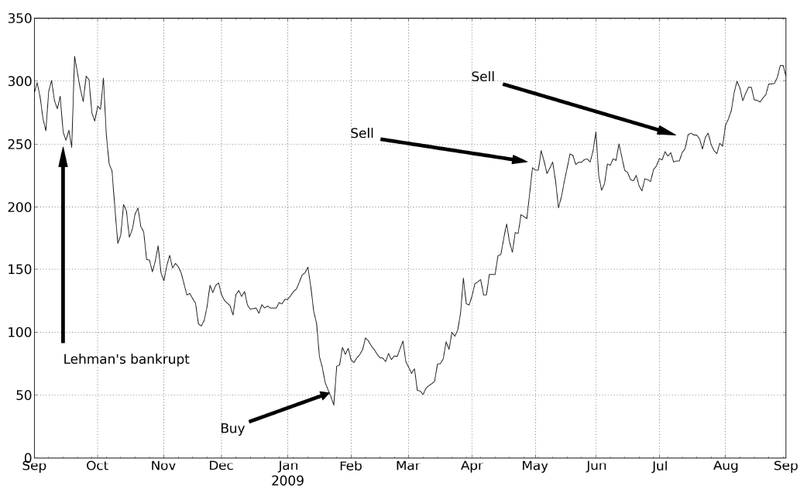

# Introduction｜英文原文版

来源：`OEBPS/Autopilot_ebook-6.xhtml`。按 EPUB 的正文、表格、插图与脚注顺序转排；字体、行内样式及印刷页码可能不同于原书。

## Introduction

### January 2009

It was 23 January 2009 and I was in my London office. Although I had a desk overlooking the Thames I was usually too busy to appreciate the view. My day job was managing a portfolio of systematic trading strategies for a large hedge fund. But right now I was focusing on my own bank balance.

Data was about to be released indicating how the UK economy had performed in the last three months of 2008. It would be bad news – the official confirmation that we were in recession – but nobody knew how bad. This didn’t mean extra work for me however, since a bank of computers would adjust our clients’ portfolios automatically when the news arrived. So I decided to devote some rare free time to trade my own money.

With a stressful full-time job I was not a particularly active trader but very occasionally an opportunity came up that was too good to miss. This was one of them. In my research I found that historically when people’s fears were confirmed by terrible economic numbers was often the best time to buy; and this was potentially the worst news I’d seen in my lifetime.

Careful analysis showed that the banks, hardest hit by the financial crisis, should rebound the most if things improved. I was particularly attracted to Barclays. I had traded for their investment bank a few years before and their balance sheet was in relatively good condition. But I also looked at investing in the other major UK banks. In all I was prepared to risk 10% of my portfolio on four banking stocks.

Then the figures came out. They were worse than expected with GDP falling by 1.5%. Barclays dropped 15% almost immediately, taking it to the lowest level I had ever seen. I waited for the market to stabilise and prepared to trade. Then I hesitated. Everything had happened as expected – I should go ahead and buy. But what if this went wrong? What if the financial industry really was imploding, as everyone else seemed to think?

Panicking, I quickly changed my orders, knocking a zero off each so that only 1% of my portfolio was at risk. It was one of the biggest mistakes of my investing career.

Figure 1: Good timing, tiny position, when trading Barclays shares in 2009. Barclays share price.

Source: Authors records.

As figure 1 shows, that day I bought Barclays for 53p a share, and just a few months later I sold my shares for an average of £2.50 each. Although Barclays was the top performer, my other bank shares also multiplied in value. I had made a decent profit but my own panic prevented me from making much, much more.

I had planned carefully and meticulously, done everything right, and then at the last moment let my emotions get the better of me.

### September 2008

Just a few months earlier I had been sitting in the same office and at the same desk. But on this particular day I had no time to think about my own money. The US government were variously trying to rescue, or had given up on, investment bank Lehman Brothers, insurer AIG, and mortgage agencies Freddie Mac and Fannie Mae. Our computer trading systems continued to run smoothly whilst the markets were in the middle of the most savage moves of a generation. But we had other things to worry about.

Although we were profitable could we trust the banks and brokers with whom we had deposited our cash? What if our clients redeemed their investments to cover holes elsewhere in their portfolio – could we pay them? What if the whole global financial system completely seized up? We were terrified. Perhaps we should just liquidate everything, put our money into gold bars, and wait for the storm to pass. At the very least we considered reducing the risk our computers wanted to take, perhaps by half. One of our main competitors had already done exactly that.

After yet another crisis meeting, where we decided to take no action for now, I left the meeting room and returned to my desk. As I sat down a colleague came over and started typing on my keyboard.

“You’ll definitely want to see this,” he said. He pressed return, and a live estimate of today’s profitability appeared on my screen. For the first time in our firm’s history it showed a ten digit number. We had made over a billion dollars in a single day. Our computer system had stuck to its preprogrammed set of trading rules and mechanically exploited the market moves almost to perfection, whilst terrified humans had discussed closing it down.

Humans are better than computers at complex intellectual tasks. But as these two stories show, our emotions prevent us from fully utilising this intelligence. The solution is to use systems to make trading decisions.

### Why you should start system trading now

Many people have been using systems to trade in one form or another for decades, but they are still a small minority. Although there are several relatively large systematic hedge funds, including the fund I used to work for, significantly less than 10% of actively managed global assets is fully systematically traded. But the investment world is changing and now is a better time than ever before to consider trading or investing with systems.

Firstly, institutional investors like pension funds have moved away from expensive active management, including hedge funds, to cheaper passive management. With passive management there is no ‘skill’ to pay for, less trading and so lower costs. In a low inflation environment active management fees of 1% or more are an intolerable drag on performance, even without the extra 20% of performance charged by hedge funds.

Passive indexing, buying shares or bonds in fixed weights, is effectively a form of systematic trading, albeit a very simple one. I’ll show how this concept can be extended and improved in the asset allocating investor example.

The returns from hedge funds can be separated into beta – what you can get by tracking the market, alpha – the skill the hedge fund manager has, and alternative beta. An example of alternative beta is the additional return you can get from buying stocks with low price-to-earnings (PE) ratios, and selling those with high PE ratios – the equity value premium.

Alternative beta doesn’t need skill, but it can’t be earned just by buying and holding shares. However it can be produced by following relatively simple rules. Some collective funds have been created to allow investors to get access to alternative beta, but they are still relatively expensive. Institutions should seriously consider using systematic rule-based trading to create in-house cheap alternative beta portfolios. The staunch systems trader example shows how this can be achieved.

It’s also easier than ever for amateurs to invest in a systematic way. Technology has revolutionised the financial industry. In the past amateur investors had to rely on yesterday’s newspapers for share prices and news. Now it’s possible to download historical price data for free from numerous websites.

Computing power has continued to fall in price and you can run quite sophisticated strategies on $30 Raspberry Pi micro computers. Instead of using expensive full service stockbrokers to place trades, cheap retail brokers allow you to trade at commission levels which are a fraction of what was possible 20 years ago.

There has been an explosion in the availability of numerous retail passive funds. In particular a vast array of dirt cheap exchange traded funds has appeared, allowing the passive tracking of almost every conceivable financial index. It’s much easier to buy and sell securities covering a wider variety of asset classes and countries than in the past.

But there have been other developments that are a mixed blessing. Derivatives like contracts for difference and spread bets allow amateurs and professionals to use leverage more easily. But unless you are careful these can quickly send your account value to zero, or even below. In the semi-automatic trader example I show how discretionary traders can trade in a relatively safe and controlled way by using a systematic framework to manage their risk.

The offering of retail stockbrokers has been radically improved. They give you access to websites and apps that make trading as easy as ordering from Amazon. You can find brokers that allow you to submit orders automatically from software, making fully automated trading a possibility. A more recent development is the appearance of online platforms which allow you to easily implement automated strategies.3

These are great tools, but they are offered solely to encourage more buying and selling. You should never forget that your broker makes more money when you trade frequently, whilst you lose out unless the extra trades are sufficiently profitable. I’ll show in this book how costly overtrading is, and how you to avoid it.

There are now many back-testing software packages available. These allow you to test potential strategies to see which made the most hypothetical money in the past. As I will explain in later chapters if you’re not careful this will often lead to losing actual money in the present.

Finally, there are many books and websites containing trading systems, advice and guidance for trading, of which more in a moment. So there is no shortage of tools and advice to begin investing systematically, although you do need to be careful as they are lethal if not used safely.

### It’s dangerous out there

Imagine for a moment you have just walked into a car dealership. Whilst admiring the vehicle on display you are approached by a slick suited salesman.

“This looks great, but it’s a bit small for me. What other models do you have?” you ask.

“Actually this is the only model we make,” he replies.

“Okay... Would you recommend the convertible, or is the fuel consumption too high?”

“We don’t have a convertible.”

“Right. How much extra would it cost to get alloy wheels and air conditioning?”

“Nothing. We don’t do them.”

“Does it come in red?”

“No. Just black.”

You’d be pretty surprised. In reality a new car buyer is offered so many options that the possible permutations usually run into millions! Car dealers can do this because cars are modular – made up of individual components which can be easily changed. When buying a new car we can specify different engines or add options like a fancy stereo. Later on we can still change certain parts like the tyres.

Now consider the large number of books and websites describing various trading systems. Many are too vague to be considered systematic but others include quite detailed rules. Nearly all of these publicly available trading systems are not modular, and can’t be easily adapted. You don’t have the opportunity to ask the author questions like:

“I notice you used a 20-day moving average here. When would it make sense to use a 30-day moving average? You say we should put 2.5% of our capital into each trade. Why? What will happen if I put 5% in? I like your trading rules, but how would I use those in my own position management framework? How can I use this to trade gasoline futures?”

I will answer these questions, and many more, later in the book. Now let’s return to the imaginary conversation with our hypothetical car dealer.

“How fast does it go?”

“It does exactly 150.6 miles an hour.”

“Wow! I bet it drinks fuel at that speed. What’s the fuel economy like at 55?”

“No you weren’t listening. It always does precisely 150.6. No faster or slower.”

“Isn’t that a little… dangerous?”

“Well it was fine on the manufacturer’s test track.”

Once again consider the many publicly available trading systems. Many advocate trading extremely quickly, holding positions for only a few days, minutes or even seconds. In many markets traded by amateur investors that will lead to extremely high trading costs. Frighteningly the majority of trading systems also suggest holding sizable positions which are far too risky unless you know in advance you will be a brilliant trader who is also very lucky. Using these systems is like driving at 200mph and hoping you won’t crash or run out of fuel.

To take an example, one expert on spread betting proposes putting at most 10%, but usually 5%, of your capital into each trade. Sensibly he suggests you diversify, holding several positions in different markets at once. He then proposes using a particular type of trading rule which means positions would be held on average for about a week.4

This sounds safe, but should actually come with a significant health warning. To overcome the trading costs this would generate on an index spread bet and break even you would need to make a return of 83% a year.5 Worse still, to avoid a high chance of losing most of your entire investment you’d need to average 256% a year after costs; implying an annualised pre-cost return of 339%!6

Thinking that you can overcome these odds is a sign of serious overconfidence, the main weakness of all traders and investors. I will explain why these systems are dangerous, and how to make your trading safer.

### Why you should read this book

I don’t believe there is any magic system that will automatically make you huge profits, and you should be wary of anyone who says otherwise, especially if they want to sell it to you. Instead success in systematic trading is mostly down to avoiding common mistakes such as over complicating your system, being too optimistic about likely returns, taking excessive risks, and trading too often. I will help you avoid these errors. This won’t guarantee vast returns, but it will make failure less likely.

My main aim isn’t just to give you a single predefined system for trading, but to provide you with a modular framework which can be adapted to meet your needs. Part three describes the framework in detail. Just like you can choose different engines and tyres on a car, my framework includes options for different trading rules and position sizing calculations.

I haven’t just pulled a bunch of components out of a parts bin. Each element of the framework has been carefully designed with months of careful research, built on many years of experience. I’ll explain the available options, which I prefer, and why.

Just like cars can be modified I will show you how to incorporate your own trading rules and change other parts of the framework. I will warn you of the dangers of being too aggressive, which will result in your bank account blowing up like an over-tuned engine. I’ll discuss the correct amount to bet on a particular trade, and how long to hold positions for.

In part four I show how to create trading strategies for each of the three example groups I mentioned in the preface. Sticking with the car analogy you can create a sturdy family car for asset allocating investing, an experimental kit car for semi-automatic trading, or a sporty two seater convertible of a trading system if you are a staunch systems trader.But before you get your fingers greasy you need to do some preparation. So the first part of the book which follows is all about theory, and in the second part I explain how to use your tools safely.

Footnote 3. I’m less keen on the appearance of ‘social trading’ websites where you ‘follow’ someone else’s trading strategy. It makes no sense to let an unregulated, unqualified and probably inexperienced stranger manage your money; with minimal, statistically insignificant, evidence that they are capable of doing so.

Footnote 4. This is a real system, but I will not identify the author. It is by no means the worst system I have seen.

Footnote 5. If you are interested I explain why on page 202.

Footnote 6. The calculation for this is on page 161.
