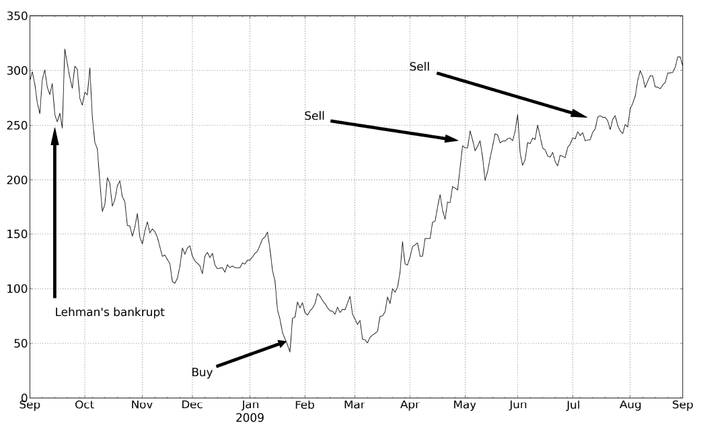

# 引言｜中文忠实版

来源：Robert Carver, *Systematic Trading*，EPUB `OEBPS/Autopilot_ebook-6.xhtml`，本地块 `introduction#0001–0067`。依原段落顺序翻译，覆盖图 1、图注、来源和脚注 3–6。块号不是印刷页码；书中的市场数据、费用与工具描述属于作者写作时的语境。

## 2009 年 1 月

<!-- introduction#0003 -->
那是 2009 年 1 月 23 日，我坐在伦敦的办公室里。虽然我的办公桌可以俯瞰泰晤士河，但通常忙得无暇欣赏景色。我的本职工作是为一家大型对冲基金管理系统化交易策略组合。但此刻我关注的是自己的银行存款余额。

<!-- introduction#0004 -->
即将公布的数据会显示英国经济在 2008 年最后三个月表现如何。这会是坏消息——官方确认我们已陷入衰退——但没人知道究竟有多糟。不过，这并不会增加我的工作量，因为消息公布时，一组计算机会自动调整客户的投资组合。所以，我决定利用这段难得的空闲时间交易自己的钱。

<!-- introduction#0005 -->
我的全职工作压力很大，因此交易并不特别活跃，但极少数时候会出现好得不容错过的机会。这就是其中一次。我在研究中发现，从历史来看，当糟糕的经济数据证实人们的恐惧时，往往正是最好的买入时机；而眼前的数据可能是我有生以来见过的最坏消息。

<!-- introduction#0006 -->
仔细分析表明，如果情况好转，受金融危机打击最重的银行应该反弹最多。我特别看好巴克莱银行。几年前我曾在它的投资银行部门做交易，它的资产负债表状况也相对良好。不过，我也考虑投资英国其他几家主要银行。总的来说，我准备在四只银行股上让投资组合的 10% 承担风险。

<!-- introduction#0007 -->
接着数据公布了。结果比预期更糟，GDP 下跌了 1.5%。巴克莱的股价几乎立刻下跌 15%，降到我见过的最低水平。我等待市场稳定，准备交易。然后，我犹豫了。一切都如预期发生——我本该买入。可如果判断错了呢？如果金融业真的像其他人似乎都认为的那样，正在崩溃呢？

<!-- introduction#0008 -->
我慌了，迅速修改订单，把每张订单的数额都去掉一个零，这样投资组合中只有 1% 承担风险。这是我投资生涯中最大的错误之一。

<!-- introduction#0010 -->
**图 1：**2009 年交易巴克莱股票时，买卖时机很好，头寸却很小。巴克莱股价。图内标注依次为“雷曼破产”“买入”和两处“卖出”；横轴从 9 月跨至次年 9 月，纵轴为图中股价刻度。原图未在坐标轴上明确标出单位，正文以便士说明买入价。

<!-- introduction#0011 -->
来源：作者的记录。

<!-- introduction#0012 -->
如图 1 所示，那天我以每股 53 便士买入巴克莱，仅仅几个月后，卖出股票的平均价格便达到每股 2.50 英镑。虽然巴克莱表现最好，我买的其他银行股的价值也翻了几倍。我确实赚了一笔可观的利润，但自己的恐慌让我错过了多得多的收益。

<!-- introduction#0013 -->
我原本周密而细致地做了计划，前面的事都做对了，却在最后一刻被情绪左右。

## 2008 年 9 月

<!-- introduction#0015 -->
就在几个月前，我坐在同一间办公室、同一张办公桌前。但那一天，我根本无暇考虑自己的钱。美国政府正分别试图救助，或已经放弃救助，投资银行雷曼兄弟、保险公司 AIG，以及抵押贷款机构房地美和房利美。当市场出现一代人以来最剧烈的波动时，我们的计算机交易系统仍在平稳运行。但我们还有别的事要担心。

<!-- introduction#0016 -->
尽管我们在盈利，可我们能信任那些存放着我们现金的银行和经纪商吗？如果客户为了填补投资组合其他地方的亏空而赎回投资，我们付得出钱吗？如果整个全球金融体系完全停摆怎么办？我们很害怕。也许我们该把一切都平仓，买成金条，等待风暴过去。至少，我们考虑过降低计算机想承担的风险，或许减半。一家主要竞争对手已经这样做了。

<!-- introduction#0017 -->
又开完一场危机会议后——会上我们决定暂时不采取行动——我离开会议室，回到办公桌前。我刚坐下，一位同事就走过来，在我的键盘上敲了起来。

<!-- introduction#0018 -->
“你肯定想看看这个，”他说。他按下回车键，我的屏幕上出现了当天盈利情况的实时估计。它第一次显示出一个十位数的数字。我们在一天之内赚了超过 10 亿美元。我们的计算机系统遵守预先编好的交易规则，近乎完美地机械式利用了市场波动；与此同时，惊恐的人们却一直在讨论是否要关掉它。

<!-- introduction#0019 -->
在复杂的智力任务上，人比计算机更擅长。但正如这两个故事所表明的，我们的情绪妨碍了我们充分运用这种智力。解决办法是用系统来做交易决策。

## 为什么现在应该开始系统化交易

<!-- introduction#0021 -->
几十年来，许多人一直以这样或那样的方式利用系统交易，但他们仍然是少数。尽管有几家规模相对较大的系统化对冲基金，包括我过去任职的那一家，但在全球主动管理资产中，完全由系统化方式交易的比例明显不到 10%。不过，投资世界正在变化，现在比以往任何时候都更值得考虑用系统来交易或投资。

<!-- introduction#0022 -->
首先，养老基金等机构投资者已经从收费高昂的主动管理——包括对冲基金——转向成本较低的被动管理。被动管理不需要为“技能”付费，交易较少，因而成本更低。在低通胀环境下，1% 或更高的主动管理费会成为难以承受的业绩拖累，更不用说对冲基金额外收取的 20% 业绩费了。

<!-- introduction#0023 -->
被动指数投资，即按固定权重买入股票或债券，实际上是系统化交易的一种形式，尽管非常简单。我会在资产配置投资者的例子中说明如何扩展并改进这一概念。

<!-- introduction#0024 -->
对冲基金的回报可以分解为 **beta**——跟踪市场就能得到的部分、**alpha**——对冲基金经理的技能所带来的部分，以及**另类 beta**。另类 beta 的一个例子是，买入市盈率（PE）低的股票，同时卖出市盈率高的股票，由此可能得到的额外回报——股票的价值溢价。

<!-- introduction#0025 -->
另类 beta 不需要技能，但也不能只靠买入并持有股票来获得。不过，遵循相对简单的规则就能产生它。已有一些集合基金让投资者接触到另类 beta，但它们仍然相对昂贵。机构应认真考虑用基于规则的系统化交易，在内部建立成本较低的另类 beta 组合。坚定的系统交易者的例子会展示如何做到这一点。

<!-- introduction#0026 -->
业余人士以系统化方式投资，也比以往任何时候都容易。科技改变了金融业。过去，业余投资者必须依靠前一天的报纸获取股价和新闻。现在，人们可以从许多网站免费下载历史价格数据。

<!-- introduction#0027 -->
计算能力的价格持续下降，售价 30 美元的树莓派微型计算机也能运行相当复杂的策略。下单时无需使用昂贵的全服务股票经纪商，廉价的零售经纪商提供的交易佣金水平，只是 20 年前的一小部分。

<!-- introduction#0028 -->
零售被动型基金的供应大幅增加。尤其是出现了种类繁多、价格极低的交易所交易基金，几乎可以被动跟踪任何想得到的金融指数。买卖覆盖更多资产类别和国家的证券，比过去容易得多。

<!-- introduction#0029 -->
但还有些发展利弊参半。差价合约和价差投注等衍生品，让业余人士和专业人士都更容易使用杠杆。但如果不谨慎，它们可以很快让你的账户价值归零，甚至变成负数。在半自动交易者的例子中，我会展示主观交易者如何利用系统化框架管理风险，从而以相对安全、可控的方式交易。

<!-- introduction#0030 -->
零售股票经纪商的服务已有根本性改善。他们提供网站和应用程序，让交易变得像在亚马逊下单一样容易。你可以找到允许软件自动提交订单的经纪商，使完全自动化交易成为可能。更近一些的发展是出现了在线平台，让你能够轻松实施自动化策略。³

<!-- introduction#0031 -->
这些工具很棒，但提供它们的唯一目的，是鼓励更多买卖。永远不要忘记：你交易得越频繁，经纪商赚得越多；而对你来说，除非额外交易足够有利可图，否则就会吃亏。本书会说明过度交易的代价有多高，以及如何避免它。

<!-- introduction#0032 -->
现在有许多回测软件包。它们允许你测试潜在策略，看哪些策略在过去假设能赚到最多的钱。后面几章我会解释，如果你不谨慎，这往往会让你在当下亏掉真金白银。

<!-- introduction#0033 -->
最后，还有很多书籍和网站介绍交易系统、交易建议与指导；我稍后会再谈。所以，开始系统化投资并不缺工具和建议。不过，你的确需要小心：若使用不安全，这些东西会有致命的危险。

## 外面的世界很危险

<!-- introduction#0035 -->
请想象一下，你刚走进一家汽车经销店。正欣赏展示的车辆时，一位穿着讲究、能说会道的销售员走上前来。

<!-- introduction#0036 -->
“这车看起来不错，但对我来说有点小。你们还有别的车型吗？”你问。

<!-- introduction#0037 -->
“实际上，我们只生产这一款，”他回答。

<!-- introduction#0038 -->
“好吧……你会推荐敞篷版吗，还是说它太费油？”

<!-- introduction#0039 -->
“我们没有敞篷版。”

<!-- introduction#0040 -->
“好。换合金轮毂、加空调要多花多少钱？”

<!-- introduction#0041 -->
“不用花钱。我们不提供这些。”

<!-- introduction#0042 -->
“有红色的吗？”

<!-- introduction#0043 -->
“没有。只有黑色。”

<!-- introduction#0044 -->
你会相当惊讶。现实中，新车买家有那么多选择，可能的配置组合通常多达数百万种！汽车经销商之所以能这样做，是因为汽车是模块化的——由可以轻松更换的独立部件组成。买新车时，我们可以指定不同的发动机，或加装高级音响等选配件。之后，我们仍能更换轮胎等某些部件。

<!-- introduction#0045 -->
现在来想想那些介绍各种交易系统的大量书籍和网站。许多介绍过于含糊，称不上系统化；但也有一些包含相当详细的规则。几乎所有这些公开可得的交易系统都不是模块化的，无法轻松调整。你没有机会问作者这样的问题：

<!-- introduction#0046 -->
“我注意到你这里用了 20 日移动平均线。什么时候改用 30 日移动平均线更合理？你说每笔交易要投入资本的 2.5%。为什么？如果投入 5% 会怎样？我喜欢你的交易规则，但怎样把它用到我自己的头寸管理框架里？怎样用它交易汽油期货？”

<!-- introduction#0047 -->
本书后面，我会回答这些问题，还有许多其他问题。现在回到我们与假想汽车经销商的对话。

<!-- introduction#0048 -->
“它能开多快？”

<!-- introduction#0049 -->
“它的时速恰好是 150.6 英里。”

<!-- introduction#0050 -->
“哇！这个速度一定很费油。时速 55 英里时的油耗怎么样？”

<!-- introduction#0051 -->
“不，你没听明白。它的时速永远精确地保持在 150.6 英里，不快也不慢。”

<!-- introduction#0052 -->
“这是不是有点……危险？”

<!-- introduction#0053 -->
“嗯，在制造商的测试赛道上开着没问题。”

<!-- introduction#0054 -->
再想想众多公开可得的交易系统。许多系统主张交易速度极快，头寸只持有几天、几分钟，甚至几秒钟。在业余投资者交易的许多市场里，这会造成极高的交易成本。更可怕的是，多数交易系统还建议持有相当大的头寸；除非你事先知道自己不仅是一位极其出色的交易者，而且运气也极好，否则这些头寸的风险过高。使用这样的系统，就像以每小时 200 英里的速度开车，盼着自己既不会撞车，也不会耗尽燃油。

<!-- introduction#0055 -->
举个例子，有位价差投注专家建议，每笔交易投入最多 10%、通常为 5% 的资本。他明智地建议分散投资，同时在不同市场持有数个头寸。接着，他提议采用一种特定的交易规则，使头寸平均持有约一周。⁴

<!-- introduction#0056 -->
这听起来安全，但其实应该附带显著的风险警示。要抵消这种指数价差投注产生的交易成本并达到盈亏平衡，你必须获得每年 83% 的回报。⁵ 更糟的是，为避免以很高概率损失几乎全部投资，你的成本后平均年回报需要达到 256%；这意味着成本前年化回报须达 339%！⁶

<!-- introduction#0057 -->
认为自己能战胜这样的胜算，是严重过度自信的表现；过度自信是所有交易者和投资者的主要弱点。我会解释这些系统为什么危险，以及怎样让交易更安全。

## 为什么应该读这本书

<!-- introduction#0059 -->
我不相信有什么神奇系统能自动让你赚取巨额利润。对于声称有这种系统的人，你应保持警惕，特别是他们还想把它卖给你时。相反，系统化交易能否成功，主要取决于能否避开常见错误，例如把系统弄得过于复杂、过度乐观地估计可能的回报、承担过多风险，以及交易过于频繁。我会帮助你避开这些错误。这不能保证你获得巨额回报，但会降低失败的可能性。

<!-- introduction#0060 -->
我的主要目的不只是给你一套预先定义好的交易系统，而是提供一个可以调整以满足你需求的模块化框架。第三部分会详细介绍这个框架。就像你可以为汽车选择不同的发动机和轮胎一样，我的框架也提供不同交易规则和头寸规模计算方法的选项。

<!-- introduction#0061 -->
我并非只是从零件箱里随手抓出一堆部件。框架的每个要素都经过数月认真研究的精心设计，建立在多年的经验之上。我会说明有哪些选项、我更偏好哪些，以及原因。

<!-- introduction#0062 -->
就像汽车可以改装，我会说明怎样把你自己的交易规则纳入框架，以及怎样修改框架的其他部分。我也会警告你过于激进的危险：那会让你的银行账户像调校过度的发动机一样爆掉。我会讨论在特定交易上应该下注多少，以及头寸应该持有多久。

<!-- introduction#0063 -->
第四部分会展示怎样为前言提到的三个示例群体分别建立交易策略。沿用汽车的比喻，你可以为资产配置投资构造一辆结实的家庭车；为半自动交易构造一辆实验性的套件车；如果你是坚定的系统交易者，也可以构造一辆运动型双座敞篷交易系统。不过，在动手弄脏双手之前，你需要先做些准备。因此，紧接着的本书第一部分全是理论，第二部分则解释如何安全地使用工具。

## 原书脚注

<!-- introduction#0064 -->
**脚注 3：**我不太喜欢“社交交易”网站的出现，在那里你可以“跟随”别人的交易策略。让一个不受监管、没有资格认证，而且很可能缺乏经验的陌生人管理你的钱，没有道理；能够证明此人有能力这么做的证据既少，在统计上也不显著。

<!-- introduction#0065 -->
**脚注 4：**这是一套真实存在的系统，但我不会指出作者是谁。它绝不是我见过的最差系统。

<!-- introduction#0066 -->
**脚注 5：**如果你感兴趣，我在原书第 202 页解释原因。

<!-- introduction#0067 -->
**脚注 6：**这一计算见原书第 161 页。

译文校注：原书 `#0063` 的 `trader.But` 缺少空格，以上按两个句子处理。图的纵轴未直接印出单位，译文没有自行补单位。脚注的页码保留原书印刷页码提示；EPUB 中脚注 5、6 另有内部链接，可在英文原文中跳转。
